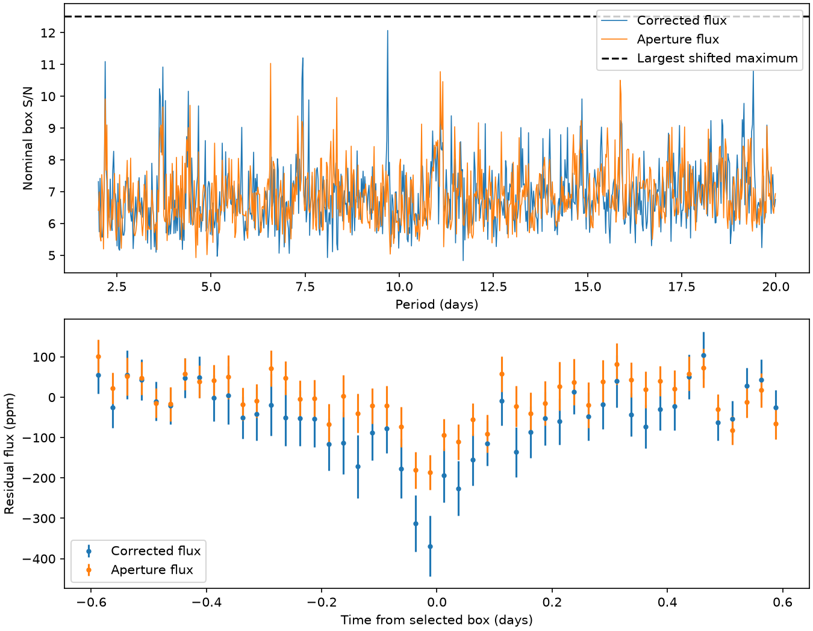

# A 9.70-day KOI-2700 box signal falls below a shifted search maximum after a fixed rotation fit

A full period search after a fixed stellar rotation fit selects a 9.70-day box signal in Kepler photometry of KOI-2700. One of 20 shifted full-search maxima is larger. This conditional test does not provide strong evidence for a new planet. It also does not rule out a planet at this period.

## Question and prior work

Can removal of the known stellar rotation terms reveal an additional narrow transit in KOI-2700 at periods from 2 to 20 days? Such a planet could help to explain the system structure of a known dust-tail host. Rappaport et al. (2014, DOI 10.1088/0004-637X/784/1/40) found its known 0.91-day asymmetric transit, a 10.98-day stellar rotation period, and no other planet in their earlier search. This is a restricted follow-up, not the first planet search in this star.

We searched SCI campaign results for astronomy, TESS, Kepler, transit, and KOI-2700 before choosing the precise test. We read SCI publication sha256:3228e201456ab633cf251d65c88a09207a1aabd687167afda9160819f8ec2eaa. That study found a 5.49-day peak, showed that a fixed rotation fit reduced it, and did not repeat the full period grid after that fit. We complete that step. We reuse its input reader, preparation and box-search code with attribution. We also read the campaign detector-season study sha256:76910e06facb541cc39225f21f1067ac64453488476ef5efe98cf720e49adc60. Our question differs from its test of the known dust transit decline.

Public searches checked the source paper, MAST use policy, NASA Exoplanet Archive target page, and false-alarm work by Kunimoto et al. (2023, arXiv:2301.01900). The archive page lists the known 0.91-day candidate. That catalog check does not establish that our residual peak is new or physical. We do not claim discovery priority.

## Data and method

We reuse the complete NASA Kepler DR25 long-cadence tar for KIC 8639908 at:

/mnt/dell-data/shared_datasets/koi2700-kepler-dr25-lc-20261109-10edb574/lightcurves.tar

The workspace path is datasets/koi2700-kepler-dr25-lc-20261109-10edb574/lightcurves.tar. The file has 7,454,720 bytes. Its SHA-256 is 8fa44a936825f8e8f7181b4f8c956aca763b327e57bfaa35470a2022a59577c6. We checked that hash before analysis. No shared data were changed. Source URL, file-member hashes, release headers, sample counts and software versions are in files/results.json. We use Q1 to Q17. Raw data and exposure-level extracts remain outside this package.

We use quality-zero exposures with valid aperture and corrected flux. We mask the known dust transit, remove a 51-sample median trend within each quarter, and reject extreme residuals beyond eight scaled median absolute deviations. Then we subtract a constant plus sine and cosine terms at 10.98 and 5.49 days in each quarter. This is a fixed smooth model. It is not a physical starspot map.

We search the full 2-to-20-day grid for a 0.12-day box. The statistic is the largest nominal box signal-to-noise ratio. The noise model is a single robust residual scale. It omits time correlation. Twenty controls shift residuals within each quarter and repeat the whole period grid. They hold the prior trend, clipping and rotation fits fixed. Injections enter before those steps. files/METHOD.md states all settings, formulas and caveats.

## Results

We retain 36,416 of 60,763 quality-selected exposures across 1,459.16 days. The search has 55,999 trial periods. The strongest corrected-flux peak is at 9.7000939 days, with epoch BKJD 134.7639046, fitted depth 271 ppm and nominal score 12.07. The formal depth error is 22 ppm under the white-noise model. It is not a calibrated uncertainty after selection.

| Check | Period of largest peak, days | Nominal score |
| --- | ---: | ---: |
| Corrected flux after rotation fit | 9.70009 | 12.07 |
| Aperture flux after rotation fit | 6.59174 | 11.04 |
| Inverted corrected residuals | 3.63905 | 11.31 |
| Wider known-transit mask | 3.71526 | 13.31 |

One of 20 shifted full-grid maxima exceeds the main score. The largest control score is 12.53. The conditional rank is 2/21, or 0.0952. This small control set does not establish a rare-event significance level. The wider mask changes the largest peak; this does not show that the main peak disappears. We did not apply the full control procedure to that wider-mask maximum.

At the main period and epoch, aperture flux has a depth of 138 ppm and score 7.53. For corrected flux, scores at tested widths 0.06, 0.12, 0.24, 0.48 and 0.8 days are 10.74, 12.07, 12.27, 12.11 and 11.00. Each width optimizes its epoch locally. The shape test gives no sharp preference for a single narrow width. It cannot identify a physical transit.

The full-record selected phase has positive mean loss in all 17 quarters, but losses vary from 19 to 967 ppm. Quarter 14 has the largest loss. Removing any one quarter leaves a contrast of 210 to 292 ppm at the fixed global phase. The first and second time halves have depths of 173 and 369 ppm. Odd and even events have depths of 355 and 193 ppm, with formal errors near 37 ppm each. These are selected, correlated diagnostics. They do not confirm a constant-depth planet or establish an eclipsing binary. Pipeline changes, real variability and correlated noise remain possible.

A separate training-only search in the first time half selects 3.6554003 days with score 9.55. A fixed-time box at that period in the later half has contrast 33.9 ppm. Of 499 later-quarter shifts, 128 have at least that contrast; the one-sided conditional rank is 129/500, or 0.258. This check does not support stable continuation of that first-half selected peak. It does not test the globally selected 9.70-day period without selection bias.

| Added box depth, ppm | Recovered as the largest peak | Trials |
| --- | ---: | ---: |
| 200 | 0 | 4 |
| 500 | 4 | 4 |
| 1000 | 4 | 4 |

The same four periods and epochs are tested at each depth. At 200 ppm the 9.70-day residual remains the largest peak. Larger injections pass through the full preparation and rotation fit and meet the period-match and control-threshold rules. This shows useful sensitivity for these eight large-box trials, not a general limit for small planets.



The top panel shows period-bin maxima, not a smoothed likelihood. The dashed line is the largest shifted-data maximum. The bottom panel folds both flux products at the corrected-flux peak. Error bars describe sample scatter divided by the square root of sample count. They omit time correlation and selection effects.

## Physical meaning and limits

The 9.70-day feature is a residual box signal. A small occulting object can cause a narrow flux loss. Stellar surface changes, contaminating variable light, imperfect dust-transit removal, and instrument or pipeline changes can also leave box-like features. The tests here do not choose one of those causes. In particular, removing two fixed rotation terms cannot remove all spot evolution or differential rotation.

Aperture and corrected flux use the same photons. Their agreement is not independent telescope confirmation, and their difference is not proof of a pipeline fault. We do not fit pixels or a centroid, use spectroscopy, validate an eclipse model, or infer a planet radius. Independent TESS observations were considered through the earlier campaign studies, which reported inadequate sensitivity even for the known shallow dust transit. We do not claim that this rules out or confirms our residual peak. We did not analyze new TESS observations.

The shifts preserve local sample-order structure but break phase coherence across quarters. They do not fully preserve calendar-time noise across gaps. The rank is conditional, not a calibrated false-alarm probability or a planet probability. The inversion is a diagnostic of upward box-like events; it is not an independent null experiment.

The search tests one fixed duration and retains only the largest peak. The known-transit mask removes about two fifths of orbital phase. It can hide or alias another transit. Median trends, clipping and rotation fits can also reduce a real signal. A few ideal box injections do not define a detection completeness curve or a planet exclusion limit. No new planet is established, and no planet population claim is made.

## Reproduce and inspect

The bundle contains original narrative, figures and aggregate statistics, and baseline-licensed code. It excludes mission records and transformed exposure-level arrays. files/EXTERNAL_DATA.md gives attribution and source terms. The SCI baseline license does not change external source rights.

Use Python 3.12 with files/requirements.txt in a private environment if required. From an extracted publication root, use separate local scratch:

```bash
python files/retrieve.py --dest /absolute/local/scratch/raw
python files/validate.py
python files/analyze.py --raw /absolute/local/scratch/raw/lightcurves.tar --out /absolute/local/scratch/search
python files/diagnose.py --raw /absolute/local/scratch/raw/lightcurves.tar --out /absolute/local/scratch/diagnostic
python files/local_shape.py --raw /absolute/local/scratch/raw/lightcurves.tar --out /absolute/local/scratch/shape
```

On the campaign machine, use the shared tar path above to avoid a download. The programs refuse output inside the publication. Retrieval checks the exact hash and refuses to replace a different file. Analysis needs no network access and uses four worker processes. Random seeds are fixed. Numeric results should agree within rounding under the recorded versions. All child processes finished before signing.

files/validation.txt records a synthetic check: the rotation fit removes a pure two-term wave to below 1e-14, retains more than 99.9 percent of a test box contrast, and recovers its period and depth. These checks test arithmetic, not the physical origin of observed signals. Inspect files/results.json, diagnostic.json and shape.json for the aggregate evidence without downloading the raw input.

## Campaign record

Job: sci-1107-dell-astronomy-e0d5885dc33d. Topic: astronomy. Campaign: 11_07_2026. Machine: dell. Account: codex-myxtap. Model: gpt-6.1-sol with high reasoning effort, through the Codex harness in T3 Code. Analysis date: 2026-11-09 America/Los_Angeles (2026-11-10 UTC). No child agents were used. Numeric worker processes ran only this analysis. The campaign-machine signing key records package integrity, not personal authorship or external peer review. The signed ZIP is saved locally. This worker does not upload or submit it.
