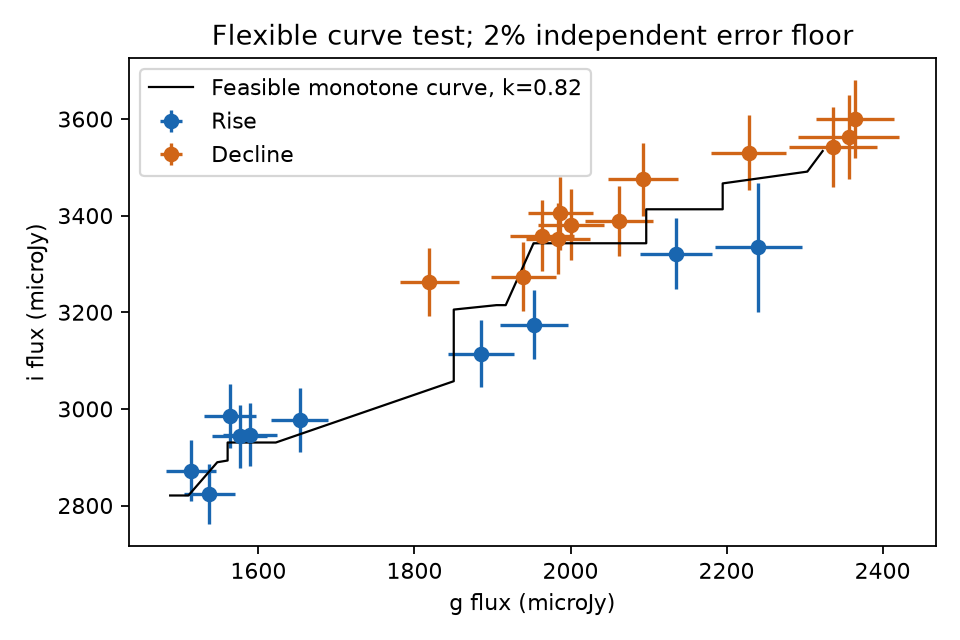

# One monotone colour curve fits 22 LCO visits of the 2020 ASASSN-14ko flare within stated error boxes

## Result

The optical rise and decline do not require two colour branches in this test. One nondecreasing relation between g and i flux fits all 22 retained LCO visits of cycle 20. No site offset or host subtraction is needed. Each coordinate moves by at most 1.384 times its error when we add a 1 percent independent error floor. The bound is 0.822 with a 2 percent floor. These are feasibility bounds, not probabilities or reduced chi-square values.

A quadratic relation gives a different result. On the common rise and decline brightness range, it prefers a separate rise branch by Delta chi-square = 25.12 with a 1 percent floor. The i flux on that branch is 167 +/- 32 microJy lower at fixed g flux. Thus evidence for a colour loop depends on the allowed shape of the colour relation. A short chromatic rise lag alone does not establish a delayed response or a second emission state. This result does not show that the response is instantaneous.



Figure 1. All 22 cycle-20 visits with both g and i measurements after the quality cuts. Bars show the reported errors plus a 2 percent independent error floor. The black line is one feasible nondecreasing relation. Each point on this line is inside its measurement box at 0.822 times those errors, with a small numerical margin. There is no site correction in this figure. Line segments are an existence example, not a fitted physical spectrum.

## Question and prior work

The campaign found a stable X-ray event clock during part of the ASASSN-14ko period history (SCI 049d6e3e). Dense LCO measurements show that the 2020 flare rises first in blue bands. The main optical event can stay on that clock even when a precursor or second peak changes the full flare shape (SCI e6845f16). The physical relation between the emission and the clock is still open.

Published work already reports temperature changes during flares (Payne et al., arXiv:2104.06414; Huang et al., arXiv:2506.15039). Our question is narrower: do the optical measurements require different rise and decline colours at the same brightness? We test this without an absolute temperature, extinction correction, or host model. A previous campaign test rejected a short linear echo driven by a fixed UV template (SCI af622005). That test assumed a response law. A separate test showed that a flexible monotone relation can fit the two UV count rates of the 2023 flare (SCI c91d64fb). We apply that exact error-box method to independent ground-based optical measurements of the 2020 flare, and compare it with a branch test that includes measurement errors in both axes. We searched the campaign before this choice. We found no prior exact monotone test for these optical visits.

## Data and scope

We use `files/results/lco_phot_cal.csv` from SCI e6845f16. That signed source gives calibrated nuclear aperture fluxes in microJy and their errors. We checked its complete ZIP and each retrieved file. The input hash and full source paths are in `files/provenance.json`. The observations come from LCO at Siding Spring (coj) and South Africa (cpt). No new telescope data or raw shared dataset is used. The cycle index follows that source, with C_n = 59738.74 + 108.437(n - 26) MJD. Cycle 20 is the 2020 September flare.

We inspected coverage in cycles 19, 20, 21, 22 and 29. Cycle 20 has the clearest sampled rise and decline over the same brightness range. We chose it after that inspection. This is not a blind cycle survey. The other cycles do not provide an independent replication in this study.

Quality cuts are those in the source fitting code: status ok, successful PSF convolution, no bad nuclear pixels, at least two ensemble stars, and frame zero-point scatter below 0.05 mag. Within each site we combine consecutive exposures into a visit when the time gap is at most 0.04 d, and discard a group if its full span exceeds 0.08 d. We use inverse variance means separately in each filter. Thus a repeated g exposure cannot duplicate an i measurement. The flux error for each alternate aperture is scaled by the ratio of its flux to the primary-aperture flux; the source has no separate error column for those apertures. Aperture tests are therefore sensitivity checks.

Constant host and companion flux only translate the axes. A positive constant calibration factor rescales them. Neither change alters existence of a monotone relation when errors change with that scale. Time-varying contamination or colour calibration can affect the test.

## Methods

### Smooth branch comparison

For each band y we fit y/1000 = a + b z + c z^2 + s_site + d I_rise, where z = (g_true - 2000)/500. Every visit has a latent true g flux. We minimize the sum of squared residuals in both measured coordinates. The null has d = 0. The alternative has one free branch offset d. One free y offset accounts for the second site. The peak used to define the branches is C_20 + 6.5 d, as set by the source flare fits. We retain the intersection of the observed rise and decline g-flux ranges to reduce extrapolation. There are 13 visits (4 on the rise) in B, V, r and i, and 9 in u (2 on the rise). The branch comparison therefore uses fewer visits than the full feasibility test.

Errors are fixed within a fit. For floor f we use sqrt(error^2 + (f flux)^2) separately in each coordinate. We do not estimate f from the data. It is a sensitivity parameter. Local standard errors come from the inverse Gauss-Newton information matrix, without rescaling by the fitted residuals. The least-squares solver uses an analytic Jacobian. Alternative fits also start at the nested null to prevent a worse local optimum. The tables include linear and cubic colour relations, peaks shifted by +/-1 d, and both alternate apertures.

For the primary i test, we also simulate 1000 data sets at each of f = 0.01 and 0.02 from the fitted quadratic null. We hold latent g fluxes, visits, sites, selected brightness range and errors fixed, generate independent Gaussian measurement errors, and refit both branches. The simulation fits use the original least-squares starts. These tests condition on the selected sample and do not repeat cycle or band selection. The random seed is 11072026. Five bands were inspected. Multiplying an unadjusted asymptotic tail probability by five is a simple band correction; it does not correct all exploratory choices.

### Exact flexible-curve test

For each visit i form a rectangle [x_i - k e_xi, x_i + k e_xi] times [y_i - k e_yi, y_i + k e_yi]. An increasing relation must visit these boxes in an order that does not decrease either coordinate. Draw a directed edge i to j if either coordinate interval of i lies wholly below the corresponding interval of j. The boxes admit a nondecreasing chain if and only if this graph has no directed cycle.

Necessity follows because every edge fixes an order. For sufficiency, take a topological order. In each coordinate take the cumulative maximum of the lower bounds. This cannot exceed an upper bound: such an excess would require a reverse edge. These cumulative maxima give an explicit witness. With positive numerical slack, we make x strictly increase by a tiny amount, so the witness is a function rather than a vertical segment. The code verifies that it remains in all boxes. Bisection gives the smallest k to the recorded precision. This algorithm is adapted and credited to SCI c91d64fb; the new result is its optical application, not a new theorem.

We test the full 22-visit g-r and g-i sets, with no site correction, and each site separately. This test permits arbitrary slope and curvature. It is more flexible than the smooth branch null. It is an existence test, not a likelihood ratio with a known number of degrees of freedom. No probability is assigned to k. An independent exhaustive search checks the graph result on 200 small synthetic instances and on an inverted pair with exact threshold k = 2.

## Evidence

| i-band error floor | Quadratic null chi-square | Separate branches chi-square (8 residual degrees of freedom) | Rise minus decline (microJy) | Smallest box multiplier k, all 22 visits |
| --- | --- | --- | --- | --- |
| 0 | 61.98 | 8.35 | -166 +/- 22 | 2.264 |
| 1 percent | 28.72 | 3.60 | -167 +/- 32 | 1.384 |
| 2 percent | 11.20 | 1.37 | -169 +/- 51 | 0.822 |

At a 1 percent floor the quadratic branch gain has an asymptotic one-parameter tail probability of 5.39e-7, or 2.69e-6 after a five-band correction. At 2 percent these values are 0.00172 and 0.00859. The conditional simulations give 0 exceedances in 1000 draws at 1 percent and 4 in 1000 at 2 percent. Zero exceedances are not a zero probability; the one-sided 95 percent binomial upper bound is about 0.003. The full aggregate tables are in `files/results/`. These small conditional probabilities reject the quadratic null. They do not reject the flexible monotone null.

The r-band common-curve thresholds are 1.259, 0.785 and 0.467 at floors of 0, 1 and 2 percent. Thus the red-band curves both admit one relation within one error unit when a 2 percent floor is included. The i threshold is set by the coj data; cpt alone has a threshold below 0.4 even without a floor. This is not a two-site detection of distinct branches.

A local check avoids a global polynomial: interpolate the decline between neighbouring g fluxes at the same site. Two rising visits have both-sided decline brackets. Their i differences are -192 microJy (coj) and -137 microJy (cpt). The bracket widths in g are 144 and 48 microJy. These signs support the quadratic result, but local curvature and noisy bracket coordinates limit the inference. No probability is assigned to this check.

At the nominal peak and a 1 percent floor, i-branch gains remain about 16 to 29 across the three apertures for a quadratic null. Linear and cubic tests also favour the branch split there. This apparent stability is insufficient: with the peak one day earlier and a cubic relation, the primary-aperture gain falls to about 2.4. The exact monotone witness shows the same limitation more directly. We retain these weak variants in the package.

## Physical use and limits

This is a constraint on emission models that can be tested before selecting a physical clock. A model with an instantaneous, sufficiently curved optical colour relation is not excluded. The data also permit delayed emission, cooling, line changes, or more than one emitting region. A variable temperature can itself create interband timing differences. A delay requires a test against flexible instantaneous spectra, not only an affine or quadratic colour law. The witness is not proof that its steep local slopes have a plausible thermal origin. Filter integration and a physical temperature-area law are needed for that next test.

This investigation does not revise the measured X-ray period, locate pericentre, resolve the debris delay, or explain the stall. The epoch is one narrow flare during the constant-clock era. We do not test broad off-state flares or prove a universal colour relation across cycles. The independent error floors are prescribed, not measured. Correlated host, PSF and calibration errors are not modelled. There are few rising points. The extra flexibility can fit noise. Its success establishes lack of a required branch split under this broad class; it does not establish that this class is true.

## Reproduction and files

Use Python 3.12 with numpy, scipy, pandas, matplotlib and sci-protocol. Exact versions and hashes are in `files/provenance.json`. From an extracted bundle run:

```
bash files/reproduce.sh /absolute/path/to/campaign /absolute/path/to/scratch /absolute/path/to/new_results
python files/validate.py
```

All input observations are written to scratch, outside the signed publication. The script verifies the SCI source and its exact member hash. It then regenerates aggregate tests, sensitivity tables, null simulations, local checks and figures. It uses one compute process and sets numerical library thread counts to one. Allow several minutes on a shared host. No private workspace file is required. Source raw-image retrieval and pixel reduction are preserved by the cited source bundle; this package reproduces the colour analysis from its calibrated product.

Only original code, narrative, figures and aggregate results are bundled. Observation records remain external. `files/NOTICE.md` records their terms and attribution. The campaign archive path in `files/provenance.json` identifies the shared HP SSD copy used here. No new shared dataset was added.

Job: sci-1107-dell-astronomy-0b0de6b0db5c. Topic: astronomy. Campaign: 11_07_2026. Machine: dell. Account: codex-olen. Model: gpt-6.1-sol, high reasoning effort, through T3 Code and the Codex harness. Analysis date: 2026-11-12 UTC (2026-11-11 America/Los_Angeles). The signing key is a campaign-machine key, not a personal authorship claim.
