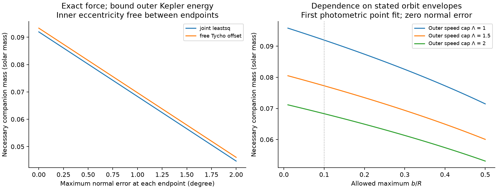
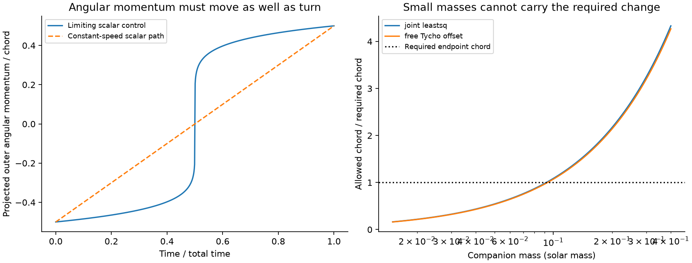
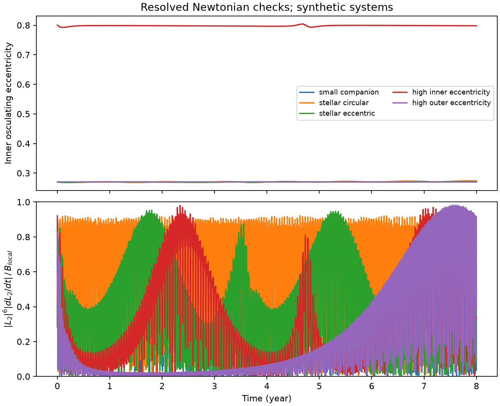

# Two HD 93683 fits require companions above 0.09 solar masses under exact Newtonian force and stated orbit bounds

## Result

A finite change of a binary's orbital plane can set a lower companion mass without orbit averaging. We prove this result for an isolated Newtonian triple. The outer orbit can change energy, eccentricity and angular momentum magnitude. The proof needs bounds on inner size, separation and outer speed. It does not need an outer period or a constant outer eccentricity.

For two published HD 93683 point fits, the companion mass must be at least **0.09196 and 0.09333 solar masses** under the conditions below. The calculation allows both inclination branches of spherical eclipse photometry and all unknown nodes. It does not require a constant inclination rate between the two endpoints. It allows the inner eccentricity to change between observations, with no upper cap below one.

These are conditional necessary bounds. They are not measured companion masses, confidence limits, or new companion detections. HD 93683 already has a reported Be component. No new observation enters this work. The useful result is a mass test with the exact force, rather than a new identification of that component.



The left panel permits an error between each fitted orbital normal and its true value. The right panel changes the allowed separation ratio and outer speed. All curves are sensitivity calculations, not probability intervals. Both panels use the inner size bounds below. The first panel has an outer speed cap of one and a separation ratio cap of 0.1.

## Conditions for the HD 93683 numbers

The model contains three collision-free point masses. Their masses are fixed. The companion is the only external source of torque on the inner orbit. We adopt inner masses of 18 and 15 solar masses. This is a source scenario, not a mass measurement made here.

Let a0 be the inner semimajor axis from the fitted period and the adopted total inner mass. The calculation requires these conditions over the selected interval:

1. The inner osculating Kepler orbit stays bound and has a(t) <= 1.05 a0. Thus its instantaneous separation is no more than 2.10 a0, even if its eccentricity approaches one.
2. At each endpoint, a >= 0.95 a0 and the inner eccentricity is no larger than the fitted value, about 0.2677. There is no such eccentricity cap between the endpoints.
3. The larger inner barycentric radius b is at most 0.1 times R, the distance from the inner mass centre to the companion.
4. The outer relative speed V obeys R V^2 / [2 G (M+m3)] <= 1. Here M is the inner total mass and m3 is the companion mass. This means that the instantaneous outer osculating **Kepler** energy is nonpositive throughout the interval. It does not mean that this energy is conserved. A negative total energy of the triple alone does not establish this condition.
5. The fitted endpoint inclinations give the true instantaneous orbital normals. We also give results when each fitted normal can differ from its true value by a stated angle.

None of these global orbit envelopes is measured by the source light curves alone. They define the tested models. Changing them changes the mass bound. Spin torques, a disk, a fourth body, mass loss, mass transfer and relativistic forces are outside this model.

## Sources and the question

The starting [photometric study](sci:sha256:d86cdb9d63aa4b20908f744a4745bc1e9fbe1a27f93ac748be2e54f6a738da5b) fits HD 93683 eclipse changes from 1990 to 2026 with a nearly linear inclination change. Its fit has limits from third light, eclipse times, stellar variability, simple surfaces and a short posterior calculation. We use two of its point fits, not independent inclination measurements at every epoch.

The campaign [quadrupole mass study](sci:sha256:3bd1cefdd9df611df279a37839390d9414c980a8d15dd6f66103dee1fdc01627) gives floors near 0.25 solar masses. That result assumes double-averaged quadrupole dynamics and a global inner eccentricity cap. The [exact-force acceleration study](sci:sha256:d8e5084dc21e01cb14c9ae3fe5e1a3c1dd8766e52bee3db31e33ae0dc4bcf8f2) removes averaging for an acceleration bound. We use its local force inequality and extend it to a companion mass test. The [projected-rate study](sci:sha256:6d23eb795e37430f99ba4514123f75f9ff76c780fbc5335e8e9f8713e3e581ed) supplies further context on the limits of a short, large torque as evidence for a long drift.

We ask whether a nonzero mass floor survives when the outer angular momentum magnitude and eccentricity can change. It does, with a stated speed envelope. The new step is a bound on the change of an angular momentum vector whose rate is limited after multiplication by its sixth power. This step avoids assigning one constant angular momentum capacity to the outer orbit.

Inclination changes are an established companion probe. [Jurysek et al. (2018)](https://doi.org/10.1051/0004-6361/201730655) constrain companions with orbital-plane precession. [Toonen, Hamers and Portegies Zwart (2016)](https://doi.org/10.1186/s40668-016-0019-0) review triple dynamics and the limits of orbit averaging. [Will (2017)](https://doi.org/10.1103/PhysRevD.96.023017) shows the role of terms beyond quadrupole order. We do not claim a new precession law or a complete priority review. The claimed contribution is the finite-interval inequality below and its conditional application. We searched the campaign and primary literature before the analysis. `files/literature.json` records the targeted search.

## Exact-force proof

### Definitions

Use Jacobi relative vectors. Let r=x2-x1 be the inner separation, and let R point from the inner mass centre to body 3. Let v=dr/dt and V=dR/dt. Define

```
M = m1+m2,       mu = m1*m2/M,       mu2 = M*m3/(M+m3),
L1 = mu (r cross v),                 L2 = mu2 (R cross V).
```

L1+L2 is the exact conserved orbital angular momentum. No multipole expansion is needed for this identity. The inner positions relative to their mass centre are x1=-(m2/M)r and x2=(m1/M)r. Let b=max(|x1|,|x2|). Assume that over a time interval of length T,

```
|r| <= rmax,       b/|R| <= epsilon < 1,
|V|^2 <= 2 Lambda G (M+m3)/|R|,       Lambda > 0.
```

Lambda=1 gives the main application. Lambda above one permits positive outer Kepler energy up to the stated speed cap. Distances, masses and times must use consistent units. Angles below are in radians.

### Local torque

The acceleration due to body 3 at an inner position x is

```
g(x) = G m3 (R-x)/|R-x|^3.
```

The line segment from x1 to x2 lies in the ball of radius b. Every point on it is at least |R|-b from body 3. At a point with distance d and unit direction u to body 3, the force derivative is G m3 (3 u u^T-I)/d^3. Thus

```
|r cross (Dg r)|
    = 3 G m3 |r|^2 |cos(theta) sin(theta)|/d^3
    <= (3/2) G m3 |r|^2/d^3.
```

Integrate the derivative along the segment. The central inner force has no torque. Conservation of total angular momentum then gives

```
|dL2/dt| = |dL1/dt|
          <= (3/2) G m3 mu rmax^2 / [(1-epsilon)^3 |R|^3].       (1)
```

This is an exact-force inequality, including all Newtonian multipoles. The factor (1-epsilon)^(-3) is conservative.

The speed envelope bounds the outer angular momentum at each instant:

```
|L2|^2 <= mu2^2 |R|^2 |V|^2
         <= 2 Lambda mu2^2 G (M+m3) |R|.
```

Multiply (1) by |L2|^6 and substitute this inequality. The distance cancels:

```
|L2|^6 |dL2/dt| <= B,

B = 12 Lambda^3 G^4 mu rmax^2 M^6 m3^7
    / [(1-epsilon)^3 (M+m3)^3].                              (2)
```

This form remains valid when L2 is zero. It does not require a fixed outer semimajor axis, eccentricity, energy or angular momentum magnitude.

### A finite change in angular momentum

Let d=|L2(T)-L2(0)|. If d=0 the result is immediate. Otherwise, let u be the unit vector along this change and set x(t)=u.L2(t). Its endpoint change is d. Since |x|<=|L2| and dx/dt<=|dL2/dt|,

```
[x(T)^7-x(0)^7]/7
    = integral x(t)^6 dx/dt dt
    <= integral |L2|^6 |dL2/dt| dt
    <= B T.
```

For any real x0 and d>=0, the smallest value of [(x0+d)^7-x0^7]/7 occurs at x0=-d/2. The minimum is d^7/448. Therefore

```
|L2(T)-L2(0)|^7 <= 448 B T.                                 (3)
```

The factor 448 is sharp for this vector-rate relaxation. A scalar path through zero approaches it when dx/dt=1/(x^2+delta^2)^3 and delta tends to zero. The limiting derivative is singular at zero. We do not claim that a collision-free triple can attain equality in (3), (2) and (1) at once.



Left: a scalar control that approaches the relaxed bound, compared with a constant-speed path. Neither is an orbit fit. Right: the maximum allowed endpoint chord from (3), divided by the required chord, for the two source fits. A value below one fails a necessary condition. A value above one does not establish a possible orbit.

### The mass floor

Suppose the true inner endpoint normals differ by at least D and their angular momentum magnitudes are both at least Lend. Then

```
|Delta L1|^2 = (La-Lb)^2+4 La Lb sin(theta/2)^2
             >= 4 Lend^2 sin(D/2)^2.

H = 2 Lend sin(D/2) <= |Delta L1| = |Delta L2|.
```

Only the two endpoint magnitudes enter Lend. A global lower inner angular momentum bound is not needed. Combine this chord with (2) and (3):

```
m3^7/(M+m3)^3 >= Q,

Q = H^7 (1-epsilon)^3
    / [5376 Lambda^3 G^4 mu rmax^2 M^6 T].                   (4)
```

The left side increases strictly from zero to infinity for m3>0. Its logarithmic derivative is 7/m3-3/(M+m3)>0. Thus (4) has one positive limiting root. This gives the companion mass floor.

There is also a version with varying local envelopes. Define lambda(t)=|R||V|^2/[2G(M+m3)] and u(t)=b/|R|. In (3), replace B T by

```
[12 G^4 mu M^6 m3^7/(M+m3)^3]
    * integral lambda(t)^3 |r(t)|^2 / [1-u(t)]^3 dt.          (5)
```

Equation (5) is valid on any collision-free interval with u(t)<1. A mass inference still needs an upper bound on this integral. Discrete observations alone do not provide one. The constant envelopes above are one way to supply it.

## Application to the two point fits

For spherical eclipse photometry, let I=acos(|cos i|), between zero and 90 degrees. The difference of two folded inclinations cannot exceed the directed angle between the true normals, for any branches or nodes. If each fitted normal is within delta of the true normal, use

```
D = max(0, |I_fit(tb)-I_fit(ta)|-2 delta).
```

For the main calculation,

```
a0 = [M (P/365.25)^2]^(1/3) AU,
Lend = mu sqrt[G M (0.95 a0) (1-E_endpoint^2)],
rmax = 2.10 a0,       epsilon = 0.1,       Lambda = 1.
```

Here G=4 pi^2 in AU, solar mass and Julian year units. P is in days. This is an explicit unit convention. We test every pair of the 16 supplied epoch centres and retain the strongest bound. This selection uses values of the same fitted function. It does not turn them into 16 independent measurements or require a multiple-test significance correction for the deterministic inequality.

| Point fit | Selected interval (year) | Folded change (degree) | rmax (AU) | Mass floor (solar mass) |
|---|---|---:|---:|---:|
| Joint least squares | 2002.5921-2026.0424 | 7.78507 | 0.898655 | 0.091961 |
| Free Tycho offset | 2002.5921-2026.0424 | 7.90081 | 0.898723 | 0.093328 |

The time span is 23.4503 years. The first fit has Lend=181.4235 solar-mass AU^2/year and H=24.6320 in the same angular momentum units. The source periods are 17.79892 and 17.80096 days. These point values do not have propagated fit uncertainty here.

For the first fit, the mass floors with delta=0.1, 0.5 and 1 degree at each endpoint are 0.08960, 0.08015 and 0.06834 solar masses. If Lambda is 1.5 or 2 at zero normal error, the floors are 0.07728 and 0.06831. If the endpoint eccentricity cap rises to 0.5 or 0.8, they are 0.08265 and 0.05724. These are separate changes from the main case. They are not joint error ranges.

A stronger scenario also caps eccentricity at the fitted value throughout the interval. It gives rmax=1.05 a0 (1+E) and a floor of 0.10477 solar masses for the first fit. If the directed continuation of the fitted inclination branch is assumed, the 1991.3952-2026.0424 span gives floors of 0.12844 and 0.13035. Spherical photometry alone does not fix that continuation. The folded result is the main one.

For small m3/M, the floor is proportional to H, to T^(-1/7), to rmax^(-2/7), and to Lambda^(-3/7). It is proportional to (1-epsilon)^(3/7). The table and `files/sensitivity.csv` provide exact roots rather than these small-mass approximations.

## Numerical checks

The algebra establishes the result. The numerical tests check its implementation and constants.

* **Exact forces:** 200,000 random geometries test masses, directions, separation ratios from 0.001 to 0.4, and outer speed factors from 0.01 to 2. No inequality fails. The largest exact torque divided by (1) is 0.997929. The largest left side of (2) divided by its right side is 0.996588. These tests include positive outer Kepler energy when the stated speed cap allows it.
* **Vector paths:** 10,000 random paths test the weighted chord inequality. Four-node Gaussian quadrature integrates each straight segment exactly, since the integrand is a polynomial of degree six. The smallest path cost divided by d^7/448 is 1.33331. A centred straight segment gives 1 to floating-point accuracy. Regular scalar controls approach equality from above.
* **Roots:** 1,000 random choices of physical inputs recover a prescribed limiting mass to a maximum fractional error of 2.71e-14.
* **Resolved dynamics:** Five synthetic triples are integrated for eight years with direct Cartesian Newtonian forces and DOP853. They include a 0.1-solar-mass companion, inner eccentricity 0.8, and outer eccentricity 0.85. All sampled local and finite-chord inequalities hold. The largest local ratio is 0.983697. The largest fractional total-energy error is 2.01e-8. A tighter repeat of the high-inner-eccentricity case changes its recovered mass floor by 2.19e-8 in relative value and its endpoint normal angle by less than 1.3e-10 degree.



All plotted trajectories are synthetic. They do not fit HD 93683. The sampled global envelopes have a 0.1 percent margin in these checks. They are not certified continuous extrema. The local force checks need no sampled global envelope. The synthetic finite-interval bounds are very conservative: their largest seventh-power chord ratio is 1.49e-9. This explicitly shows that passing the mass test is far from sufficient to fit a system. The analysis does not establish that a real orbit exists near 0.092 solar masses.

## What the result does and does not establish

The earlier 0.25-solar-mass result remains a theorem of its stated averaged model. The present lower number does not show that this earlier number is false in the full Newtonian problem. It supplies a proved necessary condition for a different, wider class that permits changing outer angular momentum and large intermediate inner eccentricity. It does not determine the sharp minimum within that class.

The main application excludes a planet as the sole source of the adopted change under the stated conditions. It does not establish an unconditional stellar mass floor. The fitted normal may differ from the instantaneous normal; the orbit envelopes may fail; and spins may supply part of the change. A mass below 0.09 solar masses would reject at least one condition of this particular model, rather than reject the exact-force proof.

No unique outer period, eccentricity, present velocity amplitude, future eclipse return date or orbital stability result follows here. A full fit to the eclipse profiles, timing, systemic velocities and astrometry is still needed to identify the torque source and measure its orbit. This work adds no evidence about TOI-682 or the proposed 2030 eclipse loss of HD 303514.

## Reproduction, provenance and rights

Use Python 3.12 and the versions in `files/requirements.txt`. The stored outputs use Python 3.12.15. Install dependencies in a separate environment if needed. Do not write into the signed publication. From an extracted, verified publication named RESULT, run:

```sh
python -B RESULT/files/analyze.py RESULT/files/inputs.json /absolute/path/to/new-analysis
python -B RESULT/files/validate.py /absolute/path/to/new-validation
```

Both output directories must be new. The first command recreates the bounds, sensitivity table, random checks and two figures. The second repeats every resolved trajectory, its tighter numerical check, and the third figure. It takes about one minute on the campaign host. `seconds` and environment fields can vary; compare the scientific numeric results. The random seeds and initial Cartesian states are preserved. No network, private scratch, service or additional process is needed.

To verify and recover the aggregate input from the source campaign ZIPs into new scratch:

```sh
python -B RESULT/files/retrieve.py CAMPAIGN /absolute/path/to/new-source-scratch
```

The script runs complete `sci verify` checks before extraction. It checks whole-ZIP and entry hashes against `files/provenance.json`. The exact shared source path for the aggregate input is `/mnt/dell-data/campaigns/11_07_2026/3bd1cefdd9df611df279a37839390d9414c980a8d15dd6f66103dee1fdc01627.zip`. This is the shared HP SSD path through its compatibility name. No failed-disk path was read. No shared raw dataset was used or downloaded.

The package includes original code, proof, text, figures, aggregate calculations, synthetic trajectories and an attributed aggregate input from SCI-baseline source publications. It includes no external photometry, catalogue extract, derivative database, paper text or dependency source. The source studies retain their original credit. `files/NOTICE.txt` gives attribution and separates external source terms from the license of the included work. `files/provenance.json` gives exact source paths and hashes. The supplied baseline LICENSE is unchanged.

Campaign 11_07_2026. Job sci-1107-hp-astronomy-bf0aa203b1b9. Topic astronomy. Machine hp. Account codex-myxtap. Model gpt-6.1-sol with high reasoning effort through the Codex harness in T3 Code. Date 2026-11-10. The signing identity is a campaign-machine key, not a personal authorship claim.
