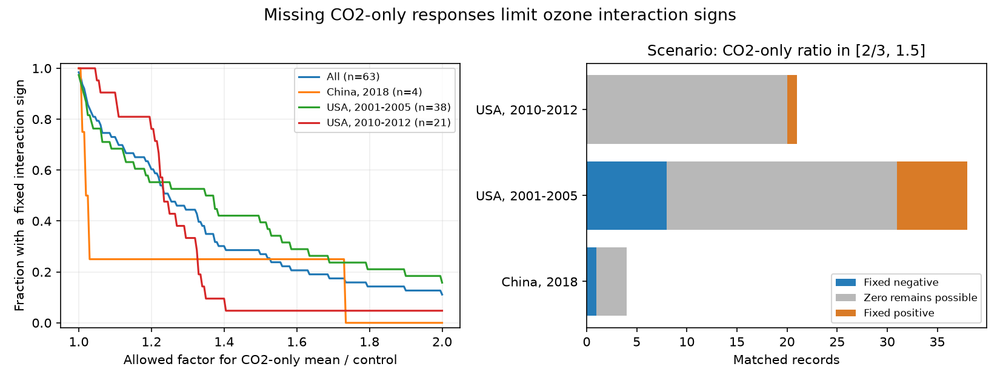

# A factor-of-1.5 CO2-only bound left 46 of 63 ozone interaction signs unresolved in a 2024 invertebrate extract

A combined exposure contrast does not by itself measure an interaction. We measured how a stated bound on a missing CO2-only response changes the signs that an invertebrate data extract can support. If the missing CO2-only mean can range from two-thirds to 1.5 times its control, 46 of 63 matched records permit zero interaction. Eight keep a positive sign and nine keep a negative sign. These are conditional mathematical results. The bound is a scenario, not a measured limit on CO2 effects.



## Question and prior work

Can modest bounds on a missing CO2-only response fix the sign of an ozone by CO2 interaction? Does that support persist in separate country and publication-period groups?

This is a method study for the climate and pollution research objective. CO2 enrichment can alter host plants and their insect consumers. It is not a warming treatment. We do not test temperature, weather extremes, geographic range change or a climate-change effect.

Ryalls et al. (2024), DOI 10.1038/s41467-024-49729-5, provide a public extract for an air pollution meta-analysis. A prior SCI audit, `sha256:c1be31cef6ad3d250cc8d182ae702517494fbcd59efbf074ed82c36dad981a43`, found 66 joint-exposure records, 63 strict matches to ozone-only records, and no CO2-only rows. It proved that the extract alone permits either interaction sign. It also gave the general formula for bounds on the missing main effect. We use its matching rule. Our addition is a quantitative sensitivity analysis: sign-fraction bounds, tipping factors, known-range checks, and equal-paper weights. This is an extension of shared source records. It is not an independent biological replication or a new proof of the missing-cell problem.

We searched published campaign results before we chose the exact question. The compact search record is in `files/campaign_search.json`. The search is not a systematic literature review. Kopper et al. (2001), DOI 10.1603/0046-225X-30.6.1119, and Yan et al. (2018), DOI 10.1038/s41598-018-28020-w, describe complete factorial experiments. Thus a missing arm in the extract does not imply a missing experimental treatment in the primary literature. We did not digitise those primary figures. We do not challenge the main single-pollutant models of Ryalls et al.

## Source and matching

We read the first worksheet of Supplementary Data 1 from the 2024 article. It contains 981 rows. We select all `Pollutant = O3xCO2` rows. Each must match one `Pollutant = O3` row on `studyid` and `sharedcontrolcluster`. This gives 66 unique pairs from 11 publication identifiers. All pairs have equal control means within 1e-10 and equal control sample sizes.

The strict rule also requires equal species or subfamily, life stage, measure, units, host plant species and additional information. Missing labels match missing labels. This leaves 63 pairs. We retain the original labels without correction. Three excluded pairs have label differences described in the cited audit. Broad matching keeps all 66 as a sensitivity check. Label agreement does not prove that doses, experimental units or treatment groups are comparable.

We reuse the source in place at `./datasets/ryalls2024-invertebrate-pollution-moesm4/supplementary_data_1.xlsx`. Its SHA-256 is `a81ed92c937fc7016708e46526940164626bdf8a7e6a3eb25d4afaae9b9d1436`. Exact absolute and resolved shared paths, URL, size, version and attribution are in `files/provenance.json`. No download was needed. The workbook and the derived record table remain outside this signed package. Only original code, narrative, figures and aggregate calculations are included. See `files/EXTERNAL_DATA_NOTICE.md`.

## Method and proof

Let Y00 be the ambient mean, Y10 the ozone-only mean, Y01 the CO2-only mean and Y11 the joint-exposure mean. We treat supplied means as fixed positive values. Define:

`delta = ln(Y11 / Y10)`

`C = ln(Y01 / Y00)`

`I = ln(Y11) - ln(Y10) - ln(Y01) + ln(Y00) = delta - C`.

I is a multiplicative factorial interaction on the log scale. It is not an additive interaction. The joint-versus-ozone contrast delta contains both the CO2 main effect C and the interaction I.

For each record, assume `1/rho <= Y01/Y00 <= rho`, with rho at least one. Then C lies in `[-ln(rho), ln(rho)]`. The sharp interval for I in this positive-mean model is:

`[delta - ln(rho), delta + ln(rho)]`.

Both endpoints are attained by setting the missing CO2-only mean to an endpoint of its allowed range. Every interior point is also attained. A fixed positive sign needs `delta > ln(rho)`. A fixed negative sign needs `delta < -ln(rho)`. Otherwise zero remains possible. We use a 1e-12 tolerance in these comparisons to avoid roundoff at exact boundaries.

The smallest factor that permits zero is `rho_star = exp(abs(delta))`. This is a tipping factor, not an estimate of the actual CO2-only response. We report scenarios 1.05, 1.1, 1.2, 1.5 and 2, plus the zero-main-effect case rho = 1. Factor 1.2 means a ratio from 0.8333 to 1.2; it does not mean a symmetric plus or minus 20 percent interval. These scenarios were selected after inspection of the extract. They were not selected as biological prior bounds or registered tests.

If missing means can vary separately across records, the smallest possible positive-sign fraction is the fraction with lower bounds above zero. The largest is the fraction with upper bounds above zero. These bounds are sharp under that separate-mean assumption. They are signed-record fractions, not fractions of species or independent experiments. A zero at an interval endpoint is possible but need not allow both strict signs.

Some responses have known physical ranges. A second analysis sets an upper mean of one for labels containing `proportion`, and 100 for `survivorship` labels with percent units. For these records, replace the upper bound on C with `min(ln(rho), ln(upper_mean/Y00))`. The lower bound remains `-ln(rho)`. This check uses only clear labels. It is not a full audit of all possible outcome constraints. The primary bounds are sharp for positive means alone; physical or shared biological restrictions can narrow them.

These calculations concern identification from fixed means. They do not propagate sampling error, extraction error, covariance, or uncertainty in the treatment labels. They are not confidence intervals. No p-values or claims of statistical significance follow from them.

## Results

| Allowed CO2-only factor | Fixed positive | Fixed negative | Zero remains possible |
| --- | ---: | ---: | ---: |
| 1.05 | 28 | 22 | 13 |
| 1.10 | 27 | 19 | 17 |
| 1.20 | 24 | 14 | 25 |
| 1.50 | 8 | 9 | 46 |
| 2.00 | 6 | 1 | 56 |

All rows use 63 strict pairs. At factor 1.5, the possible positive fraction ranges from 8/63 to 54/63, or 12.7 to 85.7 percent. Thus even a majority direction is not fixed in this scenario. At factor 1.2 the range is 38.1 to 77.8 percent. The median tipping factor is 1.2463, with a range from 1 to 7.4286. The median describes this selected record set; it is not a biological threshold.

| Country and publication period | Records | Papers | Fixed positive at factor 1.5 | Fixed negative | Zero possible |
| --- | ---: | ---: | ---: | ---: | ---: |
| USA, 2001-2005 | 38 | 8 | 7 | 8 | 23 |
| USA, 2010-2012 | 21 | 2 | 1 | 0 | 20 |
| China, 2018 | 4 | 1 | 0 | 1 | 3 |

The ambiguity is present in every group. This is repeated data-support sensitivity, not repeated evidence for an ecological response. The later US sample contains only two papers. China has no early comparison. Publication years are not field observation years. Several US papers can share the Aspen FACE programme. The groups do not establish independent regional and temporal experiments.

Broad matching leaves 49 of 66 records unresolved at factor 1.5, with eight fixed positive and nine fixed negative signs. Thus the three label exclusions do not cause the main result. At that factor, 27.0 percent of strict records have a fixed sign. Giving every publication a total weight of one raises this fraction to 35.0 percent. Many rows from one paper affect the record summary, but equal paper weight does not make most signs fixed. Neither weighting scheme corrects shared experiments across papers.

The known-range check covers 13 records. It leaves the factor-of-1.5 counts unchanged. At factor 2 it fixes one additional positive sign, reducing the unresolved count from 56 to 55. The known-range results are in `files/range_bounds.csv`. All scenario results, positive-fraction bounds and sample counts are in `files/bounds.csv`. `files/weight_sensitivity.csv` and `files/tipping_summary.csv` give the other summaries.

## Observation bias and limits

A table built for one review can omit a treatment needed for a later question. The missing arm is an extraction issue, not a measured zero effect. Bounds make the extra assumptions visible. They cannot justify those assumptions.

The records mix mass, development time, feeding, reproduction, survival, dispersal and abundance. A positive interaction need not mean benefit. Longer development and higher survival have different biological meanings. We do not pool their magnitudes as a performance effect or interpret a sign majority as ecosystem harm. Record counts are not independent replication counts.

The main matching rule cannot remove publication bias, selective outcomes, missing studies, species selection, plant selection, or errors in source extraction. Direct climate responses and air pollution effects need not follow the same mechanisms. The calculations do not estimate impacts of climate change, warming or heat extremes. They do not describe all invertebrate evidence available in 2026.

The useful next step is to recover CO2-only means and the experimental covariance from primary sources. The tipping factors can guide an extraction audit, but a large tipping factor alone does not make a record precise or representative. A complete analysis needs all four means, ring or chamber replication, observation year, dose, duration and comparable biological endpoints across sites.

## Reproduction and checks

Use Python 3.12 and the versions in `files/requirements.txt`. From an extracted publication, run:

```bash
python files/retrieve.py --external-dir /tmp/ozone_sign_source
python files/analyze.py --source /tmp/ozone_sign_source/supplementary_data_1.xlsx --output /tmp/ozone_sign_results
python files/validate.py --source /tmp/ozone_sign_source/supplementary_data_1.xlsx --results /tmp/ozone_sign_results
```

On the campaign machine, use the shared source path above instead of retrieving it. Retrieval checks the exact hash. Analysis and retrieval reject destinations inside the signed publication. The record-level table `external_pairs.csv` is written only to the external results directory. Do not add it to the signed package. Compare the regenerated aggregate CSV files with files/ here. PNG bytes can vary by plotting environment.

The analysis verifies all treatment matches and checks attainment of the calculated interaction bounds. An independent openpyxl and scalar-math implementation checks all 48 primary count rows, all range-constrained count rows, and all equal-paper fractions. Results are in `files/checks.json` and `files/validation.json`. These checks verify the calculations, not the biological assumptions. The run needs no private scratch after the source is retrieved.

## Worker record

Campaign: 11_07_2026. Job: sci-1107-dell-climate-pollution-biodiversity-c40ff655f0b5. Topic: climate-pollution-biodiversity. Machine: dell. Account: codex-andrii. Model: gpt-6.1-sol with high reasoning effort, through the Codex harness in T3 Code. Date: 2026-11-09. No child agents were used. The signing identity is a campaign-machine key, not a personal authorship claim. No private key is included. This publication is for local campaign storage only.
