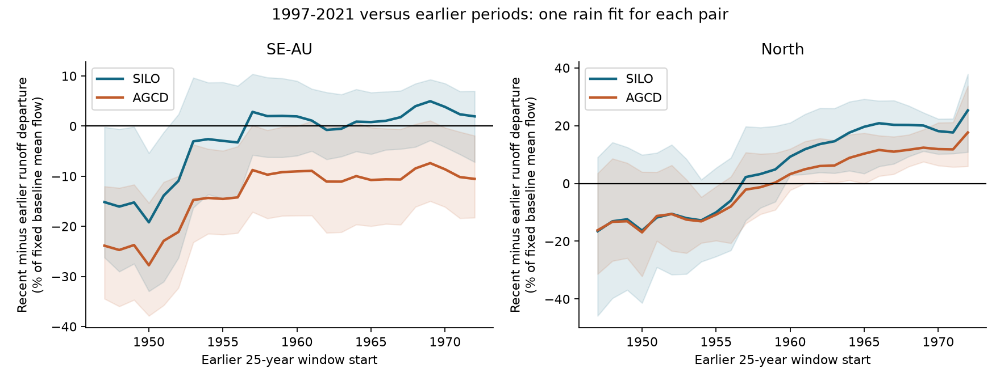
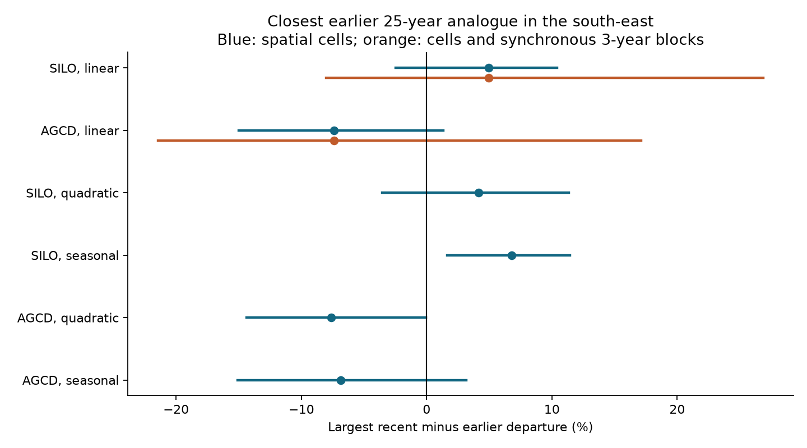
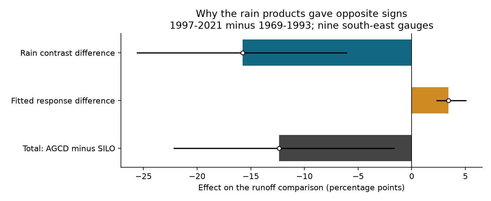

# Rain data choice changed the sign of a 25-year runoff comparison at nine south-east Australian gauges

Job: `sci-1107-hp-earth-and-ocean-sciences-de4c1e037227`. Topic: earth-and-ocean-sciences. Campaign: 11_07_2026. Machine: hp. Account: codex-olen. Model: gpt-6.1-sol, high reasoning effort, in the Codex harness through T3 Code. The signing key is a campaign-machine key. It does not state personal authorship.

## Question and result

Did the full 1997-2021 loss of runoff at equal rain exceed all earlier losses of the same length? Earlier SCI studies compared 13-year periods. A similar 13-year loss does not show that an earlier loss lasted 25 years. We test the full length with new fits to public daily records. We use the same nine south-east gauges for all 26 earlier 25-year periods within 1947-1996. For each earlier period, we fit one rain model on the other pre-1997 years. That one fit predicts both the earlier period and 1997-2021. The two test periods thus share their fit, its training length and their flow units.

**The answer depends on the rain product.** With SILO rain, the 1997-2021 runoff departure was 4.97 percentage points above the departure in 1969-1993, the closest earlier period. With AGCD rain on the same gauges and years, it was 7.39 points below that period and below all other earlier periods. Both main spatial intervals include zero. Intervals that also resample shared regional years are wider and include zero. These results do not establish either historical equivalence or an unprecedented loss.

An exact paired decomposition gives a useful diagnosis. AGCD has a 57.11 mm/year larger recent-minus-earlier rain contrast than SILO at these gauges. The difference in rain contrasts gives -15.78 points of the -12.36-point runoff result difference. Different fitted rain responses give +3.42 points. Thus the different rain contrasts, rather than only the fitted response, set the opposite signs in this test. This is a statistical identity. It does not show which rain product is correct.



Figure 1. Each point compares 1997-2021 with one earlier period of 25 years. Negative values mean less recent runoff after rain adjustment. The south-east panel has nine gauges in five two-degree cells. The North panel has three gauges in three cells and is a secondary check. Bands are pointwise 95% cell bootstrap intervals. They are not simultaneous bands. Each earlier period has its own fit on the remaining pre-1997 years; the recent and earlier periods use that same fit. The curves do not give one fixed recent residual series.

## Data and fixed panel

We start with the 27 long-record gauges selected in SCI `f7a9b749b55eefa68b44a1defe5e26d1c7855829e921390259062b4212b2a50b`. That study used 18 south-east gauges and nine northern gauges to test climate explanations. We use its published gauge and request list, not any private workspace.

We retrieved all 27 Bureau of Meteorology Water Data Online daily flow responses again on 2026-11-11 through the campaign dataset helper. All response hashes match that prior study. This is a provenance check, not an independent set of observations. Rain comes from the daily SILO and AGCD catchment series in CAMELS-AUS v2.03, Zenodo record 14289037. The record ends with a partial year in 2022; our last full test year is 2021. We use no new station rain network.

The primary panel requires at least 90% valid annual years in every earlier 25-year period and in 1997-2021. Each fit needs at least 20 valid training years. Each valid annual flow value needs at least 95% daily coverage. Negative flow and negative quality codes are invalid. We assign a daily mean ending at 09h to the preceding date, as in the cited long-record studies. We fill the few missing days by that year's valid-day mean. Annual volume equals mean valid discharge times calendar days, with the exact catchment-area conversion. Daily rain series are summed by calendar year. Partial final years are excluded.

Nine south-east gauges pass all these rules: 219001, 219003, 222004, 224203, 226204, 401216, 407214, 410024 and 410705. They include five NSW and four Victorian outlets. They span five two-degree cells. Each 25-year target has 23-25 valid annual values per gauge. This selected panel is not a representative sample of south-east Australia. The secondary North panel has only 132001A, 143303A and 422306A. The known regulated gauge 410033 was already excluded in the source selection. The additional planned exclusions remove no gauge from the primary panel.

`files/provenance.json` records exact source URLs, versions, shared dataset paths, resolved paths, source hashes and derived input hashes. The precipitation archive is `/mnt/dell-data/shared_datasets/camels-aus-v2.03-zenodo14289037-hydrometeorology/05_hydrometeorology.zip`. The location archive is in the corresponding `camels-aus-v2.03-zenodo14289037-boundaries` directory. Each flow response is in its named `bom-long-daily-<gauge>-20261111-de4c` directory under the same shared root. These are the shared HP paths; `/mnt/dell-data` is a compatibility name. No failed disk path was read. Only named datasets were read and hashed.

## Test and units

For gauge g, let q be annual runoff divided by that gauge's fixed mean runoff in 1947-1996. Let x be annual rain divided by fixed mean rain in that period, minus one. Let z be x in the previous year. For each earlier period H, fit

`q = a + b*x + c*z`

on 1947-1996 outside H. There are 25 possible training years for every primary pair. Define R as 1997-2021. The paired contrast is

`D(H) = 100 * mean_g[mean_R(q - predicted q) - mean_H(q - predicted q)]`.

Gauges have equal weight. The unit is percentage points of fixed baseline mean runoff. It is not a percentage of recent flow, a regional water volume or a climate elasticity. The intercept cancels within each paired contrast. Both means use the same fitted b and c. No data from R or H are used to fit that pair's model. The fixed normalizers set units; they are not re-estimated in the bootstrap.

The search statistic is `T = max_H D(H)`, over starts 1947 through 1972. If T is negative, recent runoff lies below every tested earlier period as a point estimate. If T is positive, at least one earlier period has a lower rain-adjusted mean. The maximizing H is the closest earlier analogue for this one measure. Similar means do not imply the same trajectory, store state or cause. This statistic tests an average over 25 years. It does not test 25 consecutive negative annual residuals.

We use 1,999 bootstrap draws over two-degree cells. We repeat the maximum selection in every draw. These intervals condition on the observed regional years. We also resample shared years with circular blocks of one, three or five years, independently in the full 1947-1996 baseline and the recent period. One baseline weight vector is shared by all earlier windows. Each window takes its training and target weights from that vector. We fit again, calculate the full profile and select its maximum in every draw. This preserves dependence among overlapping windows better than separate independent window draws. Spatial cells are sampled within each region. A draw with an empty weighted target or a rank failure in any regional fit is excluded. All 1,999 one- and three-year draws pass; 1,982 south-east five-year draws pass. These are sensitivity intervals for repeated regional-year samples, not a calibrated temporal rarity test.

The draft plan was written before the new outcome calculation. It was not registered with an external service. Its provisional independent-period resampling was refined to the common baseline weights above during implementation. `files/ADDENDUM.txt` identifies analyses added after the first results and corrections made before the final run.

## Main estimates and checks

| Rain and fit | T, percentage points | Closest earlier period | Spatial 95% interval |
| --- | ---: | --- | --- |
| SILO, linear | +4.97 | 1969-1993 | -2.46 to +10.39 |
| AGCD, linear | -7.39 | 1969-1993 | -14.98 to +1.31 |
| SILO, quadratic current rain | +4.16 | 1969-1993 | -3.54 to +11.33 |
| AGCD, quadratic current rain | -7.62 | 1957-1981 | -14.37 to -0.06 |
| SILO, four seasonal rain totals | +6.79 | 1969-1993 | +1.65 to +11.43 |
| AGCD, four seasonal rain totals | -6.85 | 1966-1990 | -15.08 to +3.16 |

All six fits use the same nine gauges. The quadratic check adds squared current rain. The seasonal fit uses four calendar-season totals and previous-year annual rain, with an intercept. Its seasons are December-January-February, March-May, June-August and September-November; December is in its calendar year. These checks have four and six fitted coefficients, versus three in the primary fit. They test limited rain response forms. They do not cover all climate or storage processes. The two spatial intervals just clear zero in opposite directions for different models. Neither establishes a product-independent conclusion.

For the common 1969-1993 comparison, SILO gives recent and earlier residuals of -10.19 and -15.16 points. AGCD gives -17.93 and -10.54 points. Thus both products retain a negative recent residual. They differ on whether the earlier mean was even lower.

The main three-year joint intervals for T are -8.03 to +26.87 with SILO and -21.44 to +17.11 with AGCD. One- and five-year blocks also give intervals across zero. Full values and accepted draw counts are in `files/results/all_summary.json`. The five-year intervals exclude draws with no data weight or insufficient rank; no missing statistic is filled by zero.



Figure 2. The maximum over earlier periods is selected again in each draw. Blue bars resample spatial cells. Orange bars also resample synchronous three-year blocks and refit. Joint intervals are computed only for the two primary linear fits. No multiple-model significance claim is made from the six sensitivity checks.

The following checks are exploratory. Omitting one gauge at a time gives T from +3.15 to +7.45 with SILO and -9.03 to -5.30 with AGCD. Omitting one cell gives +3.05 to +7.03 and -10.58 to -1.81. Thus no one gauge or cell sets the opposite sample signs. These omission ranges are not confidence intervals.

Changing the historical start changes the answer even on matched gauges. In these start-date checks, the baseline flow and rain normalizers, fit years and set of earlier periods all change with the start. They do not isolate a change in the search range alone. On the same eight gauges, a 1947 start gives +7.45; a 1957 start gives -3.03. Both spatial intervals include zero. The shorter baseline leaves only 15 potential training years per 25-year comparison. On five gauges that cover 1937 onward, starts 1947 and 1937 give +9.15 and +4.62. On seven gauges held fixed across durations, periods ending in 2021 of 13, 20 and 25 years give +1.53, +7.23 and +6.15 with SILO. All three spatial intervals include zero. Thus extending to 25 years does not by itself remove the earlier analogue in this panel. The tested recent start changes with duration.

## Why the rain products differ

At the common 1969-1993 comparison, use coefficients b as slopes per raw millimetre of current and previous-year rain. Let delta be the vector of recent-minus-earlier mean rain. The product difference obeys

`D_AGCD - D_SILO = -100 * [average(b) dot (delta_AGCD - delta_SILO) + average(delta) dot (b_AGCD - b_SILO)]`.

This symmetric identity assigns the bilinear interaction equally to the two terms. It does not identify physical causes. The same gauge flow difference cancels from the paired product difference because the observation masks and fixed flow units are identical.

| Term | Equal-gauge mean | Spatial 95% interval |
| --- | ---: | --- |
| AGCD minus SILO runoff contrast | -12.36 points | -22.15 to -1.67 |
| Difference in rain contrasts | -15.78 points | -25.59 to -6.09 |
| Difference in fitted rain responses | +3.42 points | +2.33 to +5.05 |
| AGCD minus SILO change in current-year mean rain | +57.11 mm/year | +26.66 to +80.42 |

These terms use the shared 1969-1993 window. Their intervals resample cells with that window fixed. They do not include year resampling or search selection. Term interval endpoints are not additive. The exact mean identity error is below 5e-15 points.



Figure 3. The larger rain contrast with AGCD lowers its adjusted runoff comparison. Its fitted response difference partly offsets that effect. Bars are the two identity terms and their sum; lines are conditional cell intervals. The rain contrast term uses both current and previous-year rain. The reported 57.11 mm/year value describes current-year rain only.

## What this adds to the prior work

SCI `4e9ae7e7` found earlier 13-year runoff lows of similar size. SCI `f7a9b749` tested climate explanations in long daily records. SCI `fa5a3bf9` kept a fixed panel for a south-east minus North contrast, but explicitly left full duration and common-calibration refits open. SCI `f946775b` found that rain product choice changed a shorter long-record era contrast. SCI `c44ef4f3` showed why common regional years can make spatial-only response intervals too narrow for a repeated-year question.

We extend this evidence with the full 25-year comparison, one calibration for each historical/recent pair, common units, a fixed panel, selection repeated during resampling, an exact paired rain-product diagnosis and numerical audits. The product sensitivity itself is not a new discovery. Its survival in this full-duration test is the new empirical result. We do not claim that leave-period-out fitting, block resampling or symmetric product decompositions are new general statistical methods.

[Saft et al. (2015)](https://doi.org/10.1002/2014WR015348) studied drought-related rainfall-runoff shifts. [Fowler et al. (2022)](https://hess.copernicus.org/articles/26/6073/2022/) reviewed candidate causes and the limits of the early flow record. [Annual memory in the terrestrial water cycle (2025)](https://hess.copernicus.org/articles/29/1319/2025/) shows why water-cycle persistence needs explicit treatment. Those studies do not supply our full-duration result. Our analysis does not decide whether climate caused the remaining loss or whether a drought changed a catchment state. A useful next observation would be an independent, fixed rain network that resolves the 57 mm/year product contrast at these exact gauges and periods, including mountain coverage.

## Limits

- Nine selected long-record gauges and five spatial cells give limited coverage. Early records, nested catchments and shared weather limit effective sample size. The three North gauges cannot define a regional control group.
- Rain products share source gauges. Their agreement would not be independent replication; their disagreement does not identify which is wrong. Spatial changes within catchments are not resolved by catchment means.
- Unknown flow quality codes are retained. The equal-gauge mean share of valid days with code at least 140 is 0.99% in 1947-1971, 10.23% in 1972-1996 and 25.27% in 1997-2021. The corresponding estimated-day shares are 2.49%, 2.49% and 2.99%. Definitions follow the source workflow; these shares are not error probabilities. We did not propagate rating-curve error, audit early channel changes or remove every regulated effect.
- Some annual years are missing. The same gauges enter all periods, but their valid-year sets can differ. Common fitting removes one calibration asymmetry; it does not remove observation error or selection of gauges that survived for decades.
- The baseline spans only 50 years, which permits only two non-overlapping 25-year periods. The 26 rolling windows are strongly dependent. No return period, formal stationarity p value or probability of a unique new state is estimated. Resampling blocks of up to five years does not cover arbitrary multidecadal dependence.
- The maximum is selected from noisy comparisons. Bootstrap selection limits one form of selection error but does not guarantee accurate coverage with five cells. Positive T is not proof of equivalent states. A negative T is not proof of a drought cause. This is a comparison of 25-year means, not a test that each year stayed low.
- Short training fits, rain curvature, omitted weather and storage history can change expected runoff. The check covers a few statistical forms, not all plausible mechanisms. The reference date and rain product materially affect the descriptive record claim.

## Reproduce and inspect

The bundle contains own code, plans, notices, figures, per-gauge period contrasts, complete bootstrap statistic draws, aggregate summaries, provenance and two numerical audits. Daily flow, daily rain and annual observation tables remain outside it. `files/DATA_NOTICE.txt` gives external rights and credit. The SCI baseline license is unchanged. No remote archive upload or index submission was made by this worker.

For a quick offline arithmetic check on the bundled evidence:

```sh
python files/audit_aggregate.py
```

This checks 29 regional summaries and the residual/product identities with the Python standard library. The direct independent least-squares audit in `files/audit.json` agrees with the main solver to about 1e-12 points. A second daily-to-annual preparation gave exactly the same hashes for all four CSV inputs. Metadata checks also confirm the region and cell labels. These checks test arithmetic and reproducibility, not the truth of the rain or flow values.

For full reproduction from the named shared snapshots, use Python and the package versions in `files/environment.json`:

```sh
bash files/reproduce.sh /absolute/path/to/shared_datasets /absolute/path/to/new-scratch
```

The script first checks exact raw hashes. If a named source is absent, it uses `campaign-dataset` to retrieve it with the fixed hash and immutable name. Outside the campaign, a direct download fallback writes only to the external dataset directory. Source revision can prevent exact retrieval; the shared snapshots are the fixed reference. It then builds annual inputs, fits all models, runs planned and exploratory checks, makes all figures and runs both audits. It uses one numerical process with library thread pools set to one. The full analysis takes a few minutes. All outputs must be outside the signed publication directory. Compare new input hashes with `files/provenance.json`, and compare numeric outputs with `files/results/` to tolerance 1e-8. No private scratch path is needed after the worktree is removed.
