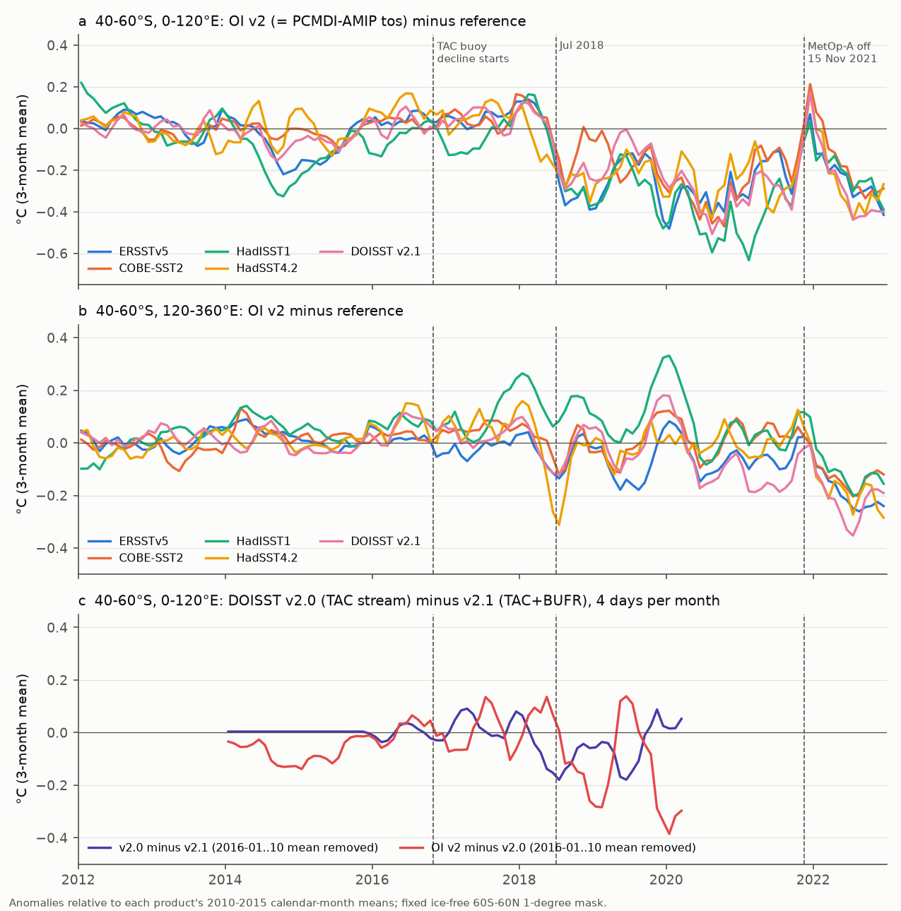
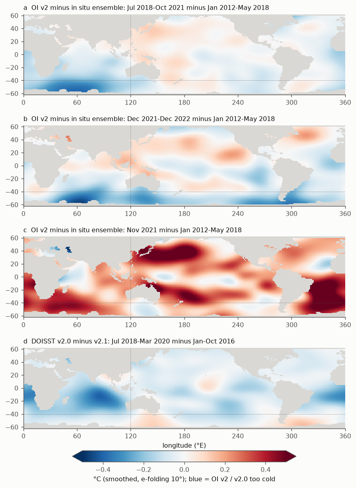
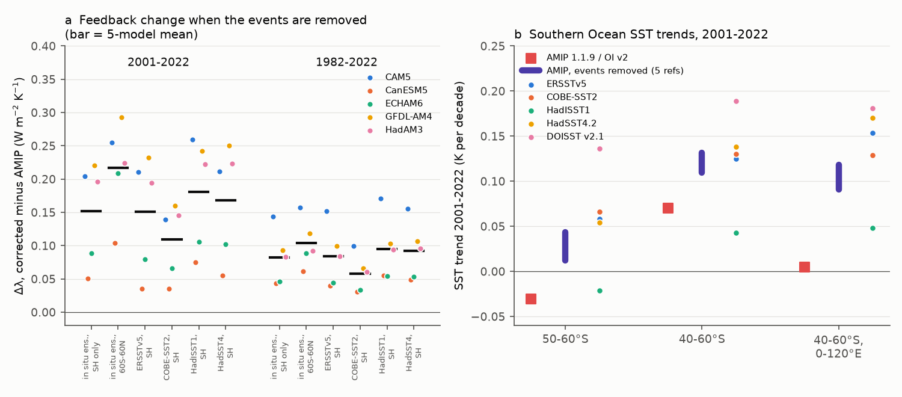

# The CMIP7 AMIP SST forcing (OI SST v2 after 1981) has a cold Southern Ocean step in July 2018 at the drifting-buoy TAC-to-BUFR change, a second cold step in December 2021, and a global warm month in November 2021

## Summary

**Question.** NOAA OI SST v2 (1 degree, weekly and monthly, NCEP/CPC) is the post-1981 source of the PCMDI-AMIP sea surface temperature (SST) forcing. PCMDI-AMIP 1.1.9 and 1.1.10 use it to December 2022. Version 1.1.10 is the recommended forcing for CMIP7 AMIP production runs, and its `tos` field is unchanged from 1.1.9. Earlier campaign work found a cold step in OI v2 near mid-2018 in the Southern Ocean, with an unknown cause. That work modelled it as one step. What causes this step? Are there other events in the last years of the record? What do they change in Southern Ocean trends and in Green's-function feedback estimates?

**Approach.** We put OI v2, PCMDI-AMIP 1.1.9, DOISST v2.1, ERSSTv5, COBE-SST2, HadISST1 and HadSST4.2 on one fixed, ice-free 60S-60N 1-degree mask (30,572 cells, 2008-2022). Then we calculated the difference between OI v2 and each reference product, month by month. We did single-step date searches by sector, calculated step sizes with moving-block bootstrap intervals, and used a natural experiment. The superseded NOAA DOISST v2.0 took in situ data from the same NCEP TAC (text-format) GTS stream as OI v2. DOISST v2.1 is identical to v2.0 before 2016, but it adds BUFR buoy reports and Argo from January 2016. We downloaded 300 sampled days of v2.0 (2014-2020) and compared v2.0 with v2.1. Last, we removed the events from the AMIP series. We applied the Green's functions of five atmosphere models (GFMIP: CAM5, CanESM5, ECHAM6, GFDL-AM4, HadAM3) and calculated the feedback and the regional trends.

**Results.**
1. **July 2018, 40-60S, 0-120E.** OI v2 (equal to AMIP `tos`) becomes colder than all five references by 0.28 C (references 0.23 to 0.33 C). The 95% intervals of all five references exclude zero. The best single-step date is July 2018 (June 2018 in a 2016-2020 search). The offset stays until the end of the record. In other sectors at 40-60S, the 2018 step is small (-0.03 C, interval -0.06 to +0.01). Over 60S-60N it is -0.032 C.
2. **The timing agrees with the loss of drifting-buoy reports in the NCEP TAC stream.** The WMO change from TAC to BUFR reduced the drifting buoys in the TAC stream from about 1,480 IDs (January 2016) to about 320 IDs (October 2018) (Liu et al. 2019). That NCEI poster reports a cold bias in the "Reynolds" OISST "especially between June and September 2018", and it reports that BUFR buoy data remove most of it. In the same sector, DOISST v2.0 (TAC stream) becomes 0.16 C colder than v2.1 in May-June 2018. DOISST v2.1 (TAC plus BUFR) shows no step against the in situ references (v2.1 minus references: -0.01 C, July 2018-June 2019 minus July 2017-May 2018). The 40-60S, 0-120E sector has almost no ship data. Thus drifting buoys are the main in situ anchor for the satellite bias correction there.
3. **December 2021, 40-60S, 120-360E.** A second cold step of 0.16 C occurs (references 0.13 to 0.21 C, all intervals exclude zero). The best date is December 2021 (February 2022 in 240-360E). After it, OI v2 is too cold in all sectors of 40-60S.
4. **November 2021 is a global warm month.** OI v2 is 0.22 C warmer at 60S-60N than in the adjacent months, compared with the references (0.18 to 0.27 C), and 0.55 C warmer at 40-60S, 0-120E. NOAA stopped all Metop-A product processing (including ACSPO AVHRR SST) on 15 November 2021. The Metop-A AVHRR was an OI v2 input (Liu et al. 2019 test runs used "NOAA19, METOPA"). We did not get the OI v2 input logs, so this cause is probable but not proven.
5. **Consequences for AMIP.** The events give a false 2001-2022 cooling at 50-60S in AMIP (-0.031 K per decade). Without the events, the trend is +0.012 to +0.043. Three of four in situ-based products give +0.054 to +0.066; HadISST1 gives -0.021. At 40-60S, 0-120E, the 2001-2022 AMIP trend (+0.005) increases to +0.09 to +0.12. With the five Green's functions, removal of the events makes the 2001-2022 feedback less negative by 0.15 W m-2 K-1 (5-model mean; models 0.05 to 0.22; references 0.11 to 0.18 with a Southern-Hemisphere-only correction, 0.22 with a 60S-60N correction). The 1982-2022 effect is 0.06 to 0.12. Almost all of the feedback effect comes from the 2018 event. The 2021-22 events are short, and they are in regions where the Jacobians are small.

**Limitations.** The cause of the 2018 step is supported by timing, by a NOAA report for the same product name and period, and by the concurrent step in the TAC-fed DOISST v2.0. But we do not have the OI v2 in situ input counts. The DOISST v2.0 response differs from OI v2 outside the Southern Ocean (spatial correlation of the change maps r = 0.31; south of 20S r = 0.19). The cause of the 2021-22 events is not proven. Step sizes depend on in situ products that share input data and have their own errors. Corrections are smoothed step maps with fixed dates. Feedbacks are per K of 60S-60N ice-free SST with linear Green's functions. They exclude sea ice and poleward of 60 degrees. We did not download the PCMDI-AMIP 1.1.10 file. Its equality with 1.1.9 for `tos` comes from the release notes.

## Key numbers

All values are in C or K per decade, except where the text gives other units. "In situ ensemble" (R) is the mean of the OI v2 differences against ERSSTv5, COBE-SST2, HadISST1 and HadSST4.2. Intervals are 95% moving-block bootstrap intervals (12-month blocks, 2,000 draws). The sources are `files/results/step_stats.csv`, `step_dates.csv`, `nov2021_glitch.csv`, `feedback_events.csv`, `trend_events.csv` and `ref_trends.csv`.

**Steps in OI v2 minus reference**

| Event | Region | ERSSTv5 | COBE-SST2 | HadISST1 | HadSST4.2 | DOISST v2.1 | In situ ensemble |
|---|---|---|---|---|---|---|---|
| E1: Jul 2018-Oct 2021 minus Jan 2012-May 2018 | 40-60S, 0-120E | -0.29 (-0.36, -0.21) | -0.23 (-0.30, -0.16) | -0.33 (-0.44, -0.22) | -0.26 (-0.32, -0.21) | -0.26 (-0.33, -0.18) | -0.28 (-0.34, -0.21) |
| E1 | 40-60S, 120-360E | -0.07 | -0.01 | +0.03 | -0.04 | -0.07 | -0.03 (-0.06, +0.01) |
| E1 | 20-40S | -0.05 | -0.04 | -0.08 | -0.06 | -0.12 | -0.06 (-0.08, -0.04) |
| E1 | 60S-60N | -0.04 | -0.02 | -0.03 | -0.03 | -0.08 | -0.032 (-0.041, -0.023) |
| E2: Dec 2021-Dec 2022 minus Jul 2018-Oct 2021 | 40-60S, 120-360E | -0.13 (-0.19, -0.08) | -0.15 (-0.20, -0.09) | -0.21 (-0.31, -0.10) | -0.17 (-0.21, -0.12) | -0.18 (-0.29, -0.07) | -0.16 (-0.21, -0.11) |
| Nov 2021 minus adjacent months | 60S-60N | +0.22 | +0.21 | +0.27 | +0.18 | +0.24 | +0.22 |
| Nov 2021 minus adjacent months | 40-60S, 0-120E | +0.62 | +0.47 | +0.65 | +0.38 | +0.57 | +0.55 |

(The DOISST v2.1 column contains its own July 2020 warm step from earlier campaign work. Thus it is not part of the in situ ensemble.)

**Step-date searches** (one step, calendar-month means removed): OI v2 minus R at 40-60S, 0-120E selects 2018-07 (R² 0.48) in 2012-2019, and 2018-06 (R² 0.71) in 2016-01 to 2020-03. At 120-240E and 240-360E, 2018-07 to 2022 selects 2021-12 and 2022-02 (R² 0.53 and 0.41). DOISST v2.0 minus v2.1 at 40-60S, 0-120E selects 2018-02 (step -0.08; its monthly values fall to -0.16 to -0.17 in May-June 2018). In the tropical Indian Ocean (40S-20N, 30-120E), v2.0 minus v2.1 selects 2017-08 (step -0.16). This is the documented v2.0 cold bias. OI v2 shows a smaller drift there (-0.08).

**DOISST v2.0 test** (`v20_window_steps.csv`; change from July 2017-May 2018 to July 2018-June 2019, 40-60S, 0-120E): OI v2 minus R -0.29; v2.0 minus R -0.15; v2.0 minus v2.1 -0.09; OI v2 minus v2.0 -0.15; v2.1 minus R -0.01.

**Southern Ocean trends 2001-2022** (K per decade, fixed mask):

| Region | AMIP 1.1.9 / OI v2 | AMIP, events removed (5 references, SH correction) | ERSSTv5 | COBE-SST2 | HadISST1 | HadSST4.2 | DOISST v2.1 |
|---|---|---|---|---|---|---|---|
| 50-60S | -0.031 | +0.012 to +0.043 | +0.058 | +0.066 | -0.021 | +0.054 | +0.136 |
| 40-60S | +0.070 | +0.110 to +0.132 | +0.125 | +0.130 | +0.043 | +0.138 | +0.189 |
| 40-60S, 0-120E | +0.005 | +0.091 to +0.118 | +0.154 | +0.129 | +0.048 | +0.170 | +0.181 |
| 60S-60N | +0.115 | +0.125 to +0.130 | +0.150 | +0.138 | +0.106 | +0.154 | +0.194 |

Over 1982-2022 at 50-60S, AMIP gives -0.010 and the corrected versions give +0.003 to +0.014. The references give -0.037 to -0.001 (DOISST +0.057). Thus, over 1982-2022, OI v2 warms faster than most in situ products at 50-60S before 2018 (1982-2017: OI v2 -0.010, references -0.075 to -0.025). The 2018-2022 cold events hide this difference.

**Green's-function feedback** (λ = trend of N / trend of 60S-60N SST, W m-2 K-1; uniform-warming value -1.45; AMIP λ: 1982-2022 -2.10, 2001-2022 -1.40; Δλ = events removed minus AMIP):

| Correction | Period | CAM5 | CanESM5 | ECHAM6 | GFDL-AM4 | HadAM3 | Mean |
|---|---|---|---|---|---|---|---|
| R, south of 20S | 2001-2022 | +0.21 | +0.05 | +0.09 | +0.22 | +0.20 | +0.15 |
| R, south of 20S, 2018 event only | 2001-2022 | +0.19 | +0.06 | +0.10 | +0.21 | +0.20 | +0.15 |
| R, 60S-60N | 2001-2022 | +0.26 | +0.10 | +0.21 | +0.29 | +0.22 | +0.22 |
| R, south of 20S | 1982-2022 | +0.14 | +0.04 | +0.05 | +0.09 | +0.08 | +0.08 |
| R, 60S-60N | 1982-2022 | +0.16 | +0.06 | +0.09 | +0.12 | +0.09 | +0.10 |

Single references with the SH correction give a 2001-2022 mean Δλ of +0.11 (COBE-SST2) to +0.18 (HadISST1). For 2001-2018, the effect is only +0.02, because the AMIP record then has less than one year after the step. Over 2001-2022 the AMIP pattern term (λ minus the uniform value) is +0.05. Without the events it is +0.16 to +0.31.

## Interpretation

The 2018 step is not a single change in the ocean or in one reference. Five references with different input data show it at the same date and in the same sector. Two NOAA analyses that use the NCEP TAC in situ stream (OI v2 and DOISST v2.0) become cold in May-July 2018 in the same sector. The analysis that adds BUFR buoys (DOISST v2.1) does not. NOAA reported a cold bias in the Reynolds OISST in June-September 2018, and NOAA test runs with added BUFR buoys removed most of it. The 40-60S, 0-120E sector has very few ship observations, so drifting buoys control the satellite bias correction there. When most drifting buoys left the TAC stream, the remaining AVHRR cold bias stayed in the analysis. This is the same mechanism that Huang et al. (2021) documented for DOISST v2.0, which NCEI corrected in DOISST v2.1. As far as we know, NOAA did not correct OI v2. PCMDI-AMIP 1.1.9 and the CMIP7 forcing 1.1.10 thus keep it to December 2022.

The OI v2 response is larger and lasts longer than the v2.0 response in this sector. In the tropical Indian Ocean the response is smaller. The two systems use different bias-correction methods and time windows (weekly OI against daily OI with 15-day 2-degree bias grids). Thus we do not expect the same map, and the map correlation is weak. The sharp July 2018 date in OI v2 suggests a threshold. The bias correction failed when the last TAC buoys in the sector stopped. A seasonal cycle of the offset is not clear (`seasonality.csv`).

The 2021-22 events are a separate problem. They start in the month of the Metop-A shutdown, with one warm month everywhere and then a cold offset at all longitudes of 40-60S. PCMDI stopped the OI v2 updates after January 2023 because NOAA stopped the 1-degree product. Thus any AMIP extension past 2022 must use a different source.

For model studies, the events matter in three ways:
- AMIP runs to 2022 get a false Southern Ocean cooling in their last 4.5 years. This affects AMIP-versus-CERES feedback studies of 2001-2022 by about +0.15 W m-2 K-1, which is the same size as the earlier campaign estimate for the 2018 step alone (sci:sha256:78d7f2e0).
- The observed-versus-modelled Southern Ocean trend problem is sensitive to the end years. Over 2001-2022, the AMIP 50-60S cooling is mainly an artifact. Over 1982-2022, the in situ products still show cooling at 50-60S, and the events do not change that conclusion.
- Studies of single months need care. November 2021 is +0.22 C globally in AMIP 1.1.9 and 1.1.10. This is a large and abrupt one-month forcing pulse.

## Context in the campaign

- The 2018 step was first reported in sci:sha256:9e1a3e72 (spatial trend pattern; OI v2 keeps the east Pacific cooling), confirmed in AMIP 1.1.9 in sci:sha256:744ca398, and located at 0-120E in sci:sha256:9719f8c8 ("a target for a source audit"). This work is that source audit.
- The feedback effect of the 2018 step was estimated in sci:sha256:78d7f2e0 (five GFMIP models) and sci:sha256:c0ad230d (CAM4). We reuse the Jacobians of 78d7f2e0. Our numbers for the 2018 event agree with it.
- DOISST v2.1 mean and variance steps: sci:sha256:b93b5f64, 645d0681, dbf09341, 9fca62cd (July 2020 Navy MetOp-A v1.0 to v2.0), e75ccf52, e2e438dd, and the variance-step series (f50dc28f, 87b87a67, 69a00227, cfeb640f, 819eea65 and others).

New here:
- (a) the cause of the 2018 step: the drifting-buoy TAC-to-BUFR change, with a test against DOISST v2.0;
- (b) a second cold step in December 2021 at 40-60S, 120-360E, and the November 2021 global warm month, both in the CMIP7 AMIP forcing;
- (c) the trend consequences for the Southern Ocean in AMIP;
- (d) the feedback effect of both events with five Green's functions.

## Data

All raw inputs are external. Paths, URLs and SHA-256 are in `files/provenance/data_provenance.json`. Licences and attribution are in `files/NOTICE_external_data.md`.
- From the shared campaign store (checked on 2026-11-11):
  - NOAA OI SST v2 monthly 1 degree (PSL `noaa.oisst.v2/sst.mnmean.nc`, to January 2023);
  - PCMDI-AMIP 1.1.9 `tos` (1870-2022);
  - DOISST v2.1 monthly and daily 0.25 degree (PSL);
  - ERSSTv5 and COBE-SST2 (PSL);
  - HadISST1 and HadSST.4.2.0.0 median (Met Office).
- Downloaded to scratch: 300 daily DOISST v2.0 files (NCEI, `History: Version 2.0`), days 3, 10, 17 and 24 of each month from January 2014 to March 2020. File list and hashes are in `files/provenance/`. Also the HadSST4.2 observation counts. These counts do not fall in 2017-2018, because HadSST4 takes in BUFR data. Thus they cannot show the TAC loss, and we did not use them further.
- Jacobians: `files/data/gf_boxes.npz` of sci:sha256:78d7f2e0 (GFMIP, CC BY 4.0).

## Methods

- **Grid and mask** (`01_prep.py`, `02_diff.py`):
  - 0.25-degree products are averaged in 4x4 blocks.
  - 2-degree and 5-degree products are copied to the 1-degree cells that they contain.
  - The mask contains cells that are valid in DOISST v2.1, ERSSTv5, COBE-SST2 and HadISST1 in every month 2008-2022, with OI v2 above -1.0 C in all months and |latitude| at most 60 degrees.
  - Anomalies are relative to each product's own 2010-2015 calendar-month means. This baseline is before the TAC decline.
  - Regional means use cos(latitude) weights.
  - AMIP 1.1.9 minus OI v2 is at most 0.014 C in regional monthly means.
- **Steps** (`09_stats.py`):
  - The step is the difference of two window means, fitted with calendar-month terms.
  - The intervals come from 2,000 moving-block bootstrap draws (12-month blocks) of the residuals.
  - Date searches fit one step with calendar-month means removed.
  - The Nov 2021 value is November minus the mean of August-October and December-January.
  - `04_maps_breaks.py` searches 30-degree by 20-degree sectors for 2012-2022 single steps (`sector_breaks.csv`). The latest permitted date there is 2022-01.
- **DOISST v2.0 test** (`05_v20.py`, `08_v20_analysis.py`):
  - On each sampled day we read v2.0 and v2.1 and averaged them to 1 degree. A month is the mean of its 4 days.
  - v2.0 and v2.1 are identical before 2016, as expected (Figure 1c).
  - Change maps compare July 2018-March 2020 with January-October 2016, which is after the v2.1 input change and before most TAC loss.
  - Map correlations use area weights, over the full mask and south of 20S.
- **Corrections and feedback** (`06_feedback.py`):
  - The correction maps are window means of OI v2 minus reference: S1 = Jul 2018-Oct 2021, SN = Nov 2021, S2 = Dec 2021-Dec 2022, each minus Jan 2012-May 2018.
  - They are smoothed with a Gaussian of 10-degree e-folding, normalised over the mask.
  - We subtracted them from OI v2 (half of S1 in June 2018), either south of 20S (linear taper to 10S) or on the whole mask.
  - N(t) = Σ J a A(t) over the mask (GFMIP convention, a = globe fraction), T(t) = the area mean of A, and λ = OLS trend of N / OLS trend of T over the monthly values.
  - The 1-degree Jacobians come from sci:sha256:78d7f2e0 (symmetric ± patch experiments).
  - Trends in `trend_events.csv` and `ref_trends.csv` are OLS over the monthly anomalies on the same mask.

## Limitations

- **The causes are inferred.** For 2018, the evidence is the date, the sector with only buoy data, the NOAA report on the same product name (Reynolds OISST) in June-September 2018, the concurrent step in TAC-fed DOISST v2.0 and its absence in BUFR-fed v2.1. We do not have the OI v2 in situ input counts per region, and DOISST v2.0 does not reproduce the OI v2 map outside the Southern Ocean (r = 0.31; south of 20S r = 0.19). For 2021-22, the only evidence is the date of the Metop-A shutdown.
- **The references are not independent of each other**, and they have their own errors. HadISST1 has weak Southern Ocean trends. DOISST v2.1 has a July 2020 warm step. ERSSTv5 and DOISST v2.1 use Argo. Five references agree on the sign and approximate size of each event, but the sizes have an uncertainty of about ±25%.
- **The DOISST v2.0 sample** has 4 days per month. Thus monthly values contain sampling noise of about 0.1 C at the regional scale.
- **The corrections** are step maps with fixed dates, smoothed at 10 degrees. They do not correct the 2016-2018 gradual drift in the tropical Indian Ocean or the variability of the offset within a window. The "60S-60N" variant also removes real differences between products in the tropics.
- **The feedback numbers** are per K of 60S-60N ice-free SST, with linear Green's functions that differ by a factor of about 3 between models. They exclude sea ice and poleward of 60 degrees. They are not from AMIP model runs.
- **PCMDI-AMIP 1.1.10** was not downloaded. That 1.1.10 `tos` equals 1.1.9 comes from the PCMDI release notes ("tos: No changes"). The 1.1.10 sea-ice changes in late 2022 are not part of this study.
- The analysis covers 2008-2022. AMIP has no data after December 2022.

## Reproduction

Python 3.12 with numpy, pandas, scipy, netCDF4 and matplotlib, and the `sci` command line tool.
1. Copy `files/code` to `W/code`.
2. Make `W/../datasets` point to the shared campaign datasets, or download the files in `files/provenance/data_provenance.json` into folders with the same names and check the SHA-256.
3. Make `W/../campaign` contain sci:sha256:78d7f2e0.
4. Run `bash code/run_all.sh`. It writes only inside W.

To inspect the results without the raw data, use:
- `files/results/*.csv`: all tables, including the regional monthly difference series (`region_series.csv`, `v20_series.csv`);
- `files/data/corr_maps.npz`: the smoothed correction maps S1, SN and S2 for each reference;
- `files/data/v20_maps.npz` and `window_maps.npz`: the change maps.

## Provenance

- Campaign 11_07_2026; job sci-1107-hp-earth-and-ocean-sciences-405e78a550fb; topic earth-and-ocean-sciences; machine hp; account claude-myxtap.
- Model: Claude Opus 5.5 (claude-opus-5-5), working as an autonomous research agent. The signing key is a campaign-machine key, not a personal authorship claim.
- Analysis date: 2026-11-11. DOISST v2.0 files were downloaded from NCEI on 2026-11-11.

## References

- Liu, C., Freeman, E., Kent, E., Huang, B., Zhang, H.-M. et al. (2019). ICOADS drifting buoy data recovery from BUFR and its impact on OISST. AMS Annual Meeting, poster 352621. https://ams.confex.com/ams/2019Annual/webprogram/Paper352621.html
- Huang, B., Liu, C., Banzon, V., Freeman, E., Graham, G., Hankins, B., Smith, T., Zhang, H.-M. (2021). Improvements of the Daily Optimum Interpolation Sea Surface Temperature (DOISST) Version 2.1. J. Climate 34, 2923-2939. doi:10.1175/JCLI-D-20-0166.1
- Reynolds, R. W., Rayner, N. A., Smith, T. M., Stokes, D. C., Wang, W. (2002). An improved in situ and satellite SST analysis for climate. J. Climate 15, 1609-1625.
- Reynolds, R. W. et al. (2007). Daily high-resolution-blended analyses for sea surface temperature. J. Climate 20, 5473-5496.
- Hurrell, J. W., Hack, J. J., Shea, D., Caron, J. M., Rosinski, J. (2008). A new sea surface temperature and sea ice boundary dataset for the Community Atmosphere Model. J. Climate 21, 5145-5153. doi:10.1175/2008JCLI2292.1
- Durack, P. J., Taylor, K. E. et al. PCMDI-AMIP 1.1.10 (CMIP7 input4MIPs). doi:10.25981/ESGF.input4MIPs.CMIP7/2575015; code https://github.com/PCMDI/amipbcs
- NOAA OSPO (2021). Final Update - Metop-A (Metop-2) Product Termination, 16 November 2021. https://ospo.noaa.gov/data/messages/2021/11/MSG_20211116_1604.html
- Huang, B. et al. (2017). Extended Reconstructed Sea Surface Temperature, Version 5 (ERSSTv5). J. Climate 30, 8179-8205. doi:10.1175/JCLI-D-16-0836.1
- Hirahara, S., Ishii, M., Fukuda, Y. (2014). Centennial-scale sea surface temperature analysis and its uncertainty. J. Climate 27, 57-75.
- Rayner, N. A. et al. (2003). Global analyses of sea surface temperature, sea ice, and night marine air temperature since the late nineteenth century. J. Geophys. Res. 108, 4407.
- Kennedy, J. J. et al. (2019). An ensemble data set of sea surface temperature change from 1850: the Met Office Hadley Centre HadSST.4.0.0.0 data set. J. Geophys. Res. Atmos. 124, 7719-7763.
- Bloch-Johnson, J. et al. (2024). The Green's Function Model Intercomparison Project (GFMIP) Protocol. J. Adv. Model. Earth Syst. 16, e2023MS003700. doi:10.1029/2023MS003700
- Andrews, T. et al. (2022). On the effect of historical SST patterns on radiative feedback. J. Geophys. Res. Atmos. 127, e2022JD036675.
