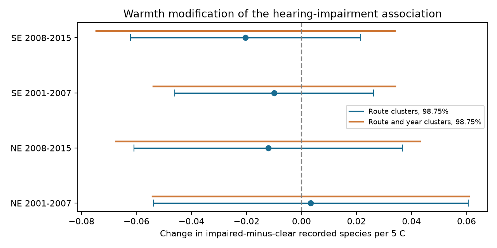

# Warmth gave no clear change in hearing-impairment links to frog records in four US samples in 2001-2015

## Question and result

Does warmer survey-night air change the association between reported hearing impairment and the number of frog species heard? All four main intervals include zero. The evidence does not establish a common warmth modification. It also does not establish that the modification is absent.

| Region | Period | Stops | Runs | Routes | Change per 5 C | 98.75% interval | Two-way interval |
|---|---|---:|---:|---:|---:|---|---|
| NE | 2001-2007 | 20,513 | 2,070 | 194 | +0.0034 | -0.0539 to +0.0607 | -0.0541 to +0.0609 |
| NE | 2008-2015 | 22,335 | 2,259 | 190 | -0.0121 | -0.0609 to +0.0367 | -0.0673 to +0.0431 |
| SE | 2001-2007 | 22,410 | 2,262 | 294 | -0.0099 | -0.0460 to +0.0262 | -0.0539 to +0.0340 |
| SE | 2008-2015 | 37,549 | 3,785 | 352 | -0.0204 | -0.0621 to +0.0214 | -0.0747 to +0.0339 |

The change is the impaired-minus-clear slope change for 5 C warmer run-mean air temperature, in recorded species per stop from a fixed set of four species. A negative value means a more negative impairment association on warmer nights. NE and SE have no common routes. The periods have no common years but can share routes. They are separate tests within one data source, not independent data sources.

## What is new

Campaign timing study sci:sha256:00fa5e9404f5c28c027c79ca3bc0e3ede118a63b563838d41de45d8e4ad459b1 found a spring-temperature link to calling-season timing. Rain study sci:sha256:66ff6db22c8fcddbf41e5e4afd0e850cf6284cc14ae047ed93f306bda9a68e86 tested rain recency by warmth. Salt study sci:sha256:6060e227103bb62576ce9ee28dfd044904822172609d2e6438c2b70be6691386 used noise as a control and reported lower detection with noise. We use the same archive and region rules. Our new test is the warmth by reported hearing-impairment term with comparisons within the same run and controls for fixed site differences. The negative average impairment association alone is not new.

Campaign searches included phenology, pollution biodiversity, weather observation bias, ozone, NAAMP and frog noise before the precise question was chosen. Three NAAMP publications were found and read. Our code was written for this study. The plan is in files/PLAN.md.

[USGS survey documentation](https://www.usgs.gov/centers/eesc/science/north-american-amphibian-monitoring-program) describes weather rules, five-minute listening and hearing-impairment reports. [Maryland occupancy work](https://pubs.usgs.gov/publication/5224605) studied factors that affect detection. [Playback work](https://doi.org/10.1002/ece3.4752) found weather and habitat effects on acoustic detection. These sources motivate the observation-bias test. They do not prove a warmth by impairment interaction. The source XML metadata supply the field definitions used here.

## Data and sample

Foreman, Grant and Weir (2017), NAAMP anuran detection data, eastern and central United States, 1994-2015, [doi:10.5066/F7G44NG0](https://doi.org/10.5066/F7G44NG0). We reuse the shared source files in place. files/provenance.json gives exact shared paths, source URLs, source manifests, byte counts and SHA-256 hashes for all five consulted files. No download was needed. No raw file or record-level panel is bundled.

We use unified-protocol runs in 2001-2015. The outcome is the number of Pseudacris crucifer, Anaxyrus americanus, Lithobates clamitans and Lithobates catesbeianus labels heard at a stop (0 to 4). Positive calling-index records are deduplicated by run, stop and species. No listed positive record at an eligible surveyed stop is treated as no detection. Complex labels and other species are not counted.

We require an explicit unskipped stop, binary Noise, air temperature from -5 to 35 C after the reported unit conversion, and at least five eligible stops per run. Missing binary Noise is filled from MassNoiseIndex only when it has a valid code: 0-2 means clear; 3-4 means impaired. This fill adds no records in the final sample; the binary-only fits are identical. Noise is an observer report that hearing was impaired, not a sound-level measurement or a traffic-only exposure. A listening break is flagged by TimeOut.

The region lists were adopted before fitting. Source state names omit spaces; matching uses that spelling. An initial fit missed multiword names. This coding error was fixed and every result and check was rerun. The final sample has 102,807 stop visits, 10,376 runs, 725 routes and 19 states. Actual states: NE: Maine, Massachusetts, NewHampshire, NewJersey, NewYork, Pennsylvania, Vermont; SE: Delaware, Florida, Georgia, Kentucky, Maryland, Mississippi, NorthCarolina, SouthCarolina, Tennessee, Texas, Virginia, WestVirginia.

files/flow.csv reports the region-period pool, unskipped stops, valid noise and temperature reports, and the joint eligible count before the run filter. The first counts are separate filters, not successive counts. Temperature availability accounts for most loss; missing noise is rare. files/support.csv gives state-level final support. Thus the sample is not a random set of all planned visits.

## Model and uncertainty

For stop s in run r, fit a linear model of the four-species count:
y = run effect + site-by-survey-window effect + bN + cN(T-15)/5 + local temperature terms + noise-by-month terms + noise-by-state terms + error.

N is the binary impairment report. T is the mean eligible stop temperature for that run. Local terms are stop temperature minus T, and stop temperature squared minus the run mean temperature squared. Run effects absorb observer, date, season, weather and all other factors shared by the same run. Site-by-window effects absorb fixed stop differences in each numbered sampling window. They do not absorb changes in habitat through time. Month and state noise slopes reduce confounding of c by seasonal or state changes in the noise association. c is the tested interaction. Its main warmth effect is absorbed by run effects.

The residualization algorithm alternately subtracts group means until its maximum update is below 1e-9. Least squares uses a pseudoinverse. Some state or month slope terms are redundant when all noise reports are clear in a category. The reported rank records this. The target interaction is estimable: its coordinate projection error is below 1e-7 in every fit. No invalid negative covariance was needed for the target.

Route-cluster sandwich covariance sums residual scores by route, with G/(G-1) correction. Intervals use a t distribution with G-1 degrees of freedom and 98.75 percent coverage per test (a four-test Bonferroni choice). They do not adjust for absorbed-effect degrees of freedom. The sensitivity covariance is route plus year minus route-year score covariance, with separate cluster-count corrections and t degrees of freedom equal to years minus one. Seven or eight year clusters limit this approximation.

Planned sensitivity fits remove TimeOut visits, use original binary Noise only, or replace site-by-window effects with site-by-observer-by-window effects. Their eligible run list is inherited from the main sample; the five-stop rule is not reapplied after removing breaks. All sensitivity interaction intervals include zero. Observer effects do not resolve observer-specific noise-report error.

## Other results and checks

Noise reports flag 9.6 to 16.1 percent of eligible visits across samples. Each sample has hundreds of runs with both clear and impaired stops (files/results.csv). Temperature support among impaired stops is given there by its tenth and ninetieth percentiles.

The sample-average fitted impairment contrasts are -0.090, -0.100, -0.085, -0.109 species per stop, in table order. These are descriptive averages over observed warmth, state and month, not causal losses or the primary test. They agree in direction with the earlier salt study. Persistent negative associations can arise from masked calls, reduced calling, site changes or observer decisions.

The explicit sparse-dummy solver in files/check_fit.py independently fits the same four main models. Its largest interaction difference from alternating demeaning is 1.2e-07. Its largest error in recovery of a known 0.1 interaction on the actual designs is 1.2e-07. files/checks.json gives each check. These tests check computation and identifiability, not confidence-interval coverage or biological truth.

## Limits and next work

- Survey nights are chosen under wind, rain and minimum-temperature rules. There is little support for severe weather; this is not a test of weather extremes.
- Subjective hearing impairment can depend on the calls heard. Reverse causation and report error remain possible.
- Run controls remove shared weather but cannot separate hearing failure from suppression of frog calling at a noisy stop. This count is not true local richness or occupancy.
- The linear temperature interaction can miss thresholds. Coarse month controls can leave seasonal confounding. Habitat changes and species-specific responses remain untested.
- These four species are not the whole community. The records end in 2015. The regions and periods are only partial replication within the same volunteer program.
- This study tests a weather and observation pathway within the broader climate-biodiversity objective. It does not test a climate trend or an air-pollutant effect. Noise has several possible sources.
- The next useful test is repeated, paired observer and recorder work on the same stops across temperature and sound levels. That design can separate auditory masking, calling activity and reporting bias. Modern independent regions and daily climate exposures remain open.

## Reproduction and rights

Use Python 3.12 and the package versions in files/environment.json. Work in a separate scratch folder. With the publication path stored in PUB and the shared dataset root in DATA, run:

    OPENBLAS_NUM_THREADS=1 OMP_NUM_THREADS=1 MKL_NUM_THREADS=1 python "$PUB/files/analyze.py" --datasets "$DATA" --out /absolute/path/to/scratch/analysis
    OPENBLAS_NUM_THREADS=1 python "$PUB/files/check_fit.py" /absolute/path/to/scratch/analysis

If the shared store is unavailable, first run files/retrieve.py --root /absolute/path/to/external-inputs and use that root as DATA. It retrieves one file at a time and requires the exact recorded hashes. Source changes fail the check. Source manifests are included in provenance.json so retrieval does not need private scratch.

The analysis writes the record-level panel to the external scratch output. Keep it outside the signed publication. Copy only the new aggregate results and figure when making another publication. Source attribution and material boundaries are in files/EXTERNAL_DATA_NOTICE.md. The exact SCI baseline license applies to the bundled new work. No private key is included.

## Job provenance

Job sci-1107-dell-climate-pollution-biodiversity-6ef279c6cb27; campaign 11_07_2026; topic climate-pollution-biodiversity; machine dell; account codex-olen; model gpt-6.1-sol with high reasoning effort, through Codex in T3 Code. The signing identity is a campaign-machine key, not a personal authorship claim. Computations used at most one compute process at a time and one numerical-library thread.
