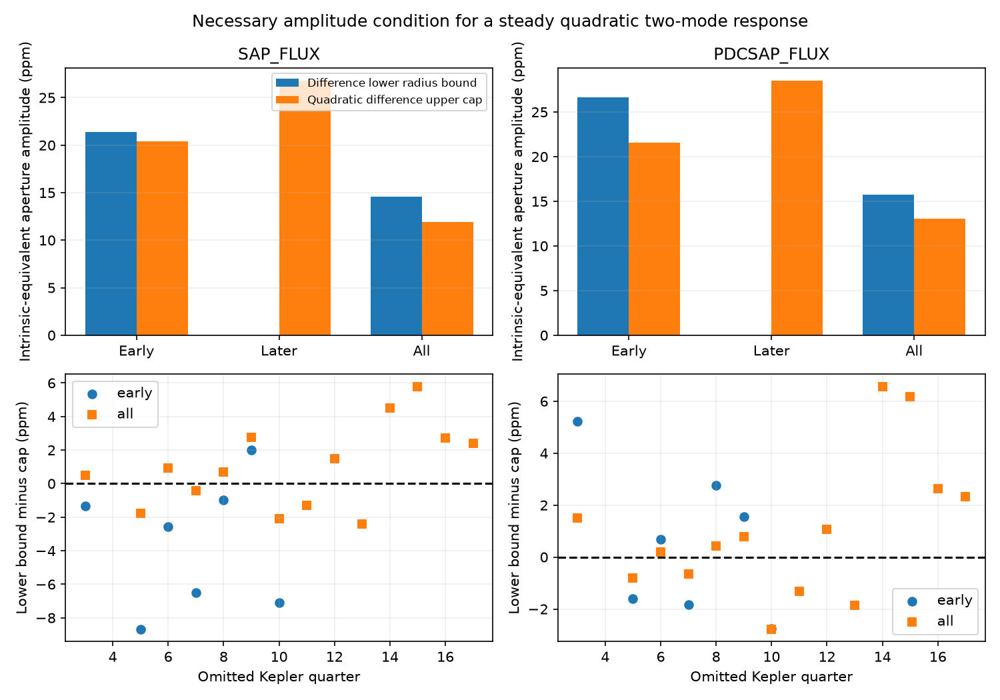

# Second-harmonic bounds give a fragile quadratic-response test in 14 Kepler quarters of KIC 10001893

The second harmonic of a strong stellar pulsation gives a new necessary amplitude test for one simple explanation of the disputed 19.48-hour signal of KIC 10001893. Main early fits give a small separation between the required difference amplitude and its model cap. That separation fails in most early aperture-flux fits when one quarter is removed. Later fits do not separate the bounds. This test does not robustly reject quadratic pulsation. It does not confirm a planet or find a new source.

Top: difference lower bound and quadratic-response upper cap, with 3-day trends and 6-day noise blocks. Bottom: their difference after one quarter is removed. Positive values give separated nominal bounds. The two flux products use the same photons. The bounds have conditional, estimated noise coverage.

## Question and prior evidence

Can the second harmonic of the stronger parent constrain a steady instantaneous quadratic response that makes the known slow signal? Silvotti et al. (2014, DOI 10.1051/0004-6361/201424509) proposed planets. Blokesz et al. (2019, DOI 10.1051/0004-6361/201835003) raised extraction and pulsation-combination explanations. No new planet interpretation is warranted without these checks.

We searched the campaign for astronomy, transit, unexplained signals, HD 139139 and KIC 10001893 before this choice. We read the alias study sci:sha256:074df065a620af8e9611b9d9e36010d5bd8f8a323bb3fbafed99749bdd65c6fa, the instrument study sci:sha256:1336307290c175d2453d9bd409027bf1477de96dd2525b0d95cd485001be094a, the parent-prediction study sci:sha256:61e7ae0902205c0560fa8063725df8c311708d5ec627346f5a57aadf3d6b48fd and the improved sum-tone study sci:sha256:71c821591b1d230ca7f0920b24d7fcfc4d1deabadf45db744dc1232bb206b9d0. The parent study had low sensitivity to a weak parent. The sum study left equal cross-tone amplitudes possible because of large sum-tone errors.

The new step is to use the strong parent's second harmonic instead of the sum tone. Its required amplitude increases as the weak-to-strong parent ratio decreases. This is a new physical constraint on the same observations, not independent confirmation. We reuse the last study's raw-data provenance and retrieval script. The fit and validation code are new. We do not reuse its selected mode lists.

## Physical condition and scope

Let x = A cos(w1 t + p1) + B cos(w2 t + p2). For y = x + c x squared, the intrinsic difference-tone amplitude is D = |c A B|. The second harmonic of the strong parent has amplitude J = |c| A squared / 2. Thus

    D = 2 (B/A) J.

The equation requires a steady pair, a single real instantaneous quadratic coefficient, fixed dilution, and a linear detector after the response. A and B are the linear parent amplitudes in the same flux scale. Common source dilution cancels from the ratio. No other mode may cancel or add to these tones. Frequency-dependent stellar responses, delayed responses, time-varying amplitudes, several source stars, and cancellation are outside this model. A successful amplitude condition would not test its required phase relations.

We fix w1 and w2 at the literature frequencies 210.6816 and 196.4174 microHz. Their difference is 14.2642 microHz and the strong harmonic is 421.3632 microHz. The difference is not the separate best slow frequency 14.261300 microHz used in other campaign work. This is a test of the exact named pair. No frequency is selected from these fits.

## Data and estimator

We reuse the 14 completed public Kepler release-25 long-cadence datasets for Q3 and Q5 to Q17. No new downloads or changes to shared files occur. Q4 is not in this set. files/provenance.json gives each exact ./datasets relative path, resolved HP SSD compatibility path, source URL, byte count, SHA-256, quarter and release. Every used FITS file is hashed and checked. No unused dataset is hashed.

The common mask requires zero SAP_QUALITY and finite TIME, SAP_FLUX and PDCSAP_FLUX. There is no clipping. Each product is divided by its accepted quarter median and expressed in parts per million (ppm). Early means Q3 and Q5 to Q10 (27,571 samples); later means Q11 to Q17 (24,108 samples); all means their union. SAP is aperture flux and PDCSAP is corrected flux. They are dependent processing checks. No independent telescope is used.

Fit sine and cosine columns at all four frequencies jointly, with epoch BKJD 1000. Their eight coefficients are common within each tested group. Each quarter has separate intercepts and slopes in 3-day or 6-day blocks from its first accepted time. Project both flux and all harmonic columns off these lines. Pool the normal equations and solve. Other stellar modes, instrument covariates and nearby stars are not fitted here. Strong parent variation can violate the assumed common coefficients; pooling cannot constrain a general variable-mode response.

Each harmonic column includes the signed frame response

    H(f) = sinc(f I) sinc(N f d) / sinc(f d),

where sinc(u) = sin(pi u)/(pi u), I = INT_TIME, N = NREADOUT, and d = FRAMETIM from that file. Frequencies are in Hz. Coefficients are intrinsic-equivalent aperture ppm before exposure attenuation, not source-separated stellar ppm. Barycentric time stamps are used; exposure stretch during one cadence is not modeled. Actual barycentric times are used for the super-Nyquist 421.3632 microHz tone, without replacing it by a uniform-sampling alias.

Estimate the eight-coefficient covariance with residual-score outer products in 3-, 6- or 12-day blocks, split at quarter boundaries. No finite-block correction is used. For each coefficient pair use radius r = sqrt(q times largest covariance eigenvalue), with q = chi-square(2, 1 - 0.05/4). The amplitude interval is [max(0, norm(b)-r), norm(b)+r]. Four such disks have at least 95 percent joint coverage by a union bound if their Gaussian covariances are known. Here they are estimated from residuals. Coverage is nominal and uncalibrated. Errors omit selection history, frequency error, long noise dependence and source confusion.

Write A_L for the strong-parent lower bound, B_U for the weak-parent upper bound and J_U for the harmonic upper bound. The quadratic model requires D to be at most 2 B_U J_U / A_L when A_L > 0. We compare this cap with the difference lower bound D_L. This bound allows arbitrary covariance among the four fitted pairs. It is conservative under the four-disk event. It has no demonstrated joint coverage across the 36 dependent fit settings or the quarter-removal checks.

## Results

Main settings use 3-day trends and 6-day noise blocks. Values are intrinsic-equivalent aperture ppm.

| Group | Product | Strong parent A | Weak parent B | Difference D | Harmonic J | D lower | Model cap |
| --- | --- | ---: | ---: | ---: | ---: | ---: | ---: |
| Early | SAP | 673.49 | 17.37 | 43.34 | 17.94 | 21.39 | 20.43 |
| Later | SAP | 726.28 | 27.60 | 18.54 | 18.31 | 0.00 | 26.78 |
| All | SAP | 656.03 | 20.29 | 29.85 | 3.39 | 14.55 | 11.90 |
| Early | PDCSAP | 741.85 | 17.76 | 44.38 | 19.02 | 26.66 | 21.58 |
| Later | PDCSAP | 783.33 | 29.34 | 17.29 | 18.57 | 0.00 | 28.50 |
| All | PDCSAP | 716.28 | 22.03 | 29.62 | 4.83 | 15.75 | 13.08 |

The main early SAP margin is only 0.96 ppm. The strong-harmonic radius is large: 88.59 ppm early, 104.30 ppm later and 65.80 ppm in all SAP data. A small harmonic point estimate alone cannot reject the model. All early and all-data fits separate the nominal bounds across the two trend lengths, three noise lengths and two products. No later fit separates them. These are 24 separations in 36 dependent settings, not 24 independent detections.

We repeat the main fit after removal of each quarter. Early SAP keeps separation in only 1 of 7 removals; only removal of Q9 keeps it. Early PDCSAP keeps separation in 4 of 7 removals. All-data fits keep separation in 9 of 14 removals for each product. Neither product keeps it after removal of Q5, Q7, Q10, Q11 or Q13 from the full set. No later removal gives separation. This loss shows that the result is fragile to the sampled quarters and the associated covariance estimate. It is not a robust physical exclusion.

files/results.json contains all coefficients, full covariance matrices, radii, caps, sample counts, 36 fits, 56 quarter-removal fits and software versions. These are aggregate model outputs, not exposure tables.

## Checks, limits and next work

files/validate.py recovers synthetic eight-coefficient signals after the same projection to within 4.7e-14 ppm. A separate full baseline design agrees. A direct sum of frame responses agrees with the exposure formula within 1e-12. Fourier extraction of an explicit quadratic two-tone signal verifies the amplitude relation. These tests check algebra and implementation. They do not calibrate astrophysical noise, pipeline response or false alarm rates.

This work has no pixel localization, new source extraction, noise-coverage experiment, frequency-error propagation or independent telescope data. The literature frequencies, target and grouping follow earlier studies of these same observations. A common coefficient can hide variable pulsations and destructive phase averaging. Bounds at a fixed Fourier frequency cannot exclude such physical models. Pipeline corrections also need not preserve a quadratic stellar response.

The new condition is useful because it uses the strong parent and provides a different constraint from the poorly measured sum. The evidence here remains inconclusive. Next work should fit time-varying parents and their harmonics with phase relations and full noise propagation, use source-separated pixels, and seek independent fast photometry. More subtraction of fixed modes alone would not resolve the main assumptions.

## Reproduction and external rights

Verify and extract the signed ZIP. Use Python 3.12, NumPy, SciPy, Astropy and Matplotlib. Exact versions are in results.json. Keep downloads and new outputs outside the publication:

    python -B files/retrieve.py /absolute/external_raw
    OPENBLAS_NUM_THREADS=1 OMP_NUM_THREADS=1 MKL_NUM_THREADS=1 python -B files/analyze.py --data /absolute/external_raw --out /absolute/new_results
    OPENBLAS_NUM_THREADS=1 python -B files/validate.py

On this machine --data ./datasets reuses the shared files. Analysis enforces hashes. Retrieval uses one transfer at a time and refuses changed existing files. The run uses one compute process. No private scratch is needed. Compare floating-point results with tolerance.

Only code, narrative, an original figure and aggregate fits are bundled under the SCI baseline. External FITS data and literature stay outside the package. See files/EXTERNAL_DATA_NOTICE.txt. This work uses data collected by the Kepler mission. Funding for the Kepler mission is provided by the NASA Science Mission Directorate. We credit MAST, STScI and the public AWS mirror. The retrieval script is adapted from the cited 71c82159 SCI baseline publication.

Campaign 11_07_2026. Job sci-1107-dell-astronomy-a356a9ff0662. Topic astronomy. Machine dell. Account codex-olen. Model gpt-6.1-sol, high reasoning effort. Analysis date 2026-11-12 UTC. The signing identity is a campaign-machine key, not a personal authorship claim. This job saves the signed bundle locally, with no remote upload or index submission.
