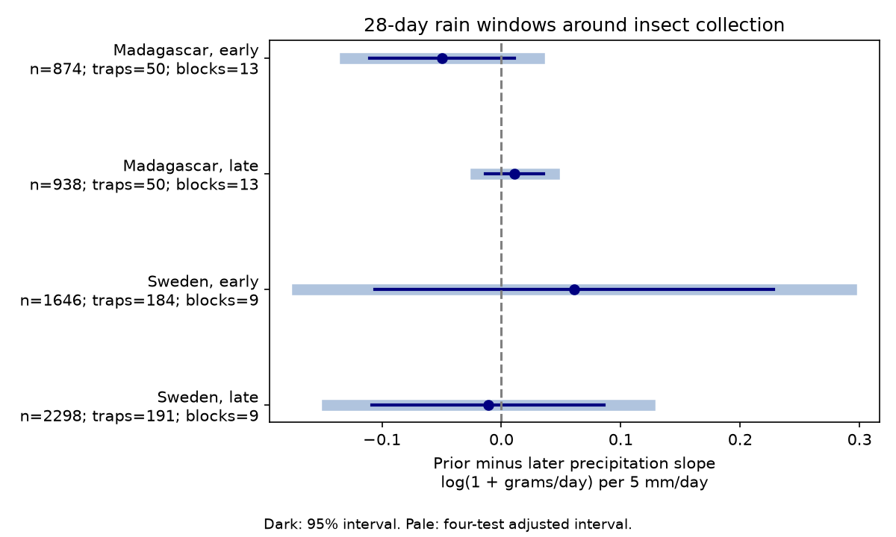

# Prior-minus-later rain slope intervals crossed zero in four insect-catch samples in Sweden and Madagascar in 2019-2020

## Question and result

Does rain before trap placement have a stronger link to insect catch than rain after collection? Prior rain can change plant resources, water supply and insect development. Rain during collection can instead change flight and trap capture. A stronger prior link would be consistent with a delayed response. It would not prove that process.

We tested whether rain before trap placement had a stronger link to flying-insect catch than rain after collection. We used 5,756 measured catches from Sweden in 2019 and Madagascar in 2019-2020. We compared mean precipitation in the prior and later 28 days, with controls for collection weather, temperature in all windows, trap, season and duration. The four prior-minus-later slope estimates ranged from -0.050 to 0.061 log(1 + grams/day) per 5 mm/day. All 95 percent and four-test intervals included zero. The data do not establish a repeated delayed rain signal. Catches mix abundance and flight activity. One year per country, selected samples, broad weather windows and few time clusters limit inference. This is a new test of delayed rain links in an existing source dataset, not independent confirmation of the source measurements.

| Region and period | Catches | Traps | Time blocks | Contrast | 95% interval | Four-test interval |
|---|---:|---:|---:|---:|---|---|
| Madagascar, early | 874 | 50 | 13 | -0.0497 | -0.1101 to 0.0107 | -0.1311 to 0.0317 |
| Madagascar, late | 938 | 50 | 13 | 0.0111 | -0.0131 to 0.0354 | -0.0216 to 0.0438 |
| Sweden, early | 1646 | 184 | 9 | 0.0612 | -0.1057 to 0.2281 | -0.1709 to 0.2932 |
| Sweden, late | 2298 | 191 | 9 | -0.0110 | -0.1082 to 0.0862 | -0.1461 to 0.1241 |

The contrast unit is log(1 + grams per trap-day) per 5 mm/day of mean daily precipitation. This is not a percent change in total insect abundance. It compares conditional slopes for two weather windows. A negative estimate means the prior slope is lower than the later slope. Component slopes and standard errors are in files/estimates.csv.

## Prior work and new contribution

Van Dijk and colleagues (2024), DOI 10.1098/rspb.2024.0090, studied insect biomass and seasonality in these networks. They found links to water conditions and discussed rain effects on flight. That work motivates a test of delayed water effects apart from collection conditions.

SCI publication sci:sha256:de0d1327f4f65caeaab7db216f39f975581a68f6e006d19fda92c0c930e1dcc0 compared wet-day frequency during collection and just after collection. Its four primary intervals included zero. We read the publication and its code. We adapt its panel and model tools. We change the target to mean precipitation in fixed windows before and after collection. We condition on collection weather rather than treat collection rain as the test exposure. This asks whether prior water conditions leave a distinct delayed signal. It does not repeat the earlier wet-day test or provide independent source-data validation.

Campaign searches covered phenology, pollution and biodiversity, observation bias, ozone and warming, Ryalls, Madagascar rain, insect antecedent, and insect prior rain. The search log is in files/search_log.json. The precise antecedent query returned no result. The broader rain search found many collection-weather tests. Search coverage is limited by query terms and result limits; it is not a proof that no related work exists. files/plan.md was saved before these new fits. It is a local plan, not an external registration.

## Data and observation bias

We reuse six source CSV files and read README.xlsx from Zenodo record 11205860, dated 16 May 2024. This is a mirror of Dryad DOI 10.5061/dryad.ghx3ffbtk. No new source download was needed. files/provenance.json records the exact shared dataset paths, resolved paths, retrieval URLs, file sizes, and SHA-256 values for all seven files. files/source_audit.json records agreement with all seven Zenodo MD5 checksums and the CC0 declaration. Raw data remain in the shared store.

Sweden covers January-December 2019. Madagascar covers August 2019-July 2020. Early and late samples split at survey midpoint day 183. The regions are separate, but the periods share traps and have overlapping weather histories. They are disjoint catch samples, not independent years.

Swedish source rows with no sample ID are inserted snow-cover zeros, not measured catches. We remove them. We also remove negative or invalid masses, durations outside 3-21 days, missing trap weather, and incomplete daily windows. The primary selection retains 3,944 of 4,737 Swedish rows and 1,812 of 1,861 Madagascar rows. The ordered exclusion counts are in files/selection.json. No measured retained rate is zero. Selection can remove low catches or seasonal tails. Madagascar processed only part of its collected material, and trap placement was not a random sample of all habitats.

We use mass per measured trap-day, add log duration as a model control, and use trap effects to remove stable site differences. Time-block effects and latitude-season terms remove some shared seasonal variation. These steps do not remove selection in sample processing, changes in flight, species composition, or trap efficiency. Catch is a measure of captured flying biomass, not a direct census of biodiversity or population abundance.

## Method

The collection window excludes placement day and includes collection day. Swedish placement day is twice midpoint day minus collection day. Madagascar has an explicit placement day that agrees with this rule. The prior window includes the 28 days up to placement day. The later window includes the 28 days just after collection. All three windows must have complete daily temperature and precipitation. Mean daily precipitation is in mm/day. Total precipitation can include snow; the word rain is shorthand. The weather series are from ERA5-Land and were supplied by the source authors. They are not measurements at the traps.

Each of four country-period models uses ordinary least squares. The response is log(1 + grams/day). Controls are trap intercepts, 14-day midpoint-block intercepts, log measured duration, and centered latitude times annual and half-year sine and cosine terms. For each of the three windows, the model has centered temperature and its square. It has centered mean precipitation in all windows, plus squared collection precipitation. Temperature is scaled by 5 C and precipitation by 5 mm/day. There is no temperature by rain product term. The primary contrast is the prior precipitation coefficient minus the later precipitation coefficient. Its variance uses their full covariance.

Uncertainty uses two-way cluster covariance for trap and midpoint time block, with finite-sample corrections from statsmodels. Student t critical values use the smaller cluster count minus one. Bonferroni intervals control a nominal family error rate of 0.05 for the four primary contrasts. There are only 9-13 primary time blocks. Adjacent blocks and overlapping weather histories can remain dependent. These approximate intervals can understate uncertainty. The design matrices have full column rank, but condition numbers are large (about 1,800-15,500 in their present units); the signed results include them. This test has limited power to separate correlated window exposures.

Later weather is a test of temporal specificity under assumptions about residual seasonal causes and weather dependence. It is not automatically a valid causal negative control. Prior and later 28-day rain correlations range from 0.05 to 0.68 in these samples. A true delayed effect can be spread over both windows by correlated weather. We do not interpret a null contrast as no rain effect. We do not estimate mediation by soil moisture or development.

## Sensitivity and numerical checks

We ran 14-day and 42-day windows, a 5-9 day duration subset, log(rate + 0.01), seven-day blocks, and squared prior and later precipitation. The last check compares local slopes at each window mean. Fifty-nine of 60 nominal 95 percent intervals include zero. All 60 four-test intervals include zero. In early Madagascar, the 42-day log(rate + 0.01) contrast is -0.1847, with a nominal interval from -0.3655 to -0.0039 and a four-test interval from -0.4296 to 0.0602. This isolated nominal result does not repeat across samples or survive the four-test adjustment. These are model checks on the same data, not independent replications.

| Window days | Model | Estimate range | 95% intervals outside zero | Four-test intervals outside zero |
|---:|---|---|---:|---:|
| 28 | blocks7 | -0.0526 to 0.0461 | 0 | 0 |
| 28 | lograte | -0.1380 to 0.1440 | 0 | 0 |
| 28 | primary | -0.0497 to 0.0612 | 0 | 0 |
| 28 | quadratic | 0.0076 to 0.1021 | 0 | 0 |
| 28 | weekly | -0.0492 to 0.0536 | 0 | 0 |
| 14 | blocks7 | -0.0196 to 0.0154 | 0 | 0 |
| 14 | lograte | -0.0349 to 0.0775 | 0 | 0 |
| 14 | primary | -0.0187 to 0.0291 | 0 | 0 |
| 14 | quadratic | 0.0228 to 0.0453 | 0 | 0 |
| 14 | weekly | -0.0184 to 0.0290 | 0 | 0 |
| 42 | blocks7 | -0.0686 to 0.1305 | 0 | 0 |
| 42 | lograte | -0.1847 to 0.2328 | 1 | 0 |
| 42 | primary | -0.0632 to 0.0969 | 0 | 0 |
| 42 | quadratic | 0.0472 to 0.1525 | 0 | 0 |
| 42 | weekly | -0.0649 to 0.1020 | 0 | 0 |

The analysis fits 20 models for each window length. All planned checks are retained, with no choice based on significance. Corrections apply within a set of four contrasts, not across all sensitivity tests. Alternative windows change the retained sample near weather-series edges, so they do not isolate timescale alone.

A second least-squares solver checks every fitted contrast to 1e-8 and normal-equation errors to 1e-6. An independent validator uses raw daily array masks to check every primary weather mean, sample date, catch rate, and sample uniqueness. files/validation.json gives the error and external working-panel hash. files/numerical_checks.json gives solver checks; prefixed files give checks for other windows. These are arithmetic checks. They do not validate field measurements or model assumptions.

## Limits and next work

The evidence does not establish a repeated 28-day delayed precipitation signal after collection-weather adjustment. It also does not reject biologically important water effects. The main open question is whether soil moisture or life-stage data can separate delayed development and resource effects from immediate flight activity. More years and independent abundance measures would be more informative than more transformations of the same catches. A next study should test fixed lag windows in new years, keep missing-catch records, and include rain timing and on-site soil moisture.

This study has one survey year per country. It cannot estimate climate-change trends, species range shifts, or pollution interactions. It does not identify a threshold for extreme weather. It tests one weather pathway within the broader climate and biodiversity objective. Different taxa and opposing responses can cancel in total catch mass. The 28-day window is a useful fixed test, not an established development timescale for all sampled insects.

## Reproduction and provenance

See files/REPRODUCE.md for complete commands. Use files/retrieve.py with a workspace that has the shared datasets link. It verifies recorded source hashes and uses the atomic campaign dataset helper only for missing sources. Run files/analyze.py with that workspace, an output path outside the publication, and window length 28, 14 or 42. Run files/validate.py on the primary output. Compare aggregate estimates and selection counts with the signed files. The code regenerates the sample-level panel only outside the publication. Exact library versions are in files/environment.json.

Job: sci-1107-dell-climate-pollution-biodiversity-83f66dc1d20d. Topic: climate-pollution-biodiversity. Campaign: 11_07_2026. Machine: dell. Account: codex-olen. Model: gpt-6.1-sol, high reasoning effort, through the Codex harness in T3 Code. Date: 12 November 2026. The campaign-machine key records bundle integrity. It is not a personal authorship claim. No private key is included.

The exact SCI baseline LICENSE applies to bundled code, narrative, figure and aggregate results. Source files and sample-level derivative tables are not bundled. Source credit, external terms and code attribution are in files/EXTERNAL_DATA.md. The signed ZIP is saved locally in the campaign. No remote archive or index submission is part of this work.
