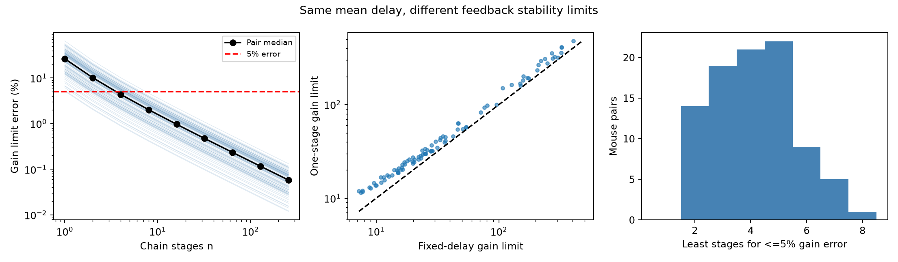

# Eight filter stages kept gain-limit error below 5% in delayed models of 91 Allen mouse E-I pairs

A filter chain with eight stages kept the critical feedback gain within 5% of a fixed-delay reference in models of all 91 selected mouse visual-cortex pairs. A one-stage filter with the same mean delay raised the gain limit by a median 26.4%, and by as much as 65.0%. Four stages met the tolerance in 54 of 91 pairs. Thus, a filter that keeps the mean delay can still change a model stability limit.

This is a model approximation test. The records provide reciprocal wiring, response onset times, and voltage decay times. They do not provide neuronal rate gains. We do not measure brain stability, oscillations, or representation reliability.



## Question and prior work

Can a chain of first-order filters replace a fixed onset delay in a two-cell negative feedback model without a large change in the critical gain? Filter chains permit ordinary differential equation solvers. They also spread the delay in time. This spread is a change in the model, even when its mean stays fixed.

Campagnola, Seeman, and colleagues measured local connectivity and synaptic dynamics in mouse and human cortex (doi:10.1126/science.abj5861). Meyer and colleagues studied the effects of distributed delays on neural feedback (doi:10.48550/arXiv.0712.0036). Ledoux and Brunel studied response filters and oscillatory instabilities in recurrent networks (doi:10.3389/fncom.2011.00025). These works establish the data source and the theoretical context. The general effect of a delay distribution is not a new discovery here. The contribution is a quantitative approximation benchmark with linked public circuit records, exact reference roots, stage counts, and checks.

Before the calculations, we started `sci search "connectivity" --in ./campaign --json` and `sci search "spine" --in ./campaign --json`. A later search used `feedback latency`. These full-folder searches did not finish during the investigation and were stopped. We also surveyed publication titles and abstracts directly from campaign ZIP metadata. We read the published delay-variability report (sci:sha256:906d8b623a15723a130cd76c98753b91636f683abe22e2a94e996e7654f49a66) and the mean-decay report (sci:sha256:367fb31164c30154685691c4289453c3ca5519e20951d1bf83162d5402c6cce7) with `sci read`. The latter used the same selection and fixed-delay model to test replacement of decay times. Here both decay times stay fixed; only the delay kernel changes. It informed our selection, donor grouping, and interior-decay check. We wrote new code and independently extracted the database. No sibling private workspace was used. This search is not an exhaustive novelty review.

The analysis design is in files/design.md. It was written before the computations. This is an exploratory investigation, not a public preregistration. The mathematical explanation below was developed with the analysis.

## Linked data and selection

We use Allen Synaptic Physiology r2.1 small, schema 22, source Last-Modified 2023-01-26. The exact shared input is:

`/mnt/dell-data/shared_datasets/allen_synphys/r2.1_small_2023-01-26/synphys_r2.1_small.sqlite`

Its size is 176771072 bytes. Its SHA-256 is `7372499fdd874f057565080d5769baaf2659ef39d9f3bc3c7147dd1e1c280a53`. The script checks the actual file hash and opens the database read-only. Source URL: https://allen-synphys.s3-us-west-2.amazonaws.com/synphys_r2.1_small.sqlite . No shared file was changed or downloaded.

The SQL in files/evidence/query.sql joins pair, synapse, cell, experiment, and slice. It extracts all 3297 detected chemical connections. A reciprocal E-I pair must have one excitatory and one inhibitory direction in the same experiment. Its nonsynaptic class labels must agree with both source signs and target classes. Both stored latencies and PSP decay times must be finite and positive. The same cell and pair IDs link structure and response. No mapping across separate animals or datasets is used. These small slice graphs are not a full anatomical connectome.

Mouse VisP has 302 detected reciprocal E-I pairs, 142 with consistent labels, and 91 with complete positive times. These span 77 recordings and 69 inferred mice. Human TCx has 23 detected pairs, eight with consistent labels, and only three complete pairs. We give the human values as a small descriptive check, not as a transfer test. Species and region are confounded.

The Allen schema defines latency from the maximum source spike slope to response onset, in seconds. PSP decay is from the average voltage response. It includes membrane and recording effects. It is not a receptor time constant or a measured firing-rate filter. A pinned schema URL is in sci.json; it documents the fields but is not a verified build commit for this database. We use no pulse-train arrays, which have a cache warning about order. We do not refit traces or add a manual fit-quality test. Positive stored values can still have large errors or fit constraints.

Mouse donor groups use isolated six-digit specimen numbers. Human groups use H-prefixed codes with three number fields. Failed parsing falls back to slice ID. These identities are inferred. The complete extracted edge table preserves source specimen names, labels, signs, and times for audit.

## Reference and replacement models

Let te and ti be the two stored positive decay times, and D the sum of the two positive onset latencies. Let K be the nonnegative product of two static gains. Each synapse is represented by a unit-area exponential response. The reference loop transfer function is

`L0(s) = K exp(-s D) / [(1+s te)(1+s ti)]`.

The characteristic equation is `1+L0(s)=0`. There is one negative feedback edge. There are no self-connections, other cells, spike thresholds, adaptation, rise times, nonlinearities, or additional cellular filters. The normalization removes response amplitudes; K is not inferred from PSP amplitude.

The first imaginary root has angular frequency w0 and critical gain K0:

`atan(w0 te) + atan(w0 ti) + w0 D = pi`,

`K0 = sqrt[(1+(w0 te)^2)(1+(w0 ti)^2)]`.

We replace only `exp(-sD)` with `(1+sD/n)^(-n)`, for positive integer n. This is a series of n identical first-order filters. Its impulse kernel is an Erlang distribution with mean D and variance D squared divided by n. We apply this chain to the total loop delay, not separately to the two edge delays. The resulting phase and gain equations are

`atan(wn te) + atan(wn ti) + n atan(wn D/n) = pi`,

`Kn = sqrt[(1+(wn te)^2)(1+(wn ti)^2)] (1+(wn D/n)^2)^(n/2)`.

All phase functions increase strictly. The reference phase is unbounded; the chain phase tends to `(n+2) pi/2`, which exceeds pi for every n >= 1. Both therefore have a unique first phase crossing. Loop magnitudes decrease strictly. Starting from K=0, the first crossing defines the stable gain range. At a crossing, the derivative of the root with respect to log K is the inverse of `D + te/(1+s te) + ti/(1+s ti)` for the reference. For a chain, replace D by `D/(1+sD/n)`. The real part of each denominator is positive on the imaginary axis, so each crossing is toward instability as gain rises. Later crossings do not restore stability.

For positive frequency, `n atan(wD/n) < wD`. Thus wn exceeds w0. The two-decay gain factor increases with frequency, and the extra chain magnitude factor exceeds one. Therefore Kn exceeds K0 for all positive times in this model. A chain permits a gain interval that it labels stable while the reference is unstable. This direction follows from the model and is not a statistical finding about neural tissue.

As n grows, the chain converges to the fixed delay. The leading large-n log gain error is approximately `(w0 D)^2/(2n)`; the phase error and frequency shift start at order 1/n squared. This explains why gain error can remain larger than frequency error. Exact roots, not this expansion, define every reported result. For n=1, a separate cubic Routh-Hurwitz calculation gives `K1=(te ti + D(te+ti))(te+ti+D)/(te ti D)-1`.

## Results and uncertainty

The primary ratio is Kn/K0. Error is this ratio minus one. Frequencies are in Hz, w/(2 pi). We report finite-sample distributions and do not test a biological null hypothesis.

| Stages | Median gain-limit error | Largest gain-limit error | Pairs within 5% | Median frequency error |
|---|---:|---:|---:|---:|
| 1 | 26.40% | 65.01% | 0/91 | 5.186% |
| 2 | 10.16% | 24.02% | 14/91 | 1.300% |
| 4 | 4.38% | 10.16% | 54/91 | 0.325% |
| 8 | 2.02% | 4.65% | 91/91 | 0.081% |
| 16 | 0.97% | 2.22% | 91/91 | 0.020% |

The least integer stage count for a 5% gain error ranged from two to eight, with median four. Counts at two through eight stages were 14, 19, 21, 22, 9, 5, and 1. Eight is therefore the smallest common integer count that meets this tolerance for all selected mouse pairs. It is not a general bound for other timings or models. The reference median gain was 25.931 and median crossing frequency was 39.378 Hz. These are model outputs, not measured gains or oscillations.

The equal-donor geometric mean one-stage ratio was 1.2674, with a descriptive 95% bootstrap interval of 1.2392 to 1.2978. For each donor we average log ratios, then resample the 69 donor means 9999 times with seed 110711. The interval describes variation conditional on the selected records and model. It omits fit error, selection bias, and uncertainty in donor identity. It has no guaranteed population coverage. The deterministic direction of the error requires no confidence interval.

The interior-decay check keeps both decays strictly within (0.00501, 0.499) seconds. It leaves 64 pairs from 52 inferred mice. Its median one-stage ratio is 1.2445, with donor mean ratio 1.2514 and interval 1.2221 to 1.2817. This is an endpoint sensitivity check, not validated fit QC. Halving both onset delays gives a median one-stage error of 13.21%; doubling them gives 52.35%. At double delay, eight stages have a maximum error of 8.72%, so the primary eight-stage result does not survive that timing perturbation as a uniform 5% guarantee. Raw sensitivity outputs are in summary.csv.

The three human pairs need three, four, and four stages for the same 5% tolerance. Their median one-stage ratio is 1.2206. Three selected pairs do not support inference across species, regions, or conditions.

## Checks and limits

The independent checker reconstructs pair selection, solves the phase equations by bisection, and checks the one-stage cubic identity. It checks 1128 local complex roots at gains 1% below and above the corresponding crossing. All have the predicted stable-to-unstable direction. The maximum relative difference from the main root calculation is below 2e-13. Maximum characteristic residual is below 3e-15. It also checks every least-stage result, summary reconstruction, exchange symmetry, and time scaling. These checks validate the computation, not the physiological model.

A useful application is to choose and audit the numerical delay representation before drawing stability conclusions from a small circuit model. A first-order delay replacement can supply a false stability margin relative to the fixed-delay reference. Neither representation is established as a biological ground truth here. Actual transmission may have distributed delays. Measured voltage decay times need not equal the appropriate rate-response filters. Rise dynamics, additional edges, membrane nonlinearities, state, and spike generation can change the result. We do not establish a new neural stability law.

The selected pairs omit many missing labels and fits. Slice cuts, missed weak connections, shared cells, recording conditions, and fit endpoints limit transfer. No anatomical axon lengths, intact-brain activity, behavior, or perturbation gains were used. A test of reliable representations needs activity and gain measurements from the same circuits. Broad transfer across animals, regions, and states remains open.

## Reproduce

The package contains code, exact extracted evidence, selection SQL, hashes, versions, tables, and the figure. The raw database is not redistributed. In a writable local copy, install files/requirements.txt in a private environment. From the publication root:

```sh
python files/analyze.py --edges files/evidence/edges.csv --out reproduced
python files/validate.py reproduced
```

This repeats selection, roots, integer-stage search, summaries, resampling, and the figure without network access. To repeat extraction and the input hash check, use:

```sh
python files/analyze.py --db /mnt/dell-data/shared_datasets/allen_synphys/r2.1_small_2023-01-26/synphys_r2.1_small.sqlite --out reproduced_from_db
python files/validate.py reproduced_from_db
```

If the shared file is absent but the mount is available, retrieve the exact source with the campaign helper and use its returned path:

```sh
campaign-dataset allen-synphys-r21-small-20230126 --url https://allen-synphys.s3-us-west-2.amazonaws.com/synphys_r2.1_small.sqlite --filename synphys_r2.1_small.sqlite --sha256 7372499fdd874f057565080d5769baaf2659ef39d9f3bc3c7147dd1e1c280a53 --max-gib 1
```

Do not create a substitute local folder at an unavailable shared mount. Raw-data retrieval is not needed to inspect the bundled computation. The second run from the derived edge table reproduced all numeric tables. Provenance for the database is in files/evidence/provenance.json; it also records software versions.

## Job and rights

Campaign: 11_07_2026. Job: sci-1107-syam2-neural-structure-and-computation-b15bfae0b115. Topic: neural-structure-and-computation. Machine: syam2. Account: codex-myxtap. Model: gpt-6.1-sol with high reasoning effort, through the Codex harness in T3 Code. Date: 2026-11-08. All computations ran in this worktree. No agents were launched. The campaign-machine key is not a personal authorship claim. No private key is included. The bundle stays local; no remote archive or index is used.

Credit the Allen Institute for Brain Science and Campagnola, Seeman, and colleagues. Source data and derived measurement records remain subject to Allen Institute terms at https://alleninstitute.org/legal/terms-use/ . The SCI baseline license covers new text, code, and figures to the extent permitted by source rights. It does not replace the source terms. No upstream code or raw database is redistributed.
