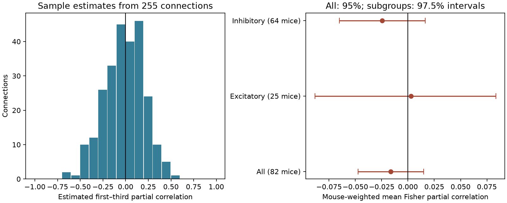

# Three-pulse Allen mouse slice data leave the mean first-to-third linear residual link unresolved

We tested whether the first and third response amplitudes retain a linear link after the middle response is removed. The sample has 255 detected connections from 82 inferred mice. The mouse-weighted mean Fisher partial correlation is -0.01640. Its nominal 95 percent mouse bootstrap interval is -0.04745 to 0.01507. This result does not resolve a nonzero mean link. It also does not show that a one-step model is correct.

A second result concerns the method. A score for the error in three-response sum variance has a negative bias in a fitted Gaussian null simulation. Its observed mean is -3.89 percent. Its simulated null mean is -1.91 percent. The observed value lies inside the central 95 percent null range. Thus, a negative score alone does not show that the one-step model overestimates biological noise.

Figure 1. The left panel shows sample partial correlations. The right panel gives equal weight to each inferred mouse. The subgroup intervals use 97.5 percent levels. The spread in the left panel includes sampling error and response-fit error. It is not a distribution of known biological parameters.

## Question and prior work

Reliable circuit models need both connection structure and response statistics. A useful small model could pass information about one response to the next without an extra first-to-third linear term. We test this covariance restriction in recorded connections. We allow the mean, variance, and adjacent correlation to differ at each pulse position. We do not require a stationary process.

Campagnola, Seeman and colleagues measured local connections and synaptic dynamics in mouse and human cortex [1]. These data link connection calls and fitted responses by pair ID. A detected connection can contain several synaptic contacts. This is a study of selected functional connections in slices, not a whole anatomical connectome.

Work on repetitive synaptic transmission has used response covariance to study release models [2,3]. Hidden release states can retain memory even if observed response amplitudes do not show a simple linear residual link. Our test does not identify vesicle depletion, release probability, or a physical state variable.

The campaign already has a study of distance and successive-response correlation [4]. A later audit checked pulse positions and compared two adjacent correlations [5]. We read both signed reports. We reuse the sufficient statistics from [5], rather than claim independent replication. That audit did not test the first-to-third partial correlation or the bias of the sum-variance score used here. Our contribution is a reproducible test of this additional covariance restriction and a sampling-bias check. The partial-correlation identity and Gaussian simulation method are established tools.

We searched the campaign before the final question was chosen. Searches included connectome neural, reciprocal failure, reciprocity degree, electrical chemical, and paired event correlation. A focused search for the quoted phrases partial correlation and pulse returned no hits. Some broad searches returned only the first page. The compact search record is in files/search_log.json. This is a local novelty check, not a full review of all prior studies.

## Inputs and selection

We use the matched three-pulse sufficient-statistic table and metadata from signed publication [5]. Complete signature, file, baseline, and timestamp checks passed for that input bundle. Each record contains the count, sums, squared sums, and cross-products of fitted amplitudes. These values permit exact reconstruction of the sample covariance matrix, subject to CSV precision.

The prior audit selected mouse visual cortex sources with multiple detected targets. It used current clamp, 50 Hz stimulation, one source spike, accepted sign-specific response quality checks, and finite reconvolution amplitude fits. We retain records with the same three pulses on at least 20 trials. Source labels 0, 1, and 2 mean physical pulses 1, 2, and 3. We do not infer pulse identity from the public analysis code alone.

The main sample has 255 connections and 82 inferred mice, with a median of 25 trials per connection. The excitatory group has 61 connections from 25 mice. The inhibitory group has 194 connections from 64 mice. These groups overlap in mice. Four source cells had mixed connection-sign labels in the prior metadata. We retain the connection labels and do not treat them as verified source cell types.

The original trial CSV is no longer present at its historical shared path after the disk failure. We did not use that path or the failed disk. The signed sufficient-statistic tables remain available in the shared campaign. We extracted verified copies to local scratch. The used file hashes, sizes, source entries, and exact shared bundle path are in files/provenance.json. We also inspected the schema of the existing shared r2.1 small database in read-only mode. That database did not supply the endpoint values in this test.

## Fixed method

This is an exploratory analysis. We inspected an initial result before writing the final analysis script. There is no external registration or independent test set.

For each connection, let C be the unbiased sample covariance of the three amplitudes. We compute:

    q = C13 - C12*C23/C22
    r_partial = q / sqrt((C11-C12^2/C22)*(C33-C23^2/C22))
    z = atanh(r_partial)

Here indices refer to physical pulse positions. This equals the correlation of residuals after separate linear regressions of the first and third amplitudes on an intercept and the middle amplitude. It is also minus the normalized 1,3 entry of the precision matrix. We check both identities independently.

The tested one-step covariance model sets C13 to C12*C23/C22. It keeps the three variances and both adjacent covariances fixed. This construction is positive semidefinite when the input covariance is valid. Under a joint Gaussian model, zero partial correlation means conditional independence of first and third amplitudes given the middle amplitude. Without that assumption, it means only no residual linear correlation. It is not a general test of absence of memory.

We average z within each inferred mouse, then average across mice. Mouse IDs use the unique six-digit specimen number in the source specimen name. Parser assertions pass, but the IDs are not an independent donor registry. We resample mouse averages 19,999 times with seed 1107099. The main interval is 95 percent. Subgroup intervals are 97.5 percent and remain exploratory. The bootstrap conditions on response fits, selected connections, and inferred identities.

A secondary score is:

    gap = (V_sample - V_one_step) / V_sample
    V = variance of amplitude1 + amplitude2 + amplitude3

Equivalently, gap = 2*q / sum(C), where sum(C) includes all nine entries. This is a model amplitude-sum variance, not integrated voltage or spike-output variance. The score can be biased because it divides a noisy residual covariance by a related noisy variance. It is not a loss on held-out trials.

To check this bias, we fit the one-step covariance separately to each retained connection. We draw 4,999 synthetic sample covariance matrices per connection from the exact Gaussian Wishart distribution with n-1 degrees of freedom. Each draw has the original trial count. We recompute both scores and use the same mouse and connection weights. This simulation assumes independent Gaussian trials and independent connections. It does not reproduce shared-source or within-mouse cross-connection dependence. It is a sampling diagnostic, not a calibrated test of a biological null. Seed: 1107100.

## Results

| Sample | Connections | Mice | Mean Fisher partial correlation | Interval |
|---|---:|---:|---:|---|
| Main | 255 | 82 | -0.01640 | -0.04745 to 0.01507 |
| Excitatory | 61 | 25 | 0.00286 | -0.08848 to 0.08349 |
| Inhibitory | 194 | 64 | -0.02445 | -0.06516 to 0.01631 |
| Preceding source interval at least 8 s | 255 | 82 | -0.01679 | -0.04764 to 0.01435 |
| At least 30 trials | 46 | 19 | 0.03693 | -0.03993 to 0.10562 |

The subgroup intervals use 97.5 percent levels. The other rows use 95 percent levels. The larger-trial subset changes the sign of the pooled point estimate and has a wider interval. Its excitatory subgroup has only 15 connections from six mice and a positive exploratory interval. This is a selection-sensitive check, not a confirmed subgroup effect.

In the main sample, 25 individual Gaussian partial-correlation tests have nominal p below 0.05. None passes Bonferroni correction across all 255 connections. This correction is conservative. Absence of a rejection does not bound every connection's memory. The sample-level spread can include real differences and estimation error.

The mean variance gap is -3.890 percent, with a nominal mouse bootstrap interval of -6.338 to -1.542 percent. However, the fitted null simulation has mean -1.915 percent and central 95 percent range -4.059 to 0.113 percent. Its two-sided tail fraction for the observed value is 0.0684. The corresponding Fisher-score tail fraction is 0.2656. These are conditional simulation diagnostics under the assumptions above.

The median absolute sample variance gap is 9.61 percent. In 121 of 255 connections it exceeds 10 percent. These counts do not establish errors of that size in true covariance. No held-out trial test was possible from sufficient statistics. Taking absolute values also raises the effect of estimation noise.

The main finding is unresolved mean residual association. The variance-score check shows why a related nonzero descriptive score needs a finite-sample calibration. We do not establish a one-step law across animals, brain regions, species, or behavior.

## Validation and limits

All sample covariance matrices passed the positive-semidefinite check. All reconstructed one-step matrices passed it too. The partial-correlation formula agreed with the inverse-matrix identity to the recorded tolerance. A separate checker verified the residual formula against direct least squares in 100 synthetic datasets. It also checked the histogram total and simulation summary values. A fresh extraction and repeat run gave byte-identical aggregate tables, simulation draws, and validation output. See files/reproduction_check.json and files/validation.json, and run files/check.py.

The data contain about 25 trials for most connections. Gaussian trials, no drift, and independent trial noise are strong assumptions for fitted synaptic amplitudes. Shared fit errors, deconvolution, non-Gaussian release, slow drift, and selection can alter correlations. Sufficient statistics cannot recover trial order, drift, trial rejection, or out-of-sample error. The original pulse-position audit was not repeated from raw traces here.

The selected sources had multiple detected targets. Weak or missing connections and slice damage can affect the sample. Equal mouse weighting does not remove selection bias. Positive and negative connection effects can cancel in the mean. The main null result is not evidence of equivalence. No equivalence margin was set. No human data, other region, awake recording, or behavioral condition was tested.

## Reproduction and external rights

The publication includes original code, narrative, figures, aggregate scores, and aggregate synthetic draws. It excludes all external record-level tables and Allen source code. The exact SCI baseline license covers the included material. It does not grant rights in the external data. See files/EXTERNAL_NOTICE.txt for source terms and attribution.

From an extracted copy of this publication, run:

    python files/check.py

For full numerical reproduction from the verified external tables:

    python files/retrieve.py --bundle /mnt/dell-data/campaigns/11_07_2026/9515efff73977561babddb9aa1fcff16c45f157dc0ed48f859094136422f6f59.zip --scratch /tmp/pulse-external
    python files/analyze.py --input /tmp/pulse-external --out /tmp/pulse-results

Use a fresh scratch directory. The retrieval script refuses to write into the publication or replace existing tables. It checks the input publication ID and exact table hashes. Compare results.csv, null_simulation.json, and histogram.csv with the bundled files. Package versions are in files/validation.json. Small numerical differences can occur on other platforms.

The signed input publication is a required external source. Preserve or obtain its ZIP by the stated SCI ID. A fresh rebuild from the original medium database is documented in its files/REPRODUCE.md, files/retrieval.json, and files/extract_trials.py. Read these with sci read. That route uses the public r2.1 medium URL in provenance.json, expected size 11,125,997,568 bytes, and an If-Match check on the recorded ETag. The ETag is not a full-file checksum. We did not download that 11 GB file or claim to check its full hash. Raw voltage trace reproduction remains outside this study.

Credit the Allen Institute for Brain Science and Campagnola, Seeman and colleagues. The Allen Synaptic Physiology Public Data Set was accessed on 2026-11-09 through its public registry and the cited signed derived tables.

## References

1. Campagnola et al. Local connectivity and synaptic dynamics in mouse and human neocortex. Science (2022). https://doi.org/10.1126/science.abj5861
2. Matveev and Wang. Implications of all-or-none synaptic transmission and short-term depression beyond vesicle depletion: a computational study. Journal of Neuroscience (2000). https://doi.org/10.1523/JNEUROSCI.20-04-01575.2000
3. Quantifying repetitive transmission at chemical synapses: a generative-model approach (2016). https://pmc.ncbi.nlm.nih.gov/articles/PMC4867027/
4. SCI sha256:6d67170692a7e7d3cdd5437fadf78322d9cf25fa6033dfcaf7fa1ad7b08a9755. Cell-body distance gave no clear gain in predictions of successive-response correlation in four Allen slice groups.
5. SCI sha256:9515efff73977561babddb9aa1fcff16c45f157dc0ed48f859094136422f6f59. Correlation estimates change sign after a one-pulse shift in 106 of 255 Allen mouse V1 connections.

Job: sci-1107-dell-neural-structure-and-computation-9dc1ffafd117. Topic: neural-structure-and-computation. Campaign: 11_07_2026. Machine: dell. Account: codex-myxtap. Model: gpt-6.1-sol, high reasoning effort, Codex harness in T3 Code. No agents were launched. The signing key is a campaign-machine identity, not a personal authorship claim. This result is saved locally only.
