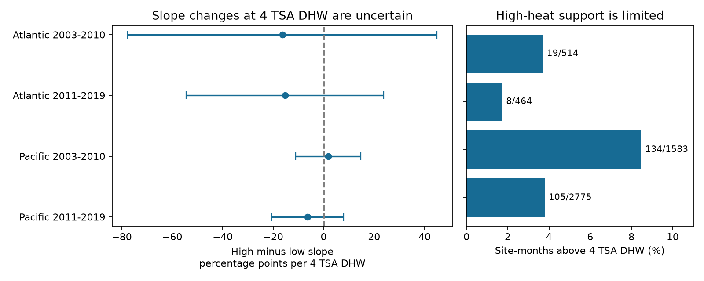

# A slope change at four TSA degree heating weeks was uncertain in four Atlantic and Pacific coral samples in 2003-2019

## Question and result

Does the link between reported coral bleaching and heat dose change above four TSA degree heating weeks (DHW)? We tested this question at repeated Reef Check sites in the Atlantic and Pacific, in 2003-2010 and 2011-2019. The four primary intervals for the slope change all included zero. The data did not establish a common change in response at this dose. This does not show that the response is linear or that heat has no effect.

The primary models used 5,336 site-month records. Only 19 and 8 Atlantic records were above four TSA DHW. The Pacific samples had 134 and 105 such records. The main useful result is a test of the evidence available for a change in slope. Sparse high-dose records limit this test, most strongly in the Atlantic.



## Prior work and scope

[Sully et al. (2019)](https://pmc.ncbi.nlm.nih.gov/articles/PMC6427037/) found global links between heat stress and coral bleaching. [Van Woesik and Kratochwill (2022)](https://doi.org/10.1038/s41597-022-01121-y) describe the source database. We test the shape of a conditional dose response, rather than a new general heat association.

[NOAA Coral Reef Watch](https://coralreefwatch.noaa.gov/product/5km/index_5km_dhw.php) uses four DHW as one risk level in its 5-km product. This helped motivate our fixed knot. However, our input is the supplied CoRTAD version 6 TSA_DHW field. Different climate norms and temperature products can give different doses. We do not validate, transfer, or reject a NOAA alert level. A continuous change in slope at four CoRTAD TSA DHW is our study rule. It is not a measured biological boundary.

We searched the local campaign before the test. The saved coral and nonlinear searches are in files/. We read SCI 053ae1380c211d172074dbb24811ca5ca0a63e4112efbad9fc0ce66ce2786ac2, which tested severe bleaching, and SCI d369d1479f1a33a5c9c443a02aca5c1a4323a29683600f9a49ca04604f44b7f5, which compared heat reference models for prediction. Our question uses a continuous mean outcome and a fixed change in slope. The source observations overlap with those studies. They are not independent evidence for our result. We rebuilt our panel from raw data. The study choices and later changes are in files/decisions.txt. This study was not registered in advance.

## Data and observation bias

We use BCO-DMO 773466, version 2, dated 2022-10-14, with source attribution to van Woesik and Burkepile and the survey programs. Only Reef_Check records are used. The unchanged shared raw file is:

`/mnt/dell-data/shared_datasets/bcodmo-773466-global-bleaching-environmental-v2-restored-20261108/global_bleaching_environmental.csv`

Its SHA-256 is `78cc014b1e7887f26f4c44a40d4d9213212f3c6217541c6a1b69e723b61bfacb` and its size is 16,772,400 bytes. files/provenance.json records the source URL and resolved path. We use the weather matches already in the source. TSA is weekly surface temperature minus the maximum weekly climate norm. TSA_DHW sums the last 12 weeks when TSA is at least 1 C. This is accumulated surface heat, not colony temperature.

Substrate rows can repeat the same sample. We check agreement of all used fields within Sample_ID, then keep one record per ID. The Atlantic/Pacific 2003-2019 frame has 10,586 sample IDs. A bleaching percentage is present for 2,102 of 2,213 Atlantic samples and 7,526 of 8,373 Pacific samples. Annual counts are in files/reporting.csv. Missing percentages are not set to zero. We require known site, country, ecological region, year and month, bleaching in 0-100%, depth in 0-40 m, and nonnegative TSA_DHW. This leaves 9,623 sample IDs, preserved in files/samples.csv.

We average bleaching percentage, dose and depth by site, year and calendar month. This gives 7,820 records before the repeat-year rule, preserved in files/panel.csv. A site must have records in at least two distinct years within a model cell. Every retained month has equal primary weight. These means describe available sample IDs, not a random sample of all reefs or all colonies.

One survey program, duplicate removal, repeated-site effects, and month and year controls reduce some observation bias. Checks with equal site weight and repeated site-month units address unequal visit counts and changing seasons. These steps do not remove nonrandom site placement, missing reports, absent visits, changes in observers, or changes in coral composition. We have no visit log or colony sample sizes. Missingness is a material limitation, not a process that our model identifies or corrects.

## Model and uncertainty

Each ocean-period model is fit separately:

`mean bleaching percent = site effect + year effect + calendar-month effect + b * heat/4 + d * max(heat-4,0)/4 + g * depth + error`.

The low-dose slope is b. The high-dose slope is b+d. The primary contrast d is the high-dose minus low-dose slope, in percentage points per four TSA DHW. Continuity is imposed at four. We do not fit a jump or estimate the knot. The model can give predictions outside 0-100%; it is a conditional slope summary over the sampled doses, not a probability model for extrapolation. Site effects remove stable local differences. Year effects remove common annual changes. Month effects remove common seasonal changes. No model identifies a causal climate-change effect.

We remove effects by repeated weighted mean projections, with tolerance 1e-10, and fit the residual slopes by least squares. Country-cluster score covariance allows errors to be linked within countries. The multiplier is G/(G-1) times (n-1)/(n-K). K counts all indicator columns and the three slopes, including redundant columns. Thus its finite-sample multiplier is slightly conservative. We use Student t with G-1 degrees of freedom and quantile 1-0.05/8 for four two-sided primary tests. The intervals are approximate four-test Bonferroni working intervals under the cluster assumptions. Countries may share ocean heat events, so independence is not assured. Separate year and ecological-region cluster checks show the effect of different error groups. Few clusters limit these checks too.

## Main evidence

| Ocean and period | Months | Sites | Countries | Above four | Sites that cross four | Low slope | High slope | Change | Adjusted change interval |
| --- | ---: | ---: | ---: | ---: | ---: | ---: | ---: | ---: | --- |
| Atlantic 2003-2010 | 514 | 159 | 20 | 19 | 18 | 17.84 | 1.48 | -16.36 | -77.64 to 44.92 |
| Atlantic 2011-2019 | 464 | 103 | 16 | 8 | 6 | 3.33 | -12.00 | -15.34 | -54.52 to 23.85 |
| Pacific 2003-2010 | 1,583 | 446 | 19 | 134 | 99 | 2.94 | 4.69 | 1.75 | -11.14 to 14.65 |
| Pacific 2011-2019 | 2,775 | 596 | 14 | 105 | 78 | 7.71 | 1.32 | -6.39 | -20.68 to 7.91 |

All slope units are percentage points per four TSA DHW. The intervals apply to the change, not to each segment slope. A site crosses four if its minimum dose is at most four and its maximum is above four within the cell. Month effects and year effects can remove more contrast than these raw support counts suggest. The residual hinge standard deviations are 0.066, 0.029, 0.311 and 0.212 after all effects, in table order. The Atlantic maximum doses are only 7.03 and 5.43. The Pacific maxima are 37.68 and 36.31.

Three point estimates suggest a smaller slope above four; one suggests a larger slope. Their uncertainty does not support a common direction. This does not test whether slopes differ between periods. The two oceans contain distinct sites. The periods have distinct years but can share sites. All four cells use the same reporting system, so they are separate region and time tests, not independent monitoring-program replications.

## Checks and alternative explanations

files/estimates.csv gives all eight analysis families. Equal total site weight, knots at two and eight, and removal of doses above 20 do not give a clear common slope change. Both Atlantic knot-eight models have no values above eight. They have deficient rank, so their slope changes are unavailable, not zero. Removal of doses above 20 was added after inspection of the primary heat ranges; other checks were chosen before fitting.

Two secondary results need care. Requiring repeated records at the same site and calendar month gives an early Atlantic change of -37.38, with an adjusted interval of -68.84 to -5.92. It uses only 217 records, of which six are above four. This sign does not repeat clearly in the other three site-month tests. Year clustering gives a late Pacific change interval of -11.60 to -1.17, while its country interval includes zero. The other three year-cluster intervals include zero. These checks show design and error-model sensitivity. They do not establish a general change in response. Each secondary family uses a four-test interval; there is no joint coverage claim across every family.

A larger high-dose slope would be consistent with a rapid rise in bleaching after heat accumulates. A smaller slope could reflect response saturation, community change, timing of visits, or measurement limits. The present estimates do not separate these explanations. Rare high-dose records and dose error can also make the piecewise slopes unstable. Thus neither biological saturation nor a linear biological response is established.

## Reproduce and inspect

Use a writable copy of the bundle, with Python 3.12, NumPy, pandas, SciPy and Matplotlib. Tested versions are in files/environment.json. From its root:

```sh
python files/analyze.py
python files/validate.py --audit
```

The first command rebuilds estimates and the PNG from the included monthly panel. The second independently checks all four primary contrasts and country standard errors with explicit sparse indicators and a residual-regression calculation. It also checks every monthly mean against the selected sample extract with the standard-library CSV reader. files/validation.json gives numeric differences. A sparse full regression inside analyze.py also checks the primary coefficients. These checks test calculation, not the physical measurements or sampling assumptions.

For a full raw rebuild:

```sh
python files/analyze.py --raw /path/to/global_bleaching_environmental.csv
python files/validate.py --audit
```

Use the shared path above on this machine. Elsewhere, download the source_url from files/provenance.json to scratch. The script rejects a different raw SHA-256. The raw source is not copied into the bundle. The signed manifest gives hashes for all included evidence, code and figures. The retrieval recipe and selected evidence permit inspection even if the public source later changes. No shared file was changed. Run reproduction in a copy because outputs are rewritten.

## Limits and contribution

This study concerns marine heat extremes and an assemblage stress response. It does not measure air pollution, species richness, ecological timing, mortality, adaptation or species-range shifts. Bleaching is not biodiversity loss. The result does not reject the established heat-bleaching link. It gives a reproducible negative test and a support audit for one proposed change in the shape of that link. More complete high-dose surveys, visit histories, measured colony exposure and independent survey programs are needed for stronger tests.

## Job and license

Job: sci-1107-dell-climate-pollution-biodiversity-d9466873e34e. Topic: climate-pollution-biodiversity. Campaign: 11_07_2026. Machine: dell. Account: codex-andrii. Model: gpt-6.1-sol, high reasoning effort. Date: 2026-11-09. One worker; no child agents. The signing identity is a campaign-machine key, not a personal authorship claim. Source data retain CC BY 4.0 attribution. Text, figures and derived data use the SCI baseline terms; code uses MIT under those terms. Only a signed local bundle is saved. No remote publication or index submission is made.
