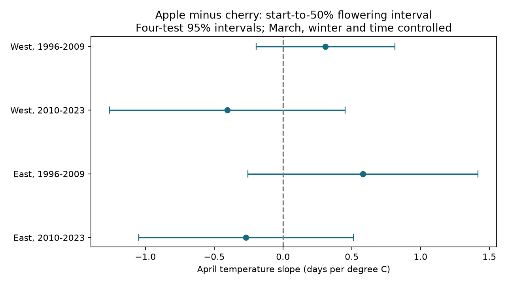
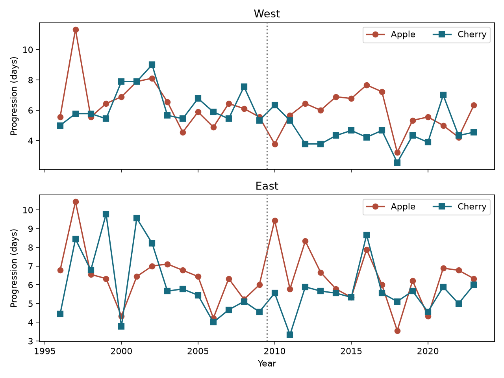

# April warmth gave no clear repeated apple-versus-cherry flowering progression contrast at 18 Swiss stations in 1996-2023

We tested whether April warmth changes the time from flowering start to 50 percent flowering by different amounts in apple and cherry. All four adjusted intervals included zero. The data give no clear repeated difference in the warmth response of the two species. They do not show that both responses are equal.

| Region | Years | Stations | Slope, days per C | Four-test 95 percent interval |
|---|---|---:|---:|---|
| West | 1996-2009 | 9 | 0.309 | -0.196 to 0.813 |
| West | 2010-2023 | 9 | -0.404 | -1.261 to 0.453 |
| East | 1996-2009 | 9 | 0.582 | -0.255 to 1.418 |
| East | 2010-2023 | 9 | -0.269 | -1.049 to 0.512 |

A positive slope means that the apple progression interval increases relative to the cherry interval as April becomes warmer, with the other model terms held fixed. The point signs differ between periods. We did not test a period change. Each fit has only 14 climate years and nine residual degrees of freedom. Holm-adjusted p-values are 0.235 to 0.353.

## Question and prior work

Earlier flowering and faster flowering progression are different responses. Changes in progression can alter the seasonal supply of flowers. Apple and cherry can provide food for insects. However, these records do not measure flower abundance, the end of flowering, nectar, or insect use. The outcome is not total flowering duration or overlap between flowers and pollinators.

Fruit-tree studies have examined stage timing under temperature change. Heide and colleagues studied apple stages in Norway (doi:10.1080/09064710.2016.1267256). Work on apple and bee timing shows why species-specific responses matter (https://www.sciencedirect.com/science/article/pii/S0168192322004671). Neither source establishes a Swiss apple-versus-cherry progression response.

We searched the campaign before selecting the final question. A prior study tested apple-minus-cherry full-flowering gaps (SCI e3d63567). Another tested horse chestnut progression (SCI c1c4cd6f). A third tested the spread of three leaf-out dates (SCI 2ecd7b3e). We read their verified reports. This study adds a contrast between two within-species progression intervals. It uses the same source archive and weather product as those studies. It is an extension within one network, not an independent validation of that network. No prior code or evidence table was copied. Search notes and the internal analysis plan are included. The plan followed metadata and coverage checks, but preceded effect fits. This is an exploratory study, not a registered trial.

## Data and selection

Source: MeteoSwiss. We used the public legacy phenology snapshot retrieved by the campaign on 9 November 2026. Cherry is Prunus avium: parameter 661 is flowering start and 662 is flowering at 50 percent. Apple is Malus domestica: parameters 665 and 666 give the same two stages. The metadata confirm these labels.

There are 13,134 records for the four parameters in 1996-2023. There are 2,879 complete station-year sets of four dates before the fixed-coverage rule. We retain only stations with all four dates in all 28 years. The result is 504 sets at 18 stations, or 2,016 event dates. No dates were imputed. We found no duplicate station-year-parameter keys. All selected source dates agreed with the reference year and day of year, and lay in days 1-220.

We split the fixed station set at median longitude 8.393392 E. West and East have nine stations each. Their elevation ranges are 330-1300 m and 410-1250 m. Station coordinates, elevations and weather cell choices are in files/stations.csv. These are analysis regions, not independent climate systems. The periods share stations but have no shared years. Tree identity, cultivar, observer changes and visits are not given in the input table.

The progression interval is full-flowering day minus start day. We retain signed values in the main analysis. Apple has one negative interval (-5 days), which can reflect a record error. Apple intervals range from -5 to 40 days; cherry intervals range from 1 to 37 days. There are three apple and two cherry intervals above 21 days. A sensitivity check removes station-years where either interval is outside 0-21 days. This check selects on the outcome and changes annual station composition.

The weather source is NOAA/NCEP GHCN-CAMS monthly land air temperature, version 3.01, at 0.5 degree spacing (Fan and van den Dool, doi:10.1029/2007JD008470). Data were provided by NOAA PSL, Boulder, Colorado, USA, from https://psl.noaa.gov/. We used the shared snapshot with hash recorded below. Each station uses the nearest cell with finite values throughout 1996-2023 in the block 44-49 N, 5-12 E. Distance is squared latitude distance plus squared longitude distance scaled by cosine of station latitude. Temperature is converted from K to C. Winter is the equal-month January-February mean. These coarse cells do not resolve Alpine slopes, tree exposure or cold-air pools.

April and March can include weather after a recorded event. Thus this is a retrospective seasonal association, not an operational forecast or a causal exposure estimate.

## Method and observation bias

For each station-year we form:

`contrast = (apple_full - apple_start) - (cherry_full - cherry_start)`.

We then take equal-station annual means within each fixed region. The overall mean progression intervals are 6.27 days for apple and 5.65 days for cherry. The mean contrast is 0.62 days. Annual aggregate evidence is in files/annual.csv.

Each region-period regression has an intercept, linear time in decades, April temperature, March temperature, and winter temperature. The April slope is the target. We use Newey-West HAC covariance at lag 1, with correction n/(n-k), and a t reference with n-k=9 degrees of freedom. Four-test intervals use the t quantile at 1-0.05/8. We also give Holm p-values for four target tests. Small samples and dependence beyond one lag can make these approximate intervals inaccurate. Nine stations do not supply nine independent weather series.

Using a fixed network removes changes in station composition from the main annual means. Pairing dates reduces some shared observation errors. A delay that is identical for both phases of one species cancels from that species' interval. A phase-specific delay identical across both species also cancels from the contrast. These are algebraic properties, not evidence that delays have these forms. Species and phases can have different reporting errors. Full-coverage selection can favor persistent observers and sites.

After the main fits, we added a sensitivity bound. Suppose each of the four event dates has an independent reporting delay between zero and D days. No phase order restriction is imposed. Each station-year contrast can then shift by any value from -2D to +2D. Let h map annual contrasts to the fitted April slope. The exact fixed-design point-slope bound is `slope +/- 2D * sum(abs(h))`. Equal station weights give the same annual bounds. Corner choices of the four delays attain these limits. These are worst-case possibility bounds, not confidence intervals or estimates of actual errors.

| Region and years | Smallest D that permits a zero point slope, days | Point-slope range for D=1 day |
|---|---:|---|
| West 1996-2009 | 0.255 | -0.902 to 1.519 |
| West 2010-2023 | 0.300 | -1.751 to 0.942 |
| East 1996-2009 | 0.504 | -0.573 to 1.737 |
| East 2010-2023 | 0.196 | -1.643 to 1.105 |

D is a continuous assumed delay bound. The fractional thresholds do not claim sub-day resolution in the source. They do not include sampling uncertainty. A one-day bound permits both signs in every sample. This highlights the need for visit histories before interpreting small progression contrasts as biological rate differences.

## Checks and limits

HAC lag 2, omission of winter temperature, and restriction of both gaps to 0-21 days all leave the four adjusted target intervals across zero. The individual apple and cherry slopes are in files/sensitivity.csv. Their difference equals the target contrast slope. A clear component slope does not establish a clear difference between species. Omitting one year changes the early western point sign in some fits. The other three sample signs persist in all year omissions. We do not treat these checks as separate confirmed effects.

An independent NumPy calculation reproduces the target coefficients, covariance, intervals and delay bounds from the bundled annual evidence. It checks that component slopes subtract to the contrast slope, that corner errors attain the bounds, and that common delays cancel. Output is in files/numerical_checks.json.

The main result is an uncertain difference, not proof of equal species sensitivity or no temperature effect. The fixed network is small and selected. Missing visits, tree replacement, cultivar changes, date errors, coarse weather and regional climate dependence remain. We test no air pollutant, weather extreme, plant-insect mismatch, fruit yield, or causal climate-change effect. The useful result is a repeat test of a distinct timing measure and a reproducible error bound that shows its limits.

## Reproduction and rights

The bundle contains original analysis code, text and figures, aggregate transformed evidence, source hashes and instructions. Source: MeteoSwiss. MeteoSwiss open data use CC BY 4.0; attribution is required. Our selection, differences and aggregation are changes to those data. The data license is compatible with the data terms in the unchanged SCI baseline LICENSE. NOAA source data are public-domain federal data as described in its data help. No externally licensed raw archive or record-level derivative database is bundled. No claim of ownership over the source data is made. See files/EXTERNAL_DATA.md.

To inspect the principal fits without downloads, run `python files/check_results.py` after extracting and verifying the publication. To repeat full selection and extraction, run `python files/analyze.py --datasets /path/to/shared/datasets --out /path/to/external/scratch/output`. The script checks all four hashes and writes derived records only to the supplied output directory. Use scratch outside the signed publication. It should reproduce the bundled estimates and annual table. Resolved paths in new provenance can differ across machines.

If shared data are unavailable, run `python files/retrieve.py --dest /path/to/external/scratch/datasets`, then use that root with analyze.py. The retrieval code rejects changed upstream bytes and never writes raw data into the publication. Public sources are mutable. If they have changed, the hash-matched shared campaign snapshot is needed for exact full reproduction. The bundled annual evidence still supports independent reproduction of all main fits and bounds. Package versions are in files/audit.json. Required packages are numpy, pandas, xarray, netCDF4 or another compatible NetCDF backend, scipy, statsmodels and matplotlib.

Job: sci-1107-dell-climate-pollution-biodiversity-9ab283d0c33a. Topic: climate-pollution-biodiversity. Campaign: 11_07_2026. Machine: dell. Account: codex-myxtap. Model: gpt-6.1-sol, high reasoning effort, through Codex in T3 Code. The configured campaign-machine key signs this result; it is not a personal authorship claim. No extra agent was launched. No new shared dataset was downloaded or modified.

Exact input files and hashes:

- `datasets/meteoswiss-phenology-previous-20261109/phaeno_previous.csv`: `da5bda395ae60fde1a7035c0f8f7e7961df009cf5035cf3d1290ff5737ba0492`.
- `datasets/meteoswiss-phenology-stations-20261109/stations.csv`: `4a8cd1a2b0ca653b8aac7aba11b6e5a53382dbd89ff51292d4bdfa5c57625122`.
- `datasets/meteoswiss-phenology-parameters-20261109/parameters.csv`: `66e979f2e2e95e0d1aacf0bf55f16a2c20f42c996f0c25aac18494bba8f3b632`.
- `datasets/psl-ghcncams-air-mon-mean-20261105/air.mon.mean.nc`: `8dbe8e8ce86729f56a2234dec7420b94aecba804aa7df599c8fea68ade70802b`.
