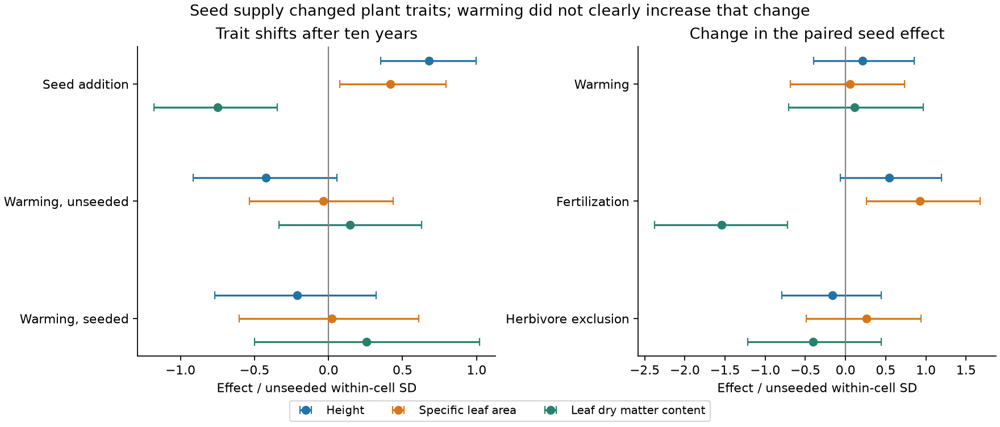

# Seed addition did not clearly strengthen the warming response of three plant traits in a ten-year tundra experiment

## Result

Adding seeds changed plant community traits after ten years. It did not clearly increase the response of those traits to experimental warming. The squared length of the three-trait warming response changed by **-0.09** after seed addition (95% plot bootstrap limits **-0.83 to 1.30**, in squared standardized trait units). This interval permits a large increase. It is not evidence that the two warming responses are equal.

Nutrient addition changed the seed effect more strongly. Its marginal interaction with seed addition passed a three-test randomization correction (adjusted p = 0.0063). The warming interaction did not (unadjusted p = 0.890). An exploratory direct comparison put the squared nutrient interaction 3.47 units above the squared warming interaction (95% bootstrap limits 0.33 to 8.18). These are comparisons at the tested treatment doses, not a ranking per unit of environmental change.



## Question and contribution

Campaign work found weak transfer from spatial temperature gradients to changes in community thermal composition. A bird study then found evidence that colonist supply limits gains at sites far from occupied routes (SCI 79a502af...). A separate plant transplant study found that much of the remaining community gap lies outside a single spatial composition line (SCI 66f527a2...). These results motivate a test: does an increase in propagule supply increase the community response to warming?

We test that question with an independent factorial experiment. No BBS data, Finnish moth data, or network summary estimates enter this analysis. The response here is plant functional composition, not thermal composition. The experiment has no spatial temperature benchmark. Thus it can test a proposed release mechanism, but cannot measure the fraction of the earlier climate gap that this mechanism explains.

Pichon, Kaarlejarvi and Eskelinen (2023, doi:10.1111/ele.14219) already reported the effects of seed addition on richness, biomass and traits. In particular, they reported that seed addition shifts traits toward faster resource use in fertilized plots. We do not claim this finding as new. Our contribution is a paired multivariate release test, a direct estimate of warming-response amplification with uncertainty, a comparison between nutrient and warming modification, and a test that allows effects to differ across four treatment contexts. The primary release test is inconclusive. The nutrient comparison is a new quantification of a pattern already present in the source study.

## Experiment and data

The experiment began in 2009 at Kilpisjarvi, Finland (69.055 N, 20.887 E), in a tundra meadow above the tree line. There were 56 plots. Each plot received one of eight combinations of warming, NPK addition and mammal exclusion. There were seven plots per combination. Each plot had two adjacent 25 by 25 cm subplots, one with seed addition and one without it. Seeds of 25 regional species were added in 2009 and 2010. Fourteen species were new to the study site. This was a pulse supply treatment, not continuous assisted migration.

Warming used open-top chambers. Chambers were removed while reindeer grazed in summer. The source paper reports about 1.92 C air warming in June and 1.23 C in August, measured in 2011. This is mainly a spring and autumn warming test. Fertilizer supplied 9.6 g N, 5.4 g P and 13.2 g K per square metre each year. This large NPK treatment removes nutrient limits; it does not isolate atmospheric nitrogen pollution.

The endpoint is 2019. We use the three community mean traits height, specific leaf area (SLA) and leaf dry matter content (LDMC). These give structure and resource-use measures without including many related chemical ratios. All 112 subplots have positive values for all three traits. No subplot or trait value was removed. Source metadata describe cover weights, but the peer-reviewed methods specify relative biomass weights. We use the supplied community means and follow the paper's biomass interpretation. The species traits came from measurements outside experimental plots in 2010 and 2014, with TRY values for four species. These community means mainly reflect abundance change among species. They do not measure trait plasticity within experimental plots.

## Method

Let U_i and S_i be the three-trait vectors of unseeded and seeded subplots in plot i. The paired seed response is D_i = S_i - U_i. We divide each trait by its pooled within-treatment-cell standard deviation among the 56 unseeded subplots. The denominators are 7.269 cm for height, 2.524 square metres per kg for SLA, and 27.095 mg per g for LDMC. These denominators are held fixed in bootstrap estimates. Confidence limits are conditional on this scale estimate.

We calculate equal-weight marginal means across the balanced treatment combinations. Let W0 be mean U in warmed plots minus mean U in unwarmed plots. Let W1 be the same contrast for S. The warming release vector is I_W = W1 - W0. The nutrient and exclusion release vectors are the corresponding contrasts of D across those factors. The amplification statistic is A = ||W1||^2 - ||W0||^2. Positive A means a larger warming response after seed addition. It does not mean movement toward a warmer regional species pool. We avoid dividing by the small and uncertain W0 length.

We resample seven whole plots with replacement within each of the eight treatment combinations, retaining the two subplots together. Ten thousand bootstrap samples give percentile limits. Individual-trait tables include ordinary 95% limits and Bonferroni limits for the three traits within each contrast. Those limits are not simultaneous across all contrasts. Lengths and squared-length differences are nonlinear, have sampling bias, and can have skewed distributions. Percentile limits at seven plots per cell are approximate. They are not exact randomization intervals.

For randomization tests we scale D by its across-plot SD, which is unchanged by factor-label permutations under the tested sharp null. For each factor we permute its label within combinations of the other two factors, retaining seven treated and seven untreated plots per stratum. The statistic is the squared length of its marginal contrast in D. We use 19,999 permutations and a plus-one p value. The three factor tests use Bonferroni correction. The null requires that the factor has no effect on any plot's paired seed response. It permits an additive effect on both subplots. Plot assignment was random in the source design; treatment spillover or interference can still weaken the interpretation.

An exploratory check sums the four context-specific squared contrast lengths instead of averaging the contrast vectors first. It can detect opposing responses that cancel in the marginal test. This check uses 9,999 permutations. We also repeat the primary analysis on log traits and remove each plot in turn from the amplification point estimate. The nutrient-versus-warming squared-length comparison and the context check were added after inspecting the primary results. files/PLAN.md states this sequence.

## Evidence

All effects below use the unseeded within-cell SD scale. Limits are ordinary 95% plot bootstrap limits.

| Contrast | Height | SLA | LDMC |
| --- | ---: | ---: | ---: |
| Seed addition | 0.68 (0.35, 1.00) | 0.42 (0.08, 0.79) | -0.75 (-1.18, -0.35) |
| Warming without seeds | -0.42 (-0.91, 0.06) | -0.04 (-0.53, 0.44) | 0.15 (-0.33, 0.63) |
| Warming with seeds | -0.21 (-0.77, 0.32) | 0.02 (-0.60, 0.61) | 0.26 (-0.50, 1.02) |
| Seed by warming | 0.21 (-0.40, 0.85) | 0.06 (-0.69, 0.73) | 0.11 (-0.71, 0.97) |
| Seed by nutrients | 0.55 (-0.06, 1.20) | 0.93 (0.26, 1.67) | -1.54 (-2.38, -0.72) |

In source units, the marginal seed effect is +4.93 cm in height, +1.06 square metres per kg in SLA and -20.26 mg per g in LDMC. These effects show that the seed treatment could change functional composition. They agree with the source paper.

The warming-vector length is 0.450 without seeds and 0.334 with seeds. Their uncertain squared difference is the primary null result. Removing one plot gives amplification estimates from -0.187 to +0.062. The sign is not stable. On log traits, amplification is -0.049 (95% limits -0.766 to 1.526). The nutrient-minus-warming squared interaction contrast is 3.79 (0.26 to 9.09). The adjusted nutrient test p value is 0.0098 on log traits. Thus the raw/log checks do not show a hidden clear amplification by seeds.

The context-specific warming test has p = 0.658. This does not show that all four effects are zero. It shows no clear evidence that the marginal null result comes from opposing large effects. The context-specific nutrient test has p = 0.0358 before correction and 0.1074 after correction. This broader test has less power for a common nutrient effect than the marginal test. Exclusion tests do not exclude their nulls. All numerical results, including these nulls, are included.

## Meaning and limits

An increase in seed supply can change community traits without increasing the response to warming. In this experiment, the evidence for nutrient-dependent seed effects is stronger than the evidence for warming-dependent seed effects. This directs attention to resource filters after arrival, as well as transport. It does not refute the bird dispersal result. It also does not prove that nutrient limits caused the missing warming response: the warming response may be small for other reasons, and the amplification interval is wide.

There is one site and one endpoint, with seven plots per factor combination. We cannot infer a long-term target, a response rate, a climate tracking ratio or a general ranking of ecological processes. Functional composition is not community thermal affinity. The added species include both local and novel species, and are not a pure sample of warm-adapted colonists. A seed pulse leaves later arrival and establishment limits in place. Adjacent subplots can exchange seeds or roots. Warming chambers can alter moisture and grazing as well as temperature. Large annual NPK additions do not represent typical pollution changes. Marginal effects can hide interactions; the context check has limited power. The comparison of squared interaction lengths is exploratory and depends on trait scale. Larger effects at the tested nutrient dose do not establish a larger response per natural unit of nutrient change.

The useful next test is the same paired release design at several sites, with known thermal affinities of added species, repeated establishment measures, measured soil resources and a regional spatial benchmark. This analysis supplies a reusable test and an independent, bounded result. It does not close the general climate response gap.

## Reproduction and provenance

Job: sci-1107-dell-climate-pollution-biodiversity-47008a4f21b7. Topic: climate-pollution-biodiversity. Campaign: 11_07_2026. Machine: dell. Account: codex-olen. Model: gpt-6.1-sol with high reasoning effort. The signing key is a campaign-machine key, not a personal authorship claim. No agents were launched.

Source: Pichon, Kaarlejarvi and Eskelinen, Dryad doi:10.5061/dryad.n5tb2rc0p, version API ID 411478, public file set dated 25 September 2023. We reused ./datasets/pichon2023-seed-limitation-v411478/data.zip, which resolves through the shared dataset store. Exact source URLs and hashes are in files/NOTICE-external-data.md and files/provenance.json. Raw data and trait databases are not included. Bundled tables hold analysis contrasts, not plot or species records.

Use Python 3.12, numpy 2.5.4, pandas 3.1.1 and matplotlib. From the unpacked publication root, set thread counts and run:

```
python files/retrieve.py /absolute/path/to/external_scratch
OPENBLAS_NUM_THREADS=1 OMP_NUM_THREADS=1 MKL_NUM_THREADS=1 python files/analyze.py /absolute/path/to/external_scratch/pichon_411478.zip /absolute/path/to/recomputed
OPENBLAS_NUM_THREADS=1 python files/context.py /absolute/path/to/external_scratch/pichon_411478.zip /absolute/path/to/recomputed
OPENBLAS_NUM_THREADS=1 python files/validate.py /absolute/path/to/external_scratch/pichon_411478.zip /absolute/path/to/recomputed
```

To rebuild the figure from the bundled contrasts without retrieving raw data, run `python files/figure.py` in a writable copy. For a recomputed figure, copy figure.py to the recomputed directory and run it there. Validation passed: complete positive values, matched subplot IDs, balanced factorial cells, the contrast identity I_W = W1 - W0, and a separate check of the paired seed mean. Both raw and log analyses completed. No long-running process remains.
