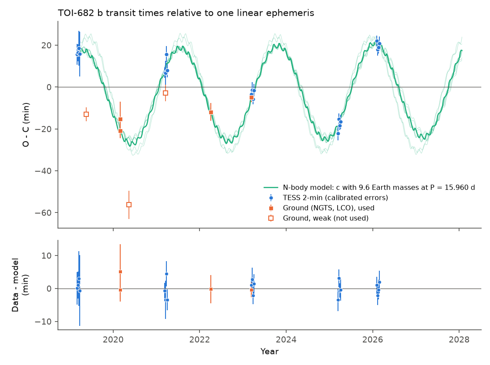
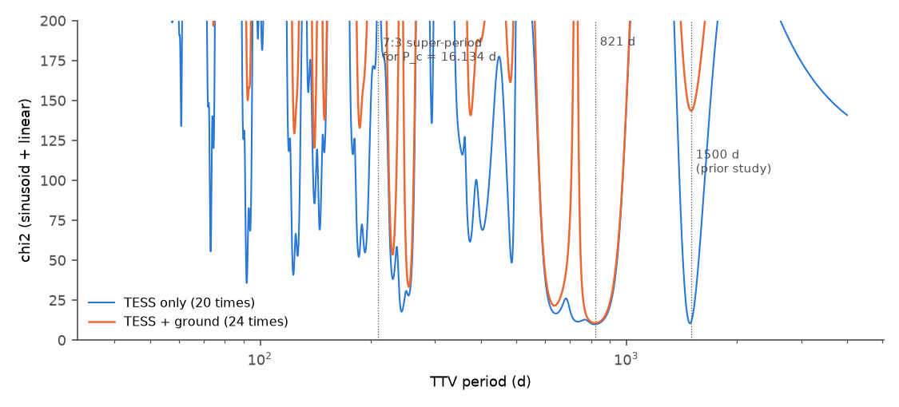
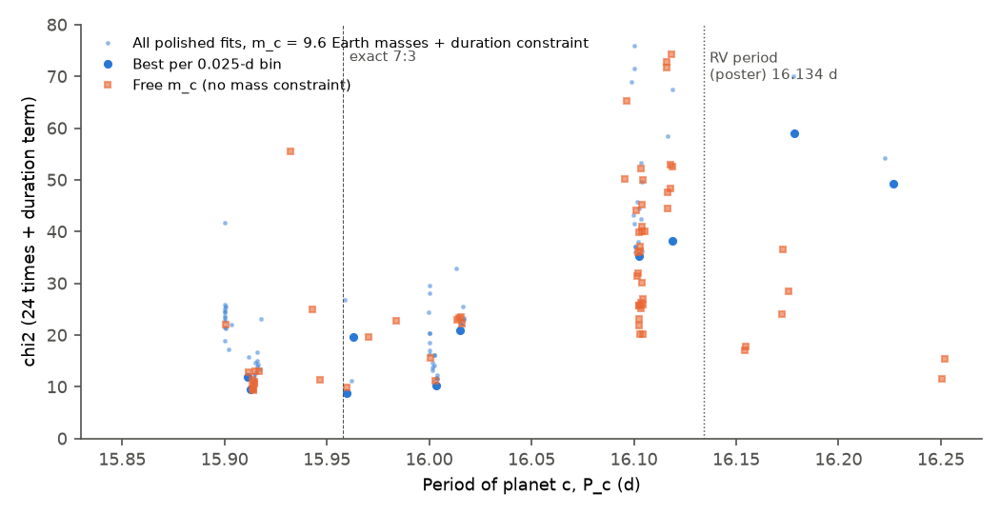

# TOI-682 b: TESS and ground transit times from 2019 to 2026 show an 821-day timing variation of 22 minutes; a coplanar planet with the radial-velocity minimum mass explains it only with an orbital period of 15.91 to 16.00 days, not 16.13 days

Job: sci-1107-dell-astronomy-b00fa1be830d. Topic: astronomy. Machine: dell.
Model: Claude Opus 5.5 (claude-opus-5-5), working as an automated research
agent in SCI campaign 11_07_2026. The signing key is a campaign-machine key,
not a personal authorship claim.

## Summary

A prior campaign study (sci:sha256:302c8280...) found a large transit timing
variation (TTV) of the sub-Neptune TOI-682 b (HD 97260 b, P = 6.84 d) in TESS
2-minute data. It fitted a 1,500-day sinusoid. TESS observed the star only in
five sectors, one per season, so the TTV period was aliased. We did these steps:

1. We timed all 20 TESS transits again with one transit shape and calibrated
   the errors with 61 injected transits.
2. We timed 7 ground-based light curves from ExoFOP-TESS (NGTS, LCO, PEST,
   2019-2023) with the same shape. Four have a clear transit.
3. We tested the TTV period with a sinusoid periodogram, leave-one-out tests,
   and two-planet N-body models (TTVFast).
4. We measured the orbital eccentricity of b from the transit duration and the
   stellar density (photo-eccentric effect), independently of radial velocities (RVs).

Main results:

- **The TTV is real.** Two ground telescopes timed the same transit on
  2020-02-29 UT (NGTS night of 2020-02-28 and LCO; NGTS -20.8 +- 3.6 min, LCO -15.3 +- 8.3 min relative to the
  linear ephemeris). On 2023-03-13 LCO and TESS timed the same transit
  (-4.9 +- 2.3 and -3.4 +- 2.3 min). The TESS clock has no sector-wide offset
  larger than 1 min in the sectors that we use (check with 33-144 other TOIs
  per sector). A linear ephemeris gives chi2 = 482 for 22 degrees of freedom.
- **The TTV period is 821 days, not 1,500 days.** TESS times alone allow 819 d
  (chi2 = 9.9) and 1,490 d (chi2 = 10.5) equally. With the ground times, a
  sinusoid with P_TTV = 821 d (797-847 d, delta chi2 = 1) and semi-amplitude
  22.4 +- 1.1 min gives chi2 = 10.7 for 20 dof. The 1,500-day solution gives
  chi2 = 143.6. This rejection depends mostly on one LCO light curve
  (2022-04-05); without it, delta chi2 is 7.2. 821 d is the best period in all
  leave-one-out tests (817-845 d).
- **Planet b is eccentric.** The transit (T14 = 4.37 h) is longer than a
  circular orbit allows for the measured stellar density (1.06 +- 0.09 solar).
  This gives g = (1 + e sin w)/sqrt(1 - e^2) = 1.28 (+0.08/-0.05) and
  e_b >= 0.18 (97.5% lower limit). This supports the RV eccentricity
  (e_b = 0.41, unrefereed poster). The duration does not change from 2019 to
  2026 (slope -0.63 +- 0.38 min/yr).
- **Timing alone does not identify the perturber.** A blind N-body scan finds
  fits with chi2 = 10-12 for perturber periods from 10 to 39 d.
- **Test of the RV planet c.** We fixed c at its RV minimum mass (9.6 Earth
  masses), with a coplanar orbit, and added the duration constraint on e_b.
  P_c = 15.91-16.00 d fits well (best chi2 = 8.8 for 24 times and one
  duration term, e_b about 0.25). P_c from 16.08 to 16.18 d (around the
  reported 16.134 d) gives best chi2 = 35 (p about 0.004 for 16 dof with
  our calibrated errors). A free mass at
  16.08-16.18 d gives chi2 = 17 only with m_c = 3.2 Earth masses, which is
  below the RV minimum mass. Thus the RV planet explains the TTV if its period
  is 0.13-0.22 d shorter than the preliminary poster value. Otherwise another
  planet or a non-coplanar orbit is necessary.
- **Forecast.** All 48 acceptable N-body solutions and the sinusoid predict
  that transits occur up to 24 min from a linear ephemeris in 2026-2029:
  near -24 min in early 2027 and near +21 min in spring 2028. The 5-95% model
  spread is at most 19-22 min to the end of 2027. `files/results/forecast.csv`
  gives the predicted times for planning, for example of JWST or Ariel
  transit observations.

A profile over P_c (Figure 6; m_c = 9.6 Earth masses, coplanar, duration
constraint on e_b) has a valley from 15.91 to 16.00 d (best chi2 = 8.8-10.3).
The best chi2 rises to 19 at 15.90 d and to 21 at 16.015 d, and it is 35 or
more in every window from 16.05 to 16.25 d.

## Data

| Data | Source | Use |
|---|---|---|
| TESS SPOC 2-min PDCSAP and SAP flux, sectors 9 (2019), 36 (2021), 63 (2023), 90 (2025), 100 (2026) | MAST (public) | 20 transit times, shape, durations, injected controls |
| Ground light curves: NGTS 2019-05-17 and 2020-02-28; LCO-CTIO 1 m 2020-02-29 (y), 2021-03-18, 2022-04-05, 2023-03-13 (zs); PEST 0.3 m 2020-05-14 (Rc) | ExoFOP-TESS (TFOP SG1 uploads) | 7 transit times (4 used) |
| Stellar mass 0.969 Msun, radius 0.966 Rsun, mass of b 12.3 Earth masses, RV planet c (P = 16.134 d, m sin i = 9.6 Earth masses), e_b = 0.411 | Quinn et al. 2021 poster, Zenodo 5131353 | fixed values and comparison |
| Gaia DR3 FLAME radius 0.972 (0.952-0.992) Rsun, Teff 5314 K | VizieR I/355/paramp | stellar density check |
| 81,821 TESS transit times of 1,388 TOIs | prior SCI study 302c8280 | sector clock check; comparison of TOI-682 b times (rms difference 1.9 min) |

We do not redistribute the raw light curves. `files/code/get_inputs.sh`
downloads them into a scratch folder. `files/data/input_sha256.txt` gives
their SHA-256 values. See `files/EXTERNAL_DATA_NOTICE.md` for sources,
observers, terms and required acknowledgements.

## Method

**TESS times** (`code/tess_times.py`). We used QUALITY = 0 cadences and
windows of +-0.45 d around each transit, each normalised by its sector median.
We fitted one quadratic limb-darkened shape (batman; Rp/R*, circular-equivalent
a/R*, b, q1, q2) to all 20 windows, with a quadratic baseline per window,
and iterated with the times three times. Then we timed each transit with this
fixed shape and a free quadratic baseline (profile chi2 over mid-time, delta
chi2 = 1 after reduced-chi2 rescale, times a red-noise factor). We also timed
the SAP flux, and linear and cubic baselines. We injected the shape at
orbital phases 0.25, 0.4, 0.6 and 0.75 (61 control transits) and timed them
with the same code. The normalised control errors have a standard deviation
k = 1.59 (bootstrap 1.35-1.77). We multiplied all TESS errors by k.

**Ground times** (`code/ground_times.py`). We used the relative flux columns
of the uploaded tables (NGTS FluxRatio, AIJ rel_flux_T1, PEST flux), removed
5-sigma outliers and binned NGTS to 2 min. The shape and depth are those of
TESS. Each telescope has its own baseline. We tried four baselines (linear or
quadratic in time, with or without airmass) and kept the lowest BIC. The error
is the profile error times the red-noise factor, added in quadrature to half
of the time range of baselines within delta BIC = 6. The search range is
+-90 min around the reference ephemeris, and one contact point must be in the
data with 30 min margin. A night is used only if the transit improves chi2 by
20 or more. Three nights are weak and not used: NGTS 2019-05-17 (egress only,
delta chi2 = 6), PEST 2020-05-14 (2.7) and LCO 2021-03-18 (7.1). A free depth
does not change the used times by more than 1 min.

**Periodogram** (`code/periodogram.py`, `code/periodogram_checks.py`).
Weighted fit of a linear ephemeris plus a sinusoid over 20,000 log-spaced
periods from 40 to 4,000 d.

**Photo-eccentric test** (`code/shape_mcmc.py`). emcee MCMC (24 walkers,
2,500 steps, 800 burn-in) of the shape with the times fixed. The
circular-equivalent density rho_circ = 3 pi (a/R*)^3 / (G P^2) is compared
with rho_star from M = 0.969 +- 0.05 Msun and R = 0.970 +- 0.02 Rsun.
g = (rho_star/rho_circ)^(1/3) (Dawson & Johnson 2012).

**N-body models** (`code/nbody.py`, `code/fit_ttv.py`, `code/fit2.py`).
TTVFast (step P_b/40; tested against P_b/100 to 0.3 min at e = 0.4) with the
star, b (12.3 Earth masses) and one more planet, coplanar and edge-on.
Free parameters: P_b, T0_b, sqrt(e)cos w and sqrt(e)sin w of both planets,
m_c, P_c and the mean longitude of c (9 parameters for 24 times). The fit has
two stages: (A) 15,000-40,000 random draws per period range, with the linear
ephemeris of b solved by weighted least squares, then (B) least-squares
polish of the best 2-40 draws. We reject starts whose orbits come within 5%
of crossing. Runs:
`rv` (P_c 15.9-16.4 d, free mass); `fixed16.134` (16.084-16.184 d);
`scan` (60 log cells from 7.5 to 40 d, 5,000 draws and 2 polishes per cell);
hypothesis runs with m_c = 9.6 Earth masses and a Gaussian term on
g (1.28 +- 0.07) in P_c windows from 15.85 to 16.25 d.
Mean (transit-to-transit) periods agree with the osculating start values to
0.002 d (`results/mean_periods.csv`).

**Forecast** (`code/predict.py`). Linear ephemeris, sinusoid with its
parameter covariance, and the 48 N-body solutions within delta chi2 = 6 of
the best free fit.

## Results

**Figure 1.** O-C of TOI-682 b relative to one linear ephemeris
(P = 6.8392948 d, T0 = 2460037.26038 BJD_TDB). Blue: TESS (errors scaled by
k = 1.59). Orange filled: ground transits used in fits. Open: weak ground
transits (not used). Green: best N-body model with c at the RV minimum
mass (9.6 Earth masses) and P_c = 15.960 d (thin lines: other solutions of the
same run within delta chi2 = 4). Lower panel: residuals from this model.

**Figure 2.** Ground light curves (grey: unbinned; dots: 10-min bins), divided
by the fitted baseline. Black: transit model at the fitted time. Blue dashed:
model at the linear-ephemeris time.

**Figure 3.** chi2 of a sinusoid plus linear ephemeris against the TTV
period. TESS alone (blue) cannot separate 819 d and 1,490 d. With the ground
times (orange), 821 d is preferred by delta chi2 = 133.

**Figure 4.** Best chi2 of two-planet N-body fits against the period of the
perturbing planet. Many periods from 10 to 39 d fit equally well. The scan
uses only 2 polished starts per cell, so high values in some cells can be
search failures; low values are real solutions.

**Figure 6.** Best chi2 against P_c for c with the RV minimum mass
(9.6 Earth masses, coplanar) and the duration constraint on e_b (blue), and for
free m_c (orange). Each 0.05-d window has 10-16 polished starts. The fits
prefer 15.91-16.00 d, near the exact 7:3 ratio (15.958 d). Near the poster
period (16.134 d) the best chi2 is 35-38. Free-mass fits above 16.05 d need
m_c = 1.7-5.5 Earth masses (below the RV minimum mass) or 25 Earth masses or
more.

**Figure 5.** Forecast to 2029. Black: sinusoid (grey band: 1 sigma). Green
band: 5-95% range of 48 N-body solutions with different perturber periods
(10-39 d) and masses.

### Key numbers

| Quantity | Value |
|---|---|
| TESS transits / ground transits used | 20 / 4 (7 timed) |
| TESS error scale k (61 injected controls) | 1.59 (1.35-1.77) |
| SAP minus PDCSAP time, rms | 2.3 min |
| Linear ephemeris chi2 (all used / TESS only) | 482 / 22 dof; 418 / 18 dof |
| Sinusoid: P_TTV, semi-amplitude, chi2 | 821 d (797-847), 22.4 +- 1.1 min, 10.7 / 20 dof |
| chi2 at 1,500 d (all / without LCO 2022-04-05) | 143.6 / 17.9 (best 10.7) |
| Rp/R* | 0.0333 (0.0329-0.0337) |
| T14 | 4.37 (4.35-4.39) h |
| g = (1 + e sin w)/sqrt(1 - e^2) | 1.28 (1.235-1.358) |
| e_b lower limit (84% / 97.5%) | 0.21 / 0.18 |
| T14 change 2019-2026 | -0.63 +- 0.38 min/yr |
| Best free N-body fit (P_c 15.9-16.4 d) | chi2 = 9.4, P_c = 15.914 d |
| m_c = 9.6, P_c 15.91-16.00 d, with duration term | chi2 = 8.8-10.3, e_b about 0.25 |
| m_c = 9.6, P_c 16.08-16.18 d, with duration term | chi2 = 35.3 |

## Interpretation

The 821-day TTV period agrees with the super-period of the 7:3 commensurability
with b for P_c = 15.914 d or 16.003 d (1/|7/P_c - 3/P_b|). For the reported
P_c = 16.134 d this super-period is 209 d, and the periodogram disfavors
periods of 200-270 d (chi2 >= 33.4). TTVs near a fourth-order commensurability
need eccentric orbits, and b is eccentric (e_b >= 0.18 from the duration).
The simplest explanation is that the non-transiting RV planet c is the
perturber with a period near 15.9-16.0 d and P_c/P_b = 2.327-2.334, very near
7:3. The poster gives no period error. A re-analysis of the RVs with the TTV
period range is a direct test. Our N-body models do not identify the
perturber by themselves: other periods from 10 to 39 d also fit the 24 times.

## Limitations

- 24 times in 6 seasons for 9 model parameters. N-body solutions are strongly
  degenerate in mass and eccentricity. We do not give a TTV mass of c.
- The search is a random-draw plus local-polish search, not a complete
  posterior. Under heavy shared-CPU load we used few polished starts. High
  chi2 values in single cells can be search failures. The conclusion about
  16.08-16.18 d uses 16 polished starts in that window (and 10 per 0.05-d
  window in the profile); a wider search could find a better solution there.
- Coplanar, edge-on orbits only. A mutual inclination changes the effective
  mass and the TTV. We used preliminary, unrefereed RV values without errors
  for P_c and the stellar mass. We did not have the RV data.
- The rejection of the 1,500-day period depends mostly on one LCO light curve.
  Ground times depend on the baseline model; we include the baseline spread in
  the errors. We did not use the 2019 NGTS egress, the 2020-05-14 PEST light
  curve, or the 2021-03-18 LCO light curve (weak detections).
- TESS errors are scaled by k = 1.59 from only 61 control transits; with
  k = 1, all chi2 values increase (sinusoid chi2 = 26.1) but the period
  preference stays (1,500 d: chi2 = 180.6).
- The photo-eccentric limit assumes the stellar density of the poster and
  Gaia radius, and no strong dilution.

## Reproduction

1. `bash files/code/get_inputs.sh SCRATCH` (downloads 5 TESS files, 12 ExoFOP
   files and the poster into SCRATCH). Check with
   `cd SCRATCH && sha256sum -c .../files/data/input_sha256.txt`.
2. Python 3.12 environment: `uv venv --python 3.12 venv; uv pip install -r files/code/requirements.txt`
   (numpy 2.5.4, scipy 1.18.1, pandas 3.1.1, astropy 8.0.2, matplotlib 3.11.2,
   batman-package 2.5.3 with setuptools, emcee 3.1.6, ttvfast 0.3.0, rebound 5.2.2).
3. `export TOI682_EXT=SCRATCH TOI682_OUT=OUTDIR`, then in `files/code/`:
   `python tess_times.py; python ground_times.py; python build_oc.py;
   python periodogram.py; python periodogram_checks.py; python shape_mcmc.py;
   python sector_shape.py`.
4. N-body: `python fit2.py rv 40000 38; python fit2.py fixed 16.134 40000 40;
   SCAN_LO=7.5 SCAN_HI=40 SCAN_N=60 POL_NFEV=120 python fit2.py scan 5000 2`;
   hypothesis runs: `MC_FIX=9.6 G_OBS=1.28 G_SIG=0.07 POL_NFEV=200 python fit2.py fixed PC 30000 16`
   for PC in 16.134, 16.003, 15.914; and `PC_HW=0.025 POL_NFEV=150` with
   15,000 draws and 10 polishes for PC = 15.875 ... 16.225 (step 0.05).
   The random seeds are fixed, but the polish depends on the CPU and library
   versions in the last digits.
5. `python predict.py; python mean_period.py; python fig_oc.py OUTDIR/fit2_rv.csv;
   python fig_ground_pgram.py; python fig_profile.py`.
6. Sector clock check: `python sector_clock_check.py transit_times_all.csv.gz`
   (file from the prior SCI bundle 302c8280).

Approximate cost: TESS and ground timing 2 min; shape MCMC 1 h; each N-body
run 10-45 min on 19 processes of a heavily shared machine.

## Files

- `files/results/transit_times.csv`: all 27 times (BJD_TDB), errors, O-C,
  use flag. `tess_times.csv`, `tess_controls.csv`, `ground_times.csv`: details.
- `files/results/ground_chi2_profiles.npz`: chi2 against mid-time for each night
  (no flux data). `shape_mcmc.npz`: MCMC chain of the TESS shape.
- `files/code/fit_ttv.py`: data loading and residual function used by `fit2.py`
  (its own multi-start mode was a first, slower attempt that we stopped).
  `diag_ground.py`: diagnostic plot of the ground nights.
- `shape_summary.json`, `sector_shape.csv`, `oc_summary.json`,
  `periodogram.csv.gz`, `periodogram_checks.json`, `sector_offsets.csv`.
- `fit2_*.csv`: all polished N-body solutions (parameter vector in column x;
  see `nbody.py` for its definition). `pc_profile.csv`, `mean_periods.csv`.
- `forecast.csv`, `forecast_summary.json`: predicted times to 2029.
- `files/code/`: all code. `files/EXTERNAL_DATA_NOTICE.md`: sources and terms.
