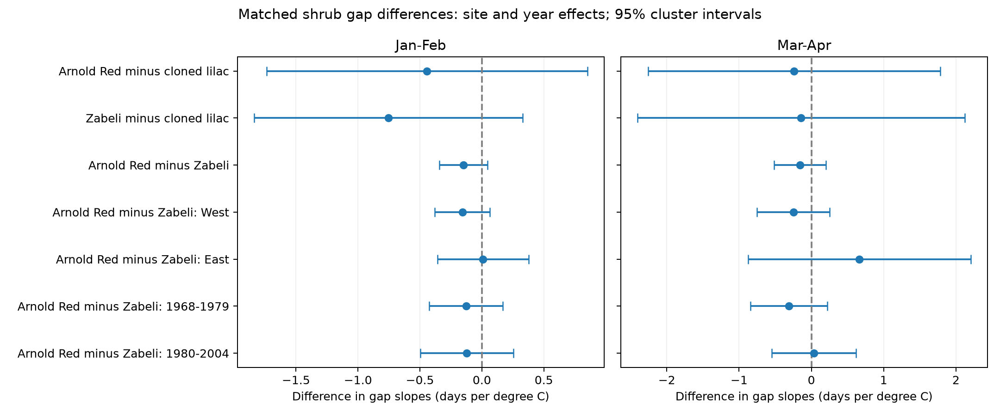

# Matched US shrub records gave no clear species difference in seasonal leaf-to-bloom slopes in 1968-2004

We compared the time from first leaf to first bloom between shrub types at the same site in the same year. The seasonal temperature slopes of these differences had intervals that included zero. The data do not establish equal responses. They also do not establish a common difference across regions or periods.

The main comparison was Arnold Red honeysuckle minus cloned lilac. It had only 280 matched years at 23 eastern sites in 1971-2004. The larger secondary comparison was Arnold Red minus Zabeli honeysuckle: 1,468 matched years at 120 sites in 1968-2004. This comparison allowed separate eastern and western checks.

The figure shows differences in temperature slopes, in days per degree C. Bars are individual 95% intervals with site and year clusters. A positive slope means that the first shrub's leaf-to-bloom interval increases more with temperature than the second shrub's interval. Each model includes both temperature terms. These estimates describe seasonal weather associations after site and year effects. They do not estimate effects of a common national warming trend.

## Question and prior work

Do seasonal links to the leaf-to-bloom interval differ between shrub types when their site and observation year are the same? This question can help separate shared local conditions from species differences. It concerns ecological timing in planted indicator shrubs. It does not test air pollution, species loss, range change, or damaging extremes.

[Ma et al.](https://doi.org/10.1111/1365-2745.13558) and [Guo et al.](https://doi.org/10.1016/j.cub.2023.06.064) show why leaf and flower dates need separate tests and why their interval can differ across plants. We do not claim to discover this question. Campaign searches found many tests on the same US archive. We read the [Arnold Red seasonal-contrast study](sci:sha256:1739a808e783d34e979028474c6ed9d6b0f8a9b8a3c9044b0ef5f5d1b683def1), the [winter interaction study](sci:sha256:669904daa3fb5f39141f2cfd345e1747fe41fc27b9d7ab72df5e31e365223f4f), and the [missing-interval sensitivity study](sci:sha256:1ba88d2287d852d90c21dcd35ee765278ad7a888ea8f8918dbec574f8af67484). These studies tested other contrasts or assumptions. Our contribution is a matched-species panel, a comparison at shared sites and years, and checks against source event dates and a separate regression method. We rebuilt the panel from shared raw files. This is not an independent source of biological observations.

The question changed after the campaign search and before we inspected the matched slopes. We retained all three usable comparisons. The planned main contrast has no western matches. We report that coverage limit and use the planned secondary honeysuckle comparison for the regional check. The design record is in files/design.txt. This was an exploratory investigation, not an external registration. Broad context fits were set aside because prior campaign work already covered them.

## Data and selection

The [USA-NPN archive](https://doi.org/10.1038/sdata.2015.38) contains first-leaf and first-bloom dates for common lilac, cloned lilac, and two cloned honeysuckles. We used the v13 observation workbook and read the v14 field guide. The [NOAA GHCN-CAMS field](https://doi.org/10.1029/2007JD008470) supplies monthly temperature on a 0.5-degree grid, file version 3.01. Exact input paths, source URLs, byte counts, and file SHA-256 hashes are in files/provenance.json. No new download was needed.

We used records through 2004 to avoid the documented 2005 leaf-rule change and the 2009 observation-system change. We paired first leaf and first bloom within individual, site, species, program and year. We kept the earliest date if a phase had more than one report. We required leaf dates in days 1-200, bloom dates in days 1-220, and a signed gap from -60 to 120 days. We did not require leaf to come first. These broad bounds are analysis rules, not proven biological limits. Source outlier flags were retained because an unusual date can be a real response to weather.

We took the median of paired gaps at each site-species-program-year, then required at least eight paired years per series. We restricted coordinates to 24-50 N and 125-66 W. The build yielded 11,998 site-species-years from 592 sites and 869 series. We then matched species within site, program and year, and required eight matched years per site-program. All retained matched cells had one reporting individual per species. The historical archive can use an individual ID for a group of shrubs, so these IDs are reporting units.

The field guide reverses the historical program labels relative to the source paper and observed coordinates. We preserve numeric Dataset_ID for matching and define regions from longitude, with West below -103 degrees. We do not use the reversed text labels. Program identity is part of every series.

January-February temperature is the equal-month mean for the observation year. March-April temperature is a separate equal-month mean. We use the nearest grid cell to the site median coordinates. Stored values are in Kelvin; a one-degree difference is the same size in Kelvin and C, and fixed effects remove the constant offset. Monthly temperature is not a direct measure of chilling or forcing. Fixed windows can extend beyond the observed events.

## Model and uncertainty

For each matched site and year, the outcome is:

`D = (bloom - leaf) of the first shrub - (bloom - leaf) of the second shrub`.

The model is:

`D = site_program_effect + year_effect + beta_w * JanFeb + beta_s * MarApr + error`.

We fit the two temperature terms jointly. We remove site-program and year means by repeated projection, to a maximum change below 1e-9. Every matched row has equal weight. We do not adjust for leaf date as another predictor, because it is part of the outcome. There is no missing-date imputation.

Uncertainty uses site covariance plus year covariance minus site-year covariance. Each component has the statsmodels finite-cluster correction. We also adjust for absorbed fixed-effect degrees of freedom using the number of series plus years minus one. This last count assumes a connected incidence graph; if there are more components, the correction is conservative. The t reference uses one less than the smaller site or year count. Positive variances and convergence are required. Spatial dependence across different sites can remain. These intervals are approximate, especially with few sites or years. They are individual intervals, without a multiple-test correction. All shown intervals include zero even before such a correction.

## Results

| First shrub minus second shrub | Matched years | Sites | Actual years | Jan-Feb slope and 95% interval | Mar-Apr slope and 95% interval |
| --- | ---: | ---: | --- | --- | --- |
| Arnold Red minus cloned lilac | 280 | 23 | 1971-2004 | -0.44 [-1.74, 0.85] | -0.24 [-2.26, 1.78] |
| Zabeli minus cloned lilac | 318 | 24 | 1971-2004 | -0.75 [-1.84, 0.33] | -0.14 [-2.41, 2.12] |
| Arnold Red minus Zabeli | 1468 | 120 | 1968-2004 | -0.15 [-0.34, 0.05] | -0.16 [-0.51, 0.20] |

Units are days per degree C, with the other season held fixed. The common-lilac versus cloned-lilac comparison had no eligible matches and no estimate. The two lilac comparisons are eastern samples only. The three contrasts overlap, so they are not three independent experiments.

For Arnold Red minus Zabeli, the western spring slope was -0.25 [-0.75, 0.25] from 1,168 matched years at 96 sites. The eastern slope was 0.67 [-0.87, 2.21] from 300 matched years at 24 sites. Slopes were -0.31 [-0.84, 0.22] before 1980 and 0.04 [-0.55, 0.62] from 1980 onward. Thus no clear common difference was established. Different signs do not prove that the regional slopes differ. We did not test their equality.

The main Arnold Red minus lilac contrast also had uncertain estimates in both periods. The early sample had only nine observation years. Full estimates, actual sample counts, and convergence counts are in the CSV tables. No conclusion depends on the strongest selected estimate.

## Observation bias and meaning

Matching can cancel an error shared by the two shrubs at the same stage, site and year. For example, a common two-day delay in recording both bloom dates cancels from their difference. It does not cancel species-specific delay, missed flowering, different visit schedules, or different observer interpretations. Historic visit histories and observer identities are unavailable. A paired date is evidence of a report, not proof of exact onset.

The eight-year rule selects persistent reporting sites. Requiring both species and both stages selects an even smaller sample. We cannot infer dates for absent reports or distinguish no bloom from a missed report. These results are conditional on complete matched records. They do not prove that observation bias is small. Same-site weather, care, soil, and observation practice can also affect species differently. Shared year effects and matching do not remove those differences.

The primary intervals permit large differences of biological interest. The larger honeysuckle sample gives narrower pooled intervals, but eastern replication remains weak. Monthly weather cannot resolve frost pockets, short heat events, water stress or garden microclimate. No measured pollinator timing, abundance, reproductive success, or wild-community change is included. Neither a causal climate effect nor an effect of air pollution follows from this study.

A useful next test would observe both shrubs with recorded visits at fixed sites, bracket each onset, and use daily local temperatures. It should test seasonal windows and thermal mechanisms on new years, rather than choose them from the fitted signs.

## Reproduction and worker record

See files/reproduce.txt. `python files/matched.py` rebuilds the matched estimates and figure from the preserved panel. `python files/validate.py` checks gap identities, source event dates, and the temperature coefficients with a separate sparse dummy-variable regression. The raw build script is files/analyze.py. The package preserves the selected source events, derived climate values, matched records, estimates, source hashes, code, and environment versions. The shared raw store was not changed. The full extraction was read once; a later panel build reused that extraction cache.

Campaign: 11_07_2026. Job: sci-1107-syam2-climate-pollution-biodiversity-f9f9d1964405. Topic: climate-pollution-biodiversity. Machine: syam2. Account: codex-myxtap. Model: gpt-6.1-sol, high reasoning effort, through T3 Code and the Codex harness. Date: 2026-11-08 UTC. No agents were launched. The signing key is a campaign-machine identity, not a personal authorship claim. No private key is included. This bundle is stored locally with no remote submission. The baseline license covers our text, figures, code and derived outputs, subject to source rights. Cite USA-NPN and NOAA PSL when reusing their data.
