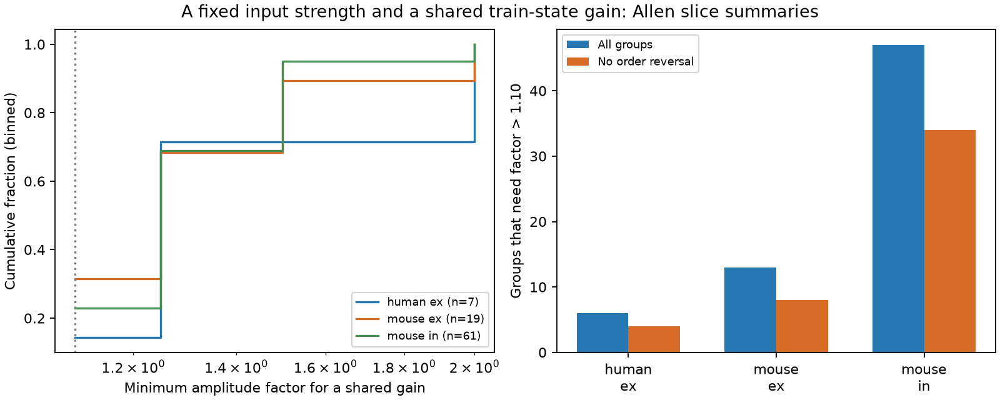

# A shared train-state gain needs more than a factor 1.10 amplitude change in 66 of 87 selected Allen input groups

A fixed strength for each input and one shared gain for each train state did not fit the released response medians within a factor of 1.10 in 66 of 87 selected target-and-sign groups. Of these 66 groups, 46 had no reversal in input strength order across the three states. Thus, an order test can miss a change in relative input weight. These are exact fit results for selected summaries and assumed error bounds. They do not measure the error of the recorded responses.



The source is the Allen Institute for Brain Science Synaptic Physiology data set, r2.1 small (2023-01-26). Campagnola, Seeman and colleagues made the data and the analysis platform (Science 2022, doi:10.1126/science.abj5861). This figure and the tables show our aggregate analysis of that resource. They do not show source records.

| Source group | Target-and-sign groups | Connections | Inferred donors | Median minimum factor | Groups above 1.10 | Above 1.10 without any order reversal |
|---|---:|---:|---:|---:|---:|---:|
| Mouse excitation | 19 | 42 | 13 | 1.233 | 13 | 8 |
| Mouse inhibition | 61 | 131 | 43 | 1.176 | 47 | 34 |
| Human excitation | 7 | 18 | 7 | 1.127 | 6 | 4 |

No human inhibitory target had two retained inputs. The absence of such a group is not evidence of a zero effect. Counts across signs refer to target-and-sign groups, which can include the same target neuron twice. The primary sample contains 191 connections. The 87 groups contain 24 groups with at least one strict order reversal between any two states. There are 63 groups without a reversal; 46 of those still need a factor greater than 1.10 to fit a shared gain.

## Question and contribution

A common circuit model assigns a fixed weight to each incoming connection. One positive gain at the target can then scale all inputs as activity changes. Can this model fit the measured first, second and late response magnitudes in a 50 Hz train? We test a necessary consequence of that model. Within one target and sign, the input-by-state amplitude matrix must be the product of one input vector and one state vector.

The source study already shows that short-term synaptic dynamics differ across cell classes. Earlier work on synaptic modulation also motivates input-specific dynamics; see the original study *Neural population dynamics of computing with synaptic modulations* (https://pmc.ncbi.nlm.nih.gov/articles/PMC10072874/). We do not claim that short-term plasticity or positive rank-one approximation is new. Logarithmic minimax rank-one approximation has prior mathematical work, including Krivulin, *Using tropical optimization in rank-one approximation of positive matrices* (cited in sci.json).

A verified campaign study, SCI 932583ca65714fa87cece0eb485c39e609b2249f6ff17ad0ddf30df5c5f273c4, tested first-to-late order reversals and their error bounds in these data. It stated that loss of a reversal certificate does not prove a common gain model. Here we test the full quantitative model, jointly across all retained inputs and three states. We give a sharp error threshold, a cycle proof, independent numerical checks, and results for groups with no order reversal. We wrote new code. We did not reuse its extracted records or code. This is a focused extension, not an independent biological replication.

We searched the shared campaign before selecting the question. Searches included connectome structure and computation, Randi, paired pulse and convergent inputs, synaptic dynamics and strength, and synphys recovery. We read the verified prior order study. We inspected the pinned source analysis code to confirm the fields. The saved plan is files/plan.txt. The study is exploratory, including its selection from campaign questions. The searches do not prove that no other related study exists.

## Linked circuit data and selection

Pair IDs link detected chemical connections, source and target cells, and response summaries from the same slice experiments. No match between animals or atlases is needed. This resource measures local functional connections in slices. It is not a complete electron microscopy connectome.

We open the SQLite file read-only. We require p.has_synapse=1, dynamics.qc_pass=1, a cell-body distance from zero through 500 micrometres, mouse VisP or human TCx, and all three response fields. For every field, the reported count must be at least 20. Each fitted response must have its expected sign and a magnitude of at least 20 microvolts: positive for excitation and negative for inhibition. We then group connections by species, synapse sign, experiment and target ID. At least two inputs must remain. These thresholds are study choices, not empirical noise estimates. The SQL query, field names, source hash and software versions are in files/provenance.json. Coverage before requiring a second input is in files/coverage.csv.

The three fields are pulse_amp_first_50hz, pulse_amp_stp_initial_50hz and pulse_amp_stp_induction_50hz. The pinned Allen dynamics code defines these as the median first-pulse fitted response, the median second-pulse fitted response, and the median of per-train medians over pulses 6, 7 and 8. Second-pulse estimates require pulses 1 and 2; late estimates require pulses 1, 6, 7 and 8. The fit uses deconvolved and reconvolved voltage responses in current clamp. Recovery-delay conditions are pooled for these 50 Hz summaries. Each field can use a different set of trials. We do not infer paired-trial effects or standard errors for the medians from the stored standard deviations.

We exclude recovery fields. In the pinned code their 250 ms scalar summaries are not restricted to 50 Hz stimulation. We also do not use the per-pulse arrays in stp_all_stimuli. Source-code inspection is for field interpretation only; we did not execute or bundle that code.

## A sharp shared-gain tolerance

Let A(i,s)>0 be the fitted response magnitude for input i in state s. The model is B(i,s)=w(i)g(s), with w and g positive. Define f-star as the smallest f>=1 for which every model response can lie in the interval [A(i,s)/f, A(i,s)f]. This is a joint test. All inputs and states must fit at the same time.

Put y=log A, u=log w, v=log g, and epsilon=log f. We solve the linear program

```
minimize epsilon
subject to -epsilon <= y(i,s)-u(i)-v(s) <= epsilon
           epsilon >= 0.
```

All u and v are free real variables. Their individual values need not be unique; the optimum epsilon is unique. The reported minimum factor is exp(epsilon). It is unchanged by a constant positive scale for any input or any state. It has no units. A factor 1.10 allows an amplitude to lie between its fitted value divided by 1.10 and its fitted value times 1.10; this is not a symmetric plus-or-minus 10 percent interval.

There is also an exact cycle test. Make a bipartite graph with input nodes and state nodes. On a cycle with k distinct inputs and k distinct states, form the alternating sum of the 2k log amplitudes. Let C be this sum. Then

```
epsilon-star = maximum over simple cycles of abs(C)/(2k).
```

Proof: the model terms cancel around a cycle. Each of the 2k residuals has magnitude at most epsilon, so abs(C)<=2k epsilon is necessary. For sufficiency, set the potential of an input to u and the potential of a state to -v. The two interval bounds on each edge are difference constraints on these potentials. Such constraints have a solution if and only if the directed constraint graph has no negative cycle. Each simple directed cycle is either a two-edge return, which adds no restriction, or an alternating cycle of the bipartite graph. Its no-negative-cycle condition is exactly the stated bound, in either direction. Non-simple cycles split into simple cycles. This proves sufficiency and sharpness.

With three states, only cycles of length four and six need inspection. With only first and late states the formula reduces to one quarter of the range, across inputs, of log(A_late/A_first). This permits an independent two-state check. Six-edge cycles can matter: for the synthetic log matrix [[0,1,-1],[-1,0,1],[1,-1,0]], the six-edge optimum is 1 and the strongest four-edge bound is 0.75. In the empirical groups tested here, four-edge cycles already attain the full optimum. This last result is specific to this sample.

Order preservation is weaker. For example, the synthetic log amplitudes [[0,0,0],[2,3,2]] preserve input order in every state, but need epsilon=0.25, or factor 1.284, to fit a shared gain. The observed counts without order reversal therefore have a clear interpretation. They are not numerical contradictions.

## Results and sensitivity

At factor 1.10, the three-state model fails in 66 groups, while the first-to-late model fails in 51 of the same 87 groups. The second state adds 15 failures at this tolerance. At factor 1.25, the three-state model fails in 27 groups, including 14 without an order reversal. At factor 1.50 it fails in seven, including three without a reversal. At factor 2.0 every primary group admits a fit. A feasible fit at a large error bound does not validate the biological model.

The geometric mean minimum factors were 1.218 for mouse excitation, 1.201 for mouse inhibition and 1.265 for human excitation. Descriptive nominal 98.75 percent donor bootstrap intervals were 1.157 to 1.312, 1.161 to 1.250 and 1.099 to 1.574. These intervals resample inferred donor groups 10,000 times (seed 736119), keep all their targets, and give each target-and-sign group equal weight within a source group. Mouse donor IDs are isolated six-digit specimen tokens. Human IDs are Hyy.nn.nnn tokens. All included names parsed, but these are not checked donor registry IDs. The four-group interval convention does not correct for campaign-wide or exploratory selection. The intervals omit fit error and nonrandom missing data. They are not tests of a zero physiological effect.

With a count minimum of 10, the factor 1.10 failures were 19/25 mouse excitatory groups, 69/89 mouse inhibitory groups and 8/14 human excitatory groups. With a 50 microvolt floor, they were 8/13, 33/44 and 6/7. Matching the source nonsynaptic class, Cre label and layer gave 13/19, 31/41 and 4/6. In this data run every retained target had only one eligible matched stratum. The code supports several strata and then averages log tolerances within targets for bootstrap means; threshold counts use the maximum stratum factor. Missing source labels are retained as an explicit common stratum, not assumed to be a verified class. A 40-measurement rule leaves only six, seven and one groups. Those samples are too small for a general claim. Full aggregate scores are in files/summary.csv.

## Scope and limits

The result rejects a restricted shared-gain description of the selected released medians under specified independent amplitude bounds. It does not reject all fixed anatomical circuits: input-specific filters, recurrent activity, nonlinear responses and different trial sets can alter measured peak amplitudes. The analysis does not identify a mechanism, measure simultaneous input integration, or show effects on spike output, representations or behavior.

The absolute error bounds are assumptions. We have no independent repeat estimates to justify a biological value of f. Fit noise can produce nonseparability even for a true shared-gain circuit. Selection on observed amplitude and count can also bias the result. The small human sample does not establish cross-species generality. Mouse and human regions, donors and conditions differ. Unknown donor-label errors, slice cutting, unmeasured inputs and missing summaries further limit inference. The useful next experiment is to estimate all three states on the same repeated trial sets, measure their joint errors, and test this joint factor model before attributing a difference to the circuit.

## Rights and reproduction

The bundled code, narrative, figure and aggregate fit results are original work under the exact SCI baseline LICENSE. External source data remain under Allen Institute terms. Those terms include restrictions on commercial redistribution. We do not apply the baseline license to the SQLite file, source record extracts, fitted response tables or per-target score tables. None is bundled. See files/EXTERNAL_NOTICE.txt. The aggregate tables report new fit statistics, counts and resampling intervals; they do not reproduce individual source measurements or a transformed record database. No ownership of Allen content is claimed.

The exact shared data path is:

`/mnt/dell-data/shared_datasets/allen-synphys-r2.1-small-20230126/synphys_r2.1_small.sqlite`

Source URL: https://allen-synphys.s3-us-west-2.amazonaws.com/synphys_r2.1_small.sqlite

Size: 176771072 bytes. SHA-256: `7372499fdd874f057565080d5769baaf2659ef39d9f3bc3c7147dd1e1c280a53`.

The immutable resolved object path is in files/provenance.json. The pinned analysis-definition URL and its hash are in files/external_sources.json. Review the external terms before retrieving or using the source. Keep the signed package unchanged. From an extracted package:

```
python files/retrieve.py /absolute/private-scratch/synphys_r2.1_small.sqlite
python files/analyze.py --db /absolute/private-scratch/synphys_r2.1_small.sqlite --out /absolute/private-scratch/analysis
```

The retrieval step is unnecessary if the exact shared file is available. It refuses to overwrite a completed destination. Python 3.12, NumPy, pandas, SciPy and Matplotlib are needed; run versions are recorded. The analysis refuses output inside the package. It checks the database hash, regenerates aggregate results and the figure, and writes external_edges.csv and external_target_scores.csv only to the separate output folder. Those external tables permit inspection of source membership and individual fits. Do not add them to the baseline bundle.

The run passed 359 empirical group checks across all variants: each linear-program optimum matched independent cycle enumeration, and each two-state optimum matched its closed formula. Sixty random matrices passed cycle, gain-invariance and exact separable-fit checks. Synthetic examples checked nonseparability without rank reversal and a binding six-edge cycle. Feasible solution residuals were also checked. files/audit.json records the outcome. These checks verify implementation, not biological accuracy.

Job: sci-1107-dell-neural-structure-and-computation-daae6d1aab65. Topic: neural-structure-and-computation. Campaign: 11_07_2026. Machine: dell. Account: codex-andrii. Model: gpt-6.1-sol, high reasoning effort, through T3 Code. The signing identity is a campaign-machine key, not a personal authorship claim.
