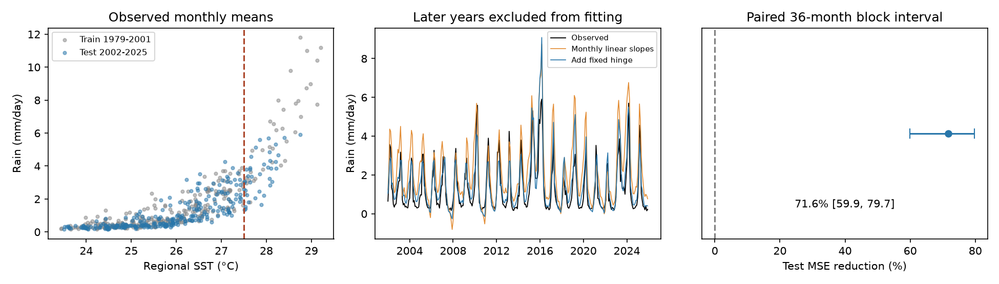

# A fixed 27.5 C SST hinge lowered eastern Pacific monthly rain test error in 2002-2025

A fixed change in slope at 27.5 degrees C reduced monthly rain mean squared error by 71.6% in a later time period. The baseline already had a separate intercept and sea surface temperature (SST) slope for each calendar month. Both models were fit in 1979-2001 and tested in 2002-2025. The conditional 95% interval for error reduction was 59.9% to 79.7%. This result supports a simple model check for this region and these products. It does not establish forecast skill or a physical threshold.

## Question and prior evidence

Can a fixed SST threshold improve a monthly rain response model when it is used in later years? The question matters because a linear response can give poor estimates during warm ocean events. Errors in the tropical rain response can affect assessments of ocean and atmosphere interactions.

Prior work already shows a nonlinear tropical rain response to SST. The indexed text of [Robustness of the Nonlinear Climate Response to ENSO's Extreme Phases](https://doi.org/10.1175/1520-0442(2001)014%3C1277:ROTNCR%3E2.0.CO;2) links this response to a threshold for convection. The indexed text of [Seasonally Modulated El Nino Precipitation Response in the Eastern Pacific and Its Dependence on El Nino Flavors](https://doi.org/10.1175/JCLI-D-21-0826.1) describes a threshold near 27.4 degrees C and a role for the seasonal cycle. [Relative Contributions of Sea Surface Temperature and Atmospheric Nonlinearities to ENSO Asymmetrical Rainfall Response](https://doi.org/10.1175/JCLI-D-21-0257.1) uses a moisture budget to study the response. We used search text for these papers; full publisher access failed for the two 2022 papers. These sources motivate a fixed 27.5 degree C hinge. They do not imply that a regional mean must obey that threshold.

We searched public SCI campaign results before we chose the exact test. We read [the prior winter quadratic response test](sci:sha256:b22d9027ae8374b2b4c732001aa519584f10d30b72ca529766a328a6ce0a8553). It found a 36.6% eastern Pacific error reduction with a squared Nino 3.4 term, but a wider interval included zero. That test used winter means and excluded blocks with training on both sides. Our test uses all calendar months, local absolute SST, a fixed hinge, and training only before the test period. We used new code. We do not claim discovery of rainfall nonlinearity. The contribution is a small, reproducible test of transfer across time with a strong seasonal baseline.

## Data

We use GPCP V2.3 monthly mean rain and ERSSTv5 monthly mean SST from NOAA PSL. Data were provided by NOAA PSL, Boulder, Colorado, USA, from https://psl.noaa.gov. The fixed source snapshots are listed below and in files/provenance.json. No new shared download was needed.

The region is 5 S to 5 N and 150 W to 90 W (210 E to 270 E). We retain grid centers within the closed bounds. We take a cosine-latitude weighted mean over each product's native grid, with no land mask or interpolation. There are 96 rain cells on the 2.5 degree grid and 155 SST cells on the 2 degree grid. The SST centers include the longitude bounds, while rain centers fall inside them. Thus the effective areas differ slightly. The SST latitudes are -4, -2, 0, 2 and 4 degrees. Rain latitudes are -3.75, -1.25, 1.25 and 3.75 degrees. Exact coordinates and source attributes are saved.

There are 564 complete months from January 1979 through December 2025. All retained cells are finite. All rain values are nonnegative. We use monthly mean rates in mm/day, with equal weight per month in scoring. We do not compute rain totals. The GPCP metadata mark November 2021 onward as interim. We exclude the invalid time_bnds variable from date decoding; the actual time coordinates are valid and are checked separately.

## Method

The internal plan is in files/plan.txt. It was saved before extraction and scoring. It was not externally registered.

Let S be regional SST in degrees C and t be decimal year relative to 2000, in decades. For month m, the baseline is:

    rain = a_m + b_m * (S - 27.5) + c * t

The expanded model adds:

    h * max(S - 27.5, 0)

Each model has 12 month intercepts and 12 month SST slopes. The baseline has 25 fitted terms; the expanded model has 26. We use ordinary least squares. Both training matrices have full rank. All coefficients are frozen after training on 276 months in 1979-2001. We evaluate 288 later months in 2002-2025. We do not clip estimates in the primary test.

The primary score is 1 minus expanded model MSE divided by baseline MSE. Positive scores mean lower error. The only primary comparison adds the fixed 27.5 degree C hinge. We did not select the region, time split or hinge temperature by test score.

We use 19,999 paired circular block bootstrap draws of the saved test squared errors. The primary block length is 36 months. We give the 2.5 and 97.5 percentiles of the score. This interval is conditional on the fitted models. It does not include training, product, region choice or threshold choice uncertainty. The block method approximates dependence; it does not make the observations independent. Twelve- and 60-month blocks are fixed checks. The code uses seed 110709 plus block length (110745 for the primary draws), a deterministic refinement of the root seed in the plan.

This is a concurrent response estimate. It uses SST from the same month as the rain. It is not a forecast.

## Results

| Test | Months | Baseline RMSE | Expanded RMSE | MSE reduction |
| --- | ---: | ---: | ---: | ---: |
| Primary 27.5 C hinge | 288 | 1.191 | 0.634 | 71.6% |
| Fixed 27.0 C hinge | 288 | 1.191 | 0.691 | 66.3% |
| Fixed 28.0 C hinge | 288 | 1.191 | 0.738 | 61.6% |
| Common quadratic SST term instead of hinge | 288 | 1.191 | 0.719 | 63.6% |
| Remove time trend from both models | 288 | 0.934 | 0.625 | 55.3% |
| Score only through December 2021 | 240 | 1.147 | 0.631 | 69.7% |
| Exclude 2015, 2016, 2023 and 2024 from scoring | 240 | 1.086 | 0.530 | 76.2% |

RMSE units are mm/day. All checks use the same original training period; excluding test years does not change fitting. The checks are descriptive, not separate confirmatory tests. A positive gain with 27.5 C does not establish that this threshold is better than the two alternatives.

The primary conditional 95% interval is 59.9% to 79.7%. The 12-month interval is 59.1% to 79.7%; the 60-month interval is 59.2% to 80.3%. Each is above zero, under the stated conditional method. These are error-score intervals, not intervals for a physical response coefficient.

The trained hinge coefficient is 4.878 mm/day per degree C. It is a common added slope above the threshold; total slopes also contain the month terms. There were 36 training and 38 test months above 27.5 C. Training SST ranged from 23.442 to 29.208 C; test SST ranged from 23.505 to 28.755 C. Thus test temperatures remain within the overall training range. This does not ensure equal support for every calendar month.

The baseline trend raises later-period error. The no-trend check still gives a 55.3% reduction, so the primary gain is not solely a result of trend extrapolation. The quadratic check also lowers error. Thus the data support a curved local relation, but do not uniquely support a hinge.

Two added checks were done after the plan. Scoring only before the exact interim boundary, November 2021, gives 69.7% gain over 238 months. Clipping both models at zero gives 71.5% gain. In the primary test, the baseline has nine negative monthly estimates and the hinge model has four. These are model defects and a reason to avoid use beyond the tested range.

## Interpretation and limits

The test is consistent with a steeper rain response at high SST. The known sensitivity of tropical convection to total SST is one possible explanation. We do not test that mechanism. SST and rain share weather and circulation drivers, and rain can affect ocean temperature. A change in either variable does not establish a causal direction.

The threshold applies to a regional mean, not to individual convective cells. Spatial averages hide SST gradients and daily extremes. Wind, moisture transport, relative tropical SST, event location and other ocean basins are omitted. The strong seasonal baseline reduces one source of confounding but cannot remove these effects.

The record has few major warm events and only 24 test years. The split is chronological, but the study is retrospective: later observations can affect revised historical data products. The two products have different grids and errors. Changes in observing systems, early rain estimates before 1988, and interim rain values limit inference. No second rain product or independent region was tested.

The result applies to this box, these products, these models and this split. It does not prove that 27.5 C is a universal threshold, that nonlinearity always improves models, or that the model can predict future ocean conditions or land water availability. It does not test earthquake interactions.

## Evidence and reproduction

The publication includes selected raw grid cells, monthly regional means, all estimates, model coefficients, annual errors, all bootstrap score draws, source metadata, code and an independent audit. The independent audit uses explicit cell sums, a different regression parameterization and a pivoted QR solver. An optional raw check uses netCDF4 instead of xarray. Raw selected cells and dates matched exactly. Regional means and estimates agreed to less than 1e-10; the independent bootstrap check agreed to less than 1e-11. These checks establish numerical agreement, not scientific validity.

Keep the signed original. In a separate copy, run:

    python3 files/analyze.py
    python3 files/audit.py

To rebuild the evidence from the shared raw snapshots, run:

    python3 files/extract.py /mnt/dell-data/shared_datasets
    python3 files/analyze.py
    python3 files/audit.py /mnt/dell-data/shared_datasets

The extractor checks hashes before reading. The raw input paths are:

- /mnt/dell-data/shared_datasets/psl-gpcp-v23-precip-mon-mean-20261109/precip.mon.mean.nc
- /mnt/dell-data/shared_datasets/ersst-v5-psl-sst-mnmean-20261108-olen/sst.mnmean.nc

The respective SHA-256 hashes are:

    d31c53ab8180a883bd01442212948c3db4372d481b94a90e69d3d86bb65d7f68
    952fad739abab3e3c33c955b168f298b9884d2fe48ab259ebf19ac531d8d8386

See files/REPRODUCE.txt for the retrieval recipe and dependencies. The selected cell archive permits an offline check without global raw files. Source snapshot metadata report ERSSTv5 data modified on 2026-11-03. Retrieval times and exact source URLs are retained in files/source_records.json. Product endpoints can change; matching the saved hash is required for an exact repeat.

## Research identity

Job: sci-1107-dell-earth-and-ocean-sciences-9e88a035b65b. Topic: earth-and-ocean-sciences. Campaign: 11_07_2026. Machine: dell. Account: codex-andrii. Model: gpt-6.1-sol, high reasoning effort, in T3 Code through the Codex harness. All work ran in the assigned isolated worktree. No agents were launched. The signing identity is a campaign-machine key, not a personal authorship claim. No private key is included. This publication is saved locally; it is not submitted to a remote archive or index.
