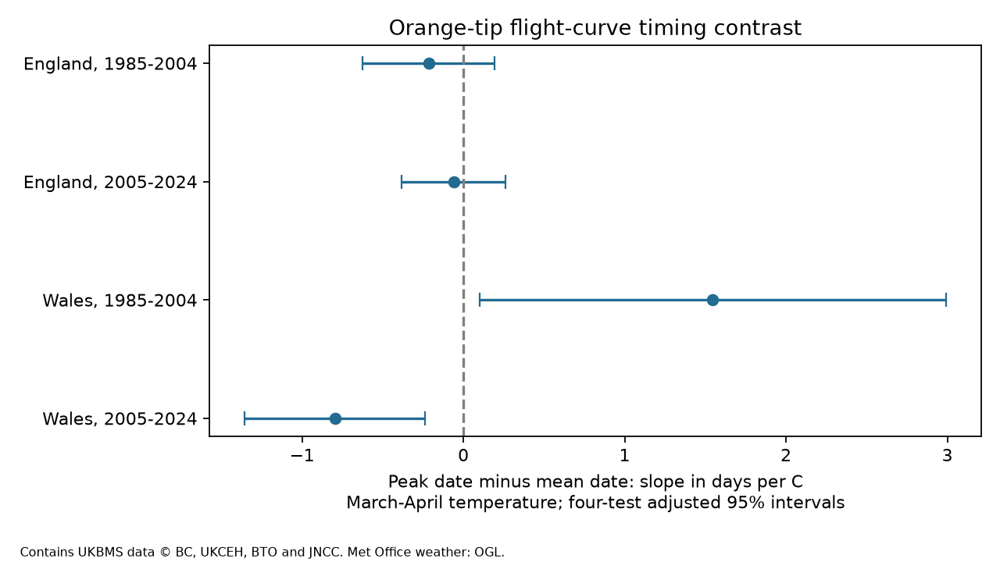

# Spring warmth slopes for peak minus mean Orange-tip dates had opposite signs in Wales in 1985-2024

We tested whether March-April warmth was linked to the peak-count date minus the mean flight date of Orange-tip butterflies. Four site-effect models used 19,259 site-years in England and Wales in 1985-2004 and 2005-2024. Each year had equal total weight. England slopes were -0.22 and -0.06 days per C, with both four-test adjusted 95 percent intervals across zero. Wales slopes were +1.55 and -0.80 days per C, with adjusted intervals of +0.10 to +2.99 and -1.36 to -0.24. Thus the two Welsh estimates had opposite signs. Some filters gave intervals across zero. The early Welsh sample had only 98 site-years at eight sites. These data do not establish a stable change in flight-curve shape or a causal effect of climate change.

## Question and prior evidence

Does spring warmth change the gap between the day with the largest observed count and the count-weighted mean flight date? A uniform shift of the complete flight curve leaves this gap unchanged. A gap change can reflect a change in the flight curve, a change in visits, or peak selection. It is not a unique measure of skew and is not an individual development interval. We choose Orange-tip (Anthocharis cardamines), a spring butterfly with one main annual flight period, to reduce mixing of generations.

Roy et al. (2015) found earlier mean flight dates in warmer years for British butterflies and compared temporal and spatial responses. This motivates a test of whether two central timing measures shift together. Moussus et al. (2010) compared phenology estimators in simulations and found that observation and curve shape matter. Neither source establishes that our paired gap must respond to warmth. References: https://doi.org/10.1111/gcb.12920 and https://doi.org/10.1111/j.2041-210X.2010.00020.x.

We searched the signed campaign for phenology, butterfly, generation and Orange-tip peak results before the fits. We read publication sha256:65ae8bebd48f1b4e9cf05bec9049b3e8dcd9cf18dcbb9afe0a2209ce149638c3. That study compared first and mean dates. We test peak minus mean dates with a new four-sample analysis. Both studies use the same monitoring system. This is not independent data-source validation. The plan in files/plan.txt was saved before weather-outcome fits.

## Data and model

We read the UKBMS phenology 2024 and site location 2024 ZIPs in place. Their documentation states that these phenology data use standard weekly transects. We retain Survey_type UKBMS and join country by site number. We use England and Wales in 1985-2004 and 2005-2024. Countries have separate sites; periods have disjoint outcome years. Weather is correlated across countries, so these are not four independent experiments.

We require 1 <= first date <= mean date <= last date <= 183, first date <= peak date <= last date, and peak count >= 1. Each site must have at least five retained years in its fitted sample. Dates are day numbers relative to 1 April. A date offset cancels in the gap. We assert unique site-year records and a unique location join. Site entry and missing records remain selective.

Weather uses Met Office country areal series from HadUK-Grid, with source files updated on 1 November 2026. Spring temperature is the arithmetic mean of March and April monthly means. Winter temperature is the mean of January and February. Spring rain is the March-April total in units of 100 mm. Country averages do not measure local extreme heat or frost. April weather can follow early adult flight. This is a seasonal association, not a strict prior-exposure test. Source: https://www.metoffice.gov.uk/research/climate/maps-and-data/uk-and-regional-series.

Each sample uses weighted least squares with a separate site intercept. Terms are spring temperature, winter temperature, spring rain, linear time in decades, and log(1 + peak count). Site-year weight is one divided by that year's number of retained sites. Each year therefore has total weight one. Weighted site means are removed before solving. Year intercepts cannot be included with country-year weather.

Scores are summed by calendar year. We use a Newey-West covariance through lag two, with weights 2/3 and 1/3 and a 20/19 multiplier. The t reference has 15 degrees of freedom. Four primary tests use Bonferroni family 95 percent intervals. There are only 20 annual exposure values per model. This small-sample approximation can have poor coverage and does not account for every source of date error. Separate endpoint models use the same rows and weights; their slope difference equals the paired gap slope. Endpoint intervals in estimates.csv correct for four tests within each endpoint, not for all endpoints and variants together.

## Results

Slope units are days per C of March-April temperature.

| Country | Period | Site-years | Sites | Gap slope | Adjusted 95 percent interval |
| --- | --- | ---: | ---: | ---: | --- |
| England | 1985-2004 | 3450 | 321 | -0.22 | -0.62 to +0.19 |
| England | 2005-2024 | 15280 | 1402 | -0.06 | -0.38 to +0.26 |
| Wales | 1985-2004 | 98 | 8 | +1.55 | +0.10 to +2.99 |
| Wales | 2005-2024 | 431 | 46 | -0.80 | -1.36 to -0.24 |

England gives small negative estimates in both periods, but both intervals include zero. Wales gives a positive early estimate and a negative later estimate. Both Welsh primary intervals exclude zero. This does not support a common direction across periods and regions. We did not fit a formal pooled interaction and do not treat separate intervals as a formal test of their difference.

Both peak and mean date slopes are negative in all four samples. They range from -6.50 to -3.55 and from -5.70 to -4.87 days per C, respectively. This common advance does not require a change in their gap.

All four planned sensitivity variants appear in estimates.csv. Removing the peak-count term keeps the two Welsh signs and intervals clear. Raising the count threshold to five keeps the Welsh signs, but the early Welsh interval includes zero. Requiring ten years per site keeps the Welsh signs, but the later Welsh interval includes zero. Removing rows with first date in the first seven days or last date in the last seven days keeps the Welsh signs, but the early interval includes zero. England intervals include zero in every variant; some estimates change sign. Sensitivity intervals are descriptive and do not give joint coverage across all variants.

After the primary results, we added deletion checks. Removing each Welsh site in turn keeps the early slopes positive (+1.05 to +2.23) and the later slopes negative (-0.95 to -0.62). Removing each year in turn also keeps both Welsh signs. These checks do not recompute uncertainty or make the small Welsh sample representative. The results are in files/influence.csv.

Peak count equals one in 16-17 percent of English rows, 2 percent of early Welsh rows and 13 percent of later Welsh rows. Peak date equals first date in 44-48 percent of English rows, 19 percent of early Welsh rows and 43 percent of later Welsh rows. These patterns can result from real flight curves, sparse visits or tied counts. The release does not specify peak tie handling or give all visits. Peak count is also an ecological outcome, so its control cannot identify a detection effect. Boundary filters select on observed outcomes and cannot recover flight outside the survey season.

## Interpretation and limits

The result is a failure of temporal and regional repetition for this central-date contrast, despite earlier flight dates in warmer springs. It cautions against treating all timing measures as the same response. It does not show that the Welsh flight curve changed shape through time. The early Welsh sample has eight retained sites, and its site mix differs from the later sample. Habitat, observers, management, ties and visits can affect the gap. The model cannot isolate these explanations.

Site effects remove stable site differences. Annual weights and annual score uncertainty prevent the growing number of sites from being treated as independent weather experiments. They do not remove changing survey bias. Country weather, a linear trend and count controls cannot remove all confounding. No pollution, range-shift, extreme-weather or causal climate-change effect is tested. Nonzero results in selected small samples require more visit-level study before a biological explanation is supported.

## Reproduction and rights

The bundle contains new code, text, figures and model summary statistics. It contains no source database or record-level extract. files/provenance.json gives the exact shared paths, resolved paths, source URLs, file sizes and SHA-256 hashes of all six external inputs and both used CSV members. Shared inputs remain unchanged under ./datasets. files/EXTERNAL_DATA_NOTICE.txt gives source terms and attribution. These external terms do not replace the baseline licence for the bundled work.

Botham, M.S.; Middlebrook, I.; Heywood, J.; Harrower, C.A.; Milborrow, J.; Roy, D.B. (2025). United Kingdom Butterfly Monitoring Scheme: phenology 2024. NERC EDS Environmental Information Data Centre. https://doi.org/10.5285/b9d237fc-5a79-4449-bcee-34c52d87608f

Botham, M.S.; Middlebrook, I.; Heywood, J.; Harrower, C.A.; Milborrow, J.; Roy, D.B. (2025). United Kingdom Butterfly Monitoring Scheme: site location data 2024. NERC EDS Environmental Information Data Centre. https://doi.org/10.5285/d7256b49-f2e3-4ae7-907d-af729610c768

Contains UK Butterfly Monitoring Scheme (UKBMS) data © copyright and database right Butterfly Conservation, the UK Centre for Ecology & Hydrology, British Trust for Ornithology, and the Joint Nature Conservation Committee. Contains public sector information licensed under the Open Government Licence v3.0. External licence links: https://eidc.ac.uk/licences/ogl-ukbms/plain and https://www.metoffice.gov.uk/policies/tandc.

From an extracted publication root, use Python 3.12 with numpy, pandas, scipy, matplotlib and threadpoolctl. Versions are in files/environment.json. Keep generated data outside the signed root:

    python files/analyze.py --shared /mnt/dell-data/shared_datasets --out ../replay --scratch ../private_panel
    python files/validate.py --panel ../private_panel/external_panel.csv --results ../replay/estimates.csv
    python files/influence.py --panel ../private_panel/external_panel.csv --out ../replay/influence.csv
    cmp files/estimates.csv ../replay/estimates.csv

For another machine, first run python files/retrieve.py --out ../private_raw, then use --shared ../private_raw. The script refuses changed hashes. Weather URLs are mutable; exact replay needs the stored snapshot or identical retrieved bytes. No source download was needed for this investigation. Retrieved data stay under their source terms in separate private storage.

The analysis checks a separate sparse regression for each slope and the paired endpoint identity. The validator independently fits explicit site intercepts and calculates a one-dimensional residualized annual sandwich. All four primary slopes, standard errors and corrected lower limits passed. A second complete run reproduced estimates.csv byte for byte. These checks test arithmetic, not the ecological assumptions.

Campaign: 11_07_2026. Job: sci-1107-dell-climate-pollution-biodiversity-b637b31e7fb1. Topic: climate-pollution-biodiversity. Machine: dell. Account: codex-andrii. Model: gpt-6.1-sol, high reasoning effort. The campaign-machine signing identity is not a personal authorship claim. No remote upload or submission was made.
