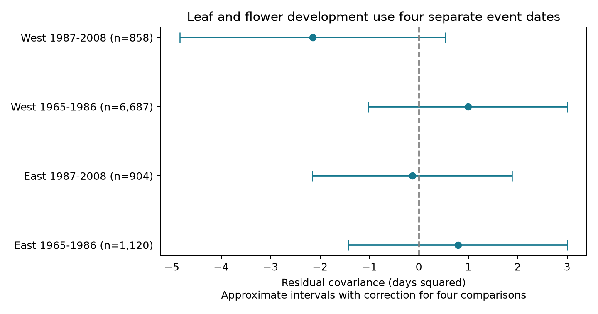

# Leaf and flower development intervals gave no common residual link in four US shrub samples in 1965-2008

We tested whether leaf expansion and flower opening took more time in the same shrub-years. The test used four separate event dates. We removed plant effects, year effects, and two local monthly temperature measures. Four East and West samples in 1965-1986 and 1987-2008 gave mixed signs. Residual correlations ranged from -0.100 to +0.051. All four primary covariance intervals included zero after correction for four comparisons. This result does not show that leaf and flower development are independent. The selected records, missing visit schedules, mixed taxa, and approximate uncertainty estimates limit the test.

## Question and prior evidence

Do leaf and flower development share a common annual pace after local weather and annual changes are removed? A common pace could link climate responses of plant growth and reproduction. This question differs from a test of which event starts first. Guo and colleagues (doi:10.1016/j.cub.2023.06.064) studied climate and the interval between leaf-out and flowering. We test the association between two development durations.

We first ran `sci search "climate pollution biodiversity phenology" --in ./campaign`. We then searched for full bloom, end bloom, leaf stages, and covariance. The saved search records give the results. We read SCI 6d1574d914bd3f6467e0a6a1dfa6beec60f2017428e9d34fea38d516b7111d2e. It found negative covariance between adjacent intervals that shared a first-bloom date. The same date entered one interval with a plus sign and the other with a minus sign. Its error analysis showed why that pattern does not establish biological compensation. Our new panel uses first leaf, full leaf, first bloom, and full bloom. It shares raw source data with that study, but it does not reuse its derived panel or code. This is an exploratory analysis. The plan was written before model results, but was not registered.

## Data and selection

We read the USA-NPN lilac and honeysuckle v13 workbook in place. Rosemartin and colleagues describe this archive (doi:10.1038/sdata.2015.38). We use the observation_data sheet, legacy Dataset_ID 7 and 8, years 1965-2008, latitude 24-50 N, and longitude 66-125 W. We define a plant by Site_ID, Individual_ID, and Species_ID. Each selected plant-year must have exactly one record for each of the four stages, with dates on day 1-250. Leaf duration is full leaf minus first leaf. Flower duration is full bloom minus first bloom. We retain each duration from zero to 60 days. We do not require the leaf and flower intervals to occur in a fixed order relative to each other.

The source has 116,662 rows. There are 13,843 complete four-stage records under the location, date, and legacy restrictions. Duration limits leave 13,836 records. Each analysis then requires at least five eligible years per plant within that region and period. The main fits use 9,569 plant-years. The full derived panel is preserved before this five-year restriction so each sensitivity can apply the same rule after its filter.

West means longitude below -100 degrees; East contains the other sites. Periods are 1965-1986 and 1987-2008. Some plants occur in both periods. Regional weather can be correlated. These are checks across distinct records, not independent experiments. Taxa differ across samples. Early West has 2,617 common lilac records, 4,064 honeysuckle records and 6 cloned lilac records. Early East has 533 cloned lilac records, 504 honeysuckle records and 83 common lilac records. Later West has 377 common lilac, 475 honeysuckle and 6 cloned lilac records. Later East has 609 cloned lilac, 253 honeysuckle and 42 common lilac records. This mixture prevents a clean regional biological comparison.

We use NOAA PSL GHCN CAMS 3.01 temperature (doi:10.1029/2007JD008470), at the nearest 0.5-degree cell. The two weather controls are equal-weight March-April mean and May mean. They are fixed calendar windows, not windows set by each observed event date. They can include weather after the event. We use them as broad adjustment variables, not causal exposures. Exact source paths, versions, URLs, file sizes and SHA-256 hashes are in files/provenance.json. The metadata workbook reverses East/West dataset labels relative to the source paper and site coordinates; our selection uses both IDs and our regions use longitude.

## Method

Let L1 and L2 be first and full leaf dates. Let F1 and F2 be first and full bloom dates. Define A = L2 - L1 and B = F2 - F1. For each region-period sample, we fit each duration to the same plant indicators, year indicators and the two temperature columns. Sparse least squares gives residuals rA and rB. We report C = mean(rA times rB) and correlation C divided by the product of the residual standard deviations. Variances use denominator n. These are residual associations in selected observed records. We do not apply a degrees-of-freedom correction to the covariance.

For uncertainty, we use the centered covariance score rA times rB minus C. We sum its cluster variance contributions by state and by year, and subtract the state-year contribution. Each contribution has the factor G/(G-1), where G is its number of clusters. We use a t reference with min(number of states, number of years) minus one degrees of freedom. Main intervals use a Bonferroni correction for four comparisons: each interval has nominal coverage 98.75%. We also save marginal 95% intervals. This calculation is approximate. It does not fully correct small cluster counts, high plant leverage, selection, spatial dependence across states, or finite-sample error from estimated plant effects. The intervals should not be treated as exact population bounds.

The sensitivity fits omit weather, add plant trends, omit any selected stage with an individual outlier or inconsistency flag, remove durations equal to a whole number of weeks (including zero), or remove any equal date across a leaf and flower endpoint. These filters can remove real events and change the selected population. They are not validated corrections for visit bias. Each sample again needs five eligible years per plant. A negative control pairs current leaf duration with next-year flower duration in consecutive years in the same period. It uses the current weather controls. This changes the sample and is not a formal test of the difference from same-year covariance.

## Results

| Region | Period | Plant-years | Plants | Correlation | Covariance, days squared | Adjusted interval |
| --- | --- | ---: | ---: | ---: | ---: | --- |
| East | 1965-1986 | 1,120 | 159 | 0.051 | 0.79 | -1.43 to 3.01 |
| East | 1987-2008 | 904 | 75 | -0.010 | -0.14 | -2.15 to 1.88 |
| West | 1965-1986 | 6,687 | 723 | 0.033 | 0.99 | -1.02 to 3.00 |
| West | 1987-2008 | 858 | 133 | -0.100 | -2.15 | -4.83 to 0.53 |

No primary adjusted interval excludes zero. The early point estimates are positive and the later estimates are negative. This is not a tested period difference. Main samples cover only 17, 22, 19, and 18 distinct years, respectively. They include 19, 17, 15, and 12 states. Coverage is uneven within the named periods.

The later western marginal 95% interval is -4.13 to -0.17 days squared. With plant trends its four-comparison interval is -3.88 to -0.07. This isolated sensitivity result does not repeat across regions and periods, and the correction does not cover all sensitivity searches. It supports no general claim of compensation. The other primary adjusted intervals and the next-year intervals all include zero. Next-year correlations range from -0.033 to +0.026. Complete results for all 28 fits are in files/results.csv. Omission of weather makes little change to the main point estimates.

## What separate endpoints do and do not solve

For recorded dates with errors eL1, eL2, eF1 and eF2, the duration errors are eL2-eL1 and eF2-eF1. Their covariance is:

`Cov(eL2,eF2) - Cov(eL2,eF1) - Cov(eL1,eF2) + Cov(eL1,eF1)`.

Under independent errors at all four stages, this term is zero. There is no shared endpoint variance term that must make the covariance negative. In adjacent intervals X-Y and Z-X, error in X instead contributes minus its variance. Our separate-endpoint test avoids that specific source of mathematical coupling. The statement also holds after any fixed common linear projection, in expectation under independent mean-zero errors that are independent of the design and true dates.

It does not solve all observation bias. Correlated errors across stages can create covariance of either sign. A common delay at all four dates cancels, but different correlated delays at the start and full stages need not cancel. The selection of complete, correctly ordered intervals using recorded dates can itself make otherwise independent errors dependent. Missing visits, reporting habits, pruning, watering, plant replacement and observer changes remain unmeasured. Thus the contrast with the adjacent-interval study cannot identify its error contribution. Its sample also differs from ours.

A useful next test would collect repeated visits that bracket all four stages on the same plants, record observer identity, and use local daily weather. A joint model of latent dates and visit schedules could then test whether a common pace remains after correlated measurement errors. Our result gives a reproducible separate-endpoint benchmark for that test.

## Scope and limits

These are planted indicator shrubs, not a sample of wild biodiversity. We do not estimate species loss, distribution shifts, pollinator mismatch, air pollution effects, damaging extremes, or causal climate-change effects. Monthly temperature does not capture chilling, frost, soil water, irrigation, or short heat events. Main temperature slopes are common across plants. Calendar controls can extend past the events. Plant and year effects do not remove all changing local conditions. Complete four-stage reporting and long records select a small part of the archive. The five-year rule and the duration bounds can affect the association. Small correlations and uncertain covariance do not prove independent biological processes. The data do not establish a common positive or negative residual association under this design.

## Reproduction and worker record

Run `python files/analyze.py` and `python files/validate.py` from this publication directory. The first command uses the preserved panel; the second checks the main projection with a separate algorithm and checks the date-error formulas by simulation. For a raw rebuild, add `--raw-root /mnt/dell-data/shared_datasets` to analyze.py. See files/REPRODUCE.md for retrieval and dependencies. Shared raw data were not changed or copied into this bundle. Their source terms continue to apply. Our text, code, figures and derived evidence use the baseline license subject to source rights.

Campaign: 11_07_2026. Job: sci-1107-dell-climate-pollution-biodiversity-7d66de003aa9. Topic: climate-pollution-biodiversity. Machine: dell. Account: codex-andrii. Model: gpt-6.1-sol, high reasoning effort, through T3 Code and the Codex harness. Date: 2026-11-08 UTC. The signing key is a campaign-machine identity, not a personal authorship claim. The publication is saved locally. No remote submission is made.
