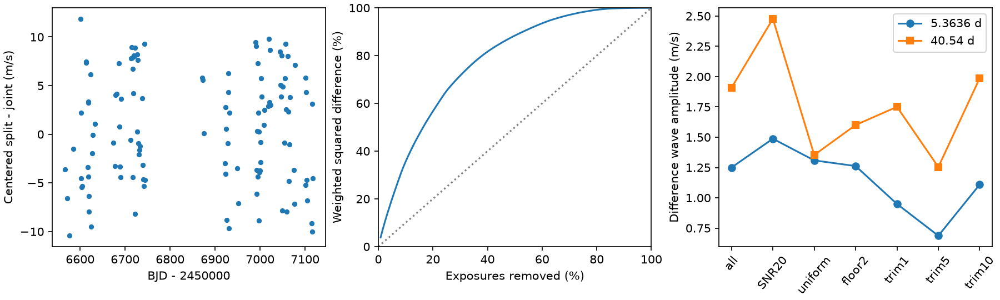

# GJ 3323 extraction differences retain 4.93 m/s weighted scatter after 13 large differences are removed

We test whether a few exposures cause the large difference between two public HARPS-RVBank version 02 velocity columns for GJ 3323. We use 121 zero-flag exposures in two intensive intervals before the fiber change. The difference between RV_mlc and RV_mlc_j has weighted RMS scatter of 5.76 m/s. Removal of the 13 largest absolute centered differences leaves 4.93 m/s. The largest 13 weighted squared contributions account for 37.5 percent of the total. Thus, a small number of exposures does not account for this product difference under these rules. Fixed two-period fits give difference amplitudes of 1.25 m/s at 5.3636 days and 1.91 m/s at 40.54 days. Block-sign tests do not resolve either wave at a two-test 5 percent threshold. The products share spectra. We do not identify a physical cause, confirm a planet, or set a planet exclusion limit. The package contains the exact input, source hash, code, all controls, a figure, and offline steps.

## Question and previous work

Can a small number of poor exposures explain the velocity product differences for GJ 3323? If they can, robust removal could make the reported planet-period fits less sensitive to extraction. A common velocity shift from a circular planet orbit must cancel when two extractions of the same exposure are subtracted. A difference can still contain stellar line changes to which the extractions respond differently. The test separates an exact shared shift from extraction-dependent response. It cannot separate all stellar and instrument effects.

Astudillo-Defru et al. (2017, DOI 10.1051/0004-6361/201630153) reported signals at 5.3636 and 40.54 days and discussed an activity concern for the outer signal. Mignon et al. (2024, DOI 10.1051/0004-6361/202346570) used another HARPS extraction. These are known signals. The present work does not search for new periods. The campaign publication `sci:sha256:afcffe4e3eb069defd61622b55d8fa5c74d7cbe6843deec1422d5bb15eba2de3` found product-dependent prediction precision. It already reported excess scatter and weak simple proxy relations. This study adds exposure concentration, removal controls, and paired coefficient tests. It does not claim the first observation of a product difference.

Before the question was fixed, we searched the campaign for astronomy, GJ 3543 and GJ 3323, and read the GJ 3323 publication. Its search response is in `files/prior_search.json`. The choice is an exploratory follow-up. The protocol records choices before the fits but after a preliminary listing of large differences. It is not a registered blind test.

## Data and provenance

Input: `/mnt/dell-data/shared_datasets/gj3323-harps-rvbank-v02-1310598/gj3323_rvbank_v02.csv`. This shared SSD compatibility path was used in place. It was not changed. Source: HARPS-RVBank version 02, URL in `files/source.json` and the citations. SHA-256 of all 86,691 source bytes: `b01aeb3a7768b0ce860811e3fa65fffeaa3dc66fce091166f2fbf61222e969d8`. The exact small snapshot is also in `files/input.csv`, so reproduction needs no network. The source file has 157 rows.

We retain BJD in [2456500,2457200) and `f_RV=0`. There are 125 rows in the time window and 121 after the flag cut. The accepted times span BJD 2456565.7954177 to 2457117.4923805. They precede the 2015 fiber change. The earlier campaign used a separate published rejection list. This audit instead uses the bank flag itself, so it has 121 rather than 123 intensive-interval rows. No nearest-date matching is needed: the paired columns occupy the same source row. Velocities and errors are in m/s. Times are BJD. The phase origin is 2456800. The input is already processed; no raw spectrum is re-extracted.

The main comparison is the uncorrected `RV_mlc` column minus `RV_mlc_j`. The previous campaign study labels these as split-template and joint-template SERVAL products. Our numerical claims refer to the exact column names and do not require those labels. We also fit the uncorrected DRS column on the same rows with the same weights. The use of uncorrected columns avoids a direct difference in nightly correction. It does not remove shared instrument shifts or prove that either extraction is correct.

## Methods

For the difference d, choose weights w = 1/(e_RV_mlc squared + e_RV_mlc_j squared). This is a defined common weighting rule. The errors share spectra, so their squared sum is not an estimate of the true difference variance. We do not use a formal independent-error chi-squared probability. Centered RMS is the square root of the weighted mean squared difference after its weighted mean is removed.

Fit a constant and sine and cosine terms at both fixed periods by weighted least squares. The amplitude is the length of each two-coefficient vector. The same rows, matrix and weights are used for each product. Thus the difference coefficient vector equals the difference of the product coefficient vectors. The amplitude difference is not in general the difference of the amplitudes.

For each period, the null model retains the constant and the other period. The statistic is reduced weighted residual sum of squares minus full weighted residual sum of squares. Generate 9999 null records by adding sign-flipped null residuals to the null fitted values. All residuals in an occupied time block share one random sign. A uniform random boundary origin is used each time. Block lengths are 1, 10 and 30 days. Refit both models in each trial. The reported p fraction includes the observed record by the usual plus-one rule. Double each fraction, with a maximum of one, for the two tested periods within each block rule. The block rules are sensitivity checks; no smallest fraction is selected as a primary detection. Monte Carlo standard error is at most 0.005 per fraction.

These are conditional residual simulations. They assume block sign symmetry and useful independence between blocks. They do not include template estimation uncertainty, correlations longer than the blocks, or full orbit uncertainty. They are not exact tests for an arbitrary noise process. The coefficient ranges use full-model residuals with the same sign rules. For each period, take the 95th percentile of the distance of the simulated coefficient vector from the fitted vector. Use this radius around the fitted vector, then project the circle to amplitude. These nominal ranges are approximate and conditional. They are not planet probability ranges.

Remove the ceil(1, 5 or 10 percent of N) largest absolute differences after median centering for removal controls. Refit every coefficient and the weighted mean after removal. Other controls require SNR_DRS >=20, use uniform weights, or add 8 (m/s) squared to the inverse weight denominator. The last control adds a 2 m/s floor to each product error. These controls were chosen for this audit and do not define an approved observation rejection rule.

For concentration, sort the individual contributions w(d-weighted mean d) squared. Sum them without recentering. This describes concentration in the original record; the separate removal controls do recenter. Removal by contribution and removal by absolute difference are distinct rankings.

## Results

| Control | Exposures | Difference RMS, m/s | Difference amplitude at 5.3636 d, m/s | Difference amplitude at 40.54 d, m/s |
| --- | ---: | ---: | ---: | ---: |
| all | 121 | 5.758 | 1.250 | 1.909 |
| SNR20 | 87 | 5.815 | 1.488 | 2.478 |
| uniform | 121 | 5.664 | 1.309 | 1.353 |
| floor2 | 121 | 5.722 | 1.262 | 1.601 |
| trim1 | 119 | 5.612 | 0.949 | 1.751 |
| trim5 | 114 | 5.287 | 0.687 | 1.254 |
| trim10 | 108 | 4.934 | 1.110 | 1.987 |

The largest two weighted contributions account for 7.40 percent of the total. The largest 13 account for 37.53 percent. It takes 65 of 121 contributions to reach 90 percent. The 13-removal control retains 73.4 percent of the original centered mean square under its refitted weighting normalization. This supports the limited statement that the difference is spread across exposures. It is not a claim that all retained data are reliable.

The two-wave residual RMS values on all accepted rows are 5.531 m/s in RV_mlc, 2.548 m/s in RV_mlc_j, and 3.119 m/s in RV_drs under common weights. After removing 13 large differences, the values are 5.083, 2.500 and 3.252 m/s. Thus this removal does not make RV_mlc as precise as the other products under this model. Lower residual scatter alone does not prove a more faithful planet signal; a reduction can also suppress real variability.

Leave-one-out difference amplitudes span 1.074 to 1.496 m/s at 5.3636 days and 1.700 to 2.195 m/s at 40.54 days. No single row determines these point amplitudes.

| Period, days | Block, days | Null fraction | Fraction after two-test correction |
| --- | ---: | ---: | ---: |
| 5.3636 | 1 | 0.2271 | 0.4542 |
| 5.3636 | 10 | 0.3645 | 0.7290 |
| 5.3636 | 30 | 0.4720 | 0.9440 |
| 40.5400 | 1 | 0.0537 | 0.1074 |
| 40.5400 | 10 | 0.0723 | 0.1446 |
| 40.5400 | 30 | 0.0727 | 0.1454 |

Neither fixed-period difference is resolved at a two-test 5 percent threshold under these block rules. This is a null result for this paired test, not evidence that the extractions have equal responses.

| Period, days | Block, days | Nominal amplitude range, m/s |
| --- | ---: | --- |
| 5.3636 | 1 | 0.000 to 3.052 |
| 5.3636 | 10 | 0.000 to 3.354 |
| 5.3636 | 30 | 0.000 to 3.608 |
| 40.5400 | 1 | 0.077 to 3.740 |
| 40.5400 | 10 | 0.103 to 3.714 |
| 40.5400 | 30 | 0.196 to 3.621 |

The amplitude ranges are not corrected for two comparisons. The outer-period ranges exclude zero under this full-model construction, but the null-model tests do not pass the corrected threshold. These different conditional calculations do not give a common calibrated detection claim. The null tests govern our stated result.

All output tables are preserved. `accepted.csv` retains each accepted row, its difference, weight and two-wave residual. `product_fits.csv` and `difference_fits.csv` give every control. `concentration.csv`, `null_tests.csv`, `coefficient_ranges.csv` and `leave_one_out.csv` permit direct inspection.

## Physical meaning and limits

A stable circular orbit gives a common sine shift, which cancels exactly in this paired construction. The included numerical check adds an arbitrary common two-period wave to both products and verifies cancellation to numerical precision. Thus the broad difference cannot be explained by a shared additive orbital shift alone. This algebra does not show that a planet is absent. A planet can be present in both products while their extraction errors differ.

Stellar line changes, template construction, spectral weights, calibration, and extraction errors remain possible causes of the difference. This study does not identify the cause. It does not assess raw spectral pixels or establish the full error covariance. Flag and SNR controls do not exclude all instrument errors. The source was selected because a previous study found excess scatter, so these results cannot estimate the prevalence of such differences in other stars.

A public search for GJ 3323 with CARMENES and ESPRESSO terms did not yield a separate precision series used here. The Mignon paper is a different HARPS reduction. This was a bounded literature search, not a complete archive census. No independent instrument observation confirms any result in this study. The new knowledge is a reproducible concentration and sensitivity result for a specific data product pair. It supplies no new planet candidate, physical mechanism, or planet exclusion limit. Independent precision velocities with activity measures remain necessary to test the reported outer signal without the shared-spectrum limit.

## Reproduce

Verify the ZIP with `sci verify BUNDLE.zip --json`. Extract a verified copy into a scratch folder. With Python and the versions in `files/requirements.txt`, run `python files/analyze.py`. It checks the saved input hash and writes results beside the code. No network or shared dataset is needed. It can take several minutes. Do not run it in a signed original folder. Use `files/validation.txt` for the numerical checks and the CSVs for inspection without computation. The figure is a static PNG within the SCI display limits.

The source URL is a reproducible retrieval recipe, but a later live release can have different bytes. The saved bytes and hash fix the exact analysis input. Any new reusable campaign download must use the campaign dataset helper and a new dataset name. This investigation downloaded no new shared raw data.

## Job and license

Job: `sci-1107-dell-astronomy-4ee29347b27f`. Campaign: `11_07_2026`. Topic: astronomy. Machine: dell. Account: codex-andrii. Model: gpt-6.1-sol, high reasoning effort, through the Codex harness. No subagent was used. The campaign-machine key signs this package. It is not a personal authorship claim. No private key is in the package. The baseline license applies as stated in LICENSE, with source attribution preserved. The signed bundle is saved locally, without remote archive or index submission.

A separate offline rerun passed all checks. Ten result files, including the figure, matched byte for byte. Exact hashes are in `files/reproduction_check.json`. Both analysis processes stopped before signing.
