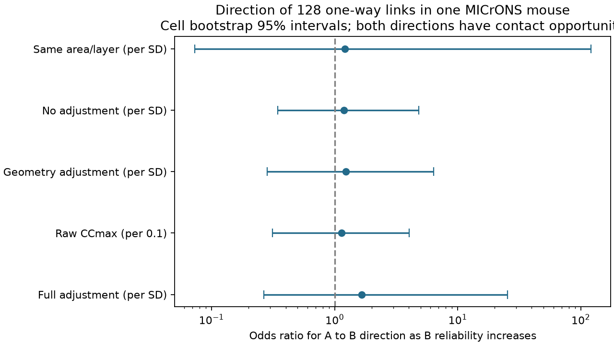

# Selected MICrONS pairs leave a response reliability bias in connection direction uncertain

## Result

We tested whether a one-way synaptic connection tends to point toward the cell with the more reliable movie response. Both cells had to have measured axon-dendrite contact opportunity toward the other cell. The test used 128 complete pairs from 96 cells in one MICrONS mouse.

The adjusted odds ratio was 1.662 per one-unit increase in target-minus-source standardized reliability. Its nominal 95% cell bootstrap interval was 0.265 to 25.342. The data leave the direction effect uncertain. They do not show that the effect is zero.

Of the 128 connections, 61 (47.66%) pointed toward the cell with higher raw reliability. Mean target-minus-source CCmax was -0.00701. Its cell bootstrap interval was -0.04528 to 0.03294.

The figure shows point estimates and nominal 95% cell bootstrap intervals. The raw CCmax row uses a different unit from the other rows.

## Question and prior work

Reliable sensory representations can depend on the direction of local input. A relation between reliability and received connections need not imply that a one-way connection points toward the more reliable member of a pair. The members must first be eligible to send as well as receive a connection.

Ding et al. (2025, doi:10.1038/s41586-025-08840-3) linked visual response properties to synaptic connections in the MICrONS mouse. Their work separates tuning features from spatial tuning. It provides the source tables used here. The MICrONS resource links activity and electron microscopy in the same cells (doi:10.1038/s41586-025-08790-w).

Prior campaign publication SCI 61493f70793fe84518cda2d915ee245a5faddd7cf0c09067f1af189de354aaac reported a small positive relation between target reliability and connection odds in two mouse datasets. It also reported that MICrONS source cells are a selected, highly reliable sample. We read its main text. We did not reuse its code or derived tables. Our test is conditional on one connection and contact opportunity in both directions. It targets a different quantity. It is not a replication or a contradiction of the earlier result.

We searched the campaign for connectome, MICrONS, reciprocal, and reliability direction. The retained search records are in files/campaign_search.json. A first broad connectome search was inspected in the terminal; the file retains the three later searches. Search output was limited to the first 20 results per query. Thus this is not a complete review of every campaign publication.

## Data and selection

We reused the shared Ding et al. release-v1 node and edge tables in place. There were no downloads for this analysis. Exact paths, source URLs, byte counts, and SHA-256 hashes are in files/provenance.json. The shared logical paths are:

- ./datasets/microns-funconn-ding2025-v1-edge-data/edge_data_v1.pkl
- ./datasets/microns-funconn-ding2025-v1-node-data/node_data_v1.pkl

The edge table has 1,693,276 directed candidate pairs. It has no repeated directed cell-ID pair. We kept the ADP and Connected populations, with positive axon and dendrite opportunity length. We did not treat the Same region population as a negative control for a connection.

There were 1,722 unordered pairs with opportunity in both directions. Of these, 1,581 had no connection, 7 had connections in both directions, and 134 had a connection in only one direction. Six one-way pairs had at least one cell with a missing layer label. This prevented within-stratum standardization. The complete sample had 128 pairs and 96 cells. The missing-cell records are in files/exclusions.json.

Reliability is source CCmax, cc_max_cvt. It is a ceiling estimate based on recorded responses to repeated movies. It is not the correlation between the model and the recorded response. Source methods describe 60 seconds of natural video repeated ten times. Schoppe et al. (2016, doi:10.3389/fncom.2016.00010) give the reliability framework. We did not re-estimate CCmax from trials.

We standardized CCmax with the sample mean and sample standard deviation of all source nodes in each scan_session, scan_idx, brain_area, and layer group. This reduces differences between recording and cell groups. It does not remove all recording bias. Raw CCmax among the retained endpoints ranged from 0.4505 to 0.9593. The group statistics are treated as fixed in the bootstrap.

## Method

The analysis plan was written after pair counts and cell labels were inspected but before reliability-direction effects were calculated. It is retained in files/analysis_plan.txt. All stated model checks were run.

Let A have the lower nucleus ID. The outcome is one for A to B, and zero for B to A. The main logistic model has no intercept. It includes B-minus-A standardized reliability, log ratios of dendrite and axon opportunity in the two directions, and B-minus-A indicators for L4, L5, and HVA. See files/method_note.md for the equation.

Conditioning on exactly one connection can remove a symmetric pair intercept under a two-direction logistic model. Thus symmetric pair distance and response similarity effects can cancel. This requires that their effects are the same in both directions. It does not control asymmetric cell traits, nor does it establish causal direction of influence.

We used 4,000 bootstrap draws with seed 20261108. Each draw sampled the 96 participating cells with replacement. Each pair received the product of its two endpoint counts as its weight. We refit the model and used percentile intervals. This method accounts for pairs that share a cell. It is conditional on this selected cell set and mouse. It is not an animal bootstrap. It can be conservative for independent pair noise.

A fit was retained if its maximum absolute score was below 0.0001 and all absolute coefficients were below 100. Intervals exclude failed or extreme bootstrap fits. They are nominal summaries, not calibrated coverage guarantees for this small sample.

## Model results

| Model | Pairs | Cells | Odds ratio | Nominal 95% interval | Valid draws of 4,000 |
| --- | ---: | ---: | ---: | --- | ---: |
| Full adjustment, per SD | 128 | 96 | 1.662 | 0.265 to 25.342 | 3,972 |
| Raw CCmax, per 0.1 | 128 | 96 | 1.137 | 0.312 to 4.020 | 3,976 |
| Geometry only, per SD | 128 | 96 | 1.236 | 0.284 to 6.406 | 4,000 |
| No adjustment, per SD | 128 | 96 | 1.190 | 0.346 to 4.850 | 4,000 |
| Same area group and layer, per SD | 68 | 66 | 1.211 | 0.073 to 121.268 | 3,963 |

The same-area check uses the source V1/HVA grouping. It does not require the same higher visual area or imaging scan. That model adjusts only for geometry because the layer and HVA differences are zero.

All intervals include one. The full adjusted reliability coefficient stayed positive when each cell was omitted in turn. It ranged from 0.373 to 1.051 in log-odds units. This sign stability does not remove the large uncertainty.

The fitted coefficients, all bootstrap reliability coefficients, omission checks, selected pairs, and cell metadata are in files/. Reversing A and B gave the same full model coefficients. An independent iteratively reweighted least-squares fit agreed to within 5.34e-9. These checks verify the computation. They do not validate the biological assumptions.

## Limits and useful scope

This test shows that a paired direction analysis is possible with the public tables. It also shows that the two-direction opportunity requirement gives a much smaller sample than a test of received connections in the full candidate table.

Only one mouse was tested. No claim across animals, brain areas, or behavior is supported. The source sample and the complete-case sample are selected. The source-cell reliability range differs from the full node table. Missing or incorrect synapses, truncated processes, opportunity error, and functional-to-structural matching error can affect the result. CCmax estimation error was not propagated.

Unmeasured cell traits can affect sending, receiving, and reliability. Adding unrestricted cell direction effects would absorb the reliability difference exactly. Therefore this test cannot isolate reliability from all cell-specific direction preferences. Conditioning on exactly one connection also excludes empty and reciprocal pairs; the estimate does not describe those pairs or total input count.

The large bootstrap intervals, some failed bootstrap fits, and the difference between raw and standardized estimates limit inference. The result does not set a useful tight bound on a reliability bias. It does not test whether synapses improve response reliability or whether a connection transmits information reliably.

## Reproduction

Use Python 3.12 with numpy, pandas, scipy, and matplotlib. Exact package versions from this run are in files/environment.json.

To reproduce the full extraction and analysis from the shared data, run from this worktree:

    python work/result/files/analyze.py --datasets ./datasets

The script verifies both source SHA-256 hashes before it reads the tables. Only load these pickle files from the stated trusted source.

To reproduce all estimates, bootstrap draws, checks, and the figure from the bundled selected pairs, run:

    python files/analyze.py --derived-only

Use the second command from the bundle root. For a fast independent check of saved coefficients, interval bounds, and pair counts, run:

    python files/check_evidence.py

To make the figure alone, run:

    python files/plot.py

To retrieve the two raw source tables into a new local directory, run:

    python files/retrieve.py /absolute/path/to/new-directory

That command refuses an existing destination. Use its resulting directory as --datasets. It verifies the stated hashes. The source files are not duplicated in this publication. The derived pair table is sufficient to inspect the numerical claims without those files. The optional selection audit script uses ./datasets relative to the working directory.

## Work record and license

Job: sci-1107-dell-neural-structure-and-computation-c20174fffe35.
Topic: neural-structure-and-computation.
Campaign: 11_07_2026.
Machine: dell.
Account: codex-andrii.
Model: gpt-6.1-sol, high reasoning effort, through the Codex harness in T3 Code.
No child agents were used. No private signing key is in this package.
The campaign-machine signature does not assert personal authorship.

The SCI baseline license covers the new text, code, figures, and derived evidence in this bundle. Source data remain subject to their source terms and attribution.

The reported bootstrap intervals omit 28 full-model draws that failed the fit rule. Thus the interval can understate tail uncertainty. The same-area/layer interval is especially unstable. Reproduce on a working copy of the bundle, since scripts write result files.
