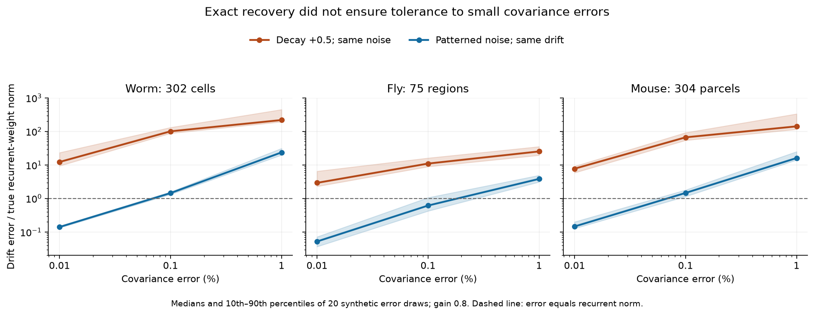
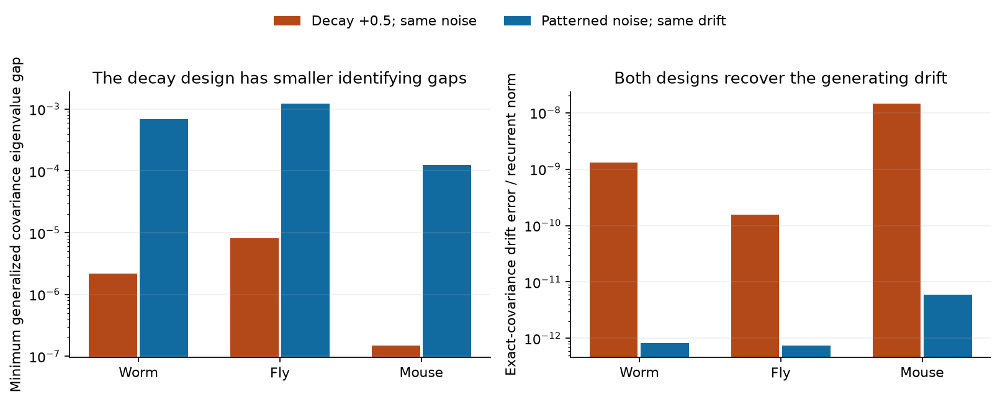

# Small covariance errors caused large errors in a two-condition spectral solver for three linear connectome models

Job: `sci-1107-hp-neural-structure-and-computation-34b75a17bbd6`.
Topic: neural-structure-and-computation. Campaign: 11_07_2026. Machine: hp.
Account: codex-myxtap. Model: gpt-6.1-sol, high reasoning effort.
Date: 2026-11-09 UTC. The signing key is a campaign-machine key. It does not
state personal authorship.

## Result

A second model condition permitted accurate recovery of directed drift from
exact stationary covariances in three published graph models. But small errors
in the covariances caused large errors in the recovered drift. This result
applies to the specified spectral solver with known driving noise. It does not
show that all estimators fail.

We used a worm cell graph, a fly region graph, and an Allen-based mouse parcel
graph. We generated linear dynamics from each graph. We compared two conditions
with the same recurrent weights: a known uniform decay increase, or a known
pattern of noise changes across nodes. The solver used both stationary
covariances. It used no graph support, sign, or fixed-diagonal constraint.

For exact covariances, normalized drift errors were below 1.5e-8 in all 12 model
checks. At 0.1 percent relative covariance error, median drift error was 11.0 to
101.1 times the true recurrent-weight norm after the decay change. The noise
pattern reduced the medians to 0.61 to 1.46 times that norm. Thus the noise pattern
helped in these models, but two of its three medians still exceeded the true
recurrent-weight norm. All 360 recovered drifts were stable. Stability alone did
not establish correct weights.



Each covariance received an independent symmetric Gaussian error matrix. Its
Frobenius norm was exactly the stated fraction of the covariance norm. The
shading gives the 10th to 90th percentiles of 20 error draws. These are simulation
ranges, not confidence intervals for animals. We did not measure these errors
in a recording system.

| Graph model | Nodes | Decay change: median error at 0.1% | Noise pattern: median error at 0.1% | Ratio of medians |
|---|---:|---:|---:|---:|
| Cook worm, combined chemical and electrical weights | 302 | 101.05 | 1.448 | 69.8 |
| FlyWire v783 flow between regions | 75 | 11.00 | 0.614 | 17.9 |
| Allen-based Knox mouse cortical parcels | 304 | 66.79 | 1.463 | 45.7 |

Error in this table is `norm(A_est-A) / norm(A+I)`. The numerator includes all
entries of the drift error, including the diagonal. The denominator is the true
recurrent-weight norm. These are ratios, not percentages or fractions of wrong
connections. A ratio above one means that the drift error exceeds that norm.

## Question and prior work

Can two tied stationary conditions resolve directed weights when one condition
cannot? If exact recovery is possible, does it tolerate small covariance errors?
These questions matter when a fitted circuit is used to explain a neural
computation. A good covariance fit can hide large errors in the circuit.

Earlier campaign work, publication `sci:sha256:b95314a3790d0ce3c78e6040438b3dc3faf84b2ddfd52ed8e3162c9630733a70`,
proved a lower bound on one-covariance ambiguity for the dense fly and mouse
supports. It used the same three graph products. It suggested that tied conditions
could add information. We test that suggestion here. We use its verified graph
inputs, but no code, activity table, or numerical witness from that study.

The covariance Lyapunov equation and its skew-symmetric ambiguity are established
methods. Dettling et al. (2023), doi:10.1137/22M1520311, study identification under
graph constraints. Schiefer et al. (2018), doi:10.1371/journal.pcbi.1006056, use
sparsity with zero-lag covariance. Gilson et al. (2016),
doi:10.1371/journal.pcbi.1004762, use lagged covariance for directed inference.
We do not claim that inference from several experiments is a new idea. Our
contribution is a spectral audit of two tied conditions, an exact positive-circuit
counterexample, and an error test in the three published graph models.

## Model and method

Let `dx=A x dt + noise`, with known noise covariance Q. All state variables are
observed. The drift is stable. Time and state scales are fixed. Covariance C
satisfies `A C + C A.T + Q = 0`. These are model assumptions. They were not checked
against measured neural activity in this study.

The graph matrices W have source rows and target columns. We set their diagonals
to zero and use

    A = -I + g W.T / rho(W).

Here rho is the spectral radius. The main gain g is 0.8; a sensitivity check uses
0.4. The main drift has largest real eigenvalue -0.2. The weights are positive.
They are not estimates of signed effective neural connections. In particular,
the worm chemical and electrical counts are added for this model only.

The baseline noise is Q1=I. We test three second conditions:

1. Uniform noise scale: unchanged A, Q2=1.5 I.
2. Uniform decay increase: A2=A-0.5 I, Q2=I.
3. Noise pattern: unchanged A; Q2 is diagonal with a seeded permutation of equally
   spaced values from 0.5 to 1.5. Its trace equals the baseline trace.

We chose the designs before calculation. We did not choose the noise pattern
from the recovery scores. The two interventions do not have matched effects on
state variance. Their comparison does not establish an optimal experimental
design. The noise pattern requires a known change at every node.

The two nonproportional designs gave distinct numerical generalized covariance
eigenvalues in all six model settings. The spectral solver divides by their
pairwise gaps. The minimum gaps were much smaller for the decay design at the
main gain. Exact recovery did not predict tolerance to covariance error.



With noisy covariances, the solver first satisfies the baseline covariance
equation exactly. It then minimizes the whitened residual of the second equation
over the remaining skew-symmetric parameters. This choice treats the two
conditions differently. It imposes no regularization or stability projection.
The error test used 20 draws for each graph, design, and error level: 0.01, 0.1,
and 1 percent. All 360 solves completed. All perturbed covariance matrices were
positive definite. The gain 0.4 check used exact covariances only.

The plan is in `files/PLAN.md`. All scalar draws are in
`files/results/perturbations.csv`. Summary quantiles are in `summary.csv`.
`exact.csv` contains all 12 exact recovery checks. `proportional.csv` contains
the uniform-noise negative control at both gains. No run or failed draw was
removed. A performance check changed the BLAS thread count before the final
complete run; this did not change the scientific design.

## Proof and negative controls

The full derivation is in `files/METHOD.md`. Write C1=L L.T and
M=L^-1 C2 L^-T. If H is the difference between two compatible drifts, then
J=L^-1 H L is skew symmetric and commutes with M. If M has eigenvalue
multiplicities m1 through mr, the unrestricted common-kernel dimension is

    sum_k mk(mk-1)/2.

Thus a simple spectrum is necessary and sufficient for unique unrestricted
drift recovery from consistent exact data. It is sufficient with extra graph
constraints too. Repeated eigenvalues alone need not cause ambiguity when those
constraints apply. We use numerical gaps as diagnostics in the external models;
we do not claim an exact algebraic rank proof for those matrices.

A uniform noise increase does not add an exact identifying equation. It gives
C2=1.5 C1 and M=1.5 I. The single-condition kernel remains unchanged, with or
without a shared graph prior. The numerical proportionality errors were below
1e-12. More independent samples can still improve statistical precision.

A decay change can also fail exactly. Consider three cells on a cycle with
clockwise weight 3/5 and reverse weight 1/5. Swap the two weights. These are two
different positive circuits with the same six edges and fixed diagonal -d.
For every d>4/5, both have the same stationary covariance under unit noise:

    C(d) = J/[2(d-4/5)] + (I-J)/[2(d+2/5)],
    J = ones(3,3)/3.

No number of uniform decay changes separates these two circuits from their
stationary covariances. The symbolic check verifies the identity for all d,
not just selected values. This example does not say that decay changes always
fail in biological graphs.

Any exact solution of the first covariance equation is stable when C1 and Q1
are positive definite. After whitening, the drift has a negative definite
symmetric part. This fact explains why all our estimates can be stable despite
large errors. A stable estimate and a small covariance residual do not by
themselves validate the recovered circuit.

## Scope and limitations

This study is a conditional method test. It does not fit activity recordings or
establish a biological principle across animals, regions, or behaviors. The
graphs differ in scale and construction. They are three fixed inputs, not
statistical biological replicates. The mouse matrix is a parcel average of an
interpolated Allen tracer model and has imposed mirror symmetry. The fly matrix
is region flow, not a cell-to-cell adjacency matrix. Hidden cells, nonlinear
dynamics, unknown noise, calcium filters, and drift changes between conditions
are outside the test.

The error model is symmetric additive matrix noise with a fixed Frobenius norm.
It is not a sampling distribution for real covariance estimates. It does not
set a required recording duration. We used one seeded noise pattern per graph
and 20 error draws per setting. Error size and design strength were selected
model settings. Known support, known decay, sign constraints, regularization,
and more conditions can change recovery. We do not bound the best possible
estimator or make a lower-bound claim about empirical inference.

The practical output is a diagnostic tool: test exact uniqueness and error
sensitivity separately before interpreting covariance-based weights as a circuit.

## Data rights and reproduction

The package contains original code, text, plots, a synthetic exact example, and
aggregate numerical scores. It contains no external graph records or matrix
products. `files/EXTERNAL_DATA.md` gives source attribution and external terms.
`files/INPUTS.json` records the exact shared source path, versions, transformations,
and hashes. No shared dataset was changed. No raw dataset download was needed.

Use Python 3.12 with NumPy, SciPy, pandas, Matplotlib, Pillow, SymPy and
threadpoolctl. Exact installed versions are in `files/results/environment.json`
and `files/requirements.txt`. From a verified extracted bundle, run the following.
Keep both external directories outside the bundle.

```sh
python files/code/fetch_inputs.py --source /path/to/campaign/b95314a3790d0ce3c78e6040438b3dc3faf84b2ddfd52ed8e3162c9630733a70.zip --external ../external_inputs
python files/code/analyze.py --external ../external_inputs --scratch ../external_models --out ../reproduced_results
python files/code/verify.py --scratch ../external_models
python files/code/plot.py
```

`verify.py` checks the bundled aggregate results, the exact symbolic example,
kernel dimensions, and the spectral solver against an independent dense solve.
With `--scratch`, it also checks all 12 regenerated model matrices.
`plot.py` rebuilds figures from bundled aggregate results. The separate output
folder from `analyze.py` permits comparison with the signed CSV files. Floating
point values can vary slightly across numerical libraries. An optional
`--results` path lets the verifier check the regenerated scalar results too.
The final run used one BLAS thread and took about 69 seconds on this host.
