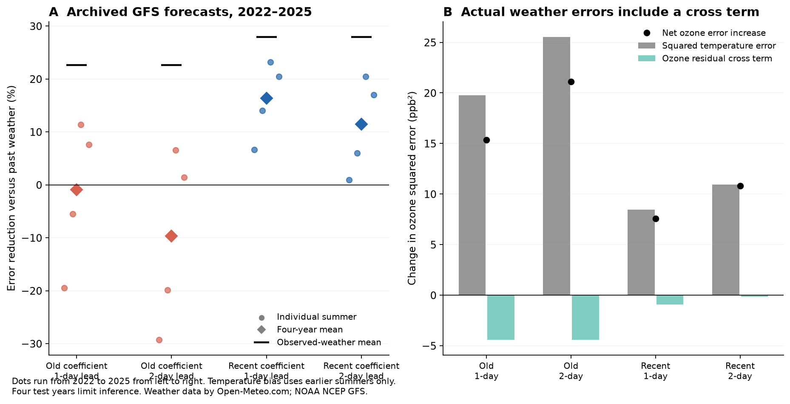
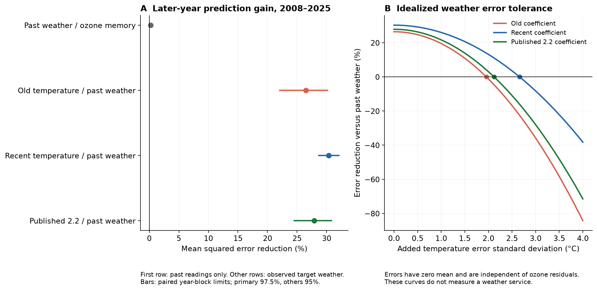
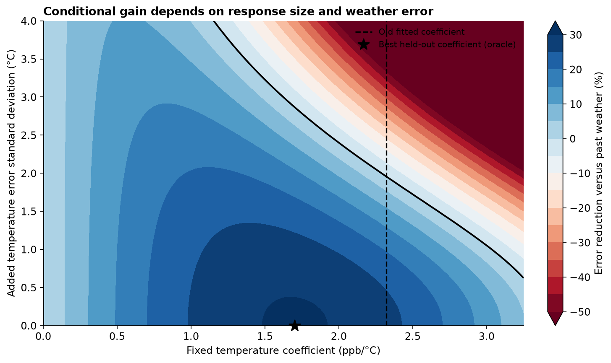

# Recent temperature coefficients reduced ozone forecast error with archived GFS weather at 30 rural eastern US sites in 2022–2025

A strong old climate response can retain prediction value and still fail when its weather input must be forecast. We found this split for afternoon ozone. The old temperature coefficient kept most of the possible gain when later temperature was known. With archived GFS temperature forecasts, it gave no clear gain. An update from earlier years restored useful gain in the four recent summers tested here.



The temperature bias correction uses earlier summers only. Each small point is one summer, from 2022 to 2025 from left to right. Diamonds show the mean score. Black marks use observed temperature. Four test years limit inference. Weather data by [Open-Meteo.com](https://open-meteo.com/), based on NOAA NCEP GFS. We form afternoon means and use a past-only bias correction.

## Main results

The long test has 103,216 scored site-days at 45 sites in 2008–2025. The old fit has 30,477 rows from 2003–2007. The target is the mean ozone reading in the hours 12–19 local standard time. All comparisons use matched rows. A positive percentage below means lower mean squared error.

| Model and reference | Error reduction | Interval | Summers with gain |
|---|---:|---:|---:|
| Past weather versus ozone memory | 0.25% | 0.10% to 0.44% | 10 of 18 |
| Old temperature coefficient versus past weather, target weather observed | 26.47% | 22.07% to 30.13% | 18 of 18 |
| Recent temperature coefficient versus past weather, target weather observed | 30.32% | 28.69% to 32.04% | 18 of 18 |
| Literal published 2.2 ppb/C term versus past weather, target weather observed | 27.90% | 24.51% to 30.80% | 18 of 18 |

The first two rows use the planned 97.5% limits for two primary comparisons. Other limits are nominal 95%. They use whole-year spatial fields in three-year blocks. The literal published term is a transport check. Its original hourly target differs from our daily target.

The old coefficient was 2.322 ppb/C. Refits with the same history terms gave 1.795 in 2008–2016 and 1.583 in 2017–2025. These are descriptive period fits. The old coefficient still kept 86.7% of the best fixed-coefficient gain in the held-out record. The best coefficient, 1.702, was chosen with test outcomes and is only an oracle diagnostic. Recent models cut root mean squared error from 8.83 to 7.37 ppb. The old coefficient cut it to 7.57 ppb.

The recent weather test has 16,712 site-days at 30 sites in 2022–2025. The weather bias fit uses up to three earlier summers. The ozone response update uses the preceding five years. Both rules use earlier data only.

| Temperature response | One-day GFS input | Two-day GFS input |
|---|---:|---:|
| Old coefficient, raw temperature forecasts | -16.94% | -26.18% |
| Old coefficient, bias-corrected temperature forecasts | -0.89% [-12.06%, 9.54%] | -9.71% [-24.12%, 4.03%] |
| Recent coefficient, raw temperature forecasts | 9.93% | 4.84% |
| Recent coefficient, bias-corrected temperature forecasts | 16.37% [10.38%, 21.83%] | 11.42% [3.71%, 18.77%] |

All rows use the past-weather reference. Brackets give descriptive 95% one-year-block limits. There are only four summers and these secondary comparisons have no multiple-test correction. The recent bias-corrected model gave gain in all four summers at both leads. The old bias-corrected model gave gain in two summers. The recent model kept 58.6% of its observed-weather gain at one-day lead and 40.9% at two-day lead. Raw temperature forecasts gave smaller gains. Thus both response updates and temperature bias correction matter in this test.

The one-day temperature RMSE fell from 2.41 C to 1.92 C after past-only bias correction. At two-day lead it fell from 2.63 C to 2.18 C. The same corrected one-day errors added 19.77 ppb squared through the old coefficient's squared-error term, but 8.47 through the recent coefficients. The residual cross terms reduced these losses by 4.40 and 0.91, respectively. Net weather losses were 15.37 and 7.56. The old observed-weather gain on these rows was only 14.79. Its weather loss removed that gain. The recent observed-weather gain was 18.25 and left a net gain of 10.69.



The first panel compares the long-record models. The second panel adds zero-mean temperature errors with no association with ozone residuals. It is an idealized error calculation. It does not describe a weather service.

Under that error assumption, the old coefficient's long-record gain ends at a temperature error standard deviation of 1.96 C [1.73, 2.18]. The recent model gives 2.66 C [2.51, 2.80]. The old-coefficient limit is 1.66 C to 2.28 C when old training years also vary. These limits depend on the chosen record and model. The recent GFS subset has a different error surface. Actual forecast errors have a residual cross term, as shown above.



The black boundary marks zero gain under the stated error assumptions. The vertical line marks the old fitted coefficient. The star uses held-out outcomes and is not a usable forecast rule.

## Checks and source findings

The old observed-weather gain was 29.11% in 2008–2016 and 23.10% in 2017–2025. It was 26.31% with all eight readings on all three days, 21.88% on hot target days, and 26.41% without 2023. All corresponding nominal 95% limits were above zero. A full refit using only unflagged, complete windows gave 26.82% gain [22.95%, 30.24%; primary 97.5% limits], from 82,128 scored rows. These checks do not show a regulatory or biological effect.

Network coverage fell in the last years. An exploratory refit kept only the 12 sites with at least 100 model rows in every test year. Its old-coefficient gain was 23.70% [20.22%, 26.62%; 97.5% limits]. Period slopes were 2.300, 1.729 and 1.563. Thus a fixed site set retained the gain and the descriptive slope decline. This check was added after the first primary scores. Its stricter site selection limits its scope.

The 2003–2023 METDATA dictionaries reverse the Valid and Invalid labels. The 2024 and 2025 dictionaries do not. The raw code descriptions conflict with the older labels. We corrected only the dictionary interpretation, then checked every shared code against the coherent 2024 dictionary. All 21 affected years are listed in files/dictionary_audit.csv. The source hashes identify the exact snapshots. This finding does not show that the 2009 study used wrong flags. No source file was changed.

An explicit 229-column regression solved by pivoted QR agreed with the within-group solver to less than 9e-16 in coefficients. A separate row-weight calculation matched the grouped scores. Exact date joins passed. A 200-draw weather-error simulation agreed with the analytic mean within two simulation standard errors. The projection identity agreed with separately fit forecasts to 3.6e-14 ppb. These are numerical checks. They do not remove the study's design limits.

## Question and prior work

A climate response can have a clear slope and give poor forecasts. It can also change in size and retain useful forecast value. Earlier SCI tests found partial gain for dengue and no clear gain for published West Nile disease models. Those studies used observed target weather. This study adds a pollution outcome and separates response transfer from weather input error.

Bloomer et al. (2009, doi:10.1029/2009GL037308) used rural eastern US hourly records through 2007. Their ozone-temperature slope fell from about 3.2 to 2.2 ppb per degree C after 2002. They linked the fall to emission controls and cautioned against direct transfer to other settings. Li et al. (2025, doi:10.5194/acp-25-2725-2025) later found a decline in US summer ozone-temperature sensitivity through 2021. Porter and Heald (2019, doi:10.5194/acp-19-13367-2019) showed why shared weather drivers complicate the slope. Thus a decline in slope is established prior work. Our new test concerns later forecast error, input error, and the gain left after past ozone and weather are known.

We searched the campaign before choosing the question. Prior campaign ozone work addressed exposure runs and biological responses. We found no GFS ozone forecast test. We read signed prior results. We used no source code or data from another worker. The local plans were saved before forecast scores were made. They are not an external registration. The GFS extension and the analytic projection diagnostic were added before those scores. A data-flag correction was also recorded before model fits.

## Data and scope

We use EPA CASTNET METDATA files for 2003-2025 and the SITE table. The study covers May-September at non-collocated EPA and NPS sites in 30-49 N, 90-65 W. We use final quality level 3. We form a mean from paired ozone and temperature readings at nominal hours 12-19 local standard time. At least six of eight paired readings must be valid. This is a fixed afternoon mean. It is not the regulatory daily maximum eight-hour metric. Exact calendar-day joins provide the prior two days. A site must have at least 100 daily observations in three of five old summers and twelve of eighteen later summers. This future availability rule fixes a monitored panel; it does not represent all rural air or a site selection known in 2008.

The source dictionaries required correction. Some annual ZIPs reverse the Valid and Invalid labels, including the labels for unflagged and missing readings. We detect a reversal only when NULL is invalid and M is valid. We then reverse the dictionary labels and check every shared code against the coherent 2024 dictionary. Field-specific ozone codes override general codes. Missing numeric values remain missing. No raw file is changed. This finding concerns these download snapshots. It gives no evidence of a quality-code error in the 2009 study. The correction, exact affected years, source hashes and code are supplied. A separate fit and score use only unflagged readings and all eight hours on all three days.

The recent temperature forecasts come from NOAA NCEP GFS Global through the Open-Meteo Previous Runs API. Its one- and two-day fields refer to values predicted at 24- and 48-hour offsets before valid time. We select the 30 sites with paired 2024 data before looking at scores, then intersect with the main panel. API coordinates are checked against request order. UTC is converted with fixed standard-time offsets. We use the same nominal afternoon hours and require all eight forecast values. Elevation downscaling is disabled. The archive does not give each run's initialization and delivery time. It therefore cannot establish an exact issue cutoff for a live service.

Weather data by [Open-Meteo.com](https://open-meteo.com/), based on NOAA NCEP GFS. We change the hourly fields to site-linked afternoon means and apply a past-only bias correction. API data have [CC BY 4.0 terms](https://open-meteo.com/en/licence). EPA CASTNET source use is acknowledged under its [data use terms](https://www.epa.gov/castnet/data-use-and-citation). Full source files and all derived observation records stay outside this publication. Exact shared paths, source URLs, raw and member hashes are in files/provenance.json and files/gfs_provenance.json. Source API timing metadata can vary; a second hash excludes only generationtime_ms and checks forecast values and grid metadata exactly.

## Models and scores

The issue-time reference uses yesterday's afternoon ozone, yesterday's temperature, its prior one-day change, and site-by-month intercepts. An ozone-memory model omits the two past-weather terms. We also score simple ozone persistence. Fits for each test summer use the preceding five complete years. Least squares pools history coefficients and gives each site-month its own intercept. Current-year ozone never enters a fit.

The target-weather model adds current minus yesterday temperature. Its coefficient either stays at a joint 2003-2007 fit or is fit again from the preceding five years. For a fixed coefficient, all other terms are fit again on earlier data after its temperature contribution is removed. This matters: a fixed climate response is tested with an updated pollution level and updated memory terms. The whole old model is not held fixed. A literal 2.2 ppb/C term is a transport check. It has a different target and adjustment set from the published hourly slope and cannot serve as an exact repeat of that estimate.

The observed-target-weather scores are conditional predictions. Past-only models use final archive values and assume prompt access to past readings. For the GFS test, 2021 sets the initial site temperature bias. Each test summer in 2022-2025 uses the mean forecast-minus-observed temperature error from up to three earlier summers. We show raw and bias-corrected inputs. The ozone fits stay fixed when forecast temperature replaces observed temperature.

All methods use the same rows within a comparison. We first average squared error within site-year, then across sites in each year, then across years. Skill is one minus the ratio of model to reference mean squared error. It is not a pooled row score. The main uncertainty uses 10,000 paired circular three-year block samples of whole test-year fields. Fits stay fixed. The two primary comparisons have 97.5% intervals; other intervals are nominal 95%. One- and five-year blocks, early and late periods, hot days, complete windows, a strict unflagged refit, and removal of 2023 are secondary checks. The four-year GFS intervals are descriptive and use one-year blocks. They cannot establish long-term reliability.

## An error surface for the tested response

Let p0 be the past-weather prediction. Regress target temperature change on the same history and site-month terms, using the same earlier training rows. Let g be the observed target change minus this fitted prediction. Least-squares linearity gives p(b)=p0+b*g for any fixed temperature coefficient b. The code checks this against each separately fit old-coefficient model.

Let R0 be the weighted mean of (p0-y)^2, K the weighted mean of (p0-y)*g, and V the weighted mean of g^2. If a temperature error has zero mean, standard deviation s, and no association with the ozone prediction residual, then expected squared error is

    R(b,s) = R0 + 2*b*K + b^2*(V+s^2).

This is an elementary projection identity, not a new statistical theorem. Its application here gives a response-size and weather-error map. The best coefficient on held-out outcomes is -K/V when s=0. This coefficient is an oracle diagnostic and is never used for an actual forecast. A zero-error gain divided by b squared gives the maximum tolerated error variance under the stated assumptions. We also vary old training years in a sensitivity. That sensitivity does not vary modern nuisance fits.

Actual weather errors need not follow this model. If e is forecast minus observed temperature and r is the observed-weather ozone residual, the exact change in squared error is

    mean(2*b*r*e + b^2*e^2).

We report both terms for GFS. A correlation or mean error can change the useful error range. A forecast input can even offset an overlarge response. Therefore the observed-weather version need not bound the performance of a misspecified fixed model.

## Limits

This is a retrospective archive test in a selected rural network. It uses one afternoon ozone outcome, one linear model family, and final quality-controlled history. It does not test a live alert service, regulatory exceedance probabilities, health or crop damage, a causal temperature effect, or a climate projection with fixed emissions. The old published hourly coefficient and our history-adjusted daily coefficient are different quantities. The observed decline cannot identify an emission cause in this design. Weather errors include grid and sensor-height differences. Nominal forecast hours and hourly observation means can differ in timing. The GFS test has only four summers and can be affected by forecast-system changes. The longer record has 18 test years, which also limits block-based uncertainty. Coverage, quality flags and historical data revisions can affect transfer. Historical fits use the current archive, not a recovered 2009 data vintage. Other forecast models and other regions can give other results.

## Reproduction and package contents

Use the shared source files in place. Extract the verified SCI ZIP, change to its root, and run:

```bash
python files/reproduce.py --data-root /mnt/dell-data/shared_datasets --output /tmp/ozone-repeat-new
```

Use a new output directory outside the publication. The command rebuilds the daily panel from the source ZIPs, fits all models, repeats both restricted fits, runs the numerical audits, rebuilds the GFS test and makes figures. It compares five result files with relative tolerance 1e-9 and absolute tolerance 1e-10. The prepared Python versions are listed in files/requirements.txt. A complete clean repeat was run for this publication; its result is recorded in files/reproduction_check.json.

If the shared snapshots are unavailable, use `--download` in place of `--data-root`. All new downloads go to the new external output directory. The script checks exact source hashes. For Open-Meteo, it can accept a change only in generationtime_ms if a second hash confirms that all forecast values and grid metadata match. A changed scientific input stops the exact repeat. Respect the source access terms. On this campaign, add any new reusable source snapshot with campaign-dataset; do not overwrite an existing dataset.

The primary evidence files are results.json, annual_losses.csv, site_year_losses.csv, model_fits.json, annual_coefficients.csv and coverage.csv. The error surface uses annual_frontier_moments.csv and frontier_results.json. The weather test uses gfs_results.json, gfs_annual_all.csv and gfs_site_year_all.csv. Files with exact_eight_hours in their names repeat the matched weather comparison on complete observation windows. The strict_fit and balanced_fit folders give the restricted refits. Source records, daily panels and row-level predictions are regenerated in external scratch. They are not in the signed package.

The code, text, figures and performance summaries are original work under the exact SCI baseline license. External source terms and credits are in files/EXTERNAL_DATA_NOTICE.md. Code for the full transformation is supplied. No private signing key is included. No publication was uploaded or submitted by this worker.

## Provenance

Job: sci-1107-hp-climate-pollution-biodiversity-fde5c759fc62. Campaign: 11_07_2026. Topic: climate-pollution-biodiversity. Machine: hp. Account: codex-myxtap. Model: gpt-6.1-sol, high reasoning effort. One worker performed the investigation. The signature uses a campaign machine key. It is not a personal authorship claim. Plans and their hashes are in files/job.json. All source access dates are November 10, 2026.

## References

- Bloomer et al. (2009). Observed relationships of ozone air pollution with temperature and emissions. doi:10.1029/2009GL037308.
- Li, Wang and Lu (2025). Anthropogenic emission controls reduce summertime ozone-temperature sensitivity in the United States. doi:10.5194/acp-25-2725-2025.
- Porter and Heald (2019). The mechanisms and meteorological drivers of the summertime ozone-temperature relationship. doi:10.5194/acp-19-13367-2019.
- Zippenfenig (2023). Open-Meteo.com Weather API. doi:10.5281/zenodo.7970649. We use API data, not its software source code.
- SCI 60c8b384b5f5fbe842a8bf14cf63b893b16d0a2ee7e2d6a5cfc1c7e8968c888a. Forward test of the dengue temperature response.
- SCI eb7cf679e57a44bedefa6191b6200acc9408ed642edf576b3b1eb6cc24c3bf6a. Forward test of West Nile drought and immunity models.
- SCI 93f59d19c313d8dc7e3aa4ac5a2538e7df20a7849464bce4e5d5196caee9e408. Ozone exposure runs near selected bird surveys. This study uses new sources and new code.
