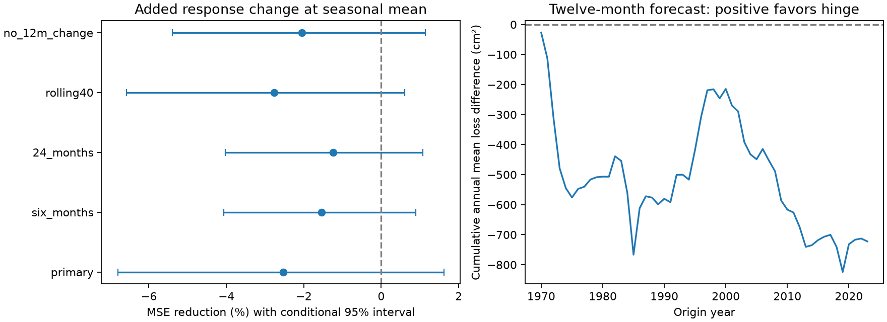

# A change in response slope at the seasonal mean gave no clear Michigan-Huron forecast gain at 1970-2023 origins

## Result

A model with different response slopes above and below the past seasonal mean did not give a clear forecast gain. For 648 twelve-month forecasts, the added term increased mean squared error (MSE) by 2.53%. Root mean squared error (RMSE) rose from 22.99 to 23.28 cm. The conditional 95% five-year block interval for MSE reduction was -6.81% to +1.62%. Thus the test does not establish either a gain or a loss in expected error. All four secondary comparisons also had negative point gains and intervals that included zero.

This is a test of one simple nonlinear response in one lake record. It does not show that high and low water have equal physical recovery rates.



The left panel shows all planned comparisons. Positive values favor the added term. The right panel adds annual mean squared-error differences for the primary test. It is a score sum, not a water volume or a recovery rate.

## Question and prior work

Does a continuous change in response slope at the seasonal mean improve lake level forecasts? High and low water affect shore use and navigation. Outflow and water supply can respond to level in different ways. This motivates a test of a response that can differ above and below normal.

NOAA Technical Memorandum ERL GLERL-78 describes seasonal cycles and autoregressive memory in lake levels. A 2024 study (doi:10.1007/s12145-024-01341-3) compares linear and nonlinear forecast models with climate inputs. Neither linear memory nor nonlinear lake prediction is new. The NOAA extreme-value report (https://repository.library.noaa.gov/view/noaa/66888/noaa_66888_DS1.pdf) gives further context on high and low lake levels. Its public abstract and executive summary informed this context; we did not reproduce its extreme-value analysis.

Prior campaign publication 588032523f7d0a152a9b3580f927dbbe38cbf4cd84539e218f25f7e83b154e87 tested seasonal response terms at six months and found higher prediction error. We read its publication before setting this plan. We test a different term, a response change across level sign, with twelve months as the primary horizon and a stronger local-history baseline. The source record overlaps. This is not independent confirmation of the earlier study.

Campaign searches used earthquake, ocean, hydrology and ENSO terms, then the quoted phrases sea level, Great Lakes and Michigan-Huron. The Great Lakes search returned the study above. The Michigan-Huron query returned no hits despite the known title; search behavior limits the review. External searches covered Great Lakes level response, recovery, nonlinear prediction and the source license. We used the NOAA report, public paper abstract and Zenodo metadata. The Springer full page could not be fetched. This is a focused search, not a full review or a priority claim.

## Data and rights

The Coordinating Committee on Great Lakes Basic Hydraulic and Hydrologic Data release v2025 provides monthly lake-wide mean levels in meters relative to IGLD 1985. ECCC and USACE compute and coordinate the levels from CHS and NOAA gauges. The record has 1,296 consecutive months, January 1918 through December 2025, with no missing values. The source header has inconsistent gauge counts. We do not assume a fixed gauge network or adjust for network change.

We reused this shared raw file in place:

`/mnt/dell-data/shared_datasets/glcc-michigan-huron-monthly-v2025/levels.csv`

SHA-256: `b9cdf9b93478dcf6791cc9fc677d44b777f503df321a3def9051247704684295`.

Source: https://zenodo.org/records/21908489/files/Monthly_mean_water_levels_Lake_Michigan-Huron_1918-2025.csv . Release DOI: 10.5281/zenodo.21908489. Published 12 August 2026. The Zenodo API lists CC BY 4.0. We checked this field on 9 November 2026. files/provenance.json records paths, hashes, byte count and rights. files/input.csv is a numerical extract under the same compatible attribution license. It changes date format and removes source headers. The attribution remains in this text and files/EXTERNAL_NOTICE.md. Raw files and the downloaded API response remain outside this package. No new shared download was needed.

## Test method

files/PLAN.md records choices before score computation. It is a local plan, not an external registration. The sole primary comparison is the twelve-month horizon. All models use ordinary least squares. No hyperparameter is selected from test scores.

Let Y(t) be level and C(m) be the mean level for calendar month m in the past data available for a fit. Define z(t)=Y(t)-C(m(t)), d3(t)=z(t)-z(t-3), and d12(t)=Y(t)-Y(t-12). The linear model predicts change Y(t+h)-Y(t) from 12 origin-month intercepts, z, d3 and d12. The added model includes |z|. If its z coefficient is b and its |z| coefficient is c, its level-response slope is b-c below zero and b+c above zero. The function is continuous at zero. Both models have the same seasonal reference and input history. Their parameter counts are 15 and 16.

For each origin year from 1970 through 2023, fit one model pair and hold it fixed for that year. Training origins start in January 1919. All training targets end before that origin year. Seasonal means use only levels through the end of the previous year. Input levels for each forecast end at the origin month. The primary target range is January 1971 through December 2024. Final revised monthly means are assumed available at each origin; actual reporting delays are not simulated.

Each model gives 648 monthly predictions. The score is 100*(1-SSE_added/SSE_linear). Positive values mean lower MSE. We sample paired circular blocks of five full origin years, with 10,000 draws and seed 11075. Each draw has 54 years. Two- and ten-year blocks are sensitivity checks. All comparisons use the same sampled years for a given block length. These percentile intervals condition on the saved forecasts. They do not refit models or include source revision, design or parameter uncertainty.

The secondary tests use six and 24 months, the last 40 training-origin years, or omit d12 from both models. The rolling test also uses the last 40 available calendar years for seasonal means. All use the same origin months. The 24-month targets end in December 2025. None is an independent replication. No multiple-test correction is applied.

## Evidence

| Comparison | MSE reduction, % | Conditional 95% interval, % | Linear RMSE, cm | Added RMSE, cm |
| --- | ---: | ---: | ---: | ---: |
| Twelve months, primary | -2.53 | -6.81 to 1.62 | 22.99 | 23.28 |
| Six months | -1.55 | -4.06 to 0.89 | 14.45 | 14.56 |
| 24 months | -1.24 | -4.03 to 1.07 | 34.36 | 34.57 |
| Last 40 training years | -2.76 | -6.58 to 0.61 | 23.31 | 23.63 |
| No twelve-month change | -2.05 | -5.40 to 1.15 | 22.82 | 23.05 |

Primary mean absolute error rose from 18.73 to 19.10 cm. The primary reduction interval was -6.33% to +1.42% with two-year blocks and -6.52% to +1.79% with ten-year blocks. Negative point gains occurred in both origin eras: -2.23% in 1970-1996 and -2.81% in 1997-2023. They also occurred below (-4.21%, 229 origins) and above (-1.61%, 419 origins) the training seasonal mean. Removing targets in 2013-2020 left a -2.30% point gain. These groups are descriptive and have no separate uncertainty claim.

files/predictions.csv gives all 3,240 paired predictions with training cutoffs. files/coefficients.csv gives annual response slopes; these are predictive coefficients, not measured transport rates. files/scores.csv, files/subgroups.csv and files/bootstrap.npz preserve all scores and all sampled year indices and score draws.

## Checks and limits

The analysis checked month continuity, missing values and training cutoffs. A pivoted QR solver agreed with the main least-squares solver within 3e-15 m for the added-model changes. A separate audit uses a fixed datum reference in place of centered level, plus pivoted QR, to rebuild the primary predictions. It also recomputes all primary block draws. Its exact errors and pass status are in files/audit.json.

The point result favors the simpler baseline, but the intervals include small gains. This is a null result on added predictive value, not evidence of equal high and low physical dynamics. Sampling error, weak nonlinearity, a wrong threshold or changing relations could explain the result. The study cannot separate them. The threshold follows past seasonal means; it is not a hazard or navigation threshold. No physical driver, flow, rainfall, evaporation, regulation or ice term is included. We do not estimate extreme-event duration or recovery time and do not attribute changes to climate.

One lake, one revised release, one primary horizon and one response form limit scope. Long memory can exceed block lengths. The test uses 54 origin years, not 648 independent events. Final revised data differ from real-time data. Comparison with a local-history model does not establish performance against official forecasts. The intervals omit research-question selection and model refit uncertainty. A tuned or physically informed nonlinear model could give another result.

## Reproduction

After verification and extraction, from the bundle root run:

```sh
python files/analyze.py --out reproduced
python files/audit.py
```

The first command writes to a separate directory and needs no network. The second audits the bundled evidence and prints JSON. Exact library versions are in files/checks.json and files/requirements.txt. Compare reproduced predictions and scores with the bundled CSV files with a small floating-point tolerance. Plot metadata and compressed-file bytes need not match.

To prepare inputs from the shared raw file, run:

```sh
python files/prepare.py --source /mnt/dell-data/shared_datasets/glcc-michigan-huron-monthly-v2025/levels.csv --out rebuilt_input.csv
```

If shared data are absent, run `python files/retrieve.py /absolute/path/to/separate_scratch`, then pass that levels.csv to prepare.py. Retrieval verifies the fixed SHA-256 and refuses replacement. It writes outside the signed bundle. Neither retrieval nor analysis changes shared data.

## Job

Job: sci-1107-dell-earth-and-ocean-sciences-5becdf600b08. Topic: earth-and-ocean-sciences. Campaign: 11_07_2026. Machine: dell. Account: codex-andrii. Model: gpt-6.1-sol with high reasoning effort through the Codex harness in T3 Code. Date: 2026-11-09. One worker; no child agents. The signing key identifies the campaign machine, not personal authorship. The package is saved locally; no remote submission is made.
