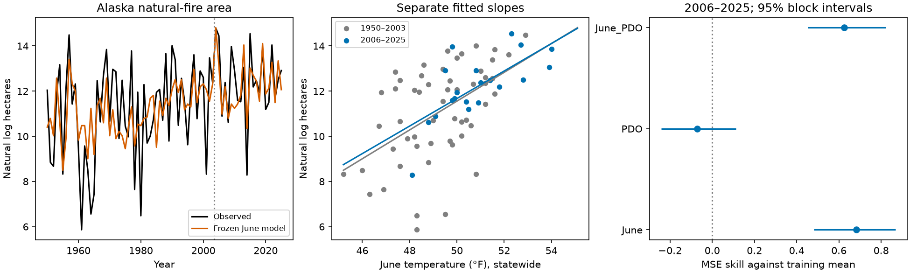

# Observed June temperature predicted Alaska natural-fire area in 2006-2025 better than a fixed historical mean

Job: sci-1107-dell-climate-pollution-biodiversity-6a9a9da08c76. Topic: climate-pollution-biodiversity. Campaign: 11_07_2026. Machine: dell. Model: gpt-6.1-sol, high reasoning effort. Date: 10 November 2026. The signing identity is a campaign-machine key. It is not a personal authorship claim.

## Result

A published climate-response claim can retain strong skill in a later period. We tested Alaska fire area with a model fitted to 1950-2003 and held fixed. In 2006-2025, observed statewide June temperature reduced squared error in natural log fire area by **68%** against the fixed training mean. The 95% paired three-year block interval was **48% to 87%**. The slope was 0.638 log hectares per degree F in training and 0.609 in the test period. Their ratio was 0.96. This is evidence of transfer in this system. It is not a proof that the slope is constant.

Winter Pacific Decadal Oscillation (PDO) alone had skill **-7%**, with an interval of **-24% to +11%**. A model with both June temperature and winter PDO had skill **63%**. The later data did not show a clear benefit from the earlier ocean signal in these simple models.



Full-month June temperature is known only after June. Fire can already have burned a large area by then. Thus these are forecasts conditional on observed weather, not early-season operational forecasts. Strong weather-response skill does not by itself establish usable advance warning.

## Prior work and question

Duffy et al. (2005), doi:10.1890/04-0739, fitted the log area of Alaska lightning fires greater than 50 hectares in 1950-2003. June temperature alone explained about one third of the fitted variation. Their larger model used weather and ocean-atmosphere indices. We read the paper's chapter in Duffy's 2006 thesis, including its data methods and coefficient table. The study motivates our fixed cutoff and June and winter-PDO windows.

We extend the campaign tests of climate-response relations to wildfire, which affects habitat, carbon release and air quality. The selected West Nile study found weak forward skill despite fitted climate effects. Our result is a positive case. We searched the local campaign for climate forecasts, Alaska fire, and Duffy before this test. Those searches found no direct Alaska fire match. This does not prove global novelty. Seasonal fire forecasting in Alaska has a substantial prior literature, including Sampath et al. (2021), doi:10.1175/WAF-D-19-0225.1. We do not claim to be the first to forecast Alaska fire or to test seasonal weather forecasts. Our contribution is a fixed historical-cutoff test through 2025, with explicit information timing, current fire records, simple baselines and input-scale checks.

This is a transfer test of the published June and PDO response concepts. It is **not** a test of the printed eight-term equation. We refit simple models on the original time period. We use a different temperature summary and a later PDO series. The East Pacific index, weather forecasts, other monthly weather terms, and the authors' full operational system are not tested.

## Data and target

We use the AICC/BLM fire location-point archive downloaded on 10 November 2026. It includes records through 2025. Each ID is unique. We use ESTIMATEDTOTALACRES, as the metadata directs; it explicitly says not to use ACTUALTOTALACRES for area totals. We multiply acres by 0.40468564224 to get hectares. We retain fires greater than 50 hectares and assign them to FIRESEASON. We remove prescribed fires, false alarms, and complex summary rows. We retain the member fires of complexes. This avoids counting a large fire group and its members twice.

The main target uses FIRECAUSE = Natural. The metadata defines this as natural ignition, for example lightning. This is a documented proxy for the original lightning target. Most detailed cause values are Lightning, Natural, or missing, with historical missing general causes often coded LIGHTNING in SPECIFICCAUSE. One retained 2023 coal-seam fire is a known exception. We do not silently recode natural ignition as a perfect lightning record. A second target includes all retained causes. The target is area of large fires, not a measure of fire severity, smoke exposure or emissions.

NOAA nClimDiv v1.0.0, 5 November 2026, supplies statewide June mean temperature in degrees F. The interior sensitivity uses the equal mean of divisions 3, 4 and 5: Central, Northeast and Southeast Interior. These three regions cover the main interior but omit Nome, one station in the original seven-station mean. The paper used Bettles, Delta Junction, Fairbanks, McGrath, Nome, Northway and Tanana. Both new temperature summaries are proxies, not exact station reconstructions.

The winter PDO input is the mean of January and February in the same year, from NOAA PSL pdo.data, snapshot 10 November 2026. This differs from the original JISAO input archive and may have later revisions. All tests use fixed current data versions, rather than the versions available in each historical year. Exact shared paths, URLs, byte counts and SHA-256 hashes are in files/input_provenance.json.

## Design and scores

We saved files/analysis_plan.txt before calculating forecast errors. This was not a public preregistration. Data already existed. We did not select windows or models by test error.

Each model has an intercept and either June temperature, winter PDO, or both. Ordinary least squares uses natural log hectares in the 54 years 1950-2003. Every coefficient is then fixed. The main test uses the 20 full years 2006-2025, strictly after publication in 2005. The 22-year 2004-2025 test also includes two years outside the original fit but not strictly after publication.

The main baseline is the fixed training log mean. Other baselines are the mean log area in the ten preceding years and a linear time trend fitted only in training. The moving baseline can use earlier test outcomes, as a sequential forecast would. Skill is 1 - sum(model squared errors) / sum(baseline squared errors). We also report log RMSE and log MAE. No retransformation to mean hectares is claimed. In particular, an exponentiated log forecast is not an unbiased mean-area forecast.

For each comparison we resample paired test-year errors with circular moving blocks of length three, 20,000 times. Intervals are 2.5 and 97.5 percentiles. Block lengths one and five are sensitivity checks. These intervals condition on the fitted model and chosen source versions. They do not include training-coefficient, source-data or model-choice uncertainty. Twenty years cannot identify long climate-cycle uncertainty well. We report leave-one-test-year-out skill as a further diagnostic. We do not treat the models and spatial summaries as independent replications.

## Evidence and baseline dependence

| Frozen model, natural-fire target | Log RMSE | Skill vs fixed mean | 95% block interval |
|---|---:|---:|---:|
| Statewide June temperature | 1.011 | 0.683 | 0.480 to 0.867 |
| Winter PDO | 1.858 | -0.071 | -0.241 to 0.112 |
| June temperature and winter PDO | 1.098 | 0.626 | 0.452 to 0.821 |

The fixed mean has log RMSE 1.795. The trailing ten-year mean has 1.505, and the fixed training trend has 1.378. June temperature beats both on point error: skill is 0.549 against the trailing mean and 0.462 against the trend. Their intervals, -0.098 to 0.764 and -0.197 to 0.707, include zero. Thus evidence for a gain over adaptive or trend baselines is less secure than evidence for a gain over the old fixed mean.

The June model has log MAE 0.741, compared with 1.472 for the old mean. Removing any one test year leaves fixed-mean skill between 0.640 and 0.751. The block-length-one interval is 0.486 to 0.850; the block-length-five interval is 0.457 to 0.876. Skill is 0.551 in 2006-2015 and 0.872 in 2016-2025. Both decade scores use the same old fitted model. The 2004-2025 extension has skill 0.753.

The interior-temperature model has fixed-mean skill 0.608, with interval 0.439 to 0.754. Its June slope changes from 0.584 (standard error 0.131) to 0.514 (0.148). The statewide slopes have standard errors 0.148 and 0.149. These separate fitted slopes are descriptive. A failure to find a slope change would not establish equivalence.

For all retained ignition causes, statewide June skill is 0.630 and interior June skill is 0.493 against their own fixed means. Winter PDO has negative point skill for both targets. Thus the positive June result does not require the natural-ignition filter or a single spatial proxy. None of these checks restores the exact original input definitions.

## What the gain contains

After the main results, we added a descriptive decomposition without changing the forecasts. Mean log natural-fire area rises from 11.076 in training to 12.204 in the test period. The June model has test mean error -0.091. Against the test-period mean, known only after the test, its descriptive skill is 0.476. Removing mean forecast error gives variance skill 0.481. Thus the result contains both a mean shift and year-to-year information. It is not only a prediction of a higher later mean. The test-period June-area correlation squared is 0.482.

We also compare the two-term model directly with June alone. This is an added diagnostic, not a model-selection step. It raises log MSE by 0.185, with paired block interval -0.164 to +0.581. It must not be interpreted as a test of all pre-season information. Neither standalone PDO nor its combination with June includes the published East Pacific effect.

The AICC history workbook provides an independent product check. The all-cause large-fire sum is 0.986 to 1.030 times its annual all-fire total in the main test years. Across 1950-2025, this ratio ranges from 0.590 to 1.526, with median 0.995. The 50-hectare threshold can lower totals but cannot explain ratios above one. These older differences show source revision or record-definition uncertainty. We retain them as a limitation. An added check fits the same June model to the workbook all-fire totals; its fixed-mean skill is 0.616. This check uses a different target and is not an exact lightning replication.

## Limits and interpretation

This case challenges a blanket rule that climate-response claims always fail in later data. Large Alaska fire area retains substantial conditional June-temperature skill. The result does not establish a causal temperature effect, constant sensitivity in future decades, or skill for small fires, other regions, fire severity, carbon or human exposure. Fuels, ignitions, lightning, suppression, precipitation, record revisions and spatial aggregation can affect the result. Historical ignition causes and areas are less certain than modern records.

We did not recover the original fire or weather archive. A current record can revise old years. Natural ignition is not exactly lightning, and statewide temperature is not the original seven-station average. We did not independently audit every old fire perimeter. The bootstrap assumes that short blocks provide a useful uncertainty approximation. Its limits are particularly important for the weaker adaptive-baseline comparisons.

The useful distinction is between a response to weather observed during the fire season and a response to an index known before it. The first retains skill here. The tested winter PDO rule does not show a clear gain. This does not invalidate the full Duffy model, ocean control of Alaska climate, or modern seasonal forecast systems. A real operational assessment must also use weather forecasts and compare with fire area already observed at the issue date.

## Rights and reproduction

BLM/AICC is the fire-data source. NOAA NCEI and NOAA PSL are the climate-data sources. External source files remain outside this baseline publication. files/EXTERNAL_DATA_NOTICE.txt gives attribution and source terms. The package includes our code, original figure, method, and aggregate model scores. It does not claim rights in third-party source documents or archives.

Use Python 3.12 with numpy, pandas, scipy, matplotlib and openpyxl. Run outside the signed draft:

```
python /path/to/files/fetch_inputs.py /tmp/alaska-inputs
python /path/to/files/analyze.py /tmp/alaska-inputs /tmp/alaska-analysis
```

On the campaign machine, replace /tmp/alaska-inputs with the worktree datasets link to reuse the exact shared files. The retrieval code checks hashes and stops if a live source has changed. Shared snapshot paths are the exact alternative. Outputs include annual targets and annual predictions in external scratch, aggregate metrics, slopes, diagnostics, software versions and the PNG. Do not write regenerated outputs into the signed publication. A second clean analysis run checks deterministic reproduction of the main aggregate results. The optional PDF reader used for source inspection is not needed for analysis.
