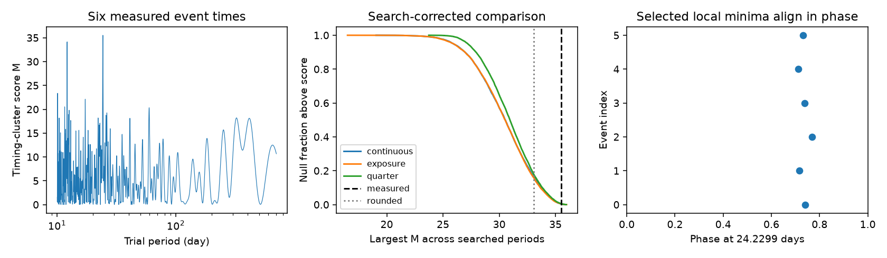
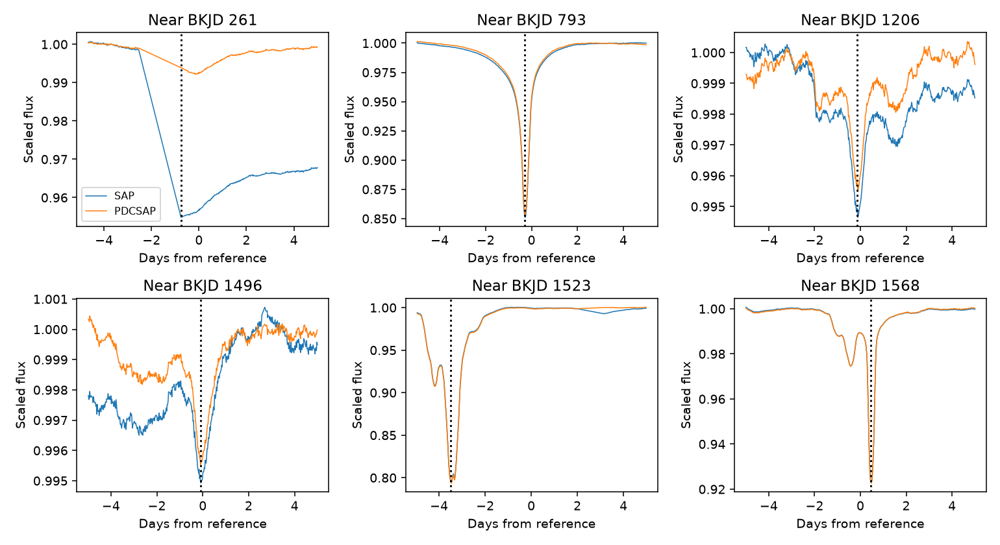

# Measured local minima give stronger phase alignment than rounded dates for six selected Kepler dips

## Result

We test six known dips of KIC 8462852 with a timing score across periods from 10 to 700 days. Local minima in Kepler release 25 aperture flux give a maximum score of 35.52 out of 36 near 24.23 days. Three sets of 10,000 random trials use continuous dates, valid exposure times, or fixed event quarters. Their full-search tail fractions are 0.0037, 0.0039 and 0.0053. The published rounded dates give fractions of 0.159 to 0.179. Eight measured-time choices give fractions from 0.0018 to 0.0068. Thus the selected time definition changes the conditional timing evidence. Event selection, gaps, quarter offsets and complex dip shape are not fully modeled by the null tests. One aperture minimum follows a data gap. A three-day window clipped another dip and was widened. The tests do not give a calibrated discovery probability. No new event, planet, physical cause or independent telescope confirmation is established. Code, input hashes, null arrays, figures and separate-scratch repeat steps are included.



| Random-date model | Measured minima: full-search fraction | Rounded dates: full-search fraction |
|---|---:|---:|
| continuous | 0.0037 | 0.1637 |
| exposure | 0.0039 | 0.1589 |
| quarter | 0.0053 | 0.1795 |


The table gives the fraction of random sets with a score at least as large as the measured score. Each random set repeats the full period search. The ranges in files/audit.json measure simulation error only. They do not measure errors in the event dates or in the null model. The three null models ask different questions. Their results are related tests, not independent evidence.

## Question and prior work

Do observation gaps, the late cluster of events, or the choice of event time change the timing evidence for a short orbital clock? We use the six known dips selected by Wright and Sigurdsson (2016). We do not search for new dips. The test extends their timing analysis. It does not establish that these six events are a complete or unique set of deepest dips.

Wright and Sigurdsson used a phase score and a scan from 10 to 700 days. They reported weak evidence after a test with random dates. We retain their score and search range. We add the actual exposure times, quarter counts and measured local times as controls. We credit the earlier null conclusion to them. This is a method check with new controls, not a discovery of the absence of a period.

Campaign searches for astronomy, 8462852, Boyajian and 24.2 found work on dip shape, centroid changes, a 0.88-day signal and aliases of a proposed 928-day pair. We read the signed 928-day alias study. It uses the same archive but tests different periods and a fixed repeated flux profile. We reuse its data inventory, not its code or fitted outputs. No returned campaign title reports the present observation-time test. This search does not prove novelty across all prior work.

## Data and method

We use Kepler release 25 long-cadence data for KIC 8462852, quarters 0 through 17. Time is BKJD, which is BJD minus 2454833 days. Read the FITS files directly from the external tar archive. Divide each flux product in each quarter by its finite-sample median before selecting a minimum. A raw quarter offset crosses the first event window. Without this correction it can set a false minimum. This normalization is a scale correction, not a physical baseline fit. Keep finite time, finite SAP and PDCSAP flux and SAP_QUALITY equal to zero for the valid exposure pool. SAP is the aperture flux. PDCSAP is a corrected flux product. These products share exposures.

The reference dates from the earlier paper are analysis parameters. For each reference date, select measurements within five days on either side. Smooth local flux with a five-sample median filter. Use the time of the smallest smoothed value. The primary set uses SAP and quality-zero exposures in the wider windows. Controls use PDCSAP and allow nonzero quality flags. All four sets use the same five-day half-width. We retain four three-day half-width sets as controls. An initial three-day window put the selected SAP minimum for the event near BKJD 1523 at the first available sample. We therefore widened all windows before the final comparison. This change was prompted by the data, not fixed in advance. The null simulations do not depend on the window width. There is no fit for a physical event center and no interpolation over gaps. A complex dip has no unique time. The reported-date control uses the six rounded dates without a new flux measurement.

For event times t_i and trial frequency f, the score is M(f) = [sum cos(2 pi f t_i)]^2 + [sum sin(2 pi f t_i)]^2. Its maximum for six events is 36. Large values mean that the events have similar phases. Use 7,997 frequencies evenly spaced from 1/700 to 1/10 per day. The largest score across that grid is the test statistic. Also use nested 3,999 and 2,000 frequency grids as resolution checks. This is a finite-grid test, not an exact continuous maximum. The same grid is used for observed and random times. A fixed 24.2-day score is saved as a diagnostic. That period was suggested using these events, so a fixed-period tail fraction is not a valid discovery significance.

Generate 10,000 random sets of six dates for each null model. The continuous model draws independent uniform dates between the first and last valid exposure. The exposure model draws six valid exposure times with replacement. The quarter model draws one valid exposure time from the quarter containing each reference event. It thus fixes the six quarter assignments, including repeated quarters. Each model assumes dates are exchangeable within its stated pool. A valid exposure is only a proxy for dip detectability. The simulations do not impose event duration, minimum event separation, a flux threshold or an event-selection pipeline. Quarter conditioning does not preserve all shorter-time clustering. The null models do not describe every possible nonperiodic physical process.

For each measured time set and grid, count k simulations whose maximum is at least the observed maximum. Report (k+1)/(10000+1). Save every null maximum, the fixed-period scores, all date choices, all grid tests and Monte Carlo standard errors. The random seed is fixed in code. We do not select the smallest tail fraction for the main result. The three-model primary table uses the same SAP time set.

## Controls and physical scope

All eight measured-time choices give full-grid tail fractions from 0.0018 to 0.0068 across the three null models. These choices share events and exposures. The main result uses the five-day half-width and quality-zero SAP minima. Its largest score is 35.5228 at 24.22988 days. The rounded dates give 33.0632 at 24.23712 days. Changes in grid density retain small measured-time fractions, but change their values. For the primary set, the 2,000-frequency fractions are 0.0030, 0.0035 and 0.0042. The 7,997-frequency values are 0.0037, 0.0039 and 0.0053. This finite-grid sensitivity is part of the result.

The selected SAP date near reference day 1523 is 1519.5021 in the wider window and 1520.0130 in the clipped window. The primary first date is 260.2458, the first available quality-zero sample after a gap in the local window. PDCSAP gives a later minimum there. A gap can therefore limit the true timing. The quarter-normalized SAP level also differs from the PDCSAP level around this event. We do not assert that any measured minimum is the physical center of its dip.



The figure scales each local product by its 90th percentile after quarter normalization. Lines connect measured samples, including across gaps; they do not show measured flux inside a gap. Vertical lines mark the primary measured dates. These plots expose the limits of local timing. They do not validate a common physical source.

The small measured-time tail fractions are conditional on these six selected windows and these timestamp rules. We have not repeated the original choice of six events, the choice of time rule or the wider research search inside each random trial. The result can guide a later independent event-selection and prediction test. It is not a calibrated false-alarm probability for an orbital detection.

An independent scalar calculation checks each observed maximum and every full-grid tail count. A pairwise cosine identity checks the vector score. A common time offset leaves the score unchanged to numerical precision. A synthetic exact 24.2-day clock gives M=36. These checks test arithmetic and an ideal positive case. They do not establish survey completeness or power for variable dust events.

Observation gaps and quality flags are tested through the time pools and the measured-date controls. The archive hash and each FITS member hash fix the input bytes. A large raw flux offset at the first quarter boundary was found in the window plot and removed by quarter normalization before the final measured-time test. This correction can still leave smaller quarter offsets. The test does not analyze target pixels, nearby stars, detector backgrounds or telescope pointing. It cannot exclude an instrumental cause of any dip. SAP and PDCSAP agreement is a processing check, not independent telescope confirmation. We have no independent observation test of these six phase alignments.

A stable orbital clock is one possible cause of clustered phases. Dust on changing orbits, variable obscurers, selection effects and chance can also affect timings. Failure to reject these null models does not prove that a clock is absent. It gives no bound on planet mass, orbit size or dust lifetime. No new planet, event or physical cause is established.

## Provenance and reproduction

Job: sci-1107-dell-astronomy-0cdf4aba4d29. Campaign: 11_07_2026. Topic: astronomy. Machine: dell. Account: codex-andrii. Model: gpt-6.1-sol, high reasoning effort, through the Codex harness in T3 Code. Date: 2026-11-09. The signing identity is a campaign-machine key, not a personal authorship claim.

Shared raw input: /mnt/dell-data/shared_datasets/kepler-kic8462852-all-lc-dr25-851ae629/lightcurves.tar. We reused it through ./datasets without changes. SHA-256: 33dbe1a703ca0f07fe38805f74d7a194ba8a8c344b5436c937136c358d4801bf. Size: 7,536,640 bytes. The source URL, all FITS member hashes, pipeline versions and library versions are in files/summary.json. The exact bytes define the data version. Raw data and paper files remain outside the signed draft.

This work uses data collected by the Kepler mission. Funding for the Kepler mission is provided by the NASA Science Mission Directorate. We thank NASA, the Kepler team, STScI and MAST. See files/EXTERNAL_DATA.md for source rights and attribution. The Kepler registry lists these data as public domain. We supply our code, text, figure and calculated results under the exact SCI baseline license. We do not assert ownership of external data or apply that license to cited papers.

Use Python 3.12 and the packages in files/requirements.txt in a separate environment. From the publication directory, run the following commands with output paths outside the publication:

```sh
python files/retrieve.py /absolute/path/to/external_raw
python files/analyze.py /absolute/path/to/external_raw/lightcurves.tar /absolute/path/to/new_results
python files/audit.py /absolute/path/to/new_results > /absolute/path/to/audit.json
```

The existing shared raw file can replace the downloaded file in the second command. The analysis checks its hash before use. It writes summary.json, three compressed null arrays and timing.png. The signed bundle preserves these derived outputs and all code. The audit checks scores and counts through separate arithmetic. To make the data-window figure and edge checks, also run python files/inspect_events.py with the same raw file and a separate output directory. The optional --reuse-nulls flag on analyze.py reuses existing null arrays in that output directory, but is not needed for a full repeat. Do not write into the signed bundle. This worker saves and verifies the signed archive locally. It does not upload or submit it.
