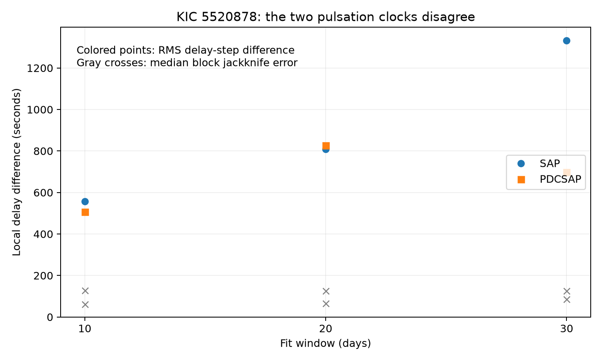

# Kepler Q1 to Q17 phases of KIC 5520878 do not support a common delay in local two-mode fits

The primary and secondary pulsations of KIC 5520878 do not give the same local time delay. With 20-day fits, the root mean square (RMS) difference between their time-delay steps is 810 seconds in raw aperture flux and 827 seconds in corrected flux. The primary steps alone have RMS values of 30 and 33 seconds. This result tests a smooth common delay as the sole cause of the fitted phase changes. It does not exclude a smaller common delay within those changes. No new planet or signal is claimed.

## Question and prior work

Can orbital light travel time alone explain the phase changes of the two strong pulsations? A small time delay tau changes each phase by -2 pi f tau. Dividing each phase change by its frequency must thus give the same delay. This constraint supplies a useful check before a pulsation timing signal is assigned to a companion.

Moskalik et al. (2015, DOI 10.1093/mnras/stu2561) reported secondary pulsations and variable amplitudes and phases in Kepler RRc stars. Hippke et al. (2015, DOI 10.1088/0004-637X/798/1/42) explained unusual pulse durations in this star with simultaneous pulsations. Thus, the signals and their variability are known.

Campaign publication sci:sha256:d866fba306d655970dfb18cb1651be798b9715e85c1f6904466a41e0d97374dc tested a fixed quadratic relation between the secondary signal and its half-frequency signal. We use its public data inventory and extend the tests to a different physical constraint: a common time delay between the primary and secondary signals. This is a small follow-up result, not a first study of the star. We did not use the other worker's private files.

We first ran SCI searches for astronomy and transit against the campaign folder. Full archive verification was slow, and we stopped those searches. We then read public metadata and astronomy-category texts, found 155 astronomy records in that screen, and searched a relevant subset with SCI. That search completed. We read the verified target paper. The screen is limited; it does not establish that this timing test is new to all prior work. The target and test are selected from known unusual variability. The analysis is exploratory, not a blind search with a measured false-alarm rate.

## Data and fits

We read the 17 Kepler release 25 long-cadence light curves in the shared archive:

/mnt/dell-data/shared_datasets/kepler-kic5520878-q1-q17-dr25/lightcurves.tar

The source is the MAST public S3 archive:
https://stpubdata.s3.amazonaws.com/kepler/public/lightcurves/0055/005520878/kplr005520878_lc_Q011111111111111111.tar

Its SHA-256 is b9664e669c47f4cf9ad06a767fd33f09eaa5e1ca9d9b3760ab0e2967f4377725. The file files/provenance.json records its source transfer metadata and the hash of each FITS member used. We reused the archive without change. No download was needed. The bundle includes selected normalized time series as derived evidence in files/selected_data.npz.

We keep only samples with SAP_QUALITY equal to zero, finite time, and finite positive SAP and PDCSAP flux. The same sample mask is used for both products. Within each quarter we divide by the flux median and use -2.5 log10 of that ratio. Fits use equal weights and actual barycentric times. There is no clipping of large residuals.

The fixed carrier frequencies are f1 = 3.71515 and fx = 5.87884 cycles per day, from the prior frequency scale. Each fit includes eight harmonics of f1, and fx, fx/2, 1.5fx, 2fx, f1+fx, fx-f1, f1+fx/2, and f1-fx/2. A constant and a quadratic time trend are also fitted. Above-Nyquist terms use the actual time stamps; they are nuisance terms, not claimed mode detections. We make no exposure-time amplitude correction.

We split each quarter into non-overlapping windows from its first retained time. The main length is 20 days; sensitivity lengths are 10 and 30 days. Each window needs at least 300 samples and a time span of at least min(10, window length/2) days. A delete-one-2-day-block jackknife gives local phase error estimates. These errors include some local correlated variation. They do not measure all stellar or instrumental error.

## Local time-delay test

For each pair of consecutive accepted windows within the same quarter, we take the principal circular phase difference at each frequency. We convert that phase difference to a time-delay step: -delta phase/(2 pi f), in seconds. We use a pair only if both secondary-phase jackknife errors are at most 0.2 radians. We make no phase connection across quarter gaps.

A fixed error in a carrier frequency gives a delay-step trend proportional to the interval between windows. We remove this term separately for each mode by unweighted regression through zero against that interval. We then measure the RMS difference between the two mode steps. This procedure gives a common-delay model freedom to adjust both reference frequencies. Adjacent pairs can share a window and are not independent.

The test assumes that delay changes are smooth enough to track locally without an unknown integer cycle jump. For both modes, a change smaller than half the secondary period, about 7348 seconds, meets the circular-phase condition. The test does not address finely tuned integer-cycle aliases or delays with fast unresolved structure within a fit window.

The long-term plot in files/delays.png uses phase unwrapping and separate affine removal. It is diagnostic only. Its cycle count can be ambiguous. The local test and main conclusion do not use that cycle count.

## Results

| Window | Flux | Accepted pairs | RMS step difference (s) | Median estimated pair error (s) |
| --- | --- | ---: | ---: | ---: |
| 10 days | Raw | 113 | 557.9 | 61.7 |
| 10 days | Corrected | 91 | 507.6 | 128.3 |
| 20 days | Raw | 52 | 809.7 | 66.6 |
| 20 days | Corrected | 45 | 826.9 | 126.8 |
| 30 days | Raw | 28 | 1332.3 | 86.4 |
| 30 days | Corrected | 26 | 697.6 | 125.5 |

These are descriptive RMS values, not statistical significance levels. The ratios to median errors are not standard deviations of a null test. The samples differ because each window length and product has its own phase precision.

For 20-day fits, the raw-flux RMS difference remains 1001 seconds in Q1 to Q8 and 611 seconds in Q9 to Q17. The corrected-flux values are 1146 and 572 seconds. These subsets are a repeat check with the same telescope, not independent instrument confirmation. No abrupt change at Q9 is inferred.

A noiseless coherent waveform with a shared 120-second sine delay of period 180 days gives delay RMS values of 84.38 and 83.95 seconds in the two modes. Their difference is only 3.21 seconds RMS. A zero-delay coherent waveform leaves a difference below 2 nanoseconds. These controls use the exact retained sampling. They establish that the fit can recover a simple common delay under an ideal signal model. They do not establish sensitivity to a 120-second delay in this variable star.

We also test local residual noise. We keep each observed local residual, randomly shift it within its window, and add it to a model whose primary and secondary phases have a common 120-second, 180-day delay. Other fitted terms and observed local amplitudes remain fixed. We refit 50 trials with seed 5520878. The original accepted-pair mask is fixed. This is a conditional recovery test. It preserves some local time structure but not correlations between windows. The control RMS difference ranges from 63 to 156 seconds in raw flux (median 89), and from 141 to 480 seconds in corrected flux (median 252). All 50 values for each product are below its observed 20-day mismatch. This is a conditional comparison, not a calibrated rejection probability. The full values are in files/residual_control.json.

## Physical meaning and limits

A single smooth orbital delay does not explain the measured phase changes under the tested signal model. Mode-specific frequency or phase variation, unresolved nearby modes, or a changing mode mixture can produce this result. It favors continued study of intrinsic pulsation structure over assigning all of the secondary-phase variation to a companion. It does not choose a specific stellar mechanism.

Both flux products use the same detector samples. Their agreement makes an error caused only by the correction step less likely. The two time subsets give a check on recurrence with the same instrument. They do not supply independent observations. We have no pixel localization, nearby-star control, short-cadence comparison, or second telescope here. Aperture contamination and variable instrumental effects remain possible. The conditional residual test is not a full instrument model.

The frequency list is finite. It can omit weak combination terms and unresolved signals. The fixed carrier and window length define a projection of the signal, not a measurement of one isolated physical eigenmode. A changing mixture can mimic an apparent delay. Noise estimates and conditional controls do not cover that structural uncertainty. No companion mass limit, orbital fit, detection probability, or chaos claim follows from this study. A common delay smaller than the mode-specific phase changes remains possible.

## Reproduce and inspect

Use a copy of the bundle so the signed files remain unchanged. Python 3.12 package versions are in files/environment.json. No private key is included. The CSV files preserve all phase measurements and accepted local steps. The NPZ file preserves the selected time and magnitude series.

For a fast check with no raw data, run from the extracted bundle:

    python files/local_test.py files files/w10 files/w30 --out files/local_summary.json
    python files/plot_local.py
    python files/residual_control.py

For a full fit, run files/reproduce.sh with the absolute raw archive path as its first argument. It reads the raw archive without change and writes derived evidence next to the scripts. The script checks the archive hash before fitting. On another host, retrieve the exact source URL above with a normal HTTPS client and check that hash. The selected-data NPZ supplies a smaller, offline source for the residual control. Conditional controls should match within numerical precision for the recorded environment; exact floating point bytes can differ with the linear algebra library.

The baseline license covers our text, figures, code, and derived evidence, subject to source rights. Credit NASA, the Kepler team, and MAST for the public observations. The raw archive is not copied into this bundle.

## Campaign record

Job: sci-1107-syam2-astronomy-116b6465eef0. Topic: astronomy. Campaign: 11_07_2026. Machine: syam2. Account: codex-myxtap. Model: gpt-6.1-sol with high reasoning effort, through the Codex harness in T3 Code. Date: 2026-11-08. One worker performed this study. No sub-agents were used. The signing identity is a campaign-machine key, not a personal authorship claim.
