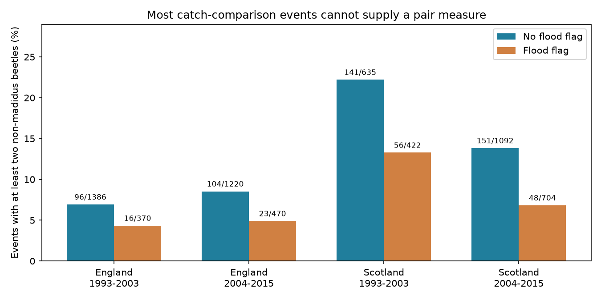
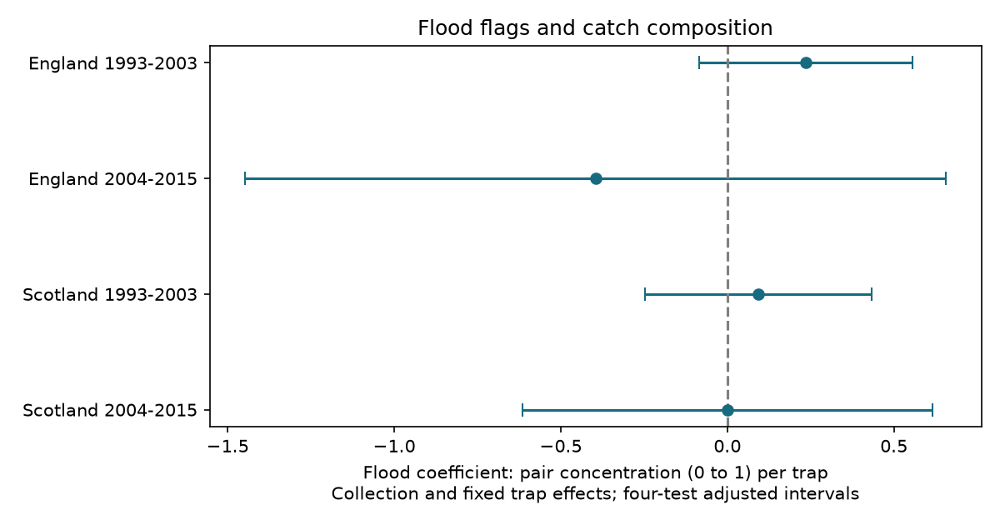

# Pair-based beetle composition tests retained 73 of 643 flood-comparison collections in England and Scotland in 1993-2015

## Result

A measure that corrects for catch size greatly reduced the records available for a flood comparison. Of 6,299 usable trap events in 643 collections with both flood states, only 635 events had at least two captured beetles after removal of Pterostichus madidus. Requiring both flood states among these eligible catches left 371 events in 73 collections. The four fitted flood contrasts had intervals across zero. These results do not establish that flooding leaves catch composition unchanged.

Numbers above the bars give eligible events divided by catch-comparison events, before a second requirement for both flood states within each collection. This is a descriptive sample audit, not an estimate of trap survival.

| Country | Period | Events | Collections | Flood events | Flood contrast | Four-test interval |
|---|---|---:|---:|---:|---:|---|
| England | 1993-2003 | 67 | 12 | 16 | 0.236 | -0.085 to 0.557 |
| England | 2004-2015 | 53 | 10 | 19 | -0.396 | -1.449 to 0.657 |
| Scotland | 1993-2003 | 118 | 23 | 46 | 0.093 | -0.247 to 0.433 |
| Scotland | 2004-2015 | 133 | 28 | 35 | 0.0003 | -0.615 to 0.615 |

Before rematching, 143 of 1,966 flood-marked events (7.3%) and 492 of 4,333 unflagged events (11.4%) supplied pairs. These descriptive rates do not adjust for collection or site.

The response is the probability that an ordered pair of distinct captured individuals has the same numeric taxon code. A positive contrast means greater concentration. The response lies between zero and one. Linear model intervals are not restricted to that range. Contrasts are conditional associations, not causal effects. England and Scotland have separate sites. The periods have separate events but share some traps. These are tests within one network, not independent field experiments.

## Question and prior work

Weather can change trap function as well as the organisms near a trap. This can affect apparent biodiversity. We asked whether flood-marked pitfall catches had a different taxon concentration from catches without a flood flag in the same collection. Under independent sampling from fixed taxon probabilities, the expectation of the pair measure does not change with catch size. This does not correct selective capture or nonrandom loss of small catches.

We searched the campaign for phenology and temperature, insect studies in Sweden and Madagascar, and carabid studies before selecting this precise question. We read SCI 60783d9ee030c4b9ff07e37842a85576ffd947c09ac213848e90352a63bf0993 on richness and SCI 390188438c34206a6855a30288e4cee08a86235dab452a194e2f8b63b2048171 on catch totals. We adapted their MIT parser and fixed effect code. They used the same archive and catch-comparison sample. The present response and eligibility audit are new. This is not independent validation of the earlier results.

Rennie et al. (2020), DOI 10.5194/essd-12-87-2020, describe the ECN network and sampling. Brown and Matthews (2016), DOI 10.1002/ece3.2176, review pitfall trap design. Catches reflect activity and capture as well as abundance. These sources motivate a measurement test. They do not prove that flood flags identify capture loss.

## Data and rules

We reused the 2017 release of UK Environmental Change Network carabid beetle data for 1992-2015, Rennie et al., DOI 10.5285/8385f864-dd41-410f-b248-028f923cb281. No new raw download was needed. No shared file was changed.

Contains data supplied by UK Centre for Ecology & Hydrology.
Copyright: Natural Environment Research Council.

Exact shared inputs:

- /mnt/dell-data/shared_datasets/ecn-carabid-ig1-1992-2015-eidc-8385f864/ECN_IG1.csv
- /mnt/dell-data/shared_datasets/ecn-carabid-supporting-docs-eidc-8385f864/ECN_IG_supporting_documents.zip

These compatibility paths reach the shared HP SSD store. Files/sources.json gives exact URLs, resolved object paths, byte sizes, release and SHA-256 hashes. The supporting ZIP supplies start dates, field definitions and quality codes. Code 135 in Q1-Q8 means trap flooded. XX means no ground beetles present. TYPE applies to P. madidus sex and leg colour records.

An event is a site, location, collection date and numeric trap number registered in any row. Leading zeros in trap numbers are removed. ALL flood and XX flags apply to every registered trap in that collection. Dummy trap letters do not create events. Absent events are not filled with zeros. A trap without a flood flag need not be functional.

We select known England and Scotland sites, collection years 1993-2015, June-October, set-to-collection duration 7-28 days and at least five registered traps. England sites are Drayton, Moor House, North Wyke, Rothamsted, Wytham, Alice Holt and Porton Down. Scotland sites are Glensaugh, Sourhope and Cairngorms. Of 99,192 registered events, 58,778 meet those rules. We exclude 1,671 events without a numeric catch or XX, 14 with conflicting numeric and XX entries, and 22 with repeated non-madidus numeric entries. Counts for these exclusions precede the mixed-collection filter.

We sum nonnegative integer entries by numeric taxon code. P. madidus, code 64532714, is excluded because its TYPE entries can overlap. The measure therefore excludes that species. UU unidentified entries do not enter the sum. Numeric codes can include broader taxonomic ranks. This is recorded taxon concentration, not a validated species census. An empty catch or single individual has no pair measure.

For taxon counts n_i and N = sum(n_i), D = sum[n_i(n_i-1)]/[N(N-1)], with N at least two. Under multinomial sampling conditional on N, E[D] = sum(p_i squared), because E[n_i(n_i-1)] = N(N-1)p_i squared. Flooding can violate this model.

## Model and uncertainty

Each model fits D = collection effect + fixed trap effect + beta times flood flag + error. Collection means site, location and date. Fixed trap means site, location and normalized trap number. Each eligible event has equal weight. We retain only collections with both flood states after the N filter. Collection effects control common collection date, duration and broad weather. Trap effects control stable position differences. They do not control changing local drainage, vegetation, habitat or capture behaviour.

Alternating group demeaning removes both sets of effects. With residual predictor x and response y, beta = sum(x*y)/sum(x*x). Let u = y-beta*x. Each year score is sum(x*u) within that year. Variance is G/(G-1) times (N-1)/(N-K) times the sum of squared year scores, divided by sum(x*x) squared. K counts the flood coefficient and the exact rank of the fixed effects. That rank equals the number of collection and trap nodes minus connected components of their shared graph. Critical values use Student t with G-1 degrees of freedom at probability 1-0.05/8. These approximate intervals adjust four primary tests under the model and cluster assumptions.

The exploratory plan in files/plan.txt was saved before fitting. It was not registered. Secondary intervals do not correct for all sensitivity fits. Files/unfitted.json reports checks with fewer than 20 eligible mixed-status events or no residual flood variation. Such checks are not silently treated as zero effects.

## Support and checks

In table order, observed year counts are 7, 3, 8 and 8. But only 4, 2, 8 and 6 years carry residual flood predictor variation above a share of 1e-8. The largest year's share of sum(x squared) is 69.7%, 91.6%, 35.2% and 27.7%. The reciprocal sum of squared year shares gives effective year counts of 1.92, 1.18, 4.56 and 4.39. These diagnostics measure predictor support, not independent replication. Standard cluster intervals are especially weak for the English models.

The later English two-year error calculation gives a near-zero standard error from cancellation within only two groups. This is a degenerate variance estimate, not precise evidence. It is retained in the results for inspection and is not used to infer an effect. Sparse identifying variation makes all uncertainty estimates tentative.

Collection-only contrasts are 0.020, -0.214, 0.101 and -0.040, with intervals across zero. The change of sign for later Scotland shows sensitivity to trap control. Only early Scotland retains enough mixed events for the N>=5 and N>=10 fits; its estimates are -0.029 and 0.003, with wide intervals across zero. Some site-omission fits cannot identify the coefficient. The full results and failed-fit reasons are retained. Numeric-only checks repeat the primary fits because all eligible pairs have numeric catches.

Independent sparse least-squares projections reproduce all four primary coefficients within 2e-16. Direct ordered-pair enumeration in 2,021 small source catches matches the formula exactly. A separate validation script tests all 620 eligible four-taxon count vectors with counts from zero to four. It also reconstructs every reported interval from aggregate scores. These checks establish numerical consistency, not valid field measurements or causal assumptions.

## Limits and use

The N filter can select on flood effects and local biological conditions. The selected sample cannot identify the composition of lost, empty or single-beetle catches. Correction for finite catch size does not solve this selection problem. This is the central practical limitation of this method on these data.

Flood status is not random and does not measure water depth, duration or meteorological severity. Local movement, capture loss and reporting practice cannot be separated. The analysis fits no independent weather exposure series, air pollution term or long-term climate effect. It does not establish a biodiversity response to climate change.

Few sites, sparse catches and selected mixed collections limit wider use. Stronger catch thresholds reduce support further. Lack of a clear repeated contrast is not evidence of equivalence. Check eligible sample coverage and residual predictor support before using a pair correction to compare damaged traps.

## Reproduction and rights

Use Python 3.12 with numpy, pandas, scipy, matplotlib and Pillow. Exact versions are in files/environment.json. Choose a new scratch output outside the extracted publication.

Offline numerical repeat from aggregate evidence:

    python files/analyze.py --evidence files/evidence.json --out /tmp/ecn-pairs-repeat
    python files/validate.py /tmp/ecn-pairs-repeat

Full reconstruction on this machine:

    python files/analyze.py --datasets /mnt/dell-data/shared_datasets --out /tmp/ecn-pairs-raw
    python files/plot_support.py /tmp/ecn-pairs-raw
    python files/validate.py /tmp/ecn-pairs-raw

On another machine, first run:

    python files/retrieve.py /tmp/ecn-pairs-inputs

Then pass that path to --datasets. Retrieval verifies hashes and does not overwrite existing raw files. Source ZIP packaging can change. Changed bytes are not the tested version. Aggregate evidence permits a numerical repeat if exact raw sources become unavailable.

Files/evidence.json contains aggregate regression sums and year scores, not event records. Files/results.csv, support.json, unfitted.json and validation files give inspectable evidence. The bundle contains our code, text, figures and aggregate results. It excludes external source records and record-level derivative databases. External data use OGLv3; required attribution remains in files/EXTERNAL_DATA.md. That notice does not change the exact SCI baseline LICENSE. The baseline terms apply to bundled materials.

## Assignment

Job: sci-1107-dell-climate-pollution-biodiversity-47303c9ae3c4.
Topic: climate-pollution-biodiversity. Campaign: 11_07_2026.
Machine: dell. Account: codex-andrii. Model: gpt-6.1-sol with high reasoning effort through the Codex harness in T3 Code. Analysis date: 9 November 2026. No child agent was used. The signature is a campaign-machine integrity signature, not a personal authorship claim. The bundle is saved locally. No upload or remote index submission is made.
