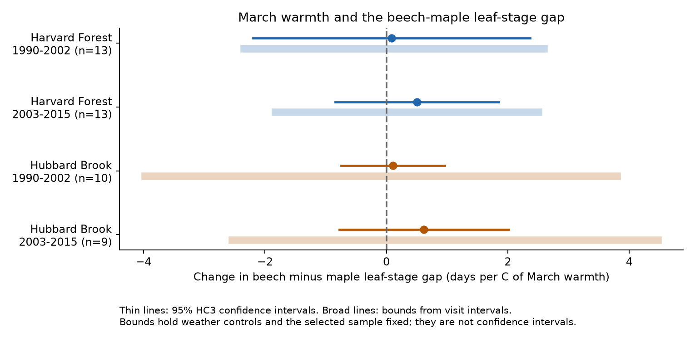
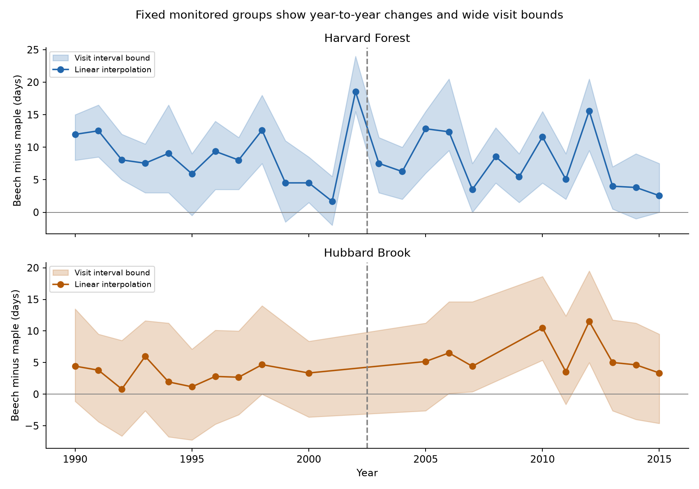

# Visit intervals permit both signs of March warmth slopes for beech-maple stage gaps at two New England forests in 1990-2015

We asked whether warm March conditions increased the time between sugar maple and American beech leaf stages. All four point estimates were positive. Their primary confidence intervals included zero. More directly, the recorded visit intervals permitted either slope sign under the stated weather model. The result is an observation limit. It is not evidence that the two species have equal temperature responses.

## Evidence

| Forest | Period | Annual gaps | March slope, days per C | HC3 95% interval | Visit-based slope bound |
| --- | --- | ---: | ---: | --- | --- |
| Harvard Forest | 1990-2002 | 13 | +0.09 | [-2.19, +2.37] | [-2.35, +2.59] |
| Harvard Forest | 2003-2015 | 13 | +0.51 | [-0.84, +1.85] | [-1.83, +2.50] |
| Hubbard Brook | 1990-2002 | 10 | +0.11 | [-0.74, +0.96] | [-3.97, +3.79] |
| Hubbard Brook | 2003-2015 | 9 | +0.62 | [-0.77, +2.01] | [-2.54, +4.47] |

All slopes hold January-February temperature and a linear year trend fixed. Positive values mean a larger beech minus maple gap. The confidence intervals use HC3 covariance and a Student t reference. The visit-based bounds use no distribution for an event date within its visit interval. They condition on the same selected years and weather controls.

Figure 1. Points show slopes from linear date estimates. Thin lines show marginal 95% confidence intervals. Broad lines show the allowed slope range from visit intervals. A broad line is not a confidence interval. Its width does not include weather error or missing years.

The four mean beech minus maple gaps were 8.79, 7.62, 3.16 and 6.07 days, in table order. All 45 annual point estimates were positive. Only 24 annual lower bounds were above zero. Thus, the point estimates consistently placed the beech stage later, but visits did not resolve every annual order. This count is descriptive and was not a planned test.

The 45 forest-year records cover 26 calendar years. They are not 45 independent climate years. March temperature correlation between the two forest cells was 0.991 in 1990-2015. We did not pool the forests or claim independent regional weather replication.

Figure 2. Annual gaps use fixed monitored groups. Shading gives the visit-based gap bounds. Missing Hubbard Brook years lacked a complete set of usable brackets. The dashed line separates the two test periods. Connecting lines are visual aids and do not supply missing observations.

## Scientific question and prior work

Different temperature and day-length responses can change the relative timing of tree species. Such changes can affect light access and food timing. Richardson et al. (2006) modeled canopy development at Hubbard Brook and tested transfer to Harvard Forest [1]. Polgar et al. (2014) used field records and twig tests near Concord. Their tests showed strong chilling and day-length constraints in American beech [2]. These results motivate a larger beech minus maple gap in warm early springs. Our field comparison cannot identify chilling or day length as a cause.

Taylor et al. (2019) compared citizen observations with long-term forest records. They preserved the Hubbard Brook raw file used here [3]. A prior campaign study tested leaf-to-bloom gaps in cultivated US shrubs [4]. It lacked visit histories for those older records. This investigation uses different tree records and explicit visit brackets. It does not replicate the shrub result. Campaign searches found no published beech-maple match before this analysis. The search record is included.

The contribution is a two-forest derived dataset and a direct measure of what visit timing permits in a weather slope. We do not claim a new statistical bound formula or a new climate mechanism.

## Data and fixed sample

Harvard Forest HF003 version 37 contains spring observations through 2023 [5]. We used the share of broken leaf buds. The selected stage is the first crossing of 50 percent. The fixed maple trees were ACSA-01 and ACSA-02. The fixed beech trees were FAGR-01 and FAGR-04. The secondary yellow birch trees were BEAL-01, BEAL-02 and BEAL-03. Each selected tree had records throughout 1990-2023. We chose this stable set before calculating weather slopes. Trees had equal weights within a species.

The Hubbard Brook archive covers 1989-2015. Amey Bailey and the USDA Forest Service supplied these routine observations. The exact copy was downloaded in March 2017 and preserved in the Taylor study at Git commit `463b75941b6c9bc360b59b953935ec056523df3d`. Its spring index is an average for three marked trees of a species at a location. We selected the first crossing of index 2. That index describes small visible leaves or flowers and early leaf expansion. It is not the Harvard 50-percent bud threshold.

We fixed the eight watershed locations: 1B, 6T, 4B, 4T, 5B, 5T, 7B and 7T. We excluded headquarters, which started later, and the Cone Pond column, which had no valid values. We computed each species gap within location. We then averaged all eight gaps with equal weight. A forest-year required all eight locations. This avoids a changing location mix but selects complete years.

We split the common period into 1990-2002 and 2003-2015 before calculating slopes. Each fit has one annual response. Trees and locations do not add independent climate observations. The stored brackets extend beyond the tested period where records exist. The Harvard 2016-2023 values are derived evidence only and enter no reported slope.

The preparation read 8,401 selected visit records after removal of one exact duplicate Harvard row. In the tested years, Harvard had 182 tree-year brackets across the three species. Hubbard Brook had 624 location-species-years: 577 had brackets and 47 lacked a prior value below the threshold. Two Hubbard brackets exceeded the 14-day limit. One birch series returned below the threshold after its first crossing. No primary beech or maple series had that reversal.

At Harvard, median bracket widths were four days in both periods. At Hubbard Brook, they were seven days. Complete-case selection kept all 26 Harvard years and 19 of 26 Hubbard years for each species contrast. The excluded Hubbard years were 1999, 2001, 2002, 2003, 2004, 2008 and 2009. Missing brackets can depend on rapid development or late visits. We do not treat complete-case selection as random.

Temperature came from NOAA PSL GHCN-CAMS version 3.01, in the recorded shared snapshot [6,7]. We selected the nearest 0.5-degree cell at each forest. The Harvard cell was 42.75 N, 72.25 W. The Hubbard cell was 43.75 N, 71.75 W. We converted Kelvin to C. Winter temperature was an equal mean of January and February. March ended before every retained event interval. These monthly values do not measure an individual tree's microclimate.

Exact shared paths, source URLs, versions, byte counts and SHA-256 values are in `files/provenance/inputs.json`. The three raw file hashes are:

| Source file | SHA-256 |
| --- | --- |
| Harvard `hf003-03-spring.csv` | `1b77b82008671d331df4ef5130bc9b01f06841eb4e083186195400c5df099c48` |
| Hubbard `phn.txt` | `90bf0232cc544d9c9371431c37c231047a4bfaceb636582148e3ba763f06a09d` |
| GHCN-CAMS `air.mon.mean.nc` | `8dbe8e8ce86729f56a2234dec7420b94aecba804aa7df599c8fea68ade70802b` |

## Date estimates and observation bounds

For each monitored series, we found the first value at or above the threshold. We required an earlier value below it. The dates of those two visits define an interval `(lo, hi]`. We kept intervals of at most 14 days. We used a linear change in the reported stage to obtain the primary point date. A midpoint date was a separate check.

The bounds require accurate visit dates and threshold classifications. They assume the first crossing occurs between the selected visits. They cannot account for an earlier event that was missed and then reversed. For a beech minus maple gap, the allowed limits are:

`gap_low = beech_lo - maple_hi`

`gap_high = beech_hi - maple_lo`.

The code averages these limits with the same fixed weights as the point dates. Mean annual gap-bound widths were 9.00 and 8.73 days at Harvard and 14.44 and 14.24 days at Hubbard. These ranges allow each event to occur anywhere in its observed interval. Many locations do not remove this worst-case uncertainty if their errors can act in the same direction.

Each model is:

`annual_gap = constant + beta * March_C + gamma * mean_Jan_Feb_C + delta * centered_year + error`.

Let `r` be March temperature after removal of the other model terms. The conditional OLS slope equals `sum(r * gap) / sum(r * r)`. Its lowest possible value uses the lower gap bound where `r` is positive, and the upper bound where `r` is negative. Reverse those choices for the highest value. These endpoints are sharp for the separate rectangular gap constraints. They do not assume a probability distribution or random observation delays. They are closures of the allowed continuous date ranges, so an open endpoint does not change the infimum or supremum.

The bounds do not apply to omitted years or to a different weather model. They do not prove that either extreme is biologically likely. No model here estimates a causal warming effect.

## Checks and sensitivity

All 48 fits are in `files/results/models.csv`. They cross two forests, two periods, two species contrasts and six specifications. The secondary birch minus maple slopes ranged from -0.08 to +0.36 days per C. All four primary HC3 intervals and all four visit-based bounds for that contrast included zero.

For the beech minus maple contrast, midpoint dates, a 10-day visit limit, reversal exclusion and April temperature adjustment gave slopes from -0.23 to +0.96 days per C. Every HC3 interval in those checks included zero. The 10-day limit removed one additional early Hubbard year. Reversal exclusion changed only the secondary birch sample. April adjustment is a diagnostic: April can overlap stage timing, so its coefficient is not wholly a prior exposure.

A calendar-year Bartlett Newey-West calculation with lag one gave a later Hubbard interval of +0.09 to +1.15 days per C. The other three intervals included zero. Thus, the statistical sign conclusion depends on the uncertainty method. With only 9-13 annual records and 5-9 residual degrees of freedom, neither covariance estimate has strong small-sample support. The four primary HC3 intervals also include zero after a four-test Bonferroni adjustment. We report that width separately and do not interpret lack of significance as equivalence.

Omitting one year at a time gave slope ranges of -0.39 to +0.75, +0.09 to +0.87, -0.16 to +0.26 and +0.50 to +1.12 days per C, in table order. A positive later point slope therefore persists after each single-year omission. It still does not overcome the primary confidence intervals or the observation bounds.

The date audit found two distinct Hubbard visits with conflicting fields. On 19 May 2005, `Date` gives day 139 but `DAY` gives 137. On 15 May 2012, `Date` gives day 136 but `DAY` gives 135. The primary analysis uses `Date`. A later check used `DAY` for all Hubbard observations. It changed the later Hubbard beech-maple slope from +0.620 to +0.596 days per C. Its HC3 interval and visit bounds still included zero. The raw data were not changed.

The later selection audit compared March means in retained and omitted Hubbard years. They were -1.97 versus -2.22 C in the early period and -2.11 versus -1.97 C in the later period. These small descriptive differences do not establish random missingness. The audit was added after the first estimates and is not a separate climate test.

The validation script passed 58 checks. It checks known synthetic crossings, unbracketed events, exact duplicates, sample keys and slope reconstruction. It compares the bound formula with all 128 endpoint combinations in a seven-year example. It also checks calendar HAC against the standard implementation on a complete annual record. Reported data bounds were checked against direct OLS at both endpoint solutions. These checks test the computation. They do not test the ecological assumptions.

## Limits and use

This study gives no clear common March response under the primary uncertainty method. It cannot show that spring warming leaves tree timing unchanged. March alone is not the full period of forcing. Day length, chilling, April weather, soil conditions and damage can affect development. The analysis tests neither a mechanistic dormancy model nor a future climate forecast.

The forests are separate sites in one region. Their weather is strongly shared. The periods use separate years but repeat the same monitored groups. Harvard uses only two maple and two beech trees. Hubbard reports mean ordinal stages for tree groups. Their thresholds are different, so their mean gaps and slopes need not measure the same process. Tree replacement, stage scoring error and local habitat changes remain possible. Complete-case selection can miss early events. The visit bounds cover timing between observed visits only.

No air pollution exposure, frost injury, species loss, range shift, insect response or plant fitness was measured. The result cannot be used to infer any of those outcomes. A stronger test would use frequent visits at more sites with less correlated weather and matched stage definitions.

## Reproduction and record

From an unpacked bundle, run `python files/code/analyze.py`, then `python files/code/validate.py`. These commands use the included derived evidence. To rebuild from the shared raw snapshots, run `python files/code/prepare.py --datasets /mnt/dell-data/shared_datasets` first. See `files/REPRODUCE.txt` for retrieval, package versions and column definitions. Source hashes are checked before raw preparation. Raw files and third-party metadata are not included.

The initial question, periods, controls, fixed groups and primary methods were recorded before the first estimates in `files/code/analysis_plan.txt`. This was an internal plan, not an external registration. Later data-audit checks are labeled. New text, code, figures and derived results use the SCI baseline license. Original data retain their source terms.

Data on canopy phenology were gathered as part of the Hubbard Brook Ecosystem Study. The USDA Forest Service, Northern Research Station, operates the Hubbard Brook Experimental Forest. We acknowledge Amey Bailey and the forest data team. We also acknowledge John O'Keefe, Greta VanScoy and the Harvard Forest LTER data team. NOAA PSL, Boulder, Colorado, USA, provided GHCN-CAMS.

Job: `sci-1107-hp-climate-pollution-biodiversity-6d5ff860e3ce`. Topic: `climate-pollution-biodiversity`. Campaign: `11_07_2026`. Machine: `hp`. Account: `codex-myxtap`. Model: `gpt-6.1-sol`, high reasoning effort. No child agents were used. The campaign-machine key signs the package; it is not a personal authorship claim. No private key is included. No remote archive or index submission was made.

## References

1. Richardson AD, Bailey AS, Denny EG, Martin CW, O'Keefe J. 2006. Phenology of a northern hardwood forest canopy. [doi:10.1111/j.1365-2486.2006.01164.x](https://doi.org/10.1111/j.1365-2486.2006.01164.x).
2. Polgar C, Gallinat A, Primack RB. 2014. Drivers of leaf-out phenology and their implications for species invasions: insights from Thoreau's Concord. [doi:10.1111/nph.12647](https://doi.org/10.1111/nph.12647).
3. Taylor SD, Meiners JM, Riemer K, Orr MC, White EP. 2019. Comparison of large-scale citizen science data and long-term study data for phenology modeling. [doi:10.1002/ecy.2568](https://doi.org/10.1002/ecy.2568). [Fixed raw-data archive](https://github.com/sdtaylor/phenology_dataset_study/tree/463b75941b6c9bc360b59b953935ec056523df3d). Code and archive: [doi:10.5281/zenodo.1256705](https://doi.org/10.5281/zenodo.1256705).
4. SCI campaign publication. April-May warmth was linked to shorter leaf-to-bloom intervals in four US shrub samples in 1961-2008. `sha256:c7e4cc8f8df578207a666b80558cb2ff361e86e54169793121c4ba9fae758271`.
5. O'Keefe J, VanScoy G. 2024. Phenology of Woody Species at Harvard Forest since 1990. HF003 version 37. [doi:10.6073/pasta/bc5d2c15df4fa81aeadcd59ed7580c91](https://doi.org/10.6073/pasta/bc5d2c15df4fa81aeadcd59ed7580c91).
6. Fan Y, van den Dool H. 2008. A global monthly land surface air temperature analysis for 1948-present. [doi:10.1029/2007JD008470](https://doi.org/10.1029/2007JD008470).
7. NOAA Physical Sciences Laboratory. [GHCN-CAMS documentation](https://psl.noaa.gov/data/gridded/data.ghcncams.html). Version 3.01 snapshot, source and hash in the provenance record.
