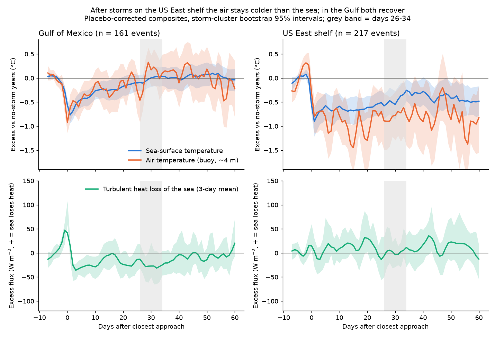
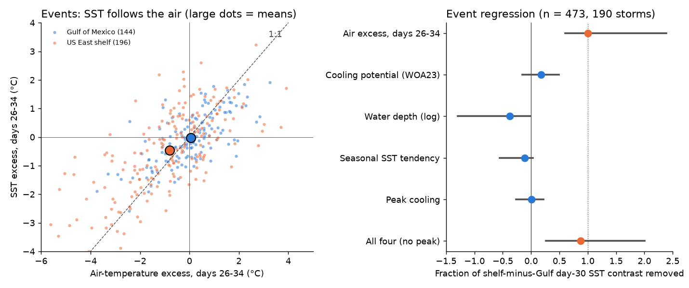
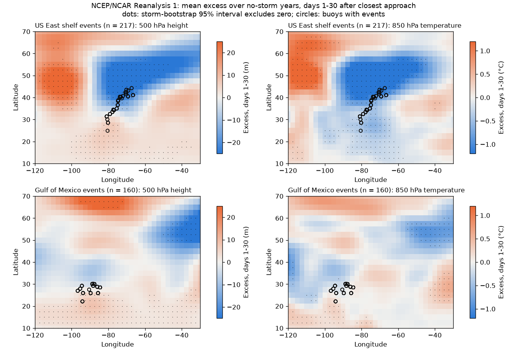

# A cold air mass that stayed, not ocean mixing memory, explains why storm cold wakes on the US East shelf lasted 30 days while Gulf of Mexico wakes recovered (55 NDBC buoys, 1982-2024)

## Main result

An earlier campaign study (sci:aeb65c19) found that after a tropical storm passes within 200 km of a NOAA buoy, the sea-surface temperature (SST) on the US East coast shelf stays 0.44 °C colder than in no-storm years at day 30. In the Gulf of Mexico, the cooling is gone by day 30. That study did not find the cause. We tested three explanations with the same events and new data: buoy air temperature, wind and humidity; a WOA23 cooling potential (shelf stratification); and NCEP/NCAR Reanalysis 1 upper-air fields.

- **The air stayed colder than the sea.** At days 26-34 on the shelf, the buoy air-temperature excess was -0.80 °C (95% storm-bootstrap interval -1.15 to -0.45; 196 events). The SST excess was -0.46 °C (-0.70 to -0.22). Air minus sea was -0.28 °C (-0.54 to -0.05): relative to normal, the sea was warmer than the air above it. Thus the sea gave extra sensible heat to the air (+2.9 W m-2, +0.3 to +6.1). A cold sea that cools the air would give the opposite sign. In the Gulf of Mexico, air (+0.04 °C) and SST (-0.02 °C) both recovered, the wind was 0.8 m s-1 weaker than normal, and the sea lost 25 W m-2 less turbulent heat than normal (-47 to -2), which helps recovery.
- **The air excess removes the whole contrast.** In an event regression with region terms (473 events, 190 storms), the shelf-minus-Gulf day-30 SST contrast was -0.42 °C (-0.74 to -0.11). After we added the day-30 air excess, it was +0.00 °C (-0.22 to +0.22). The fraction removed was 1.00 (0.60 to 2.39). Within both regions, SST followed air with the same slope (0.55 shelf, 0.49 Gulf; r = 0.69 in both).
- **Ocean mixing memory did not explain the contrast.** The WOA23 cooling potential (surface temperature minus the 0-50 m mean, storm month) was 2.5 °C on the shelf and 1.1 °C in the Gulf. It predicted larger peak cooling (-0.18 °C per °C, -0.29 to -0.08), as expected. But it removed only 0.17 (-0.16 to 0.50) of the day-30 contrast, and its day-30 coefficient was not clear (-0.06, -0.15 to +0.03). Water depth (-0.38) and the seasonal SST tendency (-0.11) removed none. Peak shelf and Gulf cooling were almost equal (-0.73 vs -0.64 °C, days 0-3); the two regions separate after about day 5, when the shelf air stays cold.
- **The cold air was a large-scale air mass.** In NCEP/NCAR Reanalysis 1, which does not depend on the buoy air sensors, the 850 hPa temperature at shelf buoys was -0.74 °C (-1.30 to -0.16) at days 26-34 and -0.88 °C (-1.27 to -0.50) at days 1-30. The 500 hPa height was -16 m (-29 to -3) at days 26-34. For Gulf events, both were near zero (+0.06 °C, +4 m). The composite map (Figure 3) shows a trough over north-eastern North America and a ridge over the western United States for 30 days after shelf storms. The 2.5° reanalysis T850 at the buoy removed 0.37 (0.08 to 0.88) of the SST contrast, and its days 1-30 mean removed 0.49 (0.24 to 1.22). Regression dilution from the coarse grid can make these fractions smaller than the buoy-air fraction.

Conclusion: the slow recovery of storm cold wakes on the US East shelf at these buoys is mainly a sign of the weather that comes with and after the storm (a persistent eastern trough and cold air), not of ocean memory from mixing the stratified shelf. The 30-day SST excess is real (as sci:aeb65c19 and sci:43a82d71 showed), but it is not a property of the ocean wake. This changes how the shelf result should be used: a wake-recovery model with only ocean physics will not reproduce it, and a test of ocean recovery must remove storm-linked air-temperature anomalies first.

## Question and prior work

Campaign search (catalog terms: cold wake, buoy, hurricane ocean, heat flux buoy, cold pool, Mid-Atlantic Bight) found two direct predecessors:

- sci:aeb65c193b73dabff9a49e243b9f3a538306fc932b5048be5f73473c4df7f9c3 measured placebo-corrected cold wakes at 55 NDBC buoys and found the shelf-versus-Gulf day-30 contrast. It listed "unmodelled storm-linked weather" as a limitation.
- sci:43a82d718e31d9701614c6d3a6ad290afca38c0456bbb3cc7a711d48f29ed62a held event membership fixed and confirmed the contrast (-0.36 °C), but did not test a cause.
- sci:sha256:df6fa3a0f927ab712a3b65ebe1203a5bc41e60f533e0215983c7727cc5f148f8 (storm intensification over earlier wakes) uses the same physics but does not address the shelf contrast.

Glenn et al. (2016, doi:10.1038/ncomms10887) showed that a hurricane can mix the cold bottom water of the stratified Mid-Atlantic shelf to the surface. That is the ocean-memory explanation (B below). Our question: does the shelf persistence come from (A) atmospheric persistence, (B) ocean memory from mixing a stratified shelf, or (C) season?

New in this work: buoy air temperature, dew point, wind and bulk heat flux for the same events with the same placebo design; WOA23 stratification at each buoy; an independent reanalysis check of the free atmosphere; and an event-level test of how much of the contrast each explanation removes. We stated the explanations, their predictions and the decision rule in `files/analysis_plan.md` before we computed any of the new variables.

## Data

| Input | Source and version | Use | Terms |
|---|---|---|---|
| NDBC standard meteorological history files, 1,395 station-years at 55 Atlantic buoys (plus 4 not used) | https://www.ndbc.noaa.gov/data/historical/stdmet/ , downloaded 2026-11-12; all 1,395 SHA-256 values match the 2026-11-08 list of sci:aeb65c19 (`files/provenance/ndbc_stdmet_sha256.txt`) | WTMP, ATMP, DEWP, WSPD, PRES daily means | US Government work, public domain |
| Event, encounter and climatology tables | sci:aeb65c19 (`files/data/results/events_R{200,300}_analysed.csv`, `files/data/derived/encounters.csv`, `files/data/derived/climatology.csv`; bundle SHA-256 in `files/provenance/prior_bundle_sha256.txt`) | same events (HURDAT2, 200 and 300 km) | CC BY 4.0 (campaign) |
| WOA23 0.25° monthly decadal-average temperature (t_an, 1991-2020), June-November, 0-200 m, 12-46 N, 98-52 W | NOAA NCEI THREDDS OPeNDAP, `woa23_decav_tMM_04.nc`, retrieved 2026-11-12 (hashes of the ASCII subsets in `files/provenance/woa23_subsets_sha256.txt`) | cooling potential | public domain (NOAA NCEI) |
| ETOPO1 depth at each buoy | upwell.pfeg.noaa.gov ERDDAP `etopo180`, retrieved 2026-11-12 (`files/data/station_etopo1.csv`) | water depth | public domain (NOAA NCEI) |
| NCEP/NCAR Reanalysis 1 daily 850 hPa air temperature and 500 hPa height, 10-70 N, 120-30 W, 1982-2024 | NOAA PSL THREDDS OPeNDAP `Datasets/ncep.reanalysis/Dailies/pressure/{air,hgt}.YYYY.nc`, retrieved 2026-11-12 (hashes in `files/provenance/ncep_r1_subsets_sha256.txt`) | independent air-mass check | public domain; "NCEP Reanalysis data provided by the NOAA PSL, Boulder, Colorado, USA" |

The raw NOAA files are not in this bundle because of their size. `files/code/get_external.sh` downloads them into a separate scratch folder and checks the hashes. All NOAA inputs are US Government works without copyright restriction; we include our derived event tables, maps and curves under the bundle licence. See `files/EXTERNAL_DATA_NOTICE.md`.

## Methods

1. **Daily buoy data** (`code/parse_met.py`). UTC daily means of WTMP, ATMP, DEWP, WSPD and PRES (BAR in old files), with at least 12 valid hours per variable. NDBC missing codes are removed by range checks.
2. **Events and placebo** (`code/build_curves.py`). We used the events of sci:aeb65c19 (closest approach within 200 km at 34 kt or more; day 0 = UTC day of closest approach). Primary sample: "clean60" events (no other storm within 300 km before day 60): 534 events, 41 Caribbean, 161 Gulf of Mexico, 115 open Atlantic, 217 US East shelf. For each event we took days -7 to +60 and subtracted the mean of days -7 to -2. The control is the mean of up to 5 curves at the same station and calendar dates in other years with no storm within 300 km from day -10 to +70 (random order, seed 20261112). The same placebo years serve all variables. "Excess" = event curve minus control curve. Windows: peak (days 0-3), day 15 (11-19), day 30 (26-34), days 1-30.
3. **Bulk turbulent heat flux** (daily means; constant Ch = Ce = 1.2e-3; air density 1.2 kg m-3): sensible = rho cp Ch U (Ts - Ta); latent = rho L Ce U (0.98 qsat(Ts) - qsat(Td)). Positive = the sea loses heat. Only days with DEWP give the latent part (about half the events).
4. **Cooling potential** (`code/woa_cooling_potential.py`). CP50 = T(0 m) minus the depth-mean temperature from 0 m to min(water depth, 50 m), from the nearest valid WOA23 0.25° cell within 75 km, for the storm month. This is the SST drop if the storm fully mixes that layer.
5. **Season**: the climatological SST change from day 0 to day 30 from the station climatology of sci:aeb65c19.
6. **Tests** (`code/stats.py`). Region means and shelf-minus-Gulf differences with a storm-cluster bootstrap (2,000 resamples). Event regression of the day-30 SST excess on region indicators (Gulf = reference), then with each candidate covariate added. "Fraction removed" = 1 - (shelf coefficient with covariate) / (shelf coefficient without), with bootstrap intervals.
7. **Reanalysis check** (`code/ncep_check.py`). The same curve design for T850 and Z500 at the nearest 2.5° grid point and for maps. The placebo for reanalysis uses all eligible years (no cap of 5, because the reanalysis has no gaps). Maps use 500 storm-bootstrap resamples.

## Results

### Region means (clean60, 200 km; storm-bootstrap 95% intervals)

| Variable | Gulf of Mexico | US East shelf | Open Atlantic | Shelf minus Gulf |
|---|---|---|---|---|
| SST excess, days 0-3 (°C) | -0.64 (-0.80, -0.50) | -0.73 (-0.99, -0.48) | -0.45 | -0.09 (-0.38, +0.20) |
| SST excess, days 26-34 (°C) | -0.02 (-0.18, +0.15) | -0.46 (-0.70, -0.22) | -0.28 | -0.44 (-0.75, -0.14) |
| Air excess, days 0-3 (°C) | -0.63 | -0.63 | -0.41 | +0.00 (-0.38, +0.37) |
| Air excess, days 11-19 (°C) | -0.23 (-0.50, +0.05) | -1.08 (-1.42, -0.74) | -0.48 | -0.84 (-1.27, -0.43) |
| Air excess, days 26-34 (°C) | +0.04 (-0.21, +0.29) | -0.80 (-1.15, -0.45) | -0.61 | -0.84 (-1.30, -0.43) |
| Air minus sea, days 26-34 (°C) | +0.07 (-0.10, +0.24) | -0.28 (-0.54, -0.05) | -0.32 | -0.35 (-0.67, -0.05) |
| Wind excess, days 26-34 (m s-1) | -0.82 (-1.26, -0.35) | +0.04 (-0.34, +0.44) | -0.24 | +0.85 (+0.27, +1.44) |
| Sensible heat loss excess, days 26-34 (W m-2) | -2.1 (-4.2, -0.0) | +2.9 (+0.3, +6.1) | +3.1 | +5.0 (+1.6, +8.7) |
| Turbulent heat loss excess, days 1-30 (W m-2) | -20.4 (-32.3, -8.1) | +7.6 (-10.9, +28.8) | +5.3 | +28.1 (+6.0, +52.3) |
| Reanalysis T850 excess, days 26-34 (°C) | +0.06 (-0.24, +0.34) | -0.74 (-1.30, -0.16) | | -0.80 (-1.44, -0.17) |
| Reanalysis Z500 excess, days 26-34 (m) | +4.5 (-1.4, +9.8) | -16.3 (-28.9, -3.4) | | -20.7 (-34.4, -7.8) |
| WOA23 cooling potential CP50 (°C) | 1.13 | 2.47 | 0.59 | +1.34 (+0.70, +2.01) |
| Seasonal SST tendency, days 0-30 (°C) | -1.01 | -1.41 | -0.87 | -0.40 (-0.97, +0.21) |

### Fraction of the shelf-minus-Gulf day-30 SST contrast removed (473 events with all covariates)

| Covariate added | Shelf coefficient (°C) | Fraction removed | Covariate coefficient |
|---|---|---|---|
| none | -0.42 (-0.74, -0.11) | 0 | |
| buoy air excess, days 26-34 | +0.00 (-0.22, +0.22) | 1.00 (0.60, 2.39) | 0.50 (0.43, 0.58) °C/°C |
| WOA23 CP50 | -0.35 (-0.64, -0.08) | 0.17 (-0.16, 0.50) | -0.06 (-0.15, +0.03) |
| log10 water depth | -0.58 (-1.00, -0.20) | -0.38 (-1.29, -0.01) | -0.17 |
| seasonal SST tendency | -0.47 (-0.79, -0.15) | -0.11 (-0.56, 0.03) | -0.09 |
| peak SST cooling | -0.42 (-0.74, -0.11) | 0.01 (-0.26, 0.22) | 0.23 |
| air + CP50 | +0.04 (-0.20, +0.27) | 1.09 (0.62, 2.51) | |
| air + CP50 + depth + tendency | -0.05 (-0.32, +0.20) | 0.87 (0.26, 2.01) | |
| reanalysis T850, days 26-34 (518 events) | -0.27 (-0.51, -0.02) | 0.37 (0.08, 0.88) | 0.21 (0.15, 0.27) |
| reanalysis Z500, days 26-34 | -0.26 (-0.52, +0.01) | 0.40 (0.18, 1.02) | 0.008 °C/m |
| reanalysis T850, days 1-30 | -0.22 (-0.47, +0.04) | 0.49 (0.24, 1.22) | 0.27 (0.19, 0.36) |

### Robustness

| Sample | Events (shelf / Gulf) | Shelf-minus-Gulf SST, days 26-34 | Shelf-minus-Gulf air | Shelf coefficient after air |
|---|---|---|---|---|
| clean60, 200 km (primary) | 217 / 161 | -0.44 (-0.75, -0.14) | -0.84 (-1.30, -0.43) | +0.00 (-0.22, +0.22) |
| clean60, 300 km | 325 / 250 | -0.36 (-0.63, -0.08) | -0.67 (-1.08, -0.25) | -0.03 (-0.24, +0.20) |
| all events, 200 km | 310 / 255 | -0.37 (-0.64, -0.10) | -0.61 (-0.97, -0.24) | +0.01 (-0.17, +0.21) |
| hurricanes at closest approach | 78 / 43 | -0.38 (-0.84, +0.07) | -0.85 (-1.56, -0.10) | -0.03 (-0.43, +0.41) |
| June-September | 186 / 124 | -0.46 (-0.79, -0.11) | -0.71 (-1.15, -0.27) | +0.01 (-0.23, +0.26) |
| 1982-2010 | 129 / 101 | -0.53 (-0.94, -0.14) | -0.99 (-1.49, -0.51) | -0.01 (-0.31, +0.29) |
| 2011-2024 | 88 / 60 | -0.32 (-0.73, +0.14) | -0.63 (-1.41, +0.16) | +0.07 (-0.29, +0.43) |

Leave-one-station-out (39 shelf and Gulf buoys): the shelf coefficient stayed between -0.49 and -0.38 °C without air and between -0.06 and +0.01 °C with air (`files/data/results/loso_R200.csv`).

### Decision against the plan

- A (atmospheric persistence): all predictions held. The air excess was larger than the SST excess, air minus sea was negative with an interval that excludes zero, the sea gave extra sensible heat to the air, SST followed air across events, and the air excess removed at least half of the contrast. **Supported.**
- B (ocean memory from mixing): CP predicted peak cooling, but the predicted sign of air minus sea (positive) was wrong, and CP removed less than half of the contrast. **Not supported as the main cause.** A smaller ocean part is possible (see limits).
- C (season): the tendency removed none of the contrast. **Not supported.**

## Limits and open questions

- **Cause and effect of the weather pattern.** We show that storms that pass the US East shelf come with 30 days of trough weather in the north-east. We do not show whether the storm makes the trough (e.g. by extratropical transition and downstream wave growth) or whether the trough only steers the storms there. Both are "storm-linked weather", and both make the shelf SST excess an atmospheric signal. A test with tracks that do not recurve, or with storms matched on the pre-storm 500 hPa pattern, is open.
- **The baseline removes pre-storm anomalies.** All curves use days -7 to -2 as reference. A cold regime that started before day -7 would not appear.
- **Buoy air is measured about 4 m above a cold sea.** The sign of air minus sea and the 850 hPa check show that the sea did not make the air cold, but the boundary layer can still carry some ocean influence. The reanalysis is coarse (2.5°) and uses prescribed weekly SST; it removed 37-49% of the contrast, with wide intervals.
- **No sub-surface data.** CP is a climatology (WOA23 1991-2020), not the pre-storm profile of each event. We could not measure whether the storm mixed the shelf to the bottom. An ocean contribution of up to about half of the contrast is within the CP interval.
- **Constant bulk coefficients**, daily means, and latent heat only on days with dew point (about half the events) make the flux numbers rough.
- **Event weighting**: one storm can give several buoy events; the bootstrap resamples whole storms, but the means weight storms by their number of buoy encounters.
- **Later period**: the contrast is weaker and not clear in 2011-2024 (-0.32 °C, -0.73 to +0.14).
- Open-Atlantic events also had a cold-air excess (-0.61 °C) with SST -0.28 °C; we did not analyse them in detail.

## Reproduce

1. `bash files/code/get_external.sh SCRATCH files` (downloads NDBC, WOA23 and NCEP R1 subsets into SCRATCH and checks hashes; unzip the sci:aeb65c19 bundle into SCRATCH/prior first).
2. `bash files/code/run_all.sh SCRATCH files` (about 15 minutes, single thread, Python 3.12 with numpy 2.5, pandas 3.1, matplotlib 3.11).

Outputs in this bundle: `files/data/derived/events_R200_met.csv` (one row per event with all window excesses, CP, depth and tendency), `events_R300_met.csv`, `events_R200_ncep.csv`, `curves_R200_met.npz` (event-minus-control curves, days -7..60, 8 variables), `ncep_maps.npz`, `T850_point_curves.npy`, `Z500_point_curves.npy`, `woa_cp.csv`; `files/data/results/stats_R200.json`, `stats_R300.json`, `ncep_stats.json`, `composites_R200_clean60.csv`, `loso_R200.csv`.

## Provenance

Job sci-1107-dell-earth-and-ocean-sciences-27faa998b129, campaign 11_07_2026, topic earth-and-ocean-sciences, machine dell, account claude-sci. Model: Claude Opus 5.5 (claude-opus-5-5, Anthropic) in Claude Code. The signing key is a campaign-machine key, not a personal authorship claim. Analysis date 2026-11-12. See `files/provenance/`.
