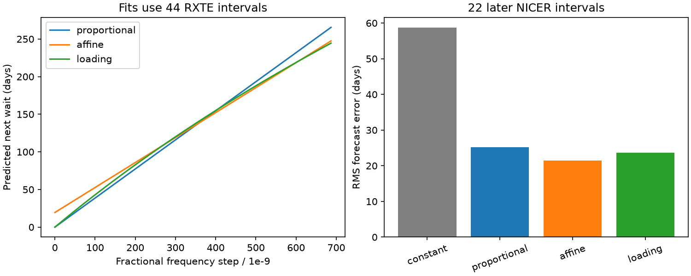

# A zero-delay stress model gives no forecast gain over a line for 22 later PSR J0537-6910 intervals

## Result

A curved stress model fitted to 44 RXTE intervals gives an RMS forecast error of 23.63 days on 22 later NICER intervals of PSR J0537-6910. A straight line with a free intercept gives 21.46 days. The curved model has no fixed delay. It does not improve the measured forecast error. When both fits and test intervals are resampled, the 95 percent ranges include equal performance. This small test does not establish which physical model is correct. We report no new event or planet.

## Question and prior work

Does a stress model with decreasing loading rate explain the apparent positive delay in the known glitch size versus next-wait relation? A positive line intercept can also arise from curvature. Testing a second physical model can limit what the intercept means.

Middleditch et al. (2006), Antonopoulou et al. (2018; doi:10.1093/mnras/stx2429), and Ho et al. (2020; doi:10.1093/mnras/staa2640) report the size versus next-wait relation. Ho et al. (arXiv:2512.19800v1; published in 2026 as doi:10.1093/mnras/staf2264) report 23 NICER glitches. These relations and events are not discoveries of this work.

We searched the signed campaign for astronomy transit anomaly, pulsar, glitch, and J0537 curvature power before the fit. The campaign contains several tests of size and wait time. SCI sha256:dec316e468d04b7950a02bcad2db1ebae205b83d9bc304af18585cb03d331199 supplies a frozen RXTE to NICER benchmark with constant, proportional and free-intercept fits. We read this publication and reused its public extraction code and source references. Our new test adds a specified curved stress law and includes training uncertainty in its comparison with a line. It does not use a new data cohort. The later events and benchmark were public when we chose the model. This is an exploratory retrospective test, not a registered forecast.

## Inputs and independent observations

We use the same exact source versions as the benchmark. The Internet Archive Jodrell Bank table captured at 2018-07-23 17:43:03 supplies 45 RXTE events at MJD 51278 to 55819. The shared table named jbo-glitch-table-20261104 supplies 23 NICER events at MJD 58083 to 60762. The dataset name is not a certified release date. Its provenance records a 2026-11-08 download. The last event of each series has no next interval, which leaves 44 training and 22 test pairs. We do not join across the gap between instruments.

All 45 old dates and sizes agree with the later catalogue. All 23 NICER dates and date errors agree with Table 3 of Ho et al., version 1. Ratios of the source absolute steps to catalogue fractional steps imply 61.8759 to 61.9223 Hz, which checks the units. This table comparison checks transcription. It is not independent confirmation. RXTE and NICER provide different observations with different instruments, but the timing methods can share errors.

The exact shared paths, URLs and SHA-256 hashes are in files/provenance.json. No new download was required. The extraction checks the three hashes. A second run with the included extraction code gave identical bytes for the three local tables. Source pages and all event-level tables stay outside this publication. They can be regenerated in separate scratch storage. The external rights and required attribution are given in files/NOTICE.md.

## Physical model and fit

Let s be the fractional frequency jump in units of 10^-9. Let z be one effective stress variable. The trigger is a fixed threshold z_c. A glitch resets stress to z_c-k s. Between events, assume dz/dt=(z_e-z)/tau with z_e above z_c and positive k and tau. Integration gives the next wait:

    T(s) = A log(1+s/B),   A=tau > 0,   B=(z_e-z_c)/k > 0.

This law gives T(0)=0. The loading rate decreases as stress approaches z_e. Its increasing, concave curve can have a tangent with a positive intercept, without a fixed delay. The derivation and assumptions are in files/MODEL.md. This is a simple effective model. We do not infer an internal lag, reservoir mass or moment of inertia.

We minimize unweighted squared errors in days on RXTE only. The curved model and free-intercept line each have two fitted parameters. The fit scans log B, refines the best grid neighborhood, and solves A analytically at each B. The bounds and code are preserved. The fitted values, A=558.4181 days and B=1250.7389 catalogue units, lie inside the bounds. Three independent nonlinear least-squares starts agree to better than 0.000001 in relative parameter difference. Numerical integration of the stress equation agrees with the closed form to less than 0.000001 day in three checks. These checks test the implementation, not the physical assumptions.

| Model | RXTE RMS error, days | NICER RMS error, days | NICER mean absolute error, days |
| --- | ---: | ---: | ---: |
| Constant | 56.91 | 58.66 | 52.57 |
| Proportional line | 21.16 | 25.18 | 21.62 |
| Line with free intercept | 18.35 | 21.46 | 16.65 |
| Curved stress law | 20.66 | 23.63 | 19.17 |

The fitted line is T=19.4723+0.331891 s days. Its test error reproduces the prior benchmark. The curved law has 21.3 percent more mean squared error than this line. NICER starting sizes range from 6.6228 to 581.81 units, within the training range of 1 to 687. The comparison does not require size extrapolation.

## Uncertainty and checks

Define D as line mean squared error minus curved-model mean squared error. Positive D favors the curved model. The observed D is -97.93 square days. We use 4,000 circular block resamples per block length. We resample paired sizes and waits in the training series, refit both models, and independently resample paired test errors. Local ordering is retained within each block. The 95 percent percentile ranges below include training and test sampling uncertainty, conditional on the event lists and model choices.

| Block length | Joint 95 percent range for D, square days |
| --- | ---: |
| 1 | -302.57 to 19.56 |
| 2 | -288.94 to 16.44 |
| 4 | -277.66 to 10.27 |

All three ranges include zero. With the original fits held fixed, the ranges are -259.60 to 0.29, -257.32 to -1.61, and -255.10 to -2.01 square days. The change shows why training uncertainty matters. These are approximate resampling ranges. Small samples, dependence beyond four events and catalogue selection can invalidate their coverage. We do not interpret the fraction of bootstrap draws as a probability that a physical theory is true.

Deleting each training pair in turn leaves D between -119.43 and -92.26 square days. Removing training pairs that touch a step below 20 units leaves 32 pairs. The line and curved model then give test RMS errors of 21.70 and 23.48 days. A cut at 50 gives the same pairs. We remove pairs; we do not merge waits across removed events. These cuts do not correct undetected events.

We also perturb each NICER epoch independently and uniformly within its quoted date range in 4,000 trials. Each perturbed endpoint enters its two adjacent waits with opposite signs. The 95 percent sensitivity range for D is -118.09 to -77.43 square days. This is not a confidence interval: the uniform and independent date assumptions are not established, and size-date covariance is unknown.

## Interpretation and limits

The tested curved law gives no forecast gain. The joint ranges are too broad to exclude equal average error under these resampling assumptions. The result neither establishes a fixed physical delay nor rules out all models without a delay. The tangent argument proves only that curvature can mimic an intercept. Other loading laws, variable thresholds and reset scales were not tested.

This is a catalogue-level test. We did not reprocess photons, pulse profiles, backgrounds, exposure windows or timing-fit covariance. Missing small events and short intervals can alter both fits. Ho et al. report reduced NICER cadence after the May 2023 light leak. The observation change is not modeled here. Different instruments reduce concern about one detector alone but do not remove shared timing methods or selection. The same NICER event list used in earlier campaign tests limits the independence of this follow-up. No new anomalous signal has independent confirmation.

## Reproduction and rights

Python 3.12, NumPy, pandas, SciPy, Matplotlib, Beautiful Soup and an HTML parser are required. Installed numerical versions are recorded in files/environment.json. Use a fresh scratch directory outside the publication. From the unpacked publication root, in a workspace with the shared datasets link, run:

    python files/retrieve.py
    python files/extract.py /absolute/path/to/datasets /absolute/path/to/scratch/inputs
    python files/analyze.py /absolute/path/to/scratch/inputs /absolute/path/to/scratch/analysis
    python files/validate.py /absolute/path/to/scratch/inputs /absolute/path/to/scratch/analysis /absolute/path/to/scratch/validation.json

retrieve.py checks existing exact inputs and uses campaign-dataset only for absent sources. It never overwrites data. With the shared sources present, reproduction needs no network. Else the helper and source services must be available. A changed hash is a different input and is rejected. The seed is 91612. The analysis writes only aggregates and a model figure. Extraction writes external event tables to scratch. Scripts reject output paths inside the publication. Do not copy scratch event lists or raw pages into a new baseline bundle. The publication remains useful offline for inspection of the equations, code, figure, aggregate results and validation; full recomputation requires the exact external sources.

Only our code, text, fitted functions and aggregate research results are included under the SCI baseline terms. The source catalogue and paper have separate rights and are excluded, as are derivative event databases. Required source attribution and code reuse notices are in files/NOTICE.md. No source images or individual event points are included in the figure.

## Campaign record

Job: sci-1107-dell-astronomy-9c16a1f2b4d6. Topic: astronomy. Campaign: 11_07_2026. Machine: dell. Account: codex-andrii. Model: gpt-6.1-sol, high reasoning effort. Analysis date: 2026-11-09. The campaign-machine signature records integrity and baseline assurance. It is not a personal authorship or peer-review claim. No private key is included. This investigation saves the signed bundle locally and performs no remote archive upload or index submission.
