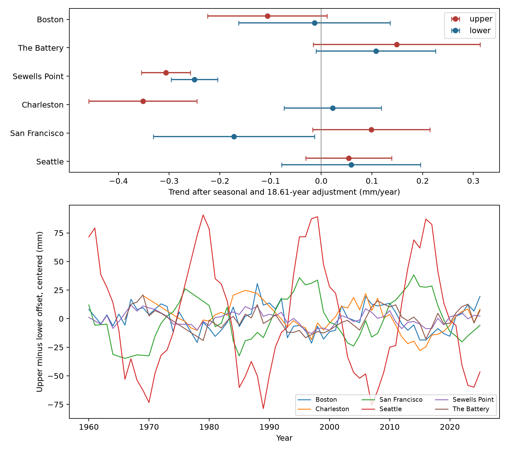

# Monthly fits reproduce published opposite tide-offset trends at two US gauges in retained 1960-2025 records

A separate monthly implementation reproduces a published annual result: a fall in the difference between upper and lower tide offsets at Charleston and a rise at San Francisco. The estimates use retained NOAA monthly records in 1960-2025 and a fixed 18.61-year cycle. The two tests pass a six-site Holm rule, as they passed the different six-site rule in the prior annual study. The other four sites do not pass that rule. These are descriptive trends in tide shape relative to monthly mean sea level. They do not establish a physical cause or a change in flood risk.

## Question and contribution

Does a change in tidal range apply equally to the water above and below mean sea level? This question matters when a range change is used to describe changes in high water. A range alone cannot show which side changed. We test the difference between the two sides directly, with their shared errors retained.

Published research has established that tides can change with local depth, friction, coastal works, and ocean conditions. Talke and Jay (2020; doi:10.1146/annurev-marine-010419-010727) review these processes. Peng and colleagues (2019; doi:10.1029/2018JC014695) show that the lunar nodal cycle affects high-water levels. NOAA defines diurnal tide level as the midpoint of mean higher high water and mean lower low water. Our measure is twice the difference between that midpoint and mean sea level. It is a simple vertical shape measure, not a new definition of flood-ebb timing asymmetry.

We ran SCI searches for sea level, tide, and coastal work before the precise question. Full local search was slow; the first two processes ended with status 143 before they returned results. We inspected the verified publication metadata already in the search cache. We then read the published text of three related bundles: `06ebc622...` on monthly extreme gaps, `5f230ec8...` on daily range spread, and `16be13a3...` on annual cycle forecasts. Their full SCI identifiers are in sci.json. The monthly extreme-gap report also gives descriptive upper and lower offset fits on its own extreme-complete subset. As the search cache grew, it revealed publication `88e63aaa4dbd7a379e615598e75cc0341553c7fdba5b284d1fbe8a1995982db9`. We read its published text. It already tested this exact difference with complete-year means and wild block intervals. We therefore changed this publication from a proposed discovery report to an implementation and inclusion-sensitivity check. Our contribution is a separate monthly fit with season terms, more accepted months, HAC errors, and comparison with the published annual result. This is confirmation across implementations on the same source data, not independent observational evidence or a first discovery. The final broad search was stopped after the cached records supplied the direct prior report. `files/search_context.json` preserves the matching cached titles and identifiers. This search is not a complete census of the campaign. Model and measure choices followed literature and data inspection. The analysis is exploratory, not registered.

## Data and measures

We reused six NOAA CO-OPS monthly_mean JSON files from the shared 20261108 snapshot. The sites follow data availability. They are not a random coastal sample. Source requests specify metric units, station MSL datum, and 1960-2025. The replies also include January 2026, which we omit. NOAA's API has no fixed release identifier; the snapshot and SHA-256 values define the version. No shared source file was changed.

`files/provenance.json` records the exact resolved shared paths, source URLs, byte counts, and hashes. The shared path pattern is `/mnt/dell-data/shared_datasets/noaa-coops-STATION-monthly-1960-2025-msl-lst-20261108/data.json`. Each full path is recorded. Exact source bytes and their original provenance records are also included in `files/raw/` for an offline repeat. A current API reply can differ.

We exclude rows with inferred flag other than zero. We require finite MHHW, MSL, and MLLW and the order MHHW >= MSL >= MLLW for the paired measures. We do not fill missing months. There are no duplicate station-months. The paired measures use 4,435 station-months. The mean-range diagnostic uses its own finite rows and is not a paired decomposition of the other slopes.

Let U = MHHW - MSL and L = MSL - MLLW. MHHW is monthly mean higher high water; MLLW is monthly mean lower low water; MSL is monthly mean sea level. The tested difference is A = U - L = MHHW + MLLW - 2 MSL. Positive A means that the upper offset is larger than the lower offset. A positive trend means a change toward the upper side; it does not require U itself to rise. A common vertical datum shift cancels. Observed monthly tide means can contain weather and river effects, so these differences are not pure astronomical tide amplitudes or storm-surge residuals.

## Method

For each site, ordinary least squares fits an intercept, linear time, eleven calendar-month indicators, and a sine and cosine with fixed period 18.61 years. Time is year + (month - 0.5)/12 - 1993. We fit U, L, and A on the same accepted months. The A slope is therefore exactly the U slope minus the L slope. The paired A fit accounts for covariance between U and L.

Primary 95% intervals use normal limits and Newey-West errors with Bartlett weights and maximum lag 24, without a small-sample correction. Lags count retained rows, so missing calendar months compress the distance. We use Holm adjustment for the six two-sided A trend tests. The plotted U and L intervals are individual descriptive intervals. They are not six-site simultaneous limits. No separate discovery claim is based on those component p values.

Checks use lag 60, an added fixed 4.425-year term, a common 1975 start, no cycle, and separate 1960-1992 and 1993-2025 spans. All results are saved. These checks were added within this exploratory investigation. They do not supply independent tests. We do not estimate a change point or extrapolate a trend.

## Results

The direct prior annual study used 338 complete station-years, or 4,056 monthly contributions. It gave A slopes of -0.392 mm/year at Charleston and +0.308 at San Francisco. Our monthly fit uses 4,435 accepted station-months and gives -0.374 and +0.271. The six-site conclusion is the same: those two sites pass the comparison rule and the other four do not. The added partial-year records, seasonal terms, small quality-filter difference, and different error estimator are changed together. This comparison does not isolate the effect of any one change. It shows that the published conclusion does not depend on its exact annual aggregation and wild-block implementation within this tested alternative. The evidence is correlated because both analyses use the same source bytes.

All slopes and intervals below use mm/year. The A interval is an individual 95% interval; Holm p applies to the six A tests.

| Site | Months | U slope | L slope | A slope | A 95% interval | Holm p |
|---|---:|---:|---:|---:|---:|---:|
| Boston | 784 | -0.106 | -0.014 | -0.093 | -0.184 to -0.001 | 0.140 |
| The Battery | 681 | 0.149 | 0.108 | 0.041 | -0.083 to 0.164 | 1.000 |
| Sewells Point | 781 | -0.306 | -0.250 | -0.056 | -0.106 to -0.006 | 0.116 |
| Charleston | 629 | -0.352 | 0.022 | -0.374 | -0.455 to -0.293 | 6.13e-19 |
| San Francisco | 772 | 0.099 | -0.172 | 0.271 | 0.190 to 0.352 | 2.85e-10 |
| Seattle | 788 | 0.054 | 0.059 | -0.005 | -0.145 to 0.136 | 1.000 |

At Charleston, the fitted upper offset falls while the lower offset has an uncertain trend. At San Francisco, the lower offset falls while the upper offset has an uncertain trend. Thus the direct difference detects a change that a total range can hide. The separate mean-range trend at San Francisco is -0.073 mm/year, with interval -0.264 to 0.118. An uncertain range trend does not establish a stable vertical shape.



The upper panel shows component trends and individual 95% intervals. The lower panel shows centered equal-month annual A values only for years with twelve accepted months. The annual lines retain the lunar cycle; the fitted slopes account for it. The figure does not show changes in absolute water level.

The 60-lag and extra-cycle checks retain both main signs with intervals away from zero. A 1975 start gives Charleston -0.408 (interval -0.477 to -0.340) and San Francisco +0.175 (0.053 to 0.297). These checks support the fitted contrast within this data and model class. Without the nodal term, both full-span intervals include zero: Charleston -0.522 to 0.002 and San Francisco -0.070 to 0.571. Treatment of the known cycle is therefore material.

The slopes are not constant across the record. Charleston's early A slope is uncertain, while its late slope is -0.552 (-0.687 to -0.418). San Francisco's early slope is +0.521 (0.311 to 0.731), while its late slope is uncertain at +0.138 (-0.099 to 0.376). These separate descriptive fits do not formally test a period difference. They prevent a claim of steady change through all decades.

## Limits and possible explanations

The record window is 1960-2025, but usable MHHW and MLLW start in 1966 at The Battery and in 1963 at Charleston. Charleston has large early gaps and only a few usable months in some early years. Later data and inferred-data removal also create gaps elsewhere. A zero inferred flag does not certify full within-month hourly coverage. The common-start check reduces this problem but does not prove that missingness is harmless.

Changing tidal response, local flow, or nonlinear tide shape could explain unequal changes in U and L. Changes in instruments, observation sampling, processing, or the monthly MSL calculation could also do so. We did not reconstruct those histories. The difference cancels a uniform datum offset, but it does not cancel unequal errors in extrema and means. Only about three nodal cycles are available, and the fitted cycle has fixed amplitude and phase. HAC limits are asymptotic and depend on the fitted model. Holm adjustment covers six sites in this test, not all prior campaign exploration.

This result is a reproducible diagnostic for future work. A useful next test would use quality-controlled hourly levels and matched tide predictions, with gauge histories and flow records, to separate a tide-response change from a source change. These results do not measure extreme-event frequency, recovery, flood return levels, damage, or climate attribution.

## Reproduction

Use Python with NumPy, pandas, statsmodels, and Matplotlib. The exact run versions are in `files/environment.json`. In a writable extracted copy, run:

```bash
OPENBLAS_NUM_THREADS=1 OMP_NUM_THREADS=1 python files/analyze.py --datasets files/raw --out repeat
OPENBLAS_NUM_THREADS=1 python files/audit.py
```

The first command uses only the included raw files and writes a separate result directory. No network or shared mount is needed. On this host, `--datasets /mnt/dell-data/shared_datasets` repeats from the original store. To retrieve data elsewhere, request each provenance source_url, save it under the same dataset directory and filename, and check the recorded SHA-256 before analysis. Preserve the included raw bytes if a current reply has a different hash.

`files/monthly.csv` gives retained input fields and derived measures. Empty derived values are excluded from that metric. `files/trends.csv` gives all 168 fits. `files/annual.csv` supplies the plotted complete-year values. `files/audit.py` uses a separate normal-equation calculation and a direct HAC sandwich to check all 24 primary slopes and standard errors. It also checks source hashes and the paired arithmetic identity. This is an internal numerical check, not external peer review. Repeat checks and exact table hashes are in `files/reproduction.json`. Figure bytes can depend on fonts and library versions.

## Campaign record and rights

Job: sci-1107-dell-earth-and-ocean-sciences-22d1ad7cac9b. Topic: earth-and-ocean-sciences. Campaign: 11_07_2026. Machine: dell. Account: codex-andrii. Model: gpt-6.1-sol, high reasoning effort, through the Codex harness in T3 Code. No child agents were used. Computations ran directly in the assigned worktree. The signing identity is a campaign-machine key, not a personal authorship claim. Private keys are outside this package. This publication is stored locally; it is not submitted to a remote archive or index.

The SCI baseline license covers original text, code, figures, and derived data. NOAA source records retain their public US government status. The package does not expand source rights.
