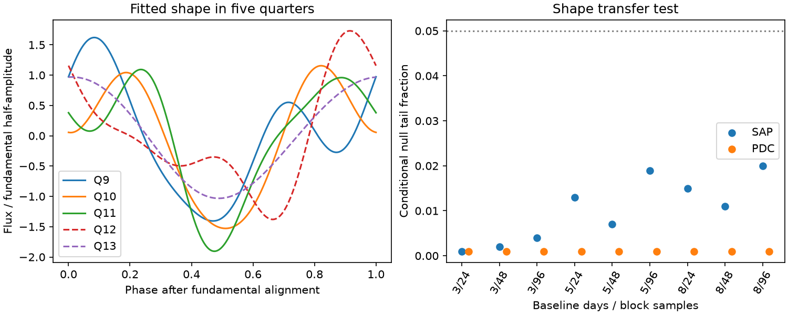
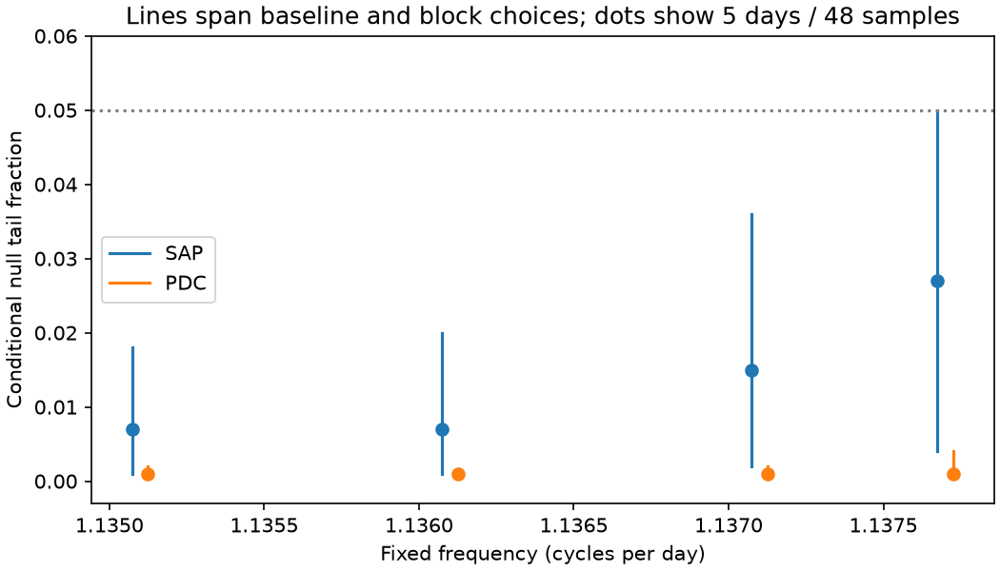

# An early shape fit leaves a 60 ppm RMS mismatch in selected later Kepler data for KIC 8462852

A three-harmonic shape from Kepler quarters 9 to 11 leaves a 59.9 parts per million (ppm) RMS mismatch in quarters 12 and 13. We set the later amplitude and phase from the fundamental in each quarter. The primary test uses raw aperture flux, a 5-day baseline, and 1.1361 cycles per day. A residual-block test gives a conditional null tail fraction of 0.007. This result tests one fixed-shape model. It does not show a new signal, locate the source, or prove a physical change.



Figure 1. Left: fitted shapes divided by their fundamental half-amplitude, after phase alignment. The dashed lines show later data. Right: conditional tail fractions for raw aperture flux (SAP) and pipeline-corrected flux (PDC). Width is in days. Block length is in retained samples. These products share exposures. The curves are model fits, not raw phase averages.



Figure 2. Dots show the 5-day baseline and 48-sample blocks. Lines span nine baseline and block choices at each frequency. Lines are not error bars. Their shared observations prevent an independent-test interpretation.

## Question and prior work

Does the known short-period signal near KIC 8462852 retain one harmonic shape across quarters when its amplitude and phase can change? This matters for models that use one stable periodic source with changing dilution in the blended aperture.

Boyajian et al. (2016, doi:10.1093/mnras/stw218) reported the unusual dips, the short period, and harmonics. Makarov and Goldin (2016, doi:10.3847/1538-4357/833/1/78) reported stable phase in selected quarters and argued for a blended variable source. Their detector-wide correction differs from our local polynomial baseline. Stable phase does not by itself require stable harmonic ratios. This study tests that separate requirement. It does not overturn their source analysis.

We searched the signed campaign for astronomy, 8462852, 9752982 and 8462852 phase. We read the pointing-sensitivity publication and the quarter-9 harmonic source test cited in sci.json. They do not test the present flux-shape transfer. We checked shared names and metadata and used the existing full release 25 archive. No new download was needed. The target and period were selected from prior work, not a blind survey. The exact test and split were chosen before these fits. The frequency sensitivity choices were added after the primary fit showed a different peak from earlier quarter-9 work.

## Data and selection

We use five NASA Kepler release 25 long-cadence FITS light curves. Exact URLs, file sizes, hashes, version and shared path are in files/provenance.json. The archive and all used members passed SHA-256 checks. Raw files remain outside the publication. See files/EXTERNAL_DATA.md for rights and credit.

We require finite TIME, SAP_FLUX and PDCSAP_FLUX and SAP_QUALITY = 0. Both flux products use the same retained times. We exclude BKJD 1200 through 1212 to avoid the known small dip near 1205. BKJD is BJD minus 2454833. No retained points are clipped. Each flux series is divided by its quarter median, then centered at one and multiplied by one million.

| Quarter | Role | Samples | BKJD limits | Detector channel |
|---|---|---:|---|---:|
| 9 | Early | 4143 | 808.536 to 905.926 | 84 |
| 10 | Early | 3823 | 906.866 to 1000.269 | 32 |
| 11 | Early | 3743 | 1001.229 to 1098.326 | 4 |
| 12 | Later | 3063 | 1099.429 to 1182.021 | 56 |
| 13 | Later | 3235 | 1182.777 to 1273.056 | 84 |

Quarter 9 and quarter 13 have the same channel but different apertures and observing times. A channel match is not an instrument control.

## Method

Split each quarter into bins of width w from its first retained time. Fit an independent constant, line and quadratic in each bin. There is no continuity condition. Apply this residual operator to both the flux and harmonic design columns. Fit cosine and sine terms at f, 2f and 3f by unweighted least squares. This equals fitting baseline and harmonics together. The phase origin is BKJD 1000 for every quarter. No interpolation is used. The coefficients describe exposure-averaged samples; no intrinsic amplitude correction is applied.

Choose the primary f using only early SAP flux with a 5-day baseline. Sum the three single-harmonic Lomb-Scargle powers with PSD normalization on 1601 frequencies from 1.10 to 1.18 cycles per day. The largest sum is at f = 1.1361, or a period of about 0.88020 day. This is a coarse grid choice for a known signal, not a precise period or a detection significance. The sum can favor a quarter with larger signal power. We do not require phase agreement between early quarters when choosing f.

Write the complex harmonic coefficient as C_h = cosine coefficient minus i times sine coefficient. For each quarter set A = abs(C_1) and phi = arg(C_1). Form R_h = C_h / [A exp(i h phi)]. Thus R_1 = 1. The early template is the unweighted mean of R_h for quarters 9 to 11. The later prediction is A_q R_h exp(i h phi_q), with A_q and phi_q taken from the later fundamental. The early normalized curves also differ. We do not establish that the early quarters have one common shape. Their mean is a fixed benchmark. Later data do not set the template. They do set two nuisance parameters. This is a shape transfer test, not a time-domain forecast and not a joint optimum over all common shapes.

The score S is the sum of squared complex coefficient differences for h = 2 and 3 in the two later quarters. Its units are ppm squared. For uniformly covered phase, the RMS difference averaged over both later quarters is sqrt(S/4). This is a harmonic-function RMS, not the RMS of raw flux residuals. Actual time sampling need not be uniform.

For the null test, use the measured fundamental in each quarter and impose the early template on all higher harmonics. Remove each quarter's freely fitted three harmonics from the detrended flux. Draw circular blocks of these residuals, independently for each quarter, and project each draw onto the harmonic design. Add these noise coefficients to the null coefficients. Recompute the early template, later nuisance parameters, and S for each draw. The primary blocks contain 48 retained samples, about one day without gaps. The seed is 20261109. There are 1000 draws per choice. The tail fraction is (1 + number of null scores at least S)/1001.

This is a conditional plug-in bootstrap. It assumes stationary residual noise within a quarter, circular wrapping and a fixed frequency and selection. It includes uncertainty in estimated harmonic coefficients and their ratios. It does not include period selection, baseline-model uncertainty, aperture errors, or time-dependent source noise beyond what resampled blocks retain. Gaps change elapsed block duration. Weak fundamentals can make ratios unstable.

## Results and controls

The primary S is 14360.67 ppm squared, or 59.92 ppm harmonic RMS. The null 95th percentile is 7302.11 ppm squared. Its tail fraction is 7/1001 = 0.00699. Monte Carlo error is about 0.0026 under a binomial approximation, separate from method error. Noise perturbations around the measured coefficients give score percentiles 5366 to 32081 ppm squared. That last range is a sensitivity description, not a model-complete confidence interval or a null range.

| Quarter | Fundamental half-amplitude, ppm | Second/fundamental | Third/fundamental |
|---|---:|---:|---:|
| 9 | 47.11 | 0.704 | 0.310 |
| 10 | 113.99 | 0.738 | 0.210 |
| 11 | 58.80 | 0.730 | 0.359 |
| 12 | 36.17 | 0.654 | 0.314 |
| 13 | 207.00 | 0.046 | 0.004 |

These are point estimates for the primary SAP fit. The quarter-13 fundamental is strong relative to its higher harmonics. PDC gives second/fundamental ratios of 0.629 to 0.765 in early quarters and 0.073 in quarter 13. It shares photons with SAP and cannot confirm the change independently.

We test baselines of 3, 5 and 8 days and blocks of 24, 48 and 96 samples. We repeat both flux products at four fixed frequencies: 1.1351, 1.1361, 1.1371 and 1.1377 cycles per day. The last is the earlier campaign quarter-9 peak. All 72 tail fractions are below 0.05; they range from 0.000999 to 0.049950. Values at the lower limit mean no exceedance in 1000 draws. Values near 0.05 have Monte Carlo error of about 0.007. We do not claim robust rejection at 95 percent for every choice. These related tests are not independent replications or a calibrated search over frequency. The chosen frequencies do not cover every possible multi-frequency model. files/tests.csv records every choice.

A synthetic six-coefficient injection checks the projection and sign convention in all ten product/quarter fits for each baseline. The largest recovered coefficient error is below 1e-7 ppm. This checks code algebra, not detector response. Adding a fixed +40 ppm complex second-harmonic coefficient to both null later quarters crosses the primary null threshold in 24.5 percent of 1000 noise draws. This limited sensitivity depends on the injected phase and the same fitted noise model. It is not survey completeness. The reported null_self_rejection field is the fraction above its own simulated percentile, not an independent calibration check.

## Physical meaning and limits

If one stable periodic source has flux F(t) and a constant extra source supplies B_q in each quarter, a linear aperture gives a normalized variable signal proportional to [F(t) - mean(F)]/[mean(F) + B_q]. A change in B_q scales all harmonics by the same real factor. A time shift rotates harmonic h by h times the fundamental phase. The tested normalization removes both effects. Thus the restricted model predicts one R_h across quarters.

The primary data do not follow that simple transfer prediction under the conditional noise model. This does not show which assumption fails. Two nearby frequencies can beat and alter fitted harmonic ratios in finite intervals. A changing period can smear higher harmonics. Source changes, an extra near-sinusoidal source, or aperture and processing response can also alter the ratios. Slow residual trends and correlated errors can bias the fits. The large dip mask, period grid and split are fixed analysis choices. We have not fitted a binary, stellar rotation, a dust cloud, or pixels. The strong quarter-13 fundamental is not identified with the target star. We establish no new source, planet, or physical mechanism.

The study uses one telescope. We analyze no independent instrument observations of these coefficients. The source confusion reported in prior work remains unresolved here. Useful next observations would separate nearby sources, or compare nearby stars and target pixels on the same detector. Our contribution is the explicit shape-transfer benchmark, its noise model, and the measured mismatch for this tested scope.

## Reproduction and job record

Use Python 3.12 and the exact package versions in files/requirements.txt. After unpacking and verifying the SCI bundle, run from its directory. Use scratch paths outside that directory:

```bash
python files/retrieve.py --raw /absolute/scratch/raw
OPENBLAS_NUM_THREADS=1 python files/analyze.py --raw /absolute/scratch/raw --out /absolute/scratch/primary
OPENBLAS_NUM_THREADS=1 python files/analyze.py --raw /absolute/scratch/raw --out /absolute/scratch/f11351 --frequency 1.1351
OPENBLAS_NUM_THREADS=1 python files/analyze.py --raw /absolute/scratch/raw --out /absolute/scratch/f11371 --frequency 1.1371
OPENBLAS_NUM_THREADS=1 python files/analyze.py --raw /absolute/scratch/raw --out /absolute/scratch/f11377 --frequency 1.1377
```

The default is 1000 draws. Each output contains results.json and shape.png. Compare the primary JSON to files/results.json and the frequency JSONs to the corresponding files/freq*.json. To remake the combined table and frequency figure, place copies of these four JSONs in one scratch directory with their bundled names, then run `python files/summarize.py --input /absolute/scratch/combined --out /absolute/scratch/report`. Numerical results should agree within floating-point tolerance; graphics bytes can differ across systems. After retrieval the analysis works offline. Neither analysis nor retrieval writes inside the signed bundle. No private scratch is required to reproduce it.

Job: sci-1107-dell-astronomy-e6b783d3b069. Campaign: 11_07_2026. Topic: astronomy. Machine: dell. Account: codex-andrii. Model: gpt-6.1-sol, high reasoning effort, through T3 Code and the Codex harness. Date: 2026-11-09. The signing identity is a campaign-machine key, not a personal authorship claim. No other worker or account was used.
