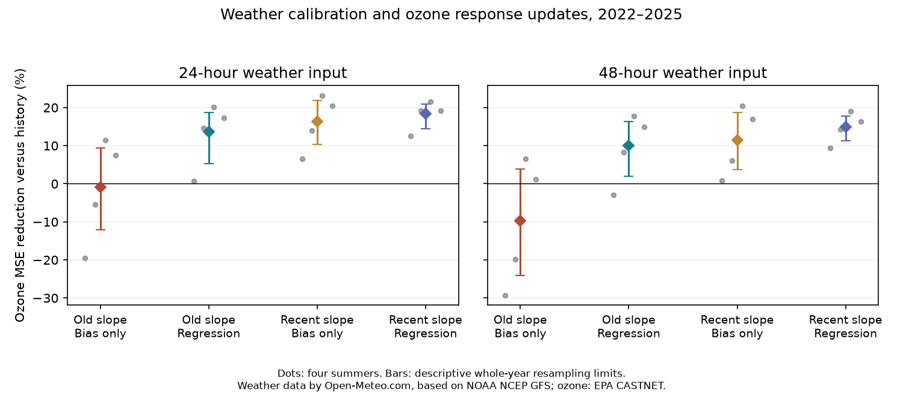

# Weather regression restored ozone forecast skill with an old temperature slope at 30 rural US sites in 2022-2025

The old ozone response regained useful forecast skill after regression calibration of its weather input. The recent response still did better with the same calibration. These results separate two sources of forecast loss in this model family. They do not show that weather calibration replaces a response update.

Weather data by [Open-Meteo.com](https://open-meteo.com/), based on NOAA NCEP GFS. Ozone and observed weather: EPA CASTNET. Bars show descriptive limits from four-year resampling. Gray points show individual summers.

## Results

The old ozone coefficient was 2.322 ppb/C. All methods used 16,594 matched site-days at 30 sites. Requiring every planned variant to have a fitted calibration group removed 118 rows (0.71%) from the prior 16,712-row weather test.

| Ozone response | Weather correction | 24-hour input MSE reduction | 48-hour input MSE reduction |
|---|---|---:|---:|
| Old | site mean bias | -0.92% [-12.07, 9.45] | -9.75% [-24.12, 3.91] |
| Old | regression | 13.61% [5.26, 18.67] | 9.95% [1.99, 16.32] |
| Recent | site mean bias | 16.37% [10.39, 21.80] | 11.42% [3.71, 18.74] |
| Recent | regression | 18.32% [14.48, 20.94] | 14.98% [11.34, 17.81] |

Positive values mean lower error than the ozone-history and past-weather reference. Brackets give descriptive 95% whole-year bootstrap limits.

For the old response, regression reduced MSE relative to bias correction by 14.39% [10.18, 17.98] with 24-hour inputs and 17.95% [12.92, 22.05] with 48-hour inputs. Both improvements occurred in all four summers. The old regression-calibrated response beat the history reference in four summers at 24 hours and three at 48 hours.

The recent response with regression beat the old response with regression in all four summers. The old model had 5.77% more MSE [2.14, 10.70] at 24 hours and 5.91% more [1.71, 10.55] at 48 hours, relative to the recent model. These are small-sample descriptive comparisons.

The old response kept positive aggregate gains in both planned checks: site rather than site-month intercepts (14.01% and 10.19%), and one rather than up to three calibration summers (11.92% and 8.14%). Against recent bias correction, old regression calibration still had 3.31% more MSE at 24 hours and 1.66% more at 48 hours; the latter interval included zero. Regression rather than bias correction added uncertain gains to the recent response (2.33% and 4.01% relative reductions).

A poor score with bias-only weather is not sufficient evidence that a climate response is unusable. This case also needs an input calibration test. Recovering skill does not prove that the old physical response is stable.

## Question and prior evidence

Earlier SCI tests found partial transfer of a dengue temperature curve and no clear transfer of published West Nile models. A later SCI ozone test found that a fixed old temperature coefficient gave useful predictions when target weather was observed. It gave no clear gain with bias-corrected archived GFS temperature. A recent coefficient did better. We test whether that contrast persists when the weather input is calibrated by regression. This is a controlled extension within the same pollution system, not a new system-wide survey.

Model output statistics and regression calibration are established methods (Glahn and Lowry, 1972). They are not new methods here. The new evidence is a past-only comparison that crosses ozone response age with weather calibration, while holding ozone fits and scored days fixed. Li et al. (2025) already found a decline in US ozone-temperature sensitivity. We do not test the cause of that decline.

## Data and target

We reuse the shared immutable EPA CASTNET METDATA snapshots for 2003-2025, the SITE table, and the 2021-2025 GFS Global archive from Open-Meteo. We read the signed prior publication, verified its ZIP, and reused its baseline-licensed panel and model code. We rebuilt the panel from raw shared sources in this worktree. The publication records exact shared paths, source URLs, versions, file and member SHA-256 hashes in provenance.json and gfs_provenance.json. No raw observations or derived record tables are bundled.

The ozone target is the mean of paired valid ozone and temperature readings at hours 12-19 local standard time in May-September, with at least six readings. The prior panel is rural eastern US sites at 30-49 N, 90-65 W with specified old and later availability. Calendar joins supply the prior two days. The forecast subset has 30 selected sites. Selection used later coverage, so this is a fixed monitored panel, not a historical selection rule.

The inherited loader corrects reversed validity dictionary labels in the 2003-2023 snapshots, checks their codes against 2024, and excludes missing readings. That source issue was reported in the prior publication. It is not a discovery of this study.

Weather data by [Open-Meteo.com](https://open-meteo.com/), based on NOAA NCEP GFS. API data use CC BY 4.0 terms. EPA CASTNET is acknowledged as the ozone and station-weather source, accessed November 10, 2026. See EXTERNAL_DATA_NOTICE.md. UTC forecast hours are changed to fixed local standard time; the same eight afternoon hours are averaged. The API reports predictions at fixed 24- and 48-hour offsets before valid time. It does not give full run delivery metadata. The model uses previous-day ozone even with 48-hour weather inputs. Thus input age is not a verified live ozone lead time.

## Models

Let H contain previous-day ozone, previous-day temperature, and the temperature change from two days ago to yesterday. Each ozone fit also has a site by calendar-month intercept. The baseline predicts ozone from H. The temperature model adds D, today's temperature minus yesterday's. The old coefficient b is estimated jointly in 2003-2007 and then held fixed. The recent coefficient is fitted again in each preceding five-year window. Other ozone coefficients and intercepts are fitted again on that window for both models; the whole old model is not frozen.

For each test summer in 2022-2025, the weather calibration uses up to three preceding summers, starting in 2021. Its target is observed D. Predictors are forecast D, yesterday's observed temperature, its prior one-day change, and site-month intercepts. No target or past ozone is used in this calibration. Its prediction replaces D in the already fitted ozone model. The ozone coefficients do not change when the weather correction changes. The bias-only comparator subtracts each site's past mean forecast temperature error. A raw comparator uses uncorrected weather. An observed-weather diagnostic uses realized D and is not a deployable forecast.

Checks replace site-month intercepts with site intercepts, or use only the most recent calibration summer. A recent ozone response with regression-calibrated weather completes the crossed comparison. All model choices were written in a local plan before the new scores. This is not an external registration. The implemented calibration uses only the meteorological history terms from the plan; it excludes yesterday's ozone to isolate weather calibration.

## Scores and checks

We compare the same finite rows for all methods within each weather-input age. We average squared errors within each site-year, then equally across sites in each year, then equally across the four years. Skill is one minus model MSE divided by reference MSE. We enumerate all 256 ordered four-year bootstrap samples. Their percentile limits are descriptive: four test years cannot establish general coverage or future reliability. Fits stay fixed. Spatial observations are not treated as independent replicates. Annual results and leave-one-year-out scores show dependence on any one summer. Secondary comparisons have no multiple-test adjustment.

An independent sparse regression with explicit group indicators checks the within-group calibration solver. A separate row-weight calculation checks the saved grouped MSE. Chronological assertions check that all fitting dates end before the test summer. All detailed prediction rows remain in external scratch, so they can be inspected after reproduction.

## Limits and interpretation

This test cannot identify emission effects, a causal temperature response, or a general rule for biodiversity. Climate response change and forecast-input error can both occur. Weather calibration can alter response to other observed history terms, not only attenuate the forecast coefficient. It estimates a conditional mean from observed weather; it does not fit ozone outcomes or estimate a new physical ozone slope. The product of an old ozone slope and a calibration slope is a forecast coefficient, not evidence that the old physical relation is stable.

Four summers, one model family, one selected rural network, final quality-controlled history and one weather archive limit the result. Forecast-system changes, data revisions, and prompt access to past ozone remain possible sources of failure. Afternoon mean ozone is not the regulatory maximum eight-hour target or a damage outcome. A retrospective test with observed history does not validate an operational warning service.

## Reproduction and checks

Extract the verified ZIP, change to its root, and run:

    python files/reproduce.py --data-root /mnt/dell-data/shared_datasets --output /tmp/ozone-calibration-new

Use a new output path outside the signed publication. The driver checks source hashes, rebuilds the panel, fits inherited ozone models, reconstructs weather joins, runs calibration and the independent audit, then compares numerical results with results.json at tolerance 1e-9. All row-level data stay in external scratch. If shared sources are unavailable, replace --data-root with --download. Exact URLs and hashes are supplied. Only a change in API generation timing metadata is accepted if the semantic hash confirms unchanged forecast values and grid metadata.

The initial raw-source reconstruction matched the published panel counts. A second calibration run on rebuilt inputs reproduced the first results. A second full raw-source reconstruction was not run. The independent sparse indicator regression agreed with the within-group calibration predictions within 1.1e-10 C. Independent row weights agreed with saved MSE within 5.0e-11 ppb squared. Software versions are in requirements.txt. To redraw the figure, run:

    python files/figure.py --root /tmp/ozone-calibration-new/results

Evidence files: results.json includes contrasts, annual scores and leave-one-year-out scores; annual.csv and site_year.csv contain forecast errors; weather.json contains temperature errors; fits.json contains weather regression coefficients; audit.json contains numerical checks. PLAN.txt records the local plan. The reused code is credited in EXTERNAL_DATA_NOTICE.md.

## Provenance and rights

Job: sci-1107-dell-climate-pollution-biodiversity-62011b074753. Topic: climate-pollution-biodiversity. Campaign: 11_07_2026. Machine: dell. Account: codex-myxtap. Model: gpt-6.1-sol, high reasoning effort. One worker performed the investigation without child agents. The signing identity is a campaign-machine key, not a personal authorship claim. Source access date: November 10, 2026.

This package contains code, text, figures, fitted coefficients and performance summaries. It contains no raw external data or derived record database. External terms and source credits are stated separately. The exact SCI baseline LICENSE applies to bundled material. No remote archive upload or index submission was made.

## References

- SCI 0dd123d426114b1277aeeacdea8f4408cf47e213c9797495c783c66365a44c72: published ozone test; reused sources and code.
- SCI 60c8b384b5f5fbe842a8bf14cf63b893b16d0a2ee7e2d6a5cfc1c7e8968c888a: dengue forward test.
- SCI eb7cf679e57a44bedefa6191b6200acc9408ed642edf576b3b1eb6cc24c3bf6a: West Nile forward test.
- Glahn and Lowry (1972). The Use of Model Output Statistics (MOS) in Objective Weather Forecasting. doi:10.1175/1520-0450(1972)011<1203:TUOMOS>2.0.CO;2.
- Li, Wang and Lu (2025). Anthropogenic emission controls reduce summertime ozone-temperature sensitivity in the United States. doi:10.5194/acp-25-2725-2025.
- Bloomer et al. (2009). Observed relationships of ozone air pollution with temperature and emissions. doi:10.1029/2009GL037308.
- EPA CASTNET use terms: https://www.epa.gov/castnet/data-use-and-citation .
- Open-Meteo archive: https://open-meteo.com/en/docs/previous-runs-api . Terms: https://open-meteo.com/en/licence .
