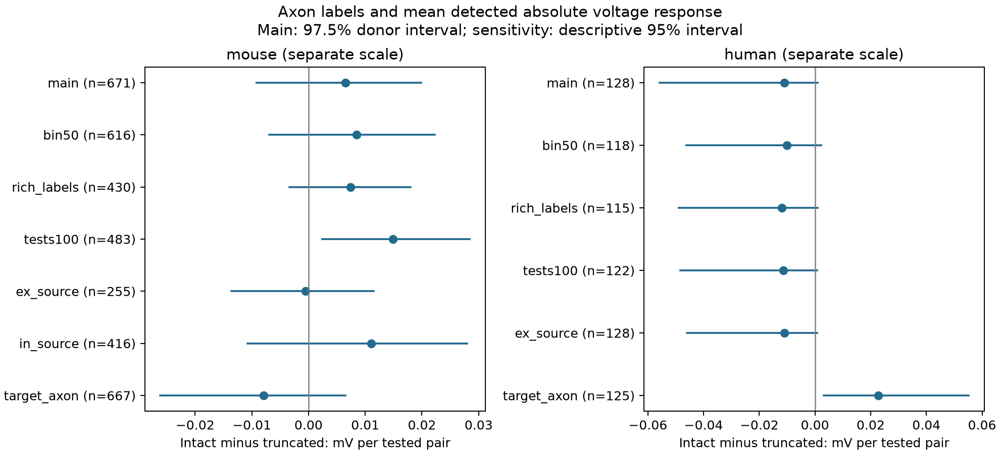

# Matched Allen slice data do not resolve an axon preservation effect on mean detected voltage response

## Main result

We tested whether source axons marked intact had a larger mean detected absolute resting voltage response per tested cell pair than axons marked truncated. We used Allen Synaptic Physiology r2.1 small data. We matched recording, ordered cell classes, and 100 micrometre distance bins. Pairs called unconnected received zero. Matched groups with a missing response estimate for a detected connection were excluded. In 671 mouse visual-cortex pairs from 68 inferred mice, the difference was 0.00648 mV per pair. The nominal 97.5% donor bootstrap interval was -0.00916 to 0.01989 mV. In 128 human temporal-cortex pairs from eight inferred donors, the difference was -0.01091 mV, with interval -0.05588 to 0.00097 mV. Neither primary interval excluded zero. A mouse high-spike sensitivity test gave a positive descriptive interval. About 28% of detected connections in each eligible sample lacked voltage estimates. Sparse matches, missing measurements, inferred donors, and residual cell differences limit the result. The method tests detected coupling in selected slices. It does not estimate lost synapses or intact-brain coupling.

The contribution is a sampling audit for circuit weights. A connection rate alone does not give the mean voltage response per tested pair. This study combines detected edge frequency and response size in one outcome. It gives no clear primary evidence that this outcome differs with source axon status in the selected samples. This result does not show equal coupling.



## Question and prior work

Campagnola, Seeman and colleagues measured local connectivity and synaptic properties in mouse and human cortex ([Science, 2022](https://doi.org/10.1126/science.abj5861)). The public Allen database links each tested pair to the morphology labels of the same cells. These are physiological slice circuits, not EM synapse maps. No cross-animal atlas match is needed.

We searched the local campaign for connectome, signal propagation, synaptic, and preservation strength before fixing this question. We read SCI `sha256:370bc73ac3c597a2824ff628d75e4228161dfa549a0e3cdc17fc707a9bc07b1f` and `sha256:be1bc665c37d982b55c16fb1aaeab66479ab234e98dbcecab1c9c1cbbc75b7b2`. The first found limited mouse evidence for a higher detected connection rate with intact source axons. The second found uncertain same-pair direction effects. We extend the first design to response magnitude. No prior code or tables were reused. Web searches covered signal propagation and Allen slice methods. The worm dataset directories checked here were empty, so they were not used. This was an exploratory study, not a systematic review or a registered test. The test plan was saved before response estimates were computed.

The Allen source code defines axon truncation as a qualitative label. Its correction framework can assign an intact axon a length of 200 micrometres when a measured length is absent. We do not use that value. The intact label does not mean that the whole axon survived. The resting-state pipeline updates `synapse.psp_amplitude` from current-clamp fits after prior-stimulus exclusion and only when the earlier rise-time fit exists. A missing value is not a zero response. Exact source paths, versions, and hashes are in `files/source_definitions.json`.

## Selection and outcome

We opened the database in read-only mode. `files/evidence/query.sql` gives the joins. We selected mouse VisP and human TCx, known nonsynaptic ex/in classes for both cells, binary chemical connection calls, and cell-body distances greater than zero and at most 500 micrometres. We required more than 10 test spikes in the source class. We used the source axon labels intact and truncated. Other labels were excluded. Missing calls were not counted as absent connections. No pulse-train arrays, electrical calls, or raw traces entered the outcome.

The mouse eligible sample had 6,642 pairs and 597 detected connections. Of those connections, 164 (27.5%) lacked a resting PSP estimate. The human sample had 1,187 pairs and 134 detected connections, of which 37 (27.6%) lacked an estimate. The 100 micrometre matching rule gave 147 mouse and 19 human groups with both axon labels. We excluded eight mouse and three human groups because at least one detected connection lacked an estimate. We excluded whole groups to keep their denominators intact. This step can still select a biased sample.

The final mouse sample had 671 pairs, 24 detected connections, 139 groups, 71 recordings, 195 source cells, and 326 target cells. It had 411 intact-source and 260 truncated-source pairs. The human sample had 128 pairs, five detected connections, 16 groups, nine recordings, 35 source cells, and 41 target cells. It had 80 intact-source and 48 truncated-source pairs. Distinct source and target counts can include the same cells. Most eligible pairs did not have matched support.

For a pair called connected, the outcome Y is 1000 times the absolute value of `psp_amplitude`, in mV. For a pair called unconnected, Y is zero. The outcome is detected absolute coupling per tested pair. It is not net excitation minus inhibition, conductance, release reliability, or a causal effect. The zero represents a call under the recording conditions, not a known biological absence. Absolute values avoid cancellation between excitation and inhibition. They do not make these cell classes interchangeable.

## Estimate and uncertainty

A group has the same recording experiment, ordered source and target nonsynaptic classes, and 100 micrometre distance bin. Bins start at zero. Let n1 and n0 be its intact and truncated counts. Its weight is w = n1*n0/(n1+n0). Its difference is the intact mean Y minus the truncated mean Y. We report the weighted mean of group differences. All-zero groups remain in the estimate. This is an overlap-weighted contrast for the retained recording and cell-class mixture.

We resampled whole inferred donors 10,000 times with seed 110708. Cells, pairs, and groups within a donor stayed together. Each draw recomputed the ratio of summed weighted differences to summed weights. Mouse donor labels use the six digits after a hyphen in the specimen name. Human donor labels use the first three dot-separated fields. These are inferred clusters, not verified donor IDs. The saved pair table keeps the source names and labels for inspection.

The two primary intervals use the 1.25th and 98.75th percentiles. They have a nominal 97.5% marginal target, for a nominal 95% two-test family target. This is not a coverage proof. Coverage can be poor with sparse nonzero outcomes and eight human donors. All sensitivity intervals use the 2.5th and 97.5th percentiles and are descriptive. We do not report calibrated p-values.

## All results

Units below are mV per tested pair. Positive differences mean a higher mean detected absolute response with intact axons. Source axon status is used except in the target-axon row.

| Species | Test | Pairs | Donors | Detected edges | Difference | Interval |
|---|---|---:|---:|---:|---:|---|
| mouse | main | 671 | 68 | 24 | 0.00648 | -0.00916 to 0.01989 |
| mouse | bin50 | 616 | 70 | 24 | 0.00849 | -0.00693 to 0.02225 |
| mouse | rich_labels | 430 | 51 | 17 | 0.00736 | -0.00338 to 0.01803 |
| mouse | tests100 | 483 | 61 | 24 | 0.01485 | 0.00241 to 0.02846 |
| mouse | ex_source | 255 | 28 | 5 | -0.00050 | -0.01361 to 0.01154 |
| mouse | in_source | 416 | 41 | 19 | 0.01101 | -0.01074 to 0.02794 |
| mouse | target_axon | 667 | 66 | 27 | -0.00794 | -0.02613 to 0.00655 |
| human | main | 128 | 8 | 5 | -0.01091 | -0.05588 to 0.00097 |
| human | bin50 | 118 | 8 | 4 | -0.01014 | -0.04621 to 0.00226 |
| human | rich_labels | 115 | 8 | 5 | -0.01195 | -0.04898 to 0.00093 |
| human | tests100 | 122 | 8 | 5 | -0.01134 | -0.04844 to 0.00086 |
| human | ex_source | 128 | 8 | 5 | -0.01091 | -0.04602 to 0.00083 |
| human | in_source | 0 | 0 | 0 | No support | No interval |
| human | target_axon | 125 | 8 | 6 | 0.02276 | 0.00318 to 0.05528 |

The main mouse rate contrast in the response-complete groups was +2.89 percentage points. The human contrast was -7.29 points. These groups differ from the earlier rate-only study because this study requires complete voltage estimates. The voltage contrasts cannot be attributed to response size alone.

The `bin50` test uses 50 micrometre bins. The `rich_labels` test adds ordered Cre and target-layer labels; identical missing labels count as a match. The `tests100` test requires more than 100 class-specific spikes. The two source-class rows split the primary groups. There was no matched human inhibitory-source group. The target-axon test changes the label axis and thus changes the selected pairs. It is not a strict negative control or a source-minus-target test.

The high-spike mouse test and human target-axon test gave descriptive intervals above zero. They were among the planned sensitivity tests, were not corrected as independent discoveries, and do not rescue the primary hypothesis. All other supported sensitivity intervals included zero. No species difference test was made.

## Limits and next test

Only 24 mouse and five human detected responses support the primary weighted contrasts. Many groups contain only zeros. Missing voltage fits affect about 28% of eligible detected connections and remove some otherwise matched groups. Fit failure may depend on response size and noise. Results therefore apply to groups with complete measurements, not all tested pairs. No finite bound on the full-sample mean follows without an assumption about the missing response sizes.

Cell subtype, cell health, depth, dendrite loss, staining quality, and detection power can affect both axon labels and measured coupling. Matching broad classes does not remove these differences. Distances still vary within bins. Donor labels can merge or split animals. Human donors are few. Species is confounded with region and preparation. These data cannot establish a general rule across regions, species, behavioral states, or intact brains. They do not test information coding or representation reliability directly.

A stronger test would record matched intact and cut sources with equal detection power, measure axon and dendrite loss, retain all response traces, and estimate responses even when a binary call is absent. It should collect more informative pairs and verified donor IDs. The present null result gives a reproducible measure and identifies the fit-completeness limit for that test.

## Reproduction and provenance

Raw file: `/mnt/dell-data/shared_datasets/allen_synphys/r2.1_small_2023-01-26/synphys_r2.1_small.sqlite`. Release: r2.1 small, schema 22. Source Last-Modified: 2023-01-26. Size: 176771072 bytes. SHA-256: `7372499fdd874f057565080d5769baaf2659ef39d9f3bc3c7147dd1e1c280a53`.

Reuse the shared file in place. If absent, retrieve the same source with the campaign helper:

```bash
campaign-dataset allen-synphys-r21-small-20230126 --url https://allen-synphys.s3-us-west-2.amazonaws.com/synphys_r2.1_small.sqlite --filename synphys_r2.1_small.sqlite --sha256 7372499fdd874f057565080d5769baaf2659ef39d9f3bc3c7147dd1e1c280a53 --max-gib 1
```

The script checks this hash before reading. No shared dataset was changed or added. The raw database and upstream software are not redistributed. Original Allen data remain under Allen terms of use. The baseline license covers our text, figures, code, and derived evidence, and does not change the upstream terms.

From the extracted bundle root, with Python 3.12.16:

```bash
uv venv /tmp/voltage-audit-env --python 3.12
uv pip install --python /tmp/voltage-audit-env/bin/python -r files/requirements.txt
OPENBLAS_NUM_THREADS=1 OMP_NUM_THREADS=1 MKL_NUM_THREADS=1 campaign-compute -- /tmp/voltage-audit-env/bin/python files/audit.py
OPENBLAS_NUM_THREADS=1 OMP_NUM_THREADS=1 MKL_NUM_THREADS=1 campaign-compute -- /tmp/voltage-audit-env/bin/python files/analyze.py --db /mnt/dell-data/shared_datasets/allen_synphys/r2.1_small_2023-01-26/synphys_r2.1_small.sqlite --out /tmp/voltage-audit-results
```

Outside the campaign, run the Python commands directly with one library thread. The audit uses only bundled evidence. It reconstructs all 14 analyses from `pairs.csv` and checks group counts, outcomes, estimates, and saved bootstrap quantiles. `validation.txt` records the pass. CSV `__NULL__` means a missing database value; it is distinct from an empty string. `strata.csv` and `donors.csv` expose each contribution. `bootstrap.npz` holds all draws. `results.json` has all counts and estimates. `provenance.json` records the runtime and raw hash. Numerical results are the reproduction target; figure bytes may depend on fonts.

An audit first found that CSV empty fields did not distinguish missing labels from empty labels. We changed the export to an explicit null token and repeated the full analysis and audit. No estimate changed. A second run also confirmed the numeric results and pair table.

## Job record

Job: `sci-1107-syam2-neural-structure-and-computation-22024a9ea3a1`. Topic: `neural-structure-and-computation`. Campaign: `11_07_2026`. Machine: `syam2`. Account: `codex-myxtap`. Model: `gpt-6.1-sol`, high reasoning effort. No agents were launched. All substantial analysis and checks used `campaign-compute` with one library thread. The campaign-machine signature is not a personal authorship claim. The bundle is saved locally; it was not uploaded or submitted to a remote index.
