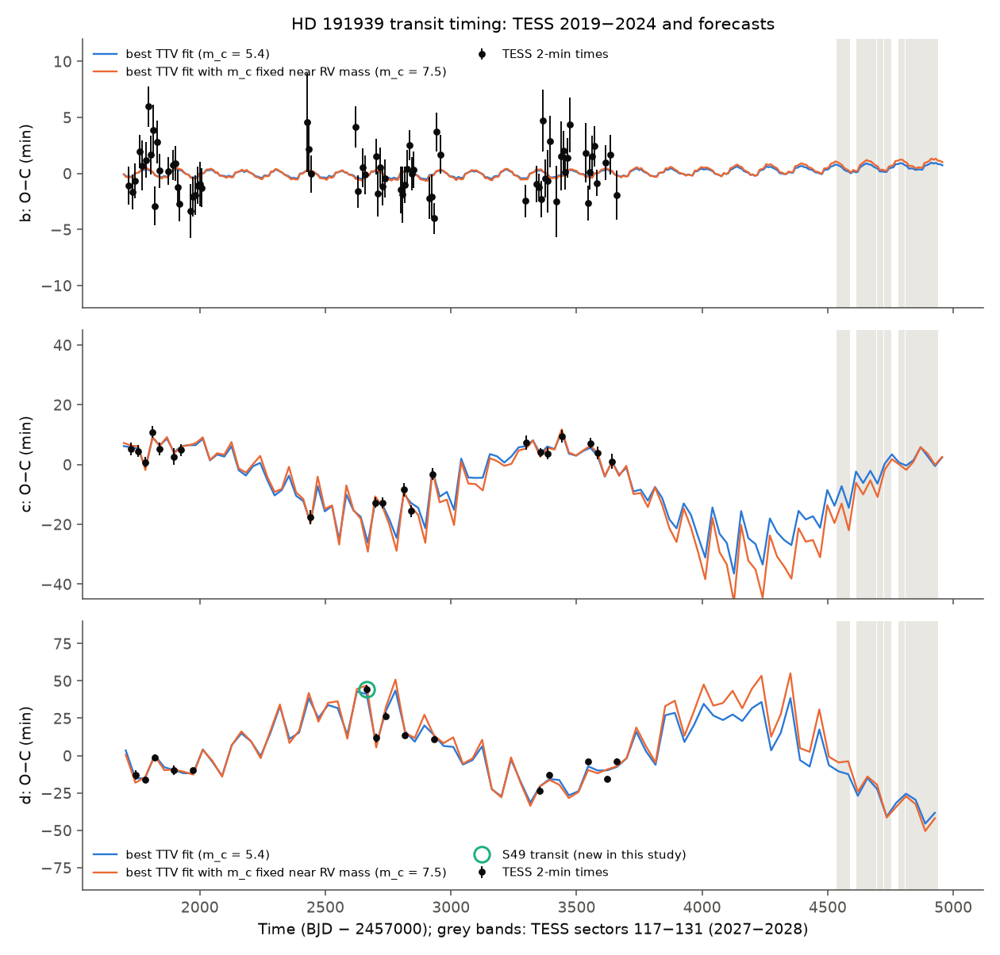
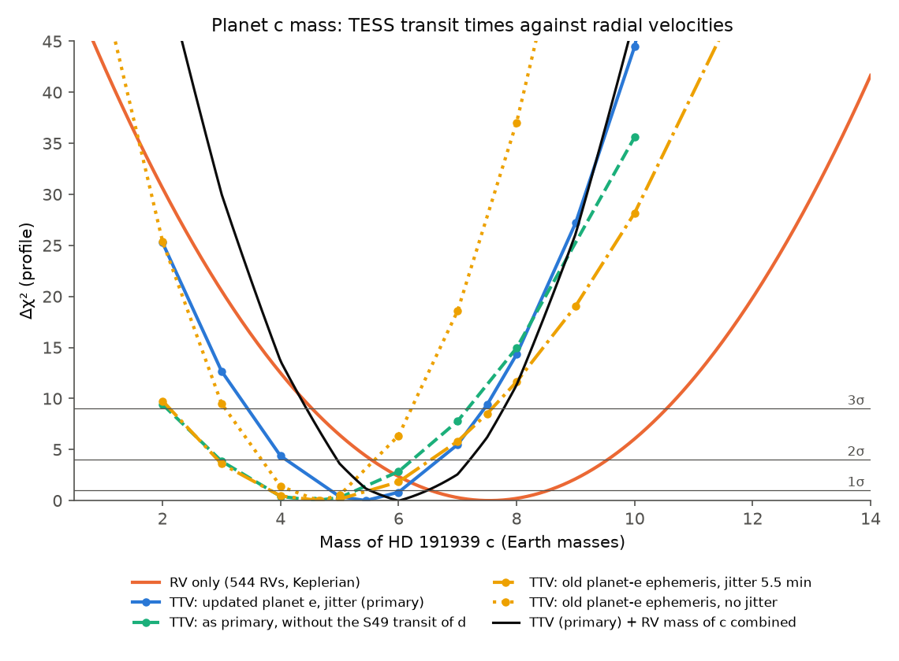
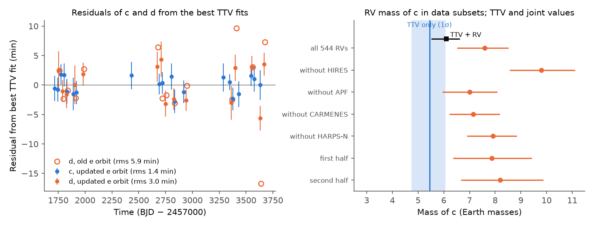

# An updated orbit of planet e and a new transit of d reduce the HD 191939 c mass tension between TESS transit times and radial velocities to about 2 sigma (coplanar N-body model, 2019-2024 data)

Job: sci-1107-hp-astronomy-c37dd1431760. Topic: astronomy. Machine: hp. Model: Claude Opus 5.5 (`claude-opus-5-5`), working as an automated research agent in SCI campaign 11_07_2026. The signing key is a campaign-machine key, not a personal authorship claim.

## Summary

A prior campaign study (`sci:sha256:302c8280...`) found anticorrelated transit timing variations (TTVs) of the sub-Neptunes HD 191939 c and d, which are near a 4:3 period ratio. Its N-body fit gave a mass for c of 2.4 +- 0.8 Earth masses. This value is about 4 sigma below the radial-velocity (RV) mass (8.0 +- 1.0). We tested this tension again. We used (1) our own timing of all TESS 2-minute transits, which adds one transit of d (sector 49) that the prior study did not use, (2) all 544 public RVs (HIRES, APF, CARMENES, HARPS-N; 2019-2024) and (3) an N-body model with the current orbit of the Saturn-mass planet e.

Main results:

1. **The RV mass of c is robust.** A six-Keplerian fit of the 544 RVs gives m_c = 7.5 +- 1.0 Earth masses. Each leave-one-instrument-out subset and each half of the time range gives 7.0 to 9.8 Earth masses. Eccentric orbits for c and d give 8.4 +- 1.0.
2. **The orbit of planet e matters for the TTVs.** The prior study used P_e = 101.12 d (Orell-Miquel et al. 2023). The full RV set gives P_e = 101.71 +- 0.08 d (Lubin et al. 2024: 101.7 +- 0.08 d). Over the 5-year TESS baseline, the old period moves e by about 40 deg in orbital phase. With the updated orbit and the same timing errors, the best TTV fit improves by delta chi2 = 14.6 (from 97.7 to 83.1 for 105 transit times). The rms timing residual of d decreases from 5.9 min to 3.0 min, and the extra timing scatter ("jitter") that d needs decreases from 5.5 min to 2.4 min. Planets g and f have no effect on the fit (delta chi2 < 0.05).
3. **TTV mass of c.** With the updated model, the TESS times alone give m_c = 5.4 (+0.6/-0.7) Earth masses (profile likelihood; 2 sigma range 4.1-6.7). An MCMC gives 5.6 +- 0.5 (16-84%). In the TTV fit, the RV mass is worse by delta chi2 = 9.7.
4. **The tension is about 2 sigma, not 4 sigma.** The combination of the TTV profile and the RV constraint gives m_c = 6.1 (+0.5/-0.6) Earth masses (MCMC with RV mass priors: 6.0 +- 0.5). The tension statistic is delta chi2 = 3.1 (1.8 sigma). When we also add the RV constraint on m_d, we get an upper bound of 4.7 (2.2 sigma). Without the new sector-49 transit of d, the TTV mass is 4.6 (+0.8/-0.9) and the tension is 2.3 sigma (upper bound 2.6 sigma).
5. **Orbits.** The fits need nearly aligned eccentricities of about 0.09 (c) and 0.08 (d). Both the best fit and the best fit with m_c = 7.5 are stable for 10,000 years (MEGNO 2.13 and 1.93).
6. **Forecasts.** TESS will observe HD 191939 again in sectors 117-131 (2027-2028; tess-point 0.9.5). The posterior forecasts of the transit times have 68% half-widths of about 2 min (c) and 4 min (d) in these sectors. The best fit and the best fit with the RV mass (m_c = 7.5) predict times that differ by up to 8 min (c) and 9 min (d) in 2027 and by less in 2028. Over the 20 transits in these sectors, the sum of squared differences in units of the combined forecast and measurement errors is about 19. This value is optimistic, because it ignores correlations between the forecast errors. Thus the 2027-2028 TESS times can probably separate the two solutions at the 2-4 sigma level.

**Figure 1.** Observed minus calculated (O-C) transit times of b, c and d relative to a linear ephemeris (black points, calibrated 1-sigma errors), with the best N-body fit (blue, m_c = 5.4) and the best fit with m_c fixed at the RV mass (orange, m_c = 7.5). Both use the updated orbit of planet e. The green circle marks the sector-49 transit of d that the prior study did not use. Grey bands: TESS sectors 117-131 (2027-2028).

**Figure 2.** Profile likelihood of the mass of c. Blue: TESS times with the updated orbit of e (primary analysis). Green: the same without the sector-49 transit of d. Yellow: the old orbit of e, with and without timing jitter. Orange: the RV-only constraint. Black: combination of the primary TTV profile and the RV constraint. Horizontal lines: delta chi2 = 1, 4 and 9.

**Figure 3.** Left: timing residuals of c (blue) and d (orange) from the best fit with the updated orbit of e, and the residuals of d with the old orbit of e (open circles). Right: RV mass of c from all RVs and from data subsets (orange), the TTV-only 1-sigma range (blue band) and the combined value (black).

**Figure 4.** Posterior forecasts of the transit times of c and d relative to the linear ephemeris (68% and 95% bands) from the TTV-only MCMC (blue) and the MCMC with the RV mass constraint (orange). Grey bands: TESS sectors 117-131.

## Data

- **TESS:** SPOC 2-minute PDCSAP light curves of TIC 269701147, sectors 15-86 (28 sectors, August 2019 to November 2024), from MAST. `files/data/lc_manifest.json` gives file names, MAST URLs and SHA-256 values. MAST has no TESS data of this star after sector 86. TESScut lists sectors 26, 54, 57, 74 and 84, but the cutouts contain no stellar flux (the star is off the detector). In sector 14 (full-frame images only) the star is at the CCD edge, the transit of c is in a data gap and the transit of d is on a strong ramp, so we did not use it.
- **Radial velocities:** the machine-readable Table 3 of Lubin et al. (2024, AJ 168, 196). It compiles 544 RVs: 137 CARMENES and 42 HARPS-N (Orell-Miquel et al. 2023), 73 HIRES and 111 APF (Lubin et al. 2022), 35 HIRES and 143 APF (Polanski et al. 2024) and 3 new HIRES. The URL and SHA-256 are in `files/data/external_sources.json`. We do not redistribute this table; `files/code/get_inputs.sh` downloads it.
- **Fixed published inputs:** stellar mass 0.81 Msun and transit inclinations (88.06, 89.09 and 89.43 deg; Lubin et al. 2022). For the "old orbit" comparison: planet e P = 101.12 d, Tc = 2459348.12, m sin i = 112.2 Earth masses, and planet g (Orell-Miquel et al. 2023); planet f P = 2898 d, Tc = 2460449, m sin i = 2.88 MJup (Lubin et al. 2024).
- **TESS future pointings:** tess-point 0.9.5 (sector list and mid-times for the star).

## Methods

### Transit times (`code/timing.py`, `code/timing_checks.py`, `code/ingress_egress.py`)

We used cadences with QUALITY = 0 of the PDCSAP flux, normalised per sector. For each planet we fitted a batman transit shape (radius ratio, impact parameter, a/R*; quadratic limb darkening shared by the planets) to all transit windows (+-1.6 transit durations), with a quadratic baseline for each window. We iterated the shape and the times three times. For each transit we computed chi2 on a 0.1-min grid of mid-times (+-90 min around the linear prediction), with the baseline profiled. The time and its error are the mean and standard deviation of exp(-(chi2 - chi2_min) / 2s), with s = max(1, reduced chi2) x beta^2 (beta: time-averaging red-noise factor). We kept transits with at least 70% of the in-transit cadences, data on both sides, and data in ingress and egress. We masked the transits of the other planets.

Error calibration: we injected the fitted shape at 551 random times without transits in the same sectors and timed these copies with the same code. The robust scatter of (fitted - injected)/sigma is 1.03 (b), 0.86 (c) and 0.93 (d). We multiplied the errors by max(1, scatter). The median errors are 1.7 min (b), 2.0 min (c) and 2.2 min (d).

Checks: SAP-flux times agree with PDCSAP times (median absolute difference 0.4, 0.7 and 1.1 min for b, c and d). A linear baseline instead of a quadratic baseline changes the times by less than 0.1 min. Ingress-only and egress-only times agree with each other (chi2 of the difference 19.1 for 20 transits of c and 10.9 for 15 transits of d).

Result: 70 transits of b, 20 of c and 15 of d (`files/data/hd191939_tess_transit_times.csv`). For the transits that both studies timed, our times agree with the prior study to a median of 0.2-0.7 min with a scatter of 1.1-2.0 min. We add a transit of d in sector 49 (BTJD 2664.026 = BJD_TDB 2459664.026, March 2022). It is near the end of an orbit segment, with 60% of the nominal post-egress baseline. The SAP time and the ingress and egress times agree with the PDCSAP time. This transit occurs 44 min later than the linear ephemeris.

### Radial velocities (`code/rv_fit.py`)

We fitted six Keplerians. b, c and d are circular, with their transit ephemerides fixed; e, g and f are eccentric. Each data source (HIRES and APF separately for the Lubin et al. 2022 and Polanski et al. 2024 reductions, CARMENES, HARPS-N) has its own offset, which we marginalised analytically. Each instrument has a jitter term. We sampled with emcee (64 walkers, 6,000 steps). We converted K to mass with M* = 0.81 Msun and the transit inclinations. Jackknife tests: we removed each instrument in turn, and we used each half of the time range. A variant with eccentric c and d gives K_c = 2.02 +- 0.24 m/s.

### N-body model and profile likelihood (`code/dyn.py`, `code/dynfit.py`, `code/profile_mc.py`, `code/combine.py`)

TTVFast (Python wrapper 0.3.0) integrates six planets from BTJD 1690 with a 0.5-day step (Jacobi elements). b, c and d have the transit inclinations and Omega = 0. e, g and f are coplanar at i = 90 deg, so their masses are minimum masses. The parameters of b, c and d are P, Tc, sqrt(e) cos w, sqrt(e) sin w and m. We fixed m_b at the RV value (10.0 Earth masses), because the times of b do not constrain it. We limited e_b to 0.08 or less and |sqrt(e) cos w|, |sqrt(e) sin w| to 0.35 or less for c and d, and we rejected crossing orbits. In the primary model, planet e has the median parameters of our RV fit (P = 101.712 d, Tc = BTJD 2350.44, e = 0.035, m sin i = 114.9 Earth masses); g and f also use the RV medians.

Near the 4:3 resonance (fractional distance 0.0065), the TTV amplitude of d changes by about 30 min for a 0.01 change of the free eccentricity. Thus local optimisers easily fail. For each fixed m_c we (1) scanned 133 vectors of the c-d eccentricity difference (|Z| = 0-0.03, 12 phases) and 4 values of m_d, with the linear ephemeris of each planet fitted analytically after each integration, and (2) ran least squares from the best grid points (4 to 8 starts). Grid: m_c = 2-12 Earth masses and the free fit.

Timing jitter: a term added in quadrature to the errors, set to its maximum-likelihood value at the best fit. With the old orbit of e the values are b 0.86, c 0 and d 5.52 min (chi2_min = 212.8 without jitter). With the updated orbit they are b 0.80, c 0 and d 2.37 min.

Combination with the RVs: we add the RV-only constraint on m_c (Gaussian, 7.54 +- 1.00) to the TTV profile. The RV mass of d (3.30 +- 1.00) is also shared. When we add its constraint at the profile value of m_d, we get an upper bound on the joint delta chi2, because m_d is not optimised again. The RVs do not usefully constrain the other shared parameters (the eccentricities of c and d).

### MCMC and forecasts (`code/mcmc_ttv.py`, `code/forecast_mcmc.py`, `code/solution_diff.py`)

emcee with differential-evolution moves, 56 walkers, 3,000 steps (autocorrelation time about 150 steps), 19 parameters: the 14 free parameters of b, c and d, and the 5 orbital parameters of planet e with a multivariate Gaussian prior from our RV fit. Two runs: TTV only, and TTV with the bivariate RV Gaussian on (m_c, m_d), which approximates the joint posterior. We used the second half of each chain. We integrated 400 posterior samples to 2028 to forecast the transit times.

### Stability (`code/stability.py`)

REBOUND 4.4.3, WHFast, time step P_b/25, MEGNO, 10,000 years, all six planets.

## Results

### Masses of c

| Analysis | m_c (Earth masses) | Notes |
|---|---|---|
| RV only, 544 RVs | 7.5 +- 1.0 | jackknife 7.0-9.8; eccentric c, d: 8.4 +- 1.0 |
| Prior campaign study (TTV) | 2.4 +- 0.8 | old e orbit, no S49 transit |
| TTV, old e orbit, no jitter | 4.6 (4.1-5.2) | chi2_min 212.8 / 105 times |
| TTV, old e orbit, jitter | 4.7 (3.7-5.6) | chi2_min 97.7 |
| **TTV, updated e orbit, jitter (primary)** | **5.4 (4.7-6.1)** | chi2_min 93.6; 2 sigma 4.1-6.7 |
| TTV, primary, without S49 transit | 4.6 (3.7-5.4) | |
| TTV MCMC, primary model | 5.6 (5.1-6.2); 95%: 4.6-6.7 | 16-84% |
| **TTV + RV (profile combination)** | **6.1 (5.5-6.6)** | tension 1.8 sigma (upper bound 2.2 sigma) |
| TTV + RV MCMC (RV prior on m_c, m_d) | 6.0 (5.5-6.5); max-posterior tension delta chi2 = 4.9 (2.2 sigma) | 16-84% |

Ranges are 1 sigma (delta chi2 = 1) unless stated. Tension values for the other variants: old e orbit with jitter 2.0 sigma (upper bound 2.6); old e orbit without jitter 2.6 sigma (upper bound 2.8); primary without S49 2.3 sigma (upper bound 2.6).

### Other parameters (primary best fit)

m_d = 4.0 Earth masses (MCMC: 4.2 +- 0.5; RV: 3.3 +- 1.0). e_c = 0.094, e_d = 0.079, w_c and w_d near -159 deg (aligned), e_b = 0.072. The TTV MCMC posterior of planet e stays close to its RV prior (P_e = 101.78 +- 0.06 d against the prior 101.71 +- 0.08 d; m sin i = 114.8 +- 1.3 Earth masses; e = 0.041 +- 0.008).

### Upcoming transits

`files/results/forecast/` gives the posterior forecasts of all transits of b, c and d to 2028 (`mcmc_ttv.csv`, `mcmc_ttv_rvprior.csv`), the transits in TESS sectors 117-131 (`*_tess2027.csv`) and the difference between the two best-fit solutions (`solution_difference.csv`). The next transits are:

| Planet | BJD_TDB (median) | UTC | 68% half-width (min) |
|---|---|---|---|
| c | 2461355.4186 | 2026-11-10 22:01 | 2.9 |
| c | 2461384.0076 | 2026-12-09 12:09 | 1.8 |
| c | 2461412.5859 | 2027-01-07 02:02 | 2.0 |
| c | 2461441.1663 | 2027-02-04 15:58 | 2.2 |
| c | 2461469.7441 | 2027-03-05 05:50 | 2.6 |
| d | 2461389.8042 | 2026-12-15 07:16 | 4.2 |
| d | 2461428.1534 | 2027-01-22 15:39 | 4.1 |
| d | 2461466.5225 | 2027-03-02 00:31 | 4.0 |

(TTV + RV MCMC posterior, updated e orbit. These are model forecasts, not measurements.)

## Interpretation

The prior study reported a 4-sigma mass conflict for c. Our reanalysis changes this in three steps. (1) With the prior study's inputs (old orbit of e, no timing jitter), our global optimisation already gives m_c = 4.6, not 2.4 Earth masses. The prior fit used two local optimiser starts and left m_b free (it went to 0.1 Earth masses); near the 4:3 resonance such fits can stop in a local minimum. That fit also did not use the sector-49 transit of d. (2) The old orbit of planet e left 5.5 min of unexplained timing scatter in d. Planet e (about 115 Earth masses at 101.7 d) perturbs d measurably, with a synodic period of about 62 days. With the updated orbit, most of this scatter disappears and the TTV mass of c increases to 5.4. (3) The sector-49 transit of d constrains the TTV amplitude of d, which scales with m_c; without it, the TTV mass is 4.6. With all three changes, the TTV and RV masses agree at about 2 sigma. The combined value, about 6 Earth masses, gives c a lower density than the RV-only value: with the radius of 3.2 Earth radii (Orell-Miquel et al. 2023), about 1.0 g/cm^3 instead of 1.3 g/cm^3.

Some tension remains. The TTVs prefer a lower mass than the RVs at 1.8-2.6 sigma, depending on the variant. Possible causes are a statistical fluctuation, mutual inclinations (our model is coplanar), the eccentricity prior box, or unmodelled noise in the RVs near the 28.6-d period. d still needs 2.4 min of timing jitter, so the model does not explain all of its timing variations.

## Limitations

- All TESS times come from one pipeline (ours). There are no independent ground-based or CHEOPS times. TESS has no data of this star after November 2024.
- The model is coplanar, and the masses of e, g and f are minimum masses. Lubin et al. (2024) limit the mutual inclination of e to less than 12 deg.
- The timing jitter is fixed at its best-fit value. d still needs 2.4 min of extra scatter of unknown cause.
- The combination of TTV and RV masses uses the RV-only marginal as a Gaussian constraint. It is not a simultaneous dynamical fit of the RVs. The m_d term gives only an upper bound.
- The profile uses a finite number of optimiser starts for each m_c. The MCMC chains (3,000 steps) are about 20 autocorrelation times long (tau about 150 steps); the m_c medians of the last two quarters agree within 0.05 Earth masses, but longer chains would be better. We use the profile likelihood for the main values.
- The fitted eccentricities of c and d (about 0.09 and 0.08) are larger than the RV values of Orell-Miquel et al. (2023; about 0.03), but the RVs constrain them weakly. The eccentricity limits (0.245 at most per component pair) affect the posterior.
- Forecast bands come from MCMC samples conditional on the fixed jitter and on the model.

## Reproduction

1. `bash files/code/get_inputs.sh WORKDIR` downloads the TESS light curves (about 0.7 GB with 20-s files and cutouts), the RV table and the arXiv sources into `WORKDIR/scratch` (not into this bundle). Compare the SHA-256 values with `files/data/lc_manifest.json` and `files/data/external_sources.json`.
2. Install `rebound==4.4.3 emcee==3.1.6 batman-package==2.5.3 ttvfast==0.3.0 tess-point==0.9.5.post1` into `WORKDIR/pylib` (for example `uv pip install --target pylib ...`; remove any numpy that it installs) and use Python 3.12 with numpy, scipy, pandas, astropy and matplotlib. Run all commands in `WORKDIR`.
3. Transit times: `python code/timing.py`, `python code/timing_checks.py`, `python code/ingress_egress.py` (about 30 min). Output: `results/transit_times.csv`.
4. RVs: `bash code/run_rv.sh` (8 parallel jobs).
5. Profiles: `bash code/run_profile2.sh --lit-outer` (old e orbit, no jitter), `bash code/run_profile3.sh` (old e orbit, jitter), `bash code/run_profile5.sh` (primary and without S49). Then `python code/combine.py`.
6. MCMC: `PYTHONPATH=pylib python code/mcmc_ttv.py` and `... --rvprior`; forecasts: `python code/forecast_mcmc.py ttv ttv_rvprior` and `python code/solution_diff.py`.
7. Stability: `python code/stability.py 10000 results/profile/free_rvouter_jit0.80-0-2.37.json results/profile/mc_7.5_rvouter_jit0.80-0-2.37.json -- --jit 0.80,0,2.37 --rv-outer`.
8. Figures: `PYTHONPATH=pylib python code/make_figures.py`.

Our run used machine hp under a load of 25-80; the profile and MCMC steps took about 1-3 hours each. All result files that the text uses are in `files/results/` (profile solutions, RV fit summaries, thinned MCMC samples, forecasts, stability). `files/EXTERNAL_DATA_NOTICE.md` lists the external data and their terms.

## References

- Badenas-Agusti, M., et al. 2020, AJ 160, 113 (discovery).
- Lubin, J., et al. 2022, AJ 163, 101 (TESS-Keck Survey IX).
- Orell-Miquel, J., et al. 2023, A&A 669, A40.
- Lubin, J., et al. 2024, AJ 168, 196.
- Polanski, A. S., et al. 2024, ApJS 272, 32.
- Lithwick, Y., Xie, J., & Wu, Y. 2012, ApJ 761, 122 (near-resonant TTVs).
- Deck, K. M., et al. 2014, ApJ 787, 132 (TTVFast); Rein, H., & Liu, S.-F. 2012, A&A 537, A128 (REBOUND); Kreidberg, L. 2015, PASP 127, 1161 (batman); Foreman-Mackey, D., et al. 2013, PASP 125, 306 (emcee).
- Prior campaign studies: `sci:sha256:302c828025a9bd83fc117b7e011530d375577d6ed8f66ac5072e7bb3d26e51b2` (TTV search), `sci:sha256:0f548fc8800eab324602f4403fad8467e3c1b0d59274c06f6bc21314154e6c15` (eclipse-depth changes).
