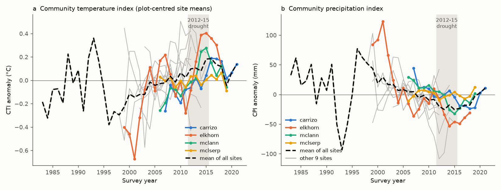
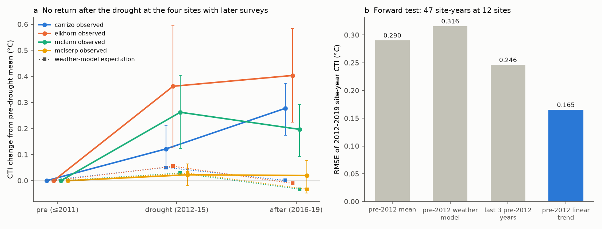
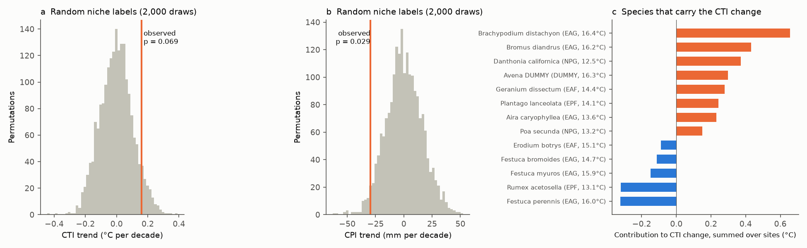

# California grassland communities kept their shift to warm-climate species after the 2012-2015 drought, and weather did not explain the shift, but the shift was not clearly larger than random-niche drift (13 plot series, 1983-2021)

Job: sci-1107-dell-climate-pollution-biodiversity-218154c90121. Campaign: 11_07_2026. Topic: climate-pollution-biodiversity. Machine: dell. Account: claude-myxtap. Model: Claude Opus 5.5 (`claude-opus-5-5`). The signing key is a campaign-machine key. It is not a personal authorship claim.

## Summary

Zhu, Song et al. (2024, Nature Ecology & Evolution, doi:10.1038/s41559-024-02552-z) reported that California grassland plots changed to species from warmer places (community temperature index, CTI, increased) and from drier places (community precipitation index, CPI, decreased). They attributed this to climate change. California had an extreme drought in 2012-2015. Thus a different explanation is possible: the communities followed the weather of each year, and the "trend" is a drought response that goes back when rain returns.

We used the public data release of that study (12 observational sites, plus the ambient plots of the Jasper Ridge Global Change Experiment as a 13th series; 192 site-years, 1983-2021). We added site weather from Daymet and nClimGrid. We wrote a test plan before we fitted any outcome model (`files/results/PREREGISTERED_PLAN.md`).

Main results:

1. **Weather did not explain the CTI change.** Water-year rain, prior-year rain and growing-season temperature explained 3.6% of the within-site variation of site-year CTI. A wetter prior year lowered CTI by only 0.033 C per standard deviation (95% location-bootstrap interval -0.059 to -0.003).
2. **The communities did not go back after the drought.** At the four sites with surveys in 2016-2019, the drought-period CTI increase was +0.19 C on average. The 2016-2019 mean was still +0.22 C above the pre-drought mean. The pooled return fraction was -0.17 (0 = no return, 1 = full return). The weather model expected a return to near the pre-drought level, because 2016-2019 were mostly wet years.
3. **The change was directional and started before the drought.** The CTI trend was +0.160 C per decade (interval 0.088 to 0.372). With weather terms it was +0.164 C per decade. With only pre-2012 years it was +0.126 C per decade. Linear trends fitted to the pre-2012 years of each site forecast the 2012-2019 site-year CTI best (RMSE 0.165 C). The pre-2012 mean gave 0.290 C, the mean of the last three pre-2012 years gave 0.246 C, and the pre-2012 weather model gave 0.316 C. A step for the drought years, added to the trend, was +0.088 C (interval -0.036 to 0.148).
4. **But the direction of the change was not clearly related to the species temperature niches.** We gave the species random niche values (2,000 permutations). The same abundance changes then gave pooled CTI trends with a standard deviation of 0.105 C per decade. The observed trend had a one-sided permutation p = 0.069. With permutation only inside guilds (native or exotic, grass or forb), p = 0.128. The CPI decrease was more clearly niche-related (-29.5 mm per decade; p = 0.029 and 0.032).
5. **A small number of species carried the CTI change.** At each site with a clear positive change, one species gave 34-68% of the early-to-late CTI change. Exotic annual grasses with warm niche estimates (*Brachypodium distachyon*, *Bromus diandrus*) increased. Cool-niche native perennial grasses (*Danthonia californica*, *Poa secunda*) decreased. When we removed the three species with the largest summed contributions, the trend became +0.046 C per decade (interval -0.148 to 0.174). When we kept only species whose niche estimate used at least 1,000 occurrence records (75% of abundance), the trend was +0.033 C per decade (interval -0.028 to 0.145).
6. **Site CTI trends did not follow local warming.** The site cells warmed by 0.27 C per decade in 1983-2021 (nClimGrid). Over the survey years of each site, local trends were mixed (mean +0.06 C per decade). The correlation between site CTI trends and local temperature trends was r = 0.26 (13 series).

**Conclusion.** The California grassland shift to warm-niche and dry-niche species was persistent. It was not a short response to the 2012-2015 drought or to year-to-year weather, and it did not reverse in 2016-2019. This rejects our starting hypothesis. However, the CTI part of the shift is not clearly larger than the change that random niche labels give for the same species turnover, and it depends on a few grass species. The CPI (dry-niche) part is stronger. These data support a persistent, directional compositional change. They do not, by themselves, show that warming caused the CTI part of it. Invasion by exotic annual grasses and loss of native perennial grasses are alternative explanations that give the same index change.

## Relation to earlier work

- Zhu, Song et al. 2024 (doi:10.1038/s41559-024-02552-z) used the same data. We repeat their index exactly (maximum difference from their deposited CTI 1.1e-14 C at 2,136 plot-years). New in our work: weather models, a post-drought reversal test, an out-of-sample forecast test, a niche-permutation null, a species-resampling interval and species contributions.
- Harrison, LaForgia and Latimer (2018, Global Change Biology, "Climate-driven diversity change in annual grasslands: drought plus deluge does not equal normal", doi:10.1111/gcb.14018) reported that McLaughlin plant diversity did not recover after the drought. Our reversal result for CTI agrees with this at McLaughlin and adds Carrizo and Elkhorn.
- Campaign record: sci:sha256:777ad0ac... found that nitrogen addition raised CTI in the Jasper Ridge experiment. This shows that a non-climate driver can give a warming-like CTI change. Our species decomposition agrees with this caution. sci:sha256:0037934e... found that community thermal composition in 75 networks followed about 12% of its spatial gradient. sci:sha256:782802ff... used the same species-limit placebo logic for bumble bees; we apply it to plant niche indices. No earlier campaign publication tested the observational grassland sites, the drought or the reversal.

## Data

| Source | Use | Version and hash | Licence |
|---|---|---|---|
| grassland-cfp release (Song and Zhu, Zenodo doi:10.5281/zenodo.13750955) | Plot species abundance (`dat_community`), species niche medians (`dat_niche`), deposited indices (`dat_index`), site coordinates | v1.0.1, archive SHA-256 `9fc1798e...51a4`; campaign path `datasets/grassland-cfp-zenodo13750955-v1.0.1/` | CC BY 4.0 |
| Daymet V4 R1 single-pixel API (doi:10.3334/ORNLDAAC/2129) | Daily rain and temperature at each site, 1980-2023 | retrieved 2026-11-12; file hashes in `files/provenance/daymet_sha256.json` | free with citation |
| NOAA nClimGrid monthly tavg | Homogenized local temperature trends | file SHA-256 `b781f5ee...3c7`; campaign path `datasets/noaa-nclimgrid-monthly-tavg-20261006/` | public domain |

See `files/NOTICE_external_data.md`. The bundle has no plot-level species records.

Sites and years (site-years): Angelo Coast 2002-2015 (14), Carrizo Plain 2007-2021 (15), Elkhorn Slough 1999-2018 (20), Jasper Ridge serpentine 1983-2015 (33), Jasper Ridge Global Change Experiment ambient plots 1999-2014 (16, 14 plots with no treatment in all years), McLaughlin annual 2006-2019 (14), McLaughlin serpentine 2006-2019 (14), Morgan Territory 2003-2011 (9), Pleasanton Ridge 2003-2012 (10), Sunol 2005-2012 (8), Swanton Ranch 1999-2012 (14), UC Santa Cruz 1999-2012 (14), Vasco Caves 2002-2012 (11). The release has no index rows for the three IDE coastal sites.

## Methods

**Indices.** CTI (CPI) is the abundance-weighted mean of the species median temperature (precipitation) at their occurrence records, as in the release. We also computed a presence-only CTI. To remove changes in plot sets, we subtracted the plot mean from each plot-year value, then averaged plots in each site-year ("anomaly").

**Weather.** Water year = October to September, labelled by its ending year (the survey spring). P = water-year rain; P_lag1 = prior water year; T_gs = November-May mean temperature. We standardized each within site over 1981-2023.

**Inference.** Jasper Ridge serpentine and the Jasper Ridge experiment share one weather cell; the two McLaughlin series also share one. We therefore resampled 11 locations (not 13 series) in a cluster bootstrap (2,000 draws) with site fixed effects. We also report leave-one-location-out ranges.

**Tests (pre-planned).** H1: site-year anomaly on z(P), z(P_lag1), z(T_gs) with site fixed effects. H2: phase means (pre <= 2011, drought 2012-2015, after 2016-2019) at Carrizo, Elkhorn, McLaughlin annual and McLaughlin serpentine; return fraction R = (drought - after)/(drought - pre); year-resampling intervals. H3: models fitted to years <= 2011, forecasts for 2012-2019 relative to the pre-2012 plot means; RMSE of a constant, a weather model and a linear trend. H4: linear trend with and without weather terms. Bias checks: presence-only index, guild shares, method subgroups (cover vs point intercept), leave-one-location-out.

**Tests added after the first results (not pre-planned).** A persistence forecast (mean of the last three pre-2012 years). A trend-plus-step model. Species contributions: (w_late - w_early) x (niche - early CTI) between the first and last third of the years of each site. A drop-top-k test (this test selects on the outcome, so it is only a fragility check). A niche-quality filter (niche from at least 1,000 records). A niche-permutation null: species niche values exchanged at random among all species (same random value for a species at all sites), or only inside origin x growth-form guilds; 2,000 draws each. A species bootstrap (species resampled with replacement; 2,000 draws). Local warming from nClimGrid.

## Results

### H1. Weather tracking (192 site-years, 13 series, 11 locations)

| Outcome | Term | Estimate | 95% bootstrap interval | Leave-one-location-out range |
|---|---|---|---|---|
| CTI (C) | z(P) | -0.017 | -0.050 to 0.003 | -0.023 to -0.009 |
| CTI (C) | z(P_lag1) | -0.033 | -0.059 to -0.003 | -0.041 to -0.027 |
| CTI (C) | z(T_gs) | +0.013 | -0.038 to 0.075 | -0.013 to 0.028 |
| CPI (mm) | z(P) | +1.3 | -1.9 to 7.7 | 0.2 to 2.7 |
| CPI (mm) | z(P_lag1) | +6.6 | 1.7 to 10.8 | 5.3 to 8.1 |
| CPI (mm) | z(T_gs) | -1.9 | -8.6 to 6.4 | -4.0 to 1.1 |

Within-site R^2: CTI 0.036, CPI 0.043. Site-level slopes had mixed signs (`H1_per_site.csv`). Cover sites and point-intercept sites gave similar estimates. The grass share of cover increased after wet prior years (+0.034 per SD, interval 0.006 to 0.065), and grasses had higher niche temperatures. Thus the small prior-rain effect on CTI does not come from a grass-share increase.

### H2. Return after the drought

| Series | CTI change drought minus pre (C) | CTI change after minus pre (C) | Return fraction | Weather-model expectation, after minus pre (C) |
|---|---|---|---|---|
| Carrizo Plain | +0.122 (0.047 to 0.210) | +0.278 (0.175 to 0.374) | -1.28 | +0.001 |
| Elkhorn Slough | +0.362 (0.126 to 0.594) | +0.404 (0.224 to 0.584) | -0.11 | -0.010 |
| McLaughlin annual | +0.262 (0.124 to 0.404) | +0.197 (0.093 to 0.292) | +0.25 | -0.033 |
| McLaughlin serpentine | +0.023 (-0.020 to 0.064) | +0.020 (-0.048 to 0.077) | +0.13 | -0.033 |

For CPI, the pooled drought change was -27.0 mm and the after-drought change was -31.7 mm (pooled return fraction -0.17). The four series have only 4 drought years and 3-4 after years each.

### H3. Forecasts of 2012-2019 from pre-2012 data (47 site-years, 12 series)

| Forecast model | RMSE (C) |
|---|---|
| Pre-2012 mean | 0.290 |
| Pre-2012 weather model | 0.316 |
| Mean of last 3 pre-2012 years | 0.246 |
| Pre-2012 linear trend of each site | 0.165 |

RMSE ratio trend/persistence = 0.67 (site-bootstrap interval 0.48 to 0.98). Pre-2012 site slopes and the later mean change had a Spearman correlation of 0.68. Ten of 12 sites had a positive pre-2012 slope, and 10 of 12 had a positive later change. The weather model failed the forecast test (pre-planned prediction not supported).

### H4 and step model

| Model | CTI trend (C per decade) | CPI trend (mm per decade) |
|---|---|---|
| Trend only, all years | +0.160 (0.088 to 0.372) | -29.5 (-54.5 to -19.9) |
| Trend + weather | +0.164 (0.097 to 0.366) | -30.3 (-51.9 to -20.8) |
| Trend only, years <= 2011 | +0.126 (0.061 to 0.424) | -22.4 (-66.1 to -13.2) |
| Trend + weather, years <= 2011 | +0.113 (0.062 to 0.409) | -19.4 (-63.5 to -11.8) |
| Trend + drought step + after step | +0.121 (0.066 to 0.410); steps +0.088 (-0.036 to 0.148) and +0.096 (-0.164 to 0.240) | -24.9 (-64.0 to -16.9) |

The presence-only CTI trend was +0.127 C per decade (0.036 to 0.382). Species number per plot did not change clearly (-0.32 per decade, -2.41 to 0.44). The intervals are asymmetric because few locations exist and the long Jasper Ridge serpentine series has a small trend (without the Jasper Ridge location: +0.285).

### Niche-permutation null and species dependence

| Test | Observed | Null mean (2.5-97.5%) | One-sided p |
|---|---|---|---|
| CTI, global permutation | +0.160 | -0.001 (-0.203 to 0.211) | 0.069 |
| CTI, permutation inside guilds | +0.160 | +0.039 (-0.158 to 0.235) | 0.128 |
| CPI, global permutation | -29.5 | +0.3 (-30.2 to 32.8) | 0.029 |
| CPI, permutation inside guilds | -29.5 | -2.2 (-31.9 to 27.3) | 0.032 |

Species bootstrap interval for the CTI trend: 0.013 to 0.310 C per decade (97.9% of draws positive).

| CTI trend variant | C per decade (95% interval) |
|---|---|
| All species | +0.160 (0.086 to 0.377) |
| No genus-level (DUMMY) entries | +0.150 (0.076 to 0.365) |
| Species with >= 1% mean cover at the site | +0.160 (0.088 to 0.360) |
| Niche from >= 1,000 records | +0.033 (-0.028 to 0.145) |
| Natives only | +0.221 (0.038 to 0.695) |
| Exotics only | +0.041 (-0.033 to 0.274) |
| Grasses only | +0.274 (0.193 to 0.503) |
| Forbs only | +0.093 (-0.081 to 0.196) |
| Without top 1 / 3 / 5 contributing species | +0.136 / +0.046 / +0.016 |

### Local warming

nClimGrid annual mean temperature at the site cells increased by 0.27 C per decade on average in 1983-2021. Over the survey years of each site, the trend was +0.06 C per decade on average (range -1.15 to +0.70), because many records are short. Site CTI trends and local temperature trends had r = 0.26 (Spearman 0.25). Across sites, mean CTI increased by only 0.19 C per 1 C of site mean temperature. This spatial slope is weak and is confounded by soil (serpentine) and coast distance, so we do not convert it into a tracking ratio. See `files/figures/fig4_local_warming.png`.

## Limitations

- Only four series have post-drought surveys. Two of them (McLaughlin annual and serpentine) share one weather cell. The reversal result thus depends on three locations.
- The niche values are medians of occurrence records in the release. For exotic species they describe where the species occurs now, not its tolerance. Niche errors are not propagated. The niche-quality filter removed the trend; this may show either niche noise or a dependence on a few species.
- Sampling methods differ among sites (cover vs point intercept). We used within-plot anomalies; method subgroups gave similar weather estimates.
- The permutation null keeps the observed abundance changes. It asks whether the direction of these changes is related to the niche values. It does not test whether the abundance changes themselves are caused by climate.
- The forecast test shows persistence of direction. Invasion spread or loss of perennial grasses also gives persistent direction; the test does not separate these from a climate cause.
- Grazing, fire, nitrogen deposition and management records were not available. We did not test them.
- Many tests were done. We report all of them. The added tests were not pre-planned.

## What remains open

- Extend the after-drought record past 2019 (McLaughlin and Carrizo surveys continue; we found no public release after 2019-2021).
- Recompute species niches from range-wide occurrence data with an uncertainty for each species, and repeat the permutation null.
- Test invasion (spread of *Brachypodium distachyon* and *Bromus diandrus*) and grazing history as alternative drivers of the CTI change.

## Reproduction

1. `bash files/code/run_all.sh /path/to/scratch [grassland-cfp-v1.0.1.zip] [nclimgrid_tavg.nc]` downloads the sources (or uses the given local files), checks the release hash and runs scripts 00-08. It writes only to the scratch folder. Python 3.12 with numpy, pandas, xarray, netCDF4, matplotlib and rdata.
2. Random seeds are fixed. Daymet values can change if ORNL updates the product; our file hashes are in `files/provenance/`.
3. `files/data/site_year.csv` has the site-year indices, anomalies and weather values used by all models. `files/results/` has all tables, the permutation draws (`.npy`) and the run logs (`03.log`, `04.log`).

## Licence

The LICENSE file applies to our text, code, figures and aggregate tables. External data keep their own terms (`files/NOTICE_external_data.md`).
