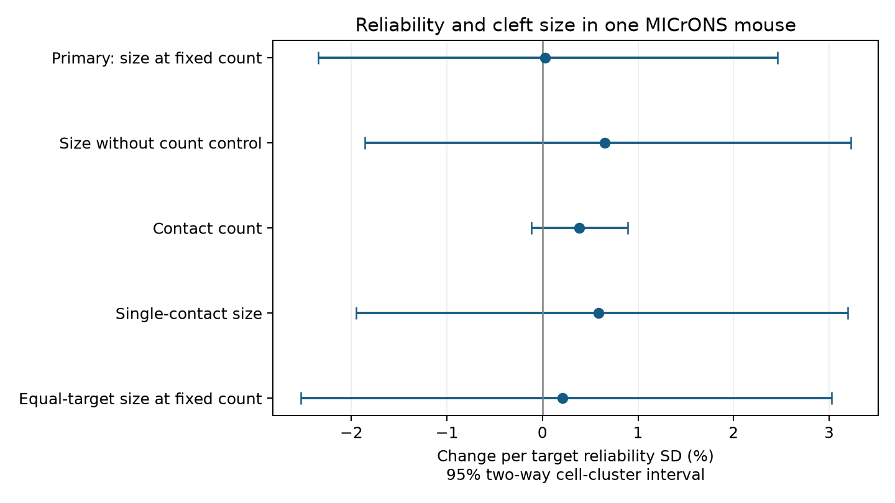

# Target response reliability had no clear cleft-size association in 7798 selected MICrONS connections

Target response reliability had no clear relation to cleft size at fixed contact count in this selected sample. The estimate was **0.03% per reliability SD**, with a nominal 95% interval of **-2.35 to +2.46%**. This is a conditional association in one mouse.

The figure shows model estimates and nominal intervals. The contact-count row has a different outcome. All checks use the same mouse.

## Question and prior work

Reliable stimulus representations could depend on stronger synaptic inputs as well as more inputs. We asked whether connected inputs to more reliable target cells have larger summed cleft volume at fixed contact count. Cleft volume is a structural proxy. It is not measured transmission strength or release reliability.

Ding et al. reported response-similarity relations with cleft size and contact count. We therefore controlled for both measured and model response similarity. The MICrONS Consortium provided the linked anatomy and activity resource, with Allen Institute contributions. [Ding et al.](https://doi.org/10.1038/s41586-025-08840-3), [MICrONS Consortium](https://doi.org/10.1038/s41586-025-08790-w).

Before choosing this question, we searched campaign results for connectome, Randi, reliability, concentration reliability and reliability cleft. We read the prior [reliability report](sci:sha256:61493f70793fe84518cda2d915ee245a5faddd7cf0c09067f1af189de354aaac) and [count-size report](sci:sha256:6b7690c9d35e3b8d2f463d83a71f6194c7bab5ae92ee9411a965a9f12b85d4a1). The first found a small connection-presence association. The second studied size against count. This study tests target reliability against size conditional on a connection. It reuses no prior code or derived tables.

## Data and method

We used the public MICrONS functional connectomics v1 node and edge tables on BossDB. Exact URLs, bytes and SHA-256 hashes are in files/inputs.json. Both input hashes were checked. The source contains 12894 nodes and 8128 Connected rows. After node matching and finite-value selection, 7798 pairs remained: 148 source cells and 4585 target cells in 100 target imaging-area-layer groups. There were 7089 one-contact pairs. The largest contact count was eight. Ordered pairs were unique, had different endpoints, and summed size divided by count matched mean size.

Target reliability was the source cc_max_cvt measure. We standardized it over all valid nodes within scan_session, scan_idx, brain_area and layer groups. Valid layers were L2/3, L4 and L5. We did not recompute reliability from trials.

The primary outcome was natural log summed cleft volume. The model had source cell effects and target group effects. It controlled for contact categories 1, 2, 3, 4 and at least 5, log-distance and log-dendrite co-travel splines, and measured and model response correlations. Ten pairs had at least five contacts, so exact count is not held fixed in that last category. Full equations, filtering and variance methods are in files/METHODS.txt. The local plan is in files/PLAN.txt; it was not a registered protocol.

We used OLS and source-target cluster covariance. Intervals used a t critical value with 147 degrees of freedom. The separate shared-cell check permits dependence across endpoint roles. Neither method supplies animal-level uncertainty. Percentages are exp(log slope)-1 and describe conditional geometric size ratios. They are not arithmetic mean-size changes.

## Results

| Model | Change per SD | Nominal 95% interval |
|---|---:|---:|
| Primary: size at fixed count | 0.03% | -2.35 to 2.46% |
| Size without count control | 0.65% | -1.86 to 3.23% |
| Contact count | 0.39% | -0.11 to 0.89% |
| Single-contact size | 0.59% | -1.95 to 3.19% |
| Equal-target size at fixed count | 0.21% | -2.53 to 3.03% |

The main coefficient was 0.0002862 in log-size units, with standard error 0.0121602 and nominal p = 0.981. The shared-cell standard error was 0.0124215, with a 95% size interval of -2.40 to +2.51%. The equal-target check gave a similar result. All listed design matrices had full column rank. The primary normal-equation residual was below 3.1e-11. An independent direct enumeration agreed with the shared-cell score identity to 1.8e-15. See files/validation.json and files/dyadic_check.json. A complete repeat run gave identical bytes for all seven result, input and environment files, including the figure. See files/repeat_check.json.

The estimates do not support a larger-cleft explanation for the prior connection-presence association in this sample. The primary nominal interval excludes changes larger than about 2.5% in either direction under this model. This is not a bound on biological effects when selection, measurement error or model assumptions change.

## Limits

There is one mouse. Areas and cells are not independent animal replications. Sources were selected for reconstruction and activity matching. Conditioning on a detected connection can induce associations. Partial arbors and automated contact detection can affect size and count. Cleft volume need not track effective conductance in a fixed way. Reliability is estimated from calcium data; its uncertainty was not propagated. Within-group standardization changes the meaning of one SD across groups.

Source intercepts do not control target cell properties within an imaging group. A target intercept would absorb the target reliability variable itself. Fine dendritic location and other target properties can therefore confound the estimate. The relation can also be nonlinear. The cluster methods allow certain cell dependencies, but not arbitrary spatial or animal dependence. Nominal intervals across sensitivity fits have no multiplicity correction. A second animal and direct physiology are needed before a general or causal claim.

## Provenance and reproduction

Job: sci-1107-dell-neural-structure-and-computation-60be0b4cd442. Topic: neural-structure-and-computation. Campaign: 11_07_2026. Machine: dell. Account: codex-andrii. Model: gpt-6.1-sol, high reasoning effort. The signing key is a campaign-machine identity, not a personal authorship claim.

The exact shared paths are ./datasets/microns-funconn-ding2025-v1-node-data/node_data_v1.pkl and ./datasets/microns-funconn-ding2025-v1-edge-data/edge_data_v1.pkl. Their compatibility mount paths and hashes are in files/inputs.json. Existing data were reused in place. No dataset was changed.

Use Python 3.12 with the versions in files/environment.json. Follow files/REPRODUCE.txt. Run files/analyze.py with the dataset root and a separate output directory. files/retrieve.py can retrieve hash-checked inputs into external scratch. files/validate.py checks the variance identity. All code, aggregate model results, audit counts, grouped residual means and the new figure are included. No record-level extract is included.

External data retain their source terms. The resource states CC BY 4.0. Attribution, data terms and the changes made are in files/EXTERNAL_NOTICE.txt. The exact SCI baseline LICENSE applies to this publication's new code, narrative, figure and aggregate results. No third-party rights were replaced.
