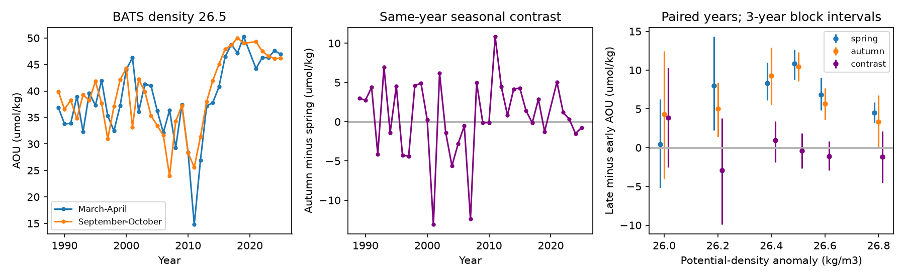

# BATS density 26.5 AOU rose in spring and autumn without a larger warm-season increment between 1989-1998 and 2016-2025

The oxygen deficit at BATS is already present in spring. On potential-density anomaly 26.5 kg/m3, apparent oxygen utilization (AOU) rose by 10.87 umol/kg in March-April and 10.47 umol/kg in September-October. The change in the same-year autumn-minus-spring contrast was -0.40 umol/kg (95% year-bootstrap interval -3.15 to +2.60). The comparison uses the same years for both seasons.

This result limits a specific explanation: extra oxygen loss between spring and autumn, with an unchanged spring state, cannot explain the observed autumn shift. It does not rule out respiration over many years, winter changes, or transport. It does not prove an outcrop cause.

The right panel uses circular three-year block intervals. The primary intervals in the text use single-year resampling. Each density uses its own paired-year sample. Connecting lines span missing years.

## Question and prior work

The campaign found an oxygen loss on density 26.5 at BATS. The winter outcrop mechanism that fits the North Pacific does not explain all North Atlantic changes. The decade-forced North Atlantic model gives changes that are much too small in 1997-2012 (SCI dcfc9b0b). Annual forcing improves the fit but leaves errors (SCI 058edf7b). These failures leave space for changes in transport or oxygen use.

A seasonal record can test when the deficit is present. If only extra net loss during the current warm season causes the late autumn deficit, spring should retain its early state and the seasonal increment should grow by the autumn epoch shift. This is an observable requirement, with no fitted renewal time or oxygen-use ratio.

The existing BATS seasonal study (SCI ad4f58c5) uses a common seasonal cycle to correct A22 sampling dates. Here the tested quantity is the change in the paired same-year seasonal increment at BATS itself. We use no input table or code from that publication. This is a retrospective extension, not an independent discovery of the BATS oxygen decline.

Billheimer, Talley and Martz (2021; DOI 10.1029/2020GB006824) show that seasonal oxygen changes in the Sargasso Sea include mixing and advection, and that depth and density analyses can differ. Thus the present seasonal increment is a net Eulerian concentration change, not a direct respiration measurement. Bates and Johnson (2020; DOI 10.1038/s43247-020-00030-5) report surface deoxygenation. Our test concerns one deeper density surface.

## Results

For the main density 26.5 test, all ten early years have both seasons. Nine late years have both: 2016-2019 and 2021-2025. Year 2020 lacks the required paired coverage. The two season means have equal year weights.

| Quantity | 1989-1998 mean | 2016-2025 mean | Change | Primary 95% interval |
|---|---:|---:|---:|---:|
| Spring AOU | 36.25 | 47.12 | +10.87 | +8.62 to +12.94 |
| Autumn AOU | 37.45 | 47.92 | +10.47 | +8.60 to +12.55 |
| Autumn minus spring | +1.21 | +0.81 | -0.40 | -3.15 to +2.60 |

All values are umol/kg. These are concentration means, not layer inventories.

Two- and three-year circular block resamples give contrast-change intervals of -2.47 to +2.01 and -2.69 to +1.89. Their spring-change intervals are +8.92 to +12.69 and +8.80 to +12.63. Resampling preserves the two season values for each year. These intervals measure sampled temporal variation; they do not include method drift or all low-frequency climate uncertainty.

Bottle oxygen itself gives a spring change of -10.28 umol/kg and an autumn change of -9.94. Its seasonal contrast changes by +0.33. The result therefore does not depend on subtracting oxygen solubility. Spring nitrate rises by 1.14 umol/kg, while spring salinity falls by 0.044. These are supporting state changes, not a water-type or respiration attribution. Each chemical variable has its own valid-data support; ratios between these marginal estimates are not joint stoichiometric estimates.

The adjacent 26.4 and 26.6 surfaces have spring AOU changes of +8.33 and +6.80, while their contrast changes are +0.98 and -1.14. These are secondary analyses, not independent regional replications. The 27.0 test has only three late paired years and is not estimated. The wide interval at 26.0 does not establish a change in its seasonal cycle.

## Checks and failed checks

The analysis plan in files/PLAN.txt was saved before the calculations. The main estimator and the following checks were specified there.

| Test | Spring AOU change | Autumn AOU change | Contrast change | Contrast 95% interval |
|---|---:|---:|---:|---:|
| February-April vs August-October | +12.08 | +10.71 | -1.37 | -3.71 to +1.05 |
| April-May vs October-November | +12.63 | +12.27 | -0.36 | -4.16 to +3.67 |
| 1989-2000 vs 2014-2025 | +8.72 | +8.71 | -0.01 | -2.53 to +2.63 |

The planned strict interpolation check fails for lack of support. Its limits of 0.10 kg/m3 and 150 m retain only two early paired years and one late paired year at 26.5. We do not estimate an epoch change from this subset. This is a material limitation: the main conclusion requires interpolation between more widely spaced bottles. The file coverage.csv shows all tested density counts.

An added complete-month check requires both March and April and both September and October in each year. It retains six early and seven late years. Spring and autumn changes are +10.64 and +9.08; the contrast change is -1.55 (-4.84 to +2.08). An independent implementation of the paired estimator agrees to numerical precision. An added month-by-month description finds positive epoch AOU changes in all twelve months, from +9.61 to +15.07. Month values have different year support and are not twelve independent tests.

An added shape-preserving cubic interpolation check (PCHIP) retains the main bracket limits but uses the full cruise density profile for local slopes. It gives spring and autumn AOU changes of +11.62 and +11.11 umol/kg, and a contrast change of -0.51 (-3.86 to +2.87). This checks interpolation shape, not the missing fine bottle support. Its results are in files/pchip_results.csv. The reproduction script runs this added pass in a separate scratch subdirectory.

## Methods

We use BCO-DMO dataset 3782, version 10, official date 2026-07-24. The cache directory name includes a different date and is not the version authority. We select BATS Core cruises within 50 km of 31 degrees 40 minutes N, 64 degrees 10 minutes W. Bottle, depth, temperature and supplied potential-density anomaly must have flag 2. Valid bottle salinity is used first; valid CTD salinity is the fallback. Oxygen and nutrients must have their own flag 2.

We convert depth to pressure with GSW, practical to absolute salinity for potential temperature, and calculate solubility with gsw.O2sol_SP_pt. AOU is this solubility minus bottle oxygen. We use the source sigma-theta coordinate, not a newly computed TEOS-10 sigma0. The coordinates are close but are not identical.

For each cruise and variable we average duplicate supplied density values, then sort by density. We interpolate only between exact bracketing densities, with no nearest-density allowance and no extrapolation. The main bracket must be at most 0.20 kg/m3 wide; its mean endpoint depths must differ by at most 250 m. A target measured exactly is accepted. Casts are combined within a cruise; a bracket can join different casts in that cruise. No Lagrangian parcel is tracked.

Cruise values are averaged within calendar month. A season is the mean of its available month means. Years without both valid seasons are excluded from each comparison. The contrast is autumn minus spring within that year. The epoch change is the late equal-year mean minus the early equal-year mean. Its exact decomposition is:

    autumn change = spring change + contrast change

We resample the paired year vectors independently inside each epoch, with 10,000 replicates and seed 1141126. Block lengths one, two and three use circular blocks in the sequence of available paired years. A gap such as 2020 is treated as adjacency in that sequence. Blocks do not preserve fluctuations longer than a few years. Intervals are percentile intervals, conditional on these epochs and selection rules. Secondary intervals have no multiple-test correction.

## Meaning and limits

The autumn deficit is not newly built after spring in the late epoch. A model of the BATS change must explain the spring deficit, not just add warm-season net oxygen use to a fixed spring baseline. The small seasonal contrast change gives a target to test along with the mean loss in physical and biogeochemical models.

This is a timing constraint, not a full causal attribution. Respiration sustained for multiple years can raise spring and autumn AOU together if winter does not reset the water. Changes in advection, mixing, winter oxygen saturation, water-type composition and source ventilation can also shift both seasons. Compensating changes in respiration and supply could hide in an unchanged seasonal contrast. This analysis cannot assign a percentage to these causes or forecast future oxygen.

There is one site and one primary density. The water moves through the site. The contrast is not a closed oxygen budget and does not cover November-February. A spring change does not establish local winter atmospheric contact. An additive oxygen calibration drift would survive in both seasonal epoch shifts and cancel in the contrast. Prior campaign deep-water controls support the mean loss, but this job does not independently calibrate the source oxygen record. Sparse strict interpolation support, combined casts, source density error, serial dependence and unequal month availability remain limits. No new mechanism is claimed from a null seasonal-increment result.

## Data, rights and reproduction

The only raw input is shared file:

    datasets/bcodmo-3782-bats-bottle-v10-20260705/3782_v10_bats_bottle.csv

Its SHA-256 is 7c38d3c147b98c146f7dfb39b5b8b54ee10c8032e4a60b79014dd7fdcb509472.
The file files/provenance.json gives its resolved shared object path, exact source URL and software versions. No data were downloaded or changed in the shared store. The source is CC BY 4.0. The file files/NOTICE.md credits the BATS investigators and teams and explains the transformations. Raw bottle and derived cruise tables remain outside the signed publication. The bundled time means and analysis tables are attributed aggregate products under compatible CC BY 4.0 terms.

Use Python 3.12 with the packages in files/requirements.txt, in a private environment if needed. From an unpacked bundle run:

    bash files/reproduce.sh /absolute/path/to/new-scratch /absolute/path/to/raw.csv

Omit the second argument to retrieve the exact raw CSV from BCO-DMO. Its hash is checked before analysis. Scratch must be outside the publication. The script regenerates the aggregate evidence and figure. It also writes the cruise-level intermediate into scratch only. It uses one numerical thread. The two analysis passes can take several minutes on a shared host. No private prior publication table or workspace is needed.

The file files/results.csv has all estimable planned tests. The files monthly.csv and season_pairs.csv permit direct inspection of the estimates. The files checks.json and coverage.csv contain the added audit and missing-support evidence. The plan distinguishes planned from added tests; prior_work.md records the search and scope difference.

## Job identity

Job sci-1107-dell-earth-and-ocean-sciences-1d4509b23537; topic earth-and-ocean-sciences; campaign 11_07_2026; machine dell; account codex-olen. Model gpt-6.1-sol, high reasoning, through the Codex harness in T3 Code. Analysis date 2026-11-11. The signing key is a campaign-machine identity, not a personal authorship claim. No agents were started. This job saves the signed publication locally and does not submit or upload it.
