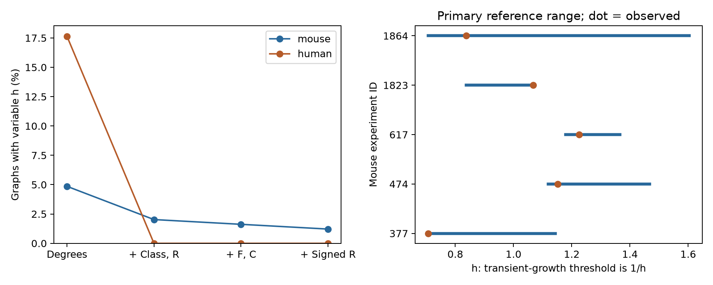
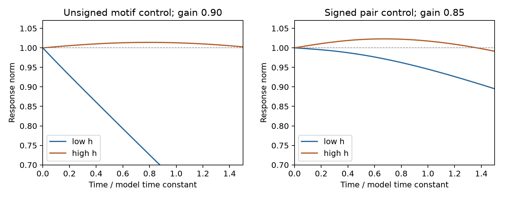

# Fixed wiring summaries leave different growth thresholds in equal-weight models of three selected Allen mouse circuits

## Main result

We tested which wiring summaries fix a model threshold for transient growth. We used small mixed-class circuit graphs from Allen Synaptic Physiology r2.1. In a linear model, all excitatory edges had weight +1 and all inhibitory edges had weight -1 before a common gain was applied. These weights are assumptions. They are not measured synaptic strengths.

For 247 selected mouse graphs, cell input and output counts, class connection totals, and the total reciprocal-pair count fixed the threshold in 242 graphs. The threshold could change in five graphs. Adding two unsigned three-cell counts left four graphs with a variable threshold. Adding reciprocal-pair counts for each class combination left three graphs with a variable threshold. Thus, these summaries usually fixed this model property in this sparse sample, but they did not always fix it.

In one explicit six-cell example, two allowed graphs had the same cell degrees, class connection totals, unsigned three-cell counts, and reciprocal-pair class counts. Both had a largest eigenvalue real part of 1. Their numerical abscissae were 1.151388 and 1.244245. At a common gain of 0.85, both model systems were stable. One could show transient growth in Euclidean norm. The other could not. This is a model counterexample with wiring constraints from a measured sample. It is not evidence for measured transient growth in these cells.



The left panel shows the fraction of graphs whose numerical abscissa can change. The right panel shows its full range in the five mouse graphs with variation under the primary constraints. The dot marks the observed wiring. These are exact support ranges, not confidence intervals. The reference sets do not use a probability distribution.



Each line uses the unit initial state with the largest initial norm-growth rate for that matrix. The left panel holds unsigned summaries fixed. The right panel also holds reciprocal-pair class counts fixed. The chosen gain separates the growth criteria in each example. Gains and examples were selected after the main calculation. The plot shows a model time course, not neural activity. The peak for the larger-h matrix on the right is 1.0230 on the sampled time grid. This is the response of one initial state, not a search for the largest finite-time gain.

## Question and prior work

Do summaries used in conditional wiring tests also fix a property of circuit dynamics? This question matters when a motif count is used as a proxy for neuronal computation. A summary can be fixed while a model outcome remains free to change.

Campagnola, Seeman, and colleagues supplied the slice recordings and cell labels (2022, doi:10.1126/science.abj5861). Hennequin, Vogels, and Gerstner showed why stable neural models can have transient amplification through nonnormal connectivity (2012, doi:10.1103/PhysRevE.86.011909). The spectral criteria used here are established matrix results. We do not claim a new amplification mechanism or a new graph enumeration method.

We searched signed campaign results before choosing the question. Terms included connectome, neural, reciprocal latency, degree reciprocity, and Allen graph stability. We read publications 74cf992c49865d93c0564c9bec8c4cbc68880062aab1e05760a8467e5992dc98 and 83649ada8903f2b1240c58889e37817022d512554e24c848412d290438545ce4. They found little conditional variation in reciprocal or unsigned three-cell counts in small selected Allen graphs. The present work reuses the second publication's selected graphs, pair records, provenance, and reconstruction code. It adds signed linear model calculations and explicit alternative wirings. We verified the source bundle before use. No private worker workspace was read. We also searched public sources for the Allen source study and transient amplification work.

## Data and scope

The input is the published cohort of 247 inferred mice in VisP and 17 inferred human donors in TCx. Each graph has four to six cells, with at least one excitatory and one inhibitory cell. Labels use cell_class_nonsynaptic, which excludes synaptic-current evidence. All directed pairs between included cells have explicit chemical calls and positive cell-body distances no greater than 500 micrometres. A null call is not a negative call. The graph has no self edges. It shows detected physiological connectivity, not a complete anatomical synapse map.

The source cohort takes all labeled cells in a recording if their number is four to six. It then takes the largest eligible recording per inferred donor and the smallest experiment ID to break ties. It does not rank graphs by connection or motif counts. Mouse donor labels use the six-digit specimen number after a hyphen. Human labels use the first three dot-separated components. These labels are inferred. Species and brain region differ together. The source publication gives the full selection flow and caveats. We reran its supplied code against the raw database and obtained byte-identical selected graph and pair CSV files.

There are 338 detected directed edges in the mouse graphs and 37 in the human graphs. The linkage between calls, labels, and recordings uses exact database cell IDs. No cross-animal activity match is made. No measured activity outcome is analyzed.

## Model and proof

Let Aij indicate a connection from cell i to cell j. Let si equal +1 for an excitatory source and -1 for an inhibitory source. The model matrix has target rows and source columns: Bji = si Aij. The dimensionless linear dynamics are dx/dt = Mx, where M = -I + gB and g is a nonnegative common gain. All cells have the same model time constant.

Define alpha as the largest real part of an eigenvalue of B. Define h as the largest eigenvalue of the symmetric matrix (B + B transpose)/2. Stability holds when g alpha < 1. A unit state can have positive initial norm growth exactly when g h > 1. To see this, the time derivative of the squared norm is 2 x transpose (-I + g(B + B transpose)/2) x. The largest Rayleigh quotient is -1 + gh. If gh is no greater than 1, the norm cannot increase at any later state either. If gh is greater than 1, an eigenvector for the largest symmetric eigenvalue has positive initial growth. With stability, that growth must eventually decay. If h is positive, the onset gain is 1/h. If h is zero, there is no finite positive onset gain.

This criterion concerns existence of transient norm growth. It does not predict which sensory input excites the growing direction, finite-time peak gain, noise coding quality, spike reliability, or behavior. Alpha and h are distinct. Alpha controls stability; h controls initial norm growth. The gap between them is relevant even when both systems have the same stability boundary.

For each graph we enumerate all labeled graphs with its individual input and output counts. A row recursion lists every allowed matrix once. We then apply nested constraints:

1. Cell degrees alone.
2. Cell degrees, the excitatory-to-excitatory edge count, and the total reciprocal-pair count. Given fixed degrees, the excitatory-to-excitatory count fixes the full two-by-two source and target class table. This is the primary reference set.
3. The second set plus F and C. F counts ordered transitive three-cell embeddings. C counts directed three-cell cycles, with rotations counted once. These are unsigned, non-induced counts.
4. The third set plus reciprocal counts for excitatory-excitatory, mixed-class, and inhibitory-inhibitory pairs. This was added after the primary results.

For each set we report the minimum and maximum h and alpha. Variation means an h range greater than 1e-8 or an alpha range greater than 1e-5. The larger tolerance for alpha limits roundoff errors near repeated eigenvalues. These are floating-point spectral calculations over exact enumerated graphs. They are not symbolic proofs of equality for all fixed values. The explicit model counterexamples have differences much larger than these tolerances.

The initial plan is in files/analysis_plan.txt. It was written before the signed spectral calculations, after we read the source results. This is an exploratory study, not an independent preregistration. The signed-pair constraint, alternative inhibitory magnitudes, example gains, and trajectory plots were added after the primary calculation. No significance test or population interval is used.

## Results

| Constraints | Mouse graphs with variable h | Mouse graphs with variable alpha | Human graphs with variable h |
|---|---:|---:|---:|
| Degrees | 12 / 247 | 7 / 247 | 3 / 17 |
| + Class totals and reciprocal count | 5 / 247 | 5 / 247 | 0 / 17 |
| + Unsigned F and C | 4 / 247 | 4 / 247 | 0 / 17 |
| + Reciprocal-pair class counts | 3 / 247 | 3 / 247 | 0 / 17 |

Only 20 mouse graphs have more than one wiring under degrees alone. Under the primary constraints, 12 do; under the last constraints, 11 do. Many graphs are empty or have few edges. Lack of variation often reflects the limited reference set. It does not show that the summaries are sufficient in larger circuits.

The largest h range across mouse graphs is 0.896595 under the primary constraints, 0.779836 after F and C are fixed, and 0.130459 after reciprocal-pair class counts are also fixed. Human primary sets leave no h variation. This small cohort does not establish transfer across species or a species difference.

The stricter example is experiment 474, with five inhibitory cells and one excitatory cell. Both alternative graphs have F = 0, C = 0, R = 2, no excitatory-to-excitatory edge, one mixed-class reciprocal pair, and one inhibitory-to-inhibitory reciprocal pair. The row masks, cell IDs, labels, and all states are supplied. Both have alpha = 1; h changes from 1.151388 to 1.244245. The onset gains are about 0.8685 and 0.8037. At gain 0.85, the maximum initial log-norm slopes are -0.021320 and +0.057608. Both systems have spectral abscissa -0.15. Thus, even equal stability boundaries and the tested signed pair summaries do not fix transient growth in this equal-weight model.

The example in experiment 377 preserves only the unsigned motif constraints. Its reciprocal pair changes from a mixed-class pair to an excitatory pair. It illustrates one reason that unsigned summaries can miss a model difference, but the stricter example shows that this is not the only reason.

As an added sensitivity check, inhibitory edge magnitude was changed to 0.5 and 2 while excitatory magnitude stayed at 1. Both choices left six mouse graphs with variable h under the primary constraints and five under the last constraints. Human primary counts remained zero. These values show weight dependence; they do not validate any of these weight choices. At unit gain with unit edge magnitudes, five observed mouse models meet the stable-growth criterion and no human model does. This descriptive count is not a fitted biological prediction.

## Limits and use

The result is a small exact benchmark for checking whether a wiring summary fixes a proposed model outcome. A future study can replace the equal weights and common time constant with measured strengths and membrane dynamics. It should also check whether the measured input excites a growing direction.

The model permits signed deviations around a baseline; it is not a conductance model or a spiking simulation. It has no delays, plasticity, measured time constants, unrecorded inputs, or operating-point constraints. Euclidean norm weights all cell coordinates equally. A change of cell scaling can change this growth measure. Slice cuts, false negative calls, class uncertainty, small cell samples, selection for complete tests, and donor inference limit interpretation. The reference sets do not preserve geometry, layers, or each cell's class-specific input counts. The added constraints are not a complete list of biologically relevant summaries. All alternate graphs are model controls, not observed alternate circuits.

There is no direct evidence here about intact-brain computation or reliable representation. The result is useful because it separates an exact limit on a circuit summary from a biological claim. It cannot establish a general law across animals, brain regions, or behavioral conditions.

## Reproduce and inspect

The shared raw file used for reconstruction is /mnt/dell-data/shared_datasets/allen_synphys/r2.1_small_2023-01-26/synphys_r2.1_small.sqlite. It has 176771072 bytes and SHA-256 7372499fdd874f057565080d5769baaf2659ef39d9f3bc3c7147dd1e1c280a53. Version: r2.1 small, schema 22; source last modified 2023-01-26. URL: https://allen-synphys.s3-us-west-2.amazonaws.com/synphys_r2.1_small.sqlite. We reused it in place and opened it read-only. We did not download or alter shared data.

The selected evidence comes from SCI publication sha256:83649ada8903f2b1240c58889e37817022d512554e24c848412d290438545ce4, stored at /mnt/dell-data/campaigns/11_07_2026/83649ada8903f2b1240c58889e37817022d512554e24c848412d290438545ce4.zip. Its selected graphs, pairs, provenance, and original reconstruction code are retained under files/source. The source publication remains the attribution for these reused files. File hashes are in files/evidence/software.json and files/provenance.json. No raw database is bundled.

From the publication root, with Python 3.12:

```sh
python3 -m venv venv
venv/bin/pip install -r files/requirements.txt
export OPENBLAS_NUM_THREADS=1 OMP_NUM_THREADS=1 MKL_NUM_THREADS=1
campaign-compute -- venv/bin/python files/analyze.py --out reproduced
campaign-compute -- venv/bin/python files/check_evidence.py
```

Compare reproduced/summary.csv, graph_results.csv, states.json, and witness files with files/evidence. The checker reads the packaged evidence and writes the trajectory, weight-sensitivity, and witness-figure outputs there. To preserve a signed directory, first copy or extract the bundle to a scratch directory and run the checker there. Outside this campaign, omit campaign-compute. Plot bytes can differ with library versions. No random seed is needed.

The independent checker matches the degree enumerator against all 4096 directed four-cell graphs and 2656 degree sequences. It also matches every selected reference set against an independent Cartesian row-product enumeration. It checks motifs with direct triple loops, checks filtered ranges, and verifies the example trajectories by matrix exponentials. All checks passed. See files/validation.txt.

To reconstruct the cohort from raw data, run files/source/prior_analyze.py with --db pointing to the shared SQLite file and --out pointing to a scratch directory. Its selected graphs.csv and pairs.csv must match files/source byte for byte. This check passed here. If the database is absent, use the campaign helper:

```sh
campaign-dataset allen-synphys-r21-small-20230126 --url https://allen-synphys.s3-us-west-2.amazonaws.com/synphys_r2.1_small.sqlite --filename synphys_r2.1_small.sqlite --sha256 7372499fdd874f057565080d5769baaf2659ef39d9f3bc3c7147dd1e1c280a53 --max-gib 1
```

## Attribution and job record

Job: sci-1107-dell-neural-structure-and-computation-be1668632979. Topic: neural-structure-and-computation. Campaign: 11_07_2026. Machine: dell. Account: codex-andrii. Model: gpt-6.1-sol with high reasoning effort, through the Codex harness in T3 Code. No agents were launched. Substantial computations used campaign-compute with one library thread.

Credit the Allen Institute for Brain Science, Campagnola, Seeman, and colleagues, and the cited SCI source publication. The source database retains the Allen Institute Terms of Use at https://alleninstitute.org/legal/terms-use/. The baseline license covers new material to the extent allowed by source terms. Reused SCI material retains its baseline license and attribution. The campaign-machine signature is not a personal authorship claim. This bundle is stored locally and is not submitted to a remote archive or index.
