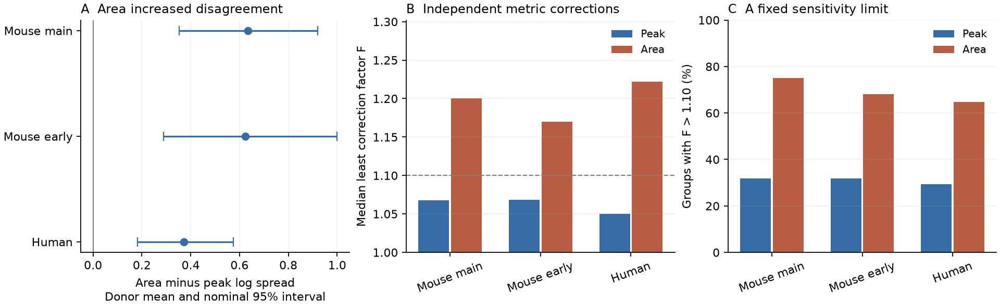
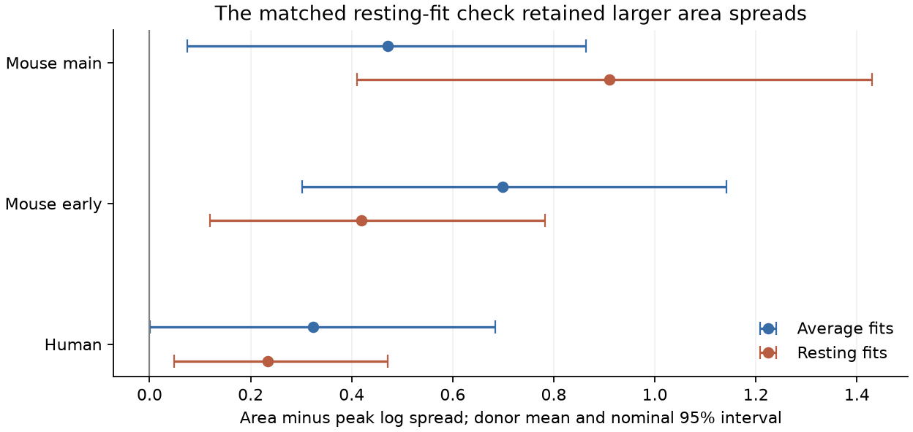

# Response integration increased mean current-to-voltage gain spread in 44 selected Allen mouse input groups

Response duration did not make current-to-voltage gains more consistent in this selected sample. The main analysis had 44 target-and-sign groups from 37 inferred animals in Allen mouse visual-cortex slices. The donor mean increase in log gain spread was 0.634, with a nominal 95% bootstrap interval of 0.353 to 0.920. A shared target filter needs equal ratios of total voltage area to total current area. In 33 groups, that condition needs changes greater than a factor of 1.10 in at least one fitted area, even when all areas can change independently. The same limit fails for peak ratios in 14 groups.

These are checks on released fits and a model assumption. They are not measured error bars or evidence that passive neurons fail. A follow-up check with resting-response fits retained the direction in a smaller matched sample.



The intervals in panel A use equal donor weights. Panels B and C describe the selected groups with equal group weights. The factor axis in panel B starts at one. Peak gain equality is a scalar comparison model. A general temporal filter need not preserve peak gains.

## Question and prior work

Can response duration account for different current-to-voltage peak gains among inputs to the same target? A circuit model can sum input currents and then apply one target filter. In that model, different input time courses can give different peak gains. However, their total-area gains must be equal. Thus integration could remove peak-gain differences that arise only from response duration. We tested this proposal directly.

The Allen Institute for Brain Science supplied measured connection calls and response fits from the same slice recordings. Campagnola, Seeman and colleagues describe the resource in Science (2022), doi:10.1126/science.abj5861. Pair and cell IDs link the two recording modes and the convergent inputs. There is no match between separate animals or atlases. The graph is a small set of tested physiological connections. It is not a complete anatomical connectome.

We searched the campaign before choosing the precise question. Search terms included Allen synaptic, reciprocal synapse strength, short term plasticity, structure function reliability, Allen common filter, Allen waveform area, Allen integrated response, and Allen charge voltage integral. We read these verified published reports:

- sci:sha256:0a312de1fa33b41dea2aa61ed1dd476e414d30722890921bb2a56e9a5ee7999e found current-versus-voltage peak order changes within targets.
- sci:sha256:3eaa990a582ba924ac4ae7b36b48055dc3084ffa10a1be3956a1df8b75fffb2a compared current peaks with fitted current charge.
- sci:sha256:fd63134619afce7c6ca077a5f7002c361243b4a79d24c66e3112ca75211b9c90 tested equal added centroids and variances under a shared normalized filter.
- sci:sha256:48701ad76e7d1e34f589d0f4af58ab0db8cdedb48d3a498c517b820cf67b5f8f bounded waveform changes for separate normalized filters.

The new test retains response magnitude. It tests the total-area gain condition, which normalization removes. It also compares peak and area disagreement on the same inputs. The convolution identity and integral formula are established mathematics. We claim a new audit and a reusable error calculation, not a new law of membrane filtering. These studies share the source release. They are not independent biological replications. We wrote new code and did not reuse their record tables or code. We did not read private worker workspaces.

## Model and exact error calculation

For each input i, let c_i and v_i be the positive, sign-corrected current and voltage response components after baseline removal. The model is

    v_i(t) = integral c_i(t-u) h(u) du

with one integrable filter h for the target-and-sign group. There is no separate gain for each input. Let C_i and V_i be the total areas of c_i and v_i. If the integrals exist, integration of the convolution gives

    V_i / C_i = integral h(u) du = G.

Thus all area gains R_i = V_i/C_i must equal the same positive G. This is necessary for a common causal nonnegative filter. It also holds for any common integrable filter with positive total gain. The condition alone is not sufficient for a common waveform filter.

We allow each positive C_i and V_i to change independently to any value between its observed value divided by F and its observed value multiplied by F, with F at least one. Set epsilon = log F and l_i = log R_i. Each corrected log ratio can lie in [l_i - 2 epsilon, l_i + 2 epsilon]. A common log G is possible exactly when these intervals intersect. Therefore the exact least factor for this relaxed metric problem is

    L = max_i l_i - min_i l_i
    F_min = exp(L/4).

Necessity follows because the largest log ratio can fall by at most 2 epsilon, and the smallest can rise by at most 2 epsilon. For sufficiency, choose their midpoint as log G. Every required ratio change is at most 2 epsilon and can be split equally between the current and voltage log changes. This proves the bound. It concerns total areas, not sampling errors. Changes to waveform shape are not estimated.

We calculate the same L and F_min for absolute fitted peak ratios as a comparator. Equal peak ratios describe a scalar target-gain model. They are not a necessary condition for a temporal filter. We do not use peak failure counts to reject temporal filtering. A synthetic common-filter example in the validator has equal area gains but a 2.80-fold range of peak gains.

## Fitted areas

The pinned Allen neuroanalysis definition gives this response component for t at or after onset:

    f(t) = A (1-exp(-t/a))^2 exp(-t/b) / N.

A is the fitted peak, b is the decay time, and N is the numerator evaluated at its peak. The stored rise time r is time to peak, not the rise constant a. We solve

    r = a log(1+2b/a), with 0 < r < 2b.

The absolute total area is |A| D, where the effective duration is

    D = [2 b^3 / ((a+b)(a+2b))] / N.

The implementation solves for log(a/b) and evaluates D in log form. This avoids subtraction of nearly equal integral terms. The fitted baseline offset and baseline exponential are excluded. Fitted onsets do not change the infinite integral. These areas extend the fitted response component to infinite time. They are not directly measured charges or voltage integrals. Tail uncertainty is not known.

## Source and selection

We reused this file read-only:

`/mnt/dell-data/shared_datasets/allen-synphys-r2.1-small-20230126/synphys_r2.1_small.sqlite`

Workspace path: `datasets/allen-synphys-r2.1-small-20230126/synphys_r2.1_small.sqlite`.

Source URL: https://allen-synphys.s3-us-west-2.amazonaws.com/synphys_r2.1_small.sqlite . Version: r2.1 small. The source HTTP header gives Last-Modified 2023-01-26 02:29:36 GMT. Size: 176771072 bytes. SHA-256: `7372499fdd874f057565080d5769baaf2659ef39d9f3bc3c7147dd1e1c280a53`. The scripts check the hash. The current resolved shared object path is in files/provenance.json. No raw data were downloaded or changed.

The primary extraction joins avg_response_fit, synapse, pair, experiment and slice. It requires a detected chemical connection, a manually accepted average fit, and at least one averaged response. Projects are mouse V1 coarse matrix, mouse V1 pre-production, and human coarse matrix. Excitatory fits use the -70 mV holding bin in both modes. Inhibitory fits use the -55 mV bin. These are bins, not equal measured voltages.

Each fit needs finite amplitude and kinetics, the expected amplitude sign, positive decay, and 0 < rise < 2 decay. Current-clamp excitation is positive and inhibition is negative. Voltage-clamp signs are reversed. We use rising power two from the fit field, or from expected_fit_params metadata if the field is null. There were no duplicate selected pair-mode rows. The query returned 3979 fit rows. Selection kept 2773 individual fits and 1016 paired connections: 554 main mouse, 284 early mouse, and 178 human.

The primary screen keeps decay times strictly inside 5.05 to 495 ms for current clamp and 0.404 to 39.6 ms for voltage clamp. This excludes values near or outside upstream default decay limits. Those defaults are not proof of the settings used in the historical database. We also require peak magnitudes of at least 10 microvolts and 1 picoampere. A group has at least two paired inputs of the same synapse sign to the same postsynaptic cell in the same experiment. We allow a separate filter for each sign, which relaxes a single-filter model for the whole target.

Mouse donor groups use the unique isolated six-digit animal number in the slice specimen name. Human groups use the first three H-prefixed number fields. All selected names parsed. These are inferred IDs, not checked registry identities. A target can contribute both sign groups. Shared groups within a donor remain together in the uncertainty calculation.

## Main evidence

For each group, we subtract peak log spread from area log spread. We average this difference over groups within each donor, then average donors. A negative value would mean integration reduces disagreement. Bootstrap intervals resample donors 10000 times with seed 110712. The main mouse series is the primary test. The other series are scope checks. Their intervals are nominal and are not adjusted for the full set of secondary comparisons.

| Series | Groups | Inputs | Recordings | Inferred donors | Area minus peak log spread | Nominal 95% interval |
|---|---:|---:|---:|---:|---:|---|
| Mouse main | 44 | 94 | 41 | 37 | 0.634 | 0.353 to 0.920 |
| Mouse early | 22 | 47 | 17 | 16 | 0.625 | 0.289 to 1.000 |
| Human | 17 | 39 | 16 | 10 | 0.372 | 0.183 to 0.575 |

Area spread is larger in 34 of 44 main mouse groups, 18 of 22 early mouse groups, and 15 of 17 human groups. The donor-weighted mean and the group counts answer different questions. The two mouse series and the human series are not independent laboratories or releases. Region, species, tissue source, cell classes and recording history can differ together.

| Series | Median peak factor | Median area factor | Peak factor >1.10 | Area factor >1.10 | Area factor >1.25 | Area factor >1.50 |
|---|---:|---:|---:|---:|---:|---:|
| Mouse main | 1.067 | 1.201 | 14/44 | 33/44 | 19/44 | 10/44 |
| Mouse early | 1.068 | 1.170 | 7/22 | 15/22 | 9/22 | 4/22 |
| Human | 1.050 | 1.222 | 5/17 | 11/17 | 7/17 | 2/17 |

At factor 1.10 in the main series, integration brings three peak-failing groups within the area limit. It adds 22 area failures among groups within the peak limit. These counts describe a change in metric consistency, not a test that one metric is biologically better. A factor of 1.10 allows division by 1.10 or multiplication by 1.10 for every metric. It is not a symmetric plus-or-minus ten percent interval.

Prespecified checks retain the positive main contrast. Including all valid decay fits gives 56 groups and a donor mean of 0.775 (0.487 to 1.086). Removing amplitude floors gives 53 groups and 0.686 (0.424 to 0.947). Doubling both floors gives 34 groups and 0.610 (0.361 to 0.880). Restricting groups to exactly two inputs gives 39 groups and 0.637 (0.346 to 0.931). These checks select different samples. They are not independent tests. The bundled files/summary.csv gives results pooled across signs. The scripts also regenerate broad sign strata outside the publication. Some of those strata have very few donors, including one single-donor stratum. Their computed bootstrap intervals do not support population precision.

## Follow-up check with resting fits

After the primary results, we inspected the pinned average-fit source in more detail. It states that different positions in pulse trains are pooled, and warns that these amplitudes can reflect short-term depression or facilitation. Different pulse mixtures across modes could affect both peak and area gain ratios. We therefore added a follow-up check. It was not part of the initial design and does not replace the primary result.

We use resting_state_fit amplitudes and kinetics for connections that also pass the primary average-fit rules. Resting fits must pass the same sign, kinetic, decay and amplitude rules. The average and resting comparisons use exactly the same retained connections and groups. A manually passed average fit is only a broad quality screen: there is no separate manual flag for the resting fit. Rising power two is an explicit source-supported model assumption for these rows.

| Series | Matched groups | Inputs | Donors | Average-fit mean difference | Resting-fit mean difference | Resting nominal 95% interval |
|---|---:|---:|---:|---:|---:|---|
| Mouse main | 23 | 50 | 21 | 0.472 | 0.910 | 0.410 to 1.430 |
| Mouse early | 14 | 30 | 11 | 0.699 | 0.419 | 0.119 to 0.782 |
| Human | 9 | 20 | 6 | 0.324 | 0.235 | 0.048 to 0.471 |

In the main resting sample, 19 of 23 area factors exceed 1.10, compared with nine peak factors. Thus pulse-position pooling alone is not a demonstrated explanation for the direction. This check cannot remove state differences, fitting error, selection, or tail dependence. The resting selector requires response segments of at least 10 ms. We did not establish each fit's recorded duration or the accuracy of its extrapolated tail.



## Validation

Independent quadrature checks every regenerated current and voltage effective duration. It resolves a narrow rise separately from the longer decay. The checker obtains the rise constant from Lambert W, rather than the analysis root solver. Near the Lambert W branch point it uses 60-digit arithmetic to avoid an inaccurate double-precision inversion. Synthetic shapes span a rise-constant-to-decay ratio from 0.001 to 1000. Independent linear programs optimize the log corrections and check the exact factor formula. A known exponential common-filter example checks that area gains can agree while peak gains differ.

The checker also rebuilds donor means, bootstrap interval endpoints, factor counts and sample sizes from the regenerated external tables. A full rerun in a second scratch directory reproduced both aggregate tables. All 3388 measured integrals agree within 7.0e-15 relative error. All 129 measured group factors agree with independent linear programs within 3.2e-15. The checker also tests 61 synthetic integrals and 400 synthetic group programs. Validation results are in files/validation.json. These checks test implementation and algebra. They do not validate the upstream fits or a biological mechanism.

## Meaning and limits

A shared target filter is a useful simplification, but the measured fit areas do not make it easier to satisfy here. Integration gives an explicit low-frequency gain test that complements the earlier normalized shape tests. A circuit model should check magnitude and shape before it assigns one filter to all inputs.

This is a result about selected fitted components. Infinite fitted tails can dominate the area. Moving away from default decay limits does not supply tail error bars. A correctly measured integral over a long response could give another result. The study does not distinguish a model error from a measurement error.

Somatic voltage-clamp current need not be the same current that drives the current-clamp voltage response. Changes in driving force, membrane state, synaptic conductance, voltage control, active currents and recording history can break that match. Dendritic location and slice damage can also matter. Input-specific filters or gains can fit cases that a shared filter cannot fit. This result therefore does not reject passive spatial models of real neurons.

Connections with missing fits and targets with only one paired input do not enter. The analysis does not estimate the fraction of all neurons that violate the model. Broad source classes are not matched. The donor bootstrap conditions on released fits, selected groups and inferred identities. It omits measurement and fit uncertainty, selection bias and donor-parser error. We did not record new data, fit traces, predict behavior, test intact-brain activity, or measure representation reliability. Generalization across species, regions and behavioral states remains open.

The next useful test is a joint current/voltage fit with matched pulse history, repeated trials and a long recorded response. Direct finite-window integrals can check tail sensitivity, but a truncated integral does not obey the exact full-area identity without a model for the unobserved tail. A joint fit should compare a shared target filter with separate input filters and include measured error.

## Reproduce and inspect

Use Python 3.12 and files/requirements.txt. Versions used are in files/provenance.json. Set numerical library threads to one. From the unpacked publication root, use the shared database and an output directory outside the publication:

```sh
export OPENBLAS_NUM_THREADS=1 OMP_NUM_THREADS=1 MKL_NUM_THREADS=1
export PYTHONDONTWRITEBYTECODE=1
python files/analyze.py --db /path/to/synphys_r2.1_small.sqlite --out /local/scratch/gain-audit
python files/resting_check.py --db /path/to/synphys_r2.1_small.sqlite --out /local/scratch/gain-audit
python files/validate.py --analysis /local/scratch/gain-audit --out /local/scratch/gain-audit/validation.json
```

Filter regenerated summary.csv and resting_summary.csv to rows with sign equal to all, then compare them with the bundled files. Numeric columns should agree within 1e-10. The validator checks this comparison when the bundled tables are present. Image bytes can depend on fonts and renderer versions. All validation assertions must pass. The analysis takes less than a minute on this worker with two available CPUs and single library threads. Run `python files/validate.py` for source-free synthetic checks.

The scripts regenerate external connection, group and donor tables in scratch. These contain the record-level evidence needed to inspect the results. Keep them outside the signed publication under Allen source terms. No private scratch is needed once the exact external database is available.

If the database is absent, reuse a completed shared dataset first. For a reusable campaign download, choose an unused dataset name and use the campaign helper:

```sh
campaign-dataset allen-synphys-gain-audit-r21 --url https://allen-synphys.s3-us-west-2.amazonaws.com/synphys_r2.1_small.sqlite --filename synphys_r2.1_small.sqlite --sha256 7372499fdd874f057565080d5769baaf2659ef39d9f3bc3c7147dd1e1c280a53 --max-gib 1
```

Use its completed path. Do not replace an existing dataset. Outside this campaign, `python files/retrieve.py /new/local/scratch/synphys_r2.1_small.sqlite` provides a bounded download and hash check. It refuses an existing destination and writes outside this publication.

The baseline bundle contains original code, text, proof, aggregate findings, figures, validation and provenance. It excludes all raw data, fitted measurement records, cell IDs, donor rows, per-target tables and upstream code. Source terms, attribution and external-material scope are in files/EXTERNAL_DATA_NOTICE.txt. The exact SCI baseline LICENSE is unchanged.

## Job record

Job: sci-1107-hp-neural-structure-and-computation-b0d1494431ad. Topic: neural-structure-and-computation. Campaign: 11_07_2026. Machine: hp. Account: codex-olen. Model: gpt-6.1-sol with high reasoning effort through the Codex harness in T3 Code. Date: 2026-11-12. No agents were launched. No other account, service, worker or Fleet controller was changed. The campaign-machine key records publication integrity. It is not a personal authorship claim. The bundle is saved locally; this worker does not upload or submit it.
