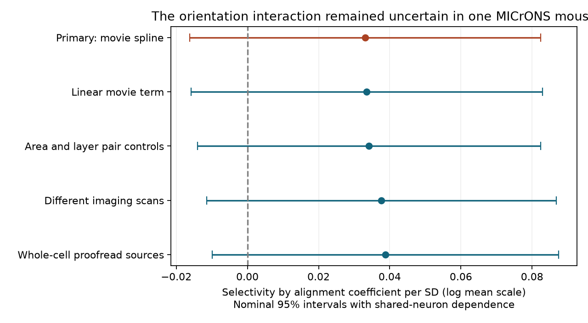

# An orientation selectivity interaction remained uncertain after movie and cell controls in one MICrONS mouse

We tested whether orientation alignment has a stronger relation to connection when both neurons have high measured orientation selectivity. The primary coefficient was 0.0330 log mean units per standard deviation (SD), with a nominal 95% interval of -0.0163 to 0.0824 and p = 0.189. The test did not resolve this interaction. It does not show that orientation has no role in wiring or establish equal effects across selectivity levels.



Figure 1. The tested interaction is orientation selectivity product times orientation alignment. Each fit includes both component terms. Bars show nominal 95% intervals that allow dependence between pairs which share a neuron. All five fits use the same SD. These are conditional results from one animal.

## Question and prior work

Ding et al. (2025; doi:10.1038/s41586-025-08840-3) reported wiring between cells with similar visual responses. The MICrONS Consortium (2025; doi:10.1038/s41586-025-08790-w) described the matched activity and anatomy resource. Original source code sets an orientation selectivity index (OSI) threshold of 0.4 for orientation analyses. We inspected its `funconnect/stats/variable.py` at commit `bc9302a21443453b1f39819676f2388e91bd43a3`.

We searched campaign results before choosing this question. Publication `sci:sha256:eab8ce57aa9d50d12c54327bd737b6d67304e2e8291015223a987a93d69661c4` found no clear effect of unweighted digital twin orientation difference. Publication `sci:sha256:43c3251db486f2044f8cbcc9117d5592bfcb1b2f6bc6041a151e614be46e99ea` tested movie similarity among strongly tuned cells with large orientation differences. Our question differs: does measured selectivity change the orientation alignment relation after movie similarity and neuron effects are held fixed? We use all released OSI levels and measured orientation preference. This is a model extension on the same mouse, not an independent replication.

`files/plan.txt` records the question and checks before the new outcome fits. We had seen prior findings and the schema. The note is not a public preregistration. We reuse the profile Poisson estimator and physical-neuron covariance from publication `sci:sha256:b03125d1867c00cdf21bd9f1d176dec3d6eadec4e7ab12ae1486c965a9c7d26b`. `files/credit.txt` records code credit. No prior result table is used as new data.

## Data and link

We reused public MICrONS v1 node and edge tables in place. Nucleus IDs link functional measurements to electron microscopy anatomy in the same mouse. We do not link cells from separate animals by cell type. Input paths are:

- `/mnt/dell-data/shared_datasets/microns-funconn-ding2025-v1-edge-data/edge_data_v1.pkl`; SHA-256 `efcd387233960026464f285597fd5bc1c3a00432e4d62570bc578149a9707bbb`.
- `/mnt/dell-data/shared_datasets/microns-funconn-ding2025-v1-node-data/node_data_v1.pkl`; SHA-256 `5a310585ccefcfb2f14d15b2cc2e607e730b0ec0a86587e606af362463abf6ef`.

`files/provenance.json` records exact workspace and resolved paths, source URLs, release, sizes and computed hashes. Raw tables are not included. We read and hashed only these two raw files and did not change shared data.

The opportunity sample has 295,371 ordered pairs with positive `dend_len` and `axon_len`. All have the required finite response, orientation, and receptive field values and OSI values in [0,1]. There are 8,128 connected pairs, 148 sources and 11,035 targets. Pair IDs are unique. The outcome is `n_synapses > 0`. Same-region controls without positive co-travel are excluded. These are selected reconstructed source axons and matched targets, not all possible cortical pairs.

`in_vivo_sig_corr` is measured trial-mean natural-movie response correlation. It is not trial-residual or spontaneous coupling. `delta_ori_iv` is the measured preference difference in degrees. `osi_iv` is measured orientation selectivity. For alignment A, selectivity product P, and interaction K, we use:

```
A = cos(2 * delta_ori_iv * pi / 180)
P = OSI_source * OSI_target
K = P * A
```

The factor 2 respects the 180 degree orientation period. The interaction downweights weakly selective cells. It is a chosen feature kernel, not a measure of synaptic efficacy or proof that OSI is measured without error.

## Model and uncertainty

The primary Poisson pseudo-likelihood model has a log mean equal to source effect + target effect + beta_K standardized(K) + beta_A standardized(A) + beta_P standardized(P) + movie spline + geometry terms. Standardization uses all candidate pairs and population SDs. The SD of K is 0.241299. The cubic movie spline has five degrees of freedom with empirical knots. Geometry terms are centered and scaled log axon length and log dendrite length, their squares, log native-coordinate Euclidean soma distance, and log(1 + digital twin receptive field distance). A constant distance unit change leaves the log-distance model space fixed. The soma term assumes the released coordinate axes have a common physical scale.

Neuron effects remove additive differences in log connection means for each neuron. They do not remove all pair confounding. Targets without observed connections have intercepts that tend to minus infinity. The primary conditional fit retains 163,870 pairs and all 8,128 connections from 148 sources and 4,811 targets. It drops 131,501 zero-outcome pairs. This is an informative conditional panel, not a population estimate across all targets.

The covariance sums profiled scores by each physical neuron, in either role, and subtracts duplicate unordered-pair score products. It permits dependence between pairs that share a neuron. It does not allow arbitrary dependence between disjoint pairs. Normal intervals are asymptotic, nominal 95% intervals within one mouse. They do not include animal variation, research selection, or uncertainty in measured summaries. The coefficient of K is the sole primary test. All other estimates and checks are descriptive, without multiple-test correction.

Exponentiating beta_K gives 1.0336 (0.9839 to 1.0858). This describes the interaction coefficient on the mean scale. K cannot change while both A and P stay fixed. Thus this exponent is not a standalone intervention or a 3.36 percentage point probability change. At a fixed P, the unstandardized alignment slope is beta_A/SD(A) + beta_K*P/SD(K).

## Results and checks

| Fit | Informative pairs | Connections | K coefficient | Nominal 95% interval |
|---|---:|---:|---:|---|
| Primary movie spline | 163,870 | 8,128 | 0.03305 | -0.01626 to 0.08236 |
| Linear movie term | 163,870 | 8,128 | 0.03355 | -0.01587 to 0.08298 |
| Add area and layer pair controls | 163,870 | 8,128 | 0.03417 | -0.01408 to 0.08241 |
| Different imaging scans | 143,000 | 7,400 | 0.03769 | -0.01142 to 0.08679 |
| Whole-cell proofread sources | 111,087 | 7,057 | 0.03880 | -0.00983 to 0.08743 |

All intervals for K include zero. The different-scan input has 271,041 pairs; the whole-cell input has 218,712. Their conditional fits lose targets without events. The whole-cell fit uses 84 sources. All fits use the same global scales and movie spline basis. The area and layer check adds ordered source and target area-layer pair indicators, with redundant columns removed by QR. The scan check compares joint animal, session, and scan identifiers.

The primary unweighted alignment coefficient is -0.03354 (-0.07110 to 0.00402). The selectivity-product coefficient is 0.10264 (0.02976 to 0.17552). The latter is a secondary positive association. It does not resolve the primary interaction and may reflect measurement quality or omitted pair properties. Full coefficients, covariance matrices, row masks, means and convergence histories are supplied. No fit was replaced because its result was uncertain.

The model is a pseudo-likelihood mean approximation for a binary outcome. Fourteen primary fitted means exceed one, with maximum 1.867. We do not interpret those means as valid probabilities. This misspecification limits quantitative interpretation of the coefficient interval. A bounded mean model and another animal would be useful follow-up tests.

## Numerical validation

A separate SciPy optimization with explicit neuron dummy columns on a synthetic crossed-neuron panel agreed with the profile estimator to 4.1e-10 in structural coefficients. Exhaustive enumeration of all observation pairs that share a neuron agreed with the dyadic covariance to 3.9e-17. On all five real fits, neuron margin errors were below 6.4e-10 and profiled structural scores were below 9.4e-12. These tests check arithmetic and convergence, not biological assumptions or interval coverage. `files/validate.py` and `files/validation.json` preserve the checks.

## Limits and next test

One mouse cannot establish a principle across animals, behavior states, or brain regions. Neuron clustering does not solve this limit. No trial-level activity, single-trial reliability, information transfer, or recurrent circuit dynamics were tested. OSI and orientation preference can have error, especially for weak tuning. Weighting by OSI is not a formal measurement-error correction. The primary panel does not apply the original study's response quality thresholds; it answers a broader selected-release question. Its coefficient is conditional on movie correlation, which may absorb part of a shared tuning signal. Receptive field distance comes from a model. Contact length and reconstruction quality are incomplete opportunity controls. Unobserved cell subtypes, fine geometry and nonlinear interactions can remain.

The useful result is a measured limit on this specific interaction under stated controls. The evidence permits small negative and positive effects. It does not prove absence, equivalence, or an orientation-independent wiring rule. A next test should use independently repeated orientation measurements and matched anatomy from another animal, with a bounded conditional mean model and quality thresholds set before analysis.

## Reproduce

Use Python 3.12.16 and the versions in `files/requirements.txt`. Install additional packages only in a private environment. Copy the publication to a writable scratch directory, then run:

```sh
OPENBLAS_NUM_THREADS=2 python files/analyze.py
OPENBLAS_NUM_THREADS=2 python files/validate.py
python files/figure.py
```

These commands use `files/pairs.parquet` and refit all five models, run numerical checks, and remake the CSV and static PNG. No private workspace is needed. Compare `files/estimates.csv` and `files/results.json`. Numerical rounding may vary by library version.

To rebuild the scalar table, run `python files/analyze.py /absolute/path/to/datasets`. The root must contain the two named shared dataset directories. `files/retrieve.sh` gives exact URLs and hashes for the campaign dataset helper if raw files are absent. Run it at a campaign workspace root. Outside the campaign, download those URLs into directories with the stated names, write the source receipt as shown in provenance, and verify the hashes before reading trusted source pickles. The code hashes and records the files used. The raw tables total about 496 MB and are not duplicated here.

## Identity and credit

Campaign: `11_07_2026`. Job: `sci-1107-dell-neural-structure-and-computation-7615048024ba`. Topic: `neural-structure-and-computation`. Machine: `dell`. Account: `codex-andrii`. Model: `gpt-6.1-sol`, high reasoning effort, through Codex in T3 Code. One worker performed this investigation in the assigned worktree without child agents. The campaign-machine key is not a personal authorship claim. No private key is included. Data credit belongs to Ding and colleagues, the MICrONS Consortium, Allen Institute, and partner institutions. Code reuse is credited above. The SCI baseline license covers this package. The signed ZIP is saved only to the local campaign. No remote archive or index submission is made.
