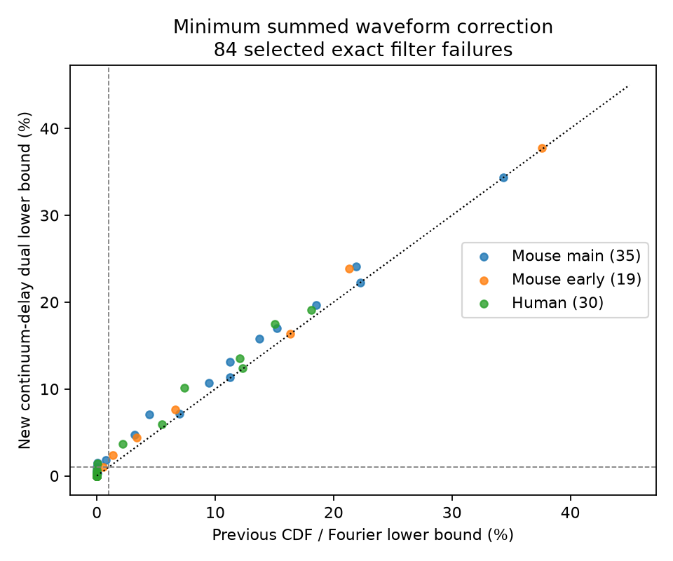

# Four more selected Allen response pairs need summed waveform error above 1 percent under causal filtering

This study gives a method to test whether a causal nonnegative filter can link a fitted synaptic current to a fitted voltage response. A proof reduces the least summed input and output error to one convex approximation problem. Numerical tests then give stronger lower bounds than the earlier cumulative-area and frequency tests in some selected Allen Synaptic Physiology r2.1 connections. These are checks of exact fitted shapes. They are not evidence against passive neurons.

## Question and prior work

Can a direct optimization improve error bounds when a fitted current and voltage cannot share a nonnegative causal filter? Circuit models often place a passive filter after a synaptic current. Before using this rule, one must check whether the measured response summaries permit it.

The Allen Institute supplied the circuit measurements and fits. Pair IDs link two clamp modes of the same chemical connection. This is a within-connection link between local circuit structure and response dynamics. It does not join cells across animals or atlases. Campagnola, Seeman and colleagues describe this dataset in Science (2022), doi:10.1126/science.abj5861. Seeman and colleagues describe the response fit family in eLife (2018), doi:10.7554/eLife.37349.

We searched the shared campaign for connectome, neural structure, Allen, synphys, current voltage filter, charge, stochastic dominance, causal cumulative, filter correction, and convolution optimization. We read verified SCI publications sci:sha256:4d02809da30774324c48f1e0fb5b4a55b95580a00da2092e30d379d359bf7993 and sci:sha256:48701ad76e7d1e34f589d0f4af58ab0db8cdedb48d3a498c517b820cf67b5f8f. The first gives an exact inverse-filter sign test. The second gives lower bounds on summed waveform error from cumulative area and Fourier modulus. It leaves many sign failures below a 1% error bound and lists optimization as an open step.

This study takes that step. It proves a reduction for the summed-error problem and uses a finite linear program to find a test function. A separate delay bound makes that test valid for all nonnegative delays, including delays outside the optimization grid. Contraction of total variation is a standard probability result; we do not claim that result or linear programming as new. The contribution is the reduction, the delay certificate, and this data test. The source release is the same as in the prior work. This is not an independent biological replication.

## Proof of the reduction

Let c and v be nonnegative unit-area response densities on time t >= 0. Onsets are aligned. Let h be any probability measure on nonnegative delays; an atom at zero is allowed. TV(p,q) is half the integrated absolute difference. Define

    E = inf { TV(c,c*) + TV(v,v*) : v* = c* * h }.
    D = inf_h TV(v,c*h).

The corrected shapes need not stay in the fitted family. Both are probability distributions. For any permitted c*, v*, and h, convolution contraction and the triangle inequality give

    TV(v,c*h) <= TV(v,v*) + TV(c* * h,c*h)
                 <= TV(v,v*) + TV(c*,c).

Thus D <= E. Conversely, keep c*=c and set v*=c*h. This choice gives E <= D, using infima if a minimum is not attained. Therefore E=D. This proof does not require a parametric response family. A separate upper limit on each waveform error would be a different problem.

The reduction also explains why an input-only error allowance does not need a separate nonlinear optimization when the objective is summed TV. It gives a convex problem over h. It does not identify a unique filter or prove that a small correction exists from a small lower bound.

## Bound from time bins and a continuous delay check

Partition [0,T] into time bins and add one tail bin [T,infinity). Write y for the voltage bin probabilities and a(d) for the current bin probabilities after a delay d. Binning cannot increase TV. For any vector q with |q_i| <= 1/2,

    E >= q dot y - sup_{d>=0} q dot a(d).

This follows by integrating the bound for each delay against h and using the dual inequality for TV. The code finds q through a linear program that minimizes binned TV over a finite set of delay columns. The finite-grid primal objective is NOT used as a lower bound for continuous h. Only the test vector q and a continuous-delay upper bound are used.

For d>=T, all response area is in the tail bin, so the tail column is exact. For d in [0,T], let phi(d)=q dot a(d). A unimodal normalized current density with peak height M obeys

    |phi(d)-phi(e)| <= M |d-e|.

To see this, the L1 norm of its derivative is 2M, so TV between two shifts is at most M times their separation. Binning and the bounded q preserve this inequality. On an interval [l,u] with Lipschitz constant L, an upper bound on phi is

    (phi(l)+phi(u)+L(u-l))/2.

The code also bounds the local derivative by the sum of absolute jumps in q times the largest current density over each shifted bin boundary in that interval. It uses the smaller of that bound and M. The density is unimodal, so these local maxima are computed from the peak and interval endpoints. Adaptive bisection stops when the remaining upper gap is at most 0.0002, or after 24 rounds. Even an unfinished interval retains its upper bound. The computed lower bound has an extra subtraction of 1e-7 for numerical error. These are floating-point numerical certificates, not interval-arithmetic proofs.

The bins and candidate delays use logarithmic spacing. The main run has 512 positive bin edges and 512 positive candidate delays, plus zero. T is 20 times the larger fitted decay constant. A 256-bin run checks sensitivity. Each run also checks its delay upper bound on 4096 additional delay points. This grid check is a diagnostic; the derivative bound supplies the continuum argument.

## Data and selection

Source: Allen Synaptic Physiology r2.1 small, release 2023-01-26. We reused the completed file read-only at /mnt/dell-data/shared_datasets/allen-synphys-r2.1-small-20230126/synphys_r2.1_small.sqlite. The workspace link is datasets/allen-synphys-r2.1-small-20230126/synphys_r2.1_small.sqlite. The resolved object path is in files/run512.json. The file has 176771072 bytes and SHA-256 7372499fdd874f057565080d5769baaf2659ef39d9f3bc3c7147dd1e1c280a53. Each analysis checks that hash.

We repeat the previous study's selection and its bounds with its verified code. We join avg_response_fit, synapse, pair and experiment. We require a chemical connection, manual fit acceptance and at least one averaged response. Projects are mouse V1 coarse matrix, mouse V1 pre-production, and human coarse matrix. The holding bins are -70 mV for excitation and -55 mV for inhibition in both clamp modes. Fits need a finite nonzero amplitude, positive rise and decay, rise < 2 decay, and rise power two. Missing stored rise power is taken from expected_fit_params in row metadata. A pair needs one fit in each mode. There are no duplicate selected pair/mode rows.

The prior screen keeps current-clamp decays strictly inside 5.05 to 495 ms and voltage-clamp decays inside 0.404 to 39.6 ms. These limits remove fits near default limits; they do not establish the settings of each fit. The screened samples have 480 main mouse, 262 early mouse and 160 human connections. We optimize only their 35, 19 and 30 exact inverse-filter sign failures. The other screened connections have a feasible filter under the prior exact fitted-shape test and hence zero correction in this model, within its numerical tolerance.

Each shape is proportional to (1-exp(-t/a))^2 exp(-t/b). The stored rise time r is time to peak. We solve r=a log(1+2b/a). Its normalized distribution is a sum of three exponential times, with rates 1/b+j/a for j=0,1,2. This gives analytic bin probabilities. Amplitude, baseline and onset differences are removed. The test concerns a response component and infinite fitted tails, not an observed trace or a finite recording window.

## Results and validation

The 512-bin test raises the count above 1% summed TV from 25 to 29 among the 84 exact sign failures. It adds two main mouse connections, one early mouse connection and one human connection. The same four additions occur with 256 bins.

| Series | All screened pairs | Exact sign failures tested | Previous bound >1% | New bound >1% | Added >1% |
|---|---:|---:|---:|---:|---:|
| Mouse main | 480 | 35 | 12 | 14 | 2 |
| Mouse early | 262 | 19 | 6 | 7 | 1 |
| Human | 160 | 30 | 7 | 8 | 1 |

For the four added cases, the prior bound and new bound, as percentages of summed normalized area, are 0.0755 to 1.4760, 0.5183 to 1.0169, 0.0709 to 1.4445, and 0.7644 to 1.8020. Three cases are excitatory and one is inhibitory. These are aggregate research findings; the regeneration files identify records outside the signed bundle. The largest improvement within each series is 2.659, 2.507, and 2.716 percentage points. The new bound exceeds 5% for 11 main mouse, four early mouse, and six human cases.

The 1% classification agrees in both bin runs for all 84 pairs. The largest absolute bound change is 0.1240 percentage points. The continuum-delay upper gaps are at most 0.0002 in both runs. The added early mouse case is close to the 1% threshold: its finer lower bound is 1.0169%. This threshold is an illustrative reporting choice, not a measured uncertainty limit. Fifty-five of 84 sign failures remain at or below 1% under both the old and new bounds. A small lower bound does not show that a small correction is possible.

Counts describe the selected connections and do not estimate an animal population rate. Connections can share cells, recordings and donors. We give no independent-animal interval or causal species contrast. Error is normalized response area; 1% summed TV does not mean 1% peak error or recording error. No upper bound on the exact minimum correction is claimed. The remaining gap is open.

The prior run reproduced the six reported CDF/Fourier threshold tables and the 1016 complete paired connections. Its independent integration check had a maximum CDF error below 5e-16; long-double and high-precision CDF witness values differed by less than 1.5e-11. The new code tests identical shapes and a known slower feasible shape, which give zero or near-zero bounds. A faster synthetic shape gives a positive bound. It checks |q|<=1/2 and all additional delay points for every optimized pair. One 512-bin linear program returned an unknown solver status during development; the final code retries failures with the interior-point solver and no presolve. A dual vector need not be optimal to give a valid lower bound. The finer run and all solver calls must complete before a summary is written.

## Limits and next steps

Separate clamp modes can measure different physiological states. Somatic voltage-clamp current need not be the input that drives current-clamp voltage. Space-clamp error, driving force, active conductances, synapse location, pulse mixtures and slice damage can break this equality. The fitted family is not closed under passive filtering. Free onset alignment removes timing constraints. A rejected fit model does not locate a circuit mechanism or establish nonpassive behavior.

The method applies to any nonnegative normalized response shape with bin probabilities and a delay derivative bound. Generality of the mathematics does not establish a general law of brain computation. We did not analyze behavior, in vivo activity, other brain areas, or independent connectome data. The next useful step is a joint fit to trial-level currents and voltages with measured uncertainty. Constructive upper bounds on continuous TV would also show how close the new lower bounds are to the true minimum.

## Reproduce and rights

Use Python 3.12 with NumPy, SciPy, pandas, mpmath and Matplotlib. Exact versions are in the run files. From the unpacked publication root:

    python files/previous_bounds.py --database /path/to/synphys_r2.1_small.sqlite --out /local/scratch/baseline
    python files/optimize.py --database /path/to/synphys_r2.1_small.sqlite --baseline /local/scratch/baseline/external_pairs.csv --out /local/scratch/opt512 --bins 512
    python files/optimize.py --database /path/to/synphys_r2.1_small.sqlite --baseline /local/scratch/baseline/external_pairs.csv --out /local/scratch/opt256 --bins 256

Set OMP_NUM_THREADS, OPENBLAS_NUM_THREADS and MKL_NUM_THREADS to 1. Compare summaries with files/summary512.csv and files/summary256.csv. Regenerated record-level files stay in external scratch under Allen terms. Do not add them to the publication. If the shared file is absent, files/retrieve.py --out /local/scratch/allen-source retrieves the exact source and checks its hash. For a reusable shared download, use campaign-dataset with a new unused name, the source URL in the external-data notice, --filename synphys_r2.1_small.sqlite, --sha256 with the hash above, and --max-gib 1. Do not change existing shared data.

The bundle contains code, this proof and narrative, an original aggregate figure, and aggregate findings. It contains no external fit records, traces, database extracts or upstream code. See files/EXTERNAL_DATA_NOTICE.txt for source terms and code attribution. The prior study's analysis code is reused under its SCI baseline MIT license. The baseline license applies to the bundled research contribution, not to external Allen data.

## Job record

Job sci-1107-dell-neural-structure-and-computation-9acc118d7bad. Topic neural-structure-and-computation. Campaign 11_07_2026. Machine dell. Account codex-olen. Model gpt-6.1-sol, high reasoning effort, through the Codex harness in T3 Code. No agents were launched. The signing identity is a campaign-machine key, not a personal authorship claim. This publication is saved locally. No remote upload or submission is requested.
