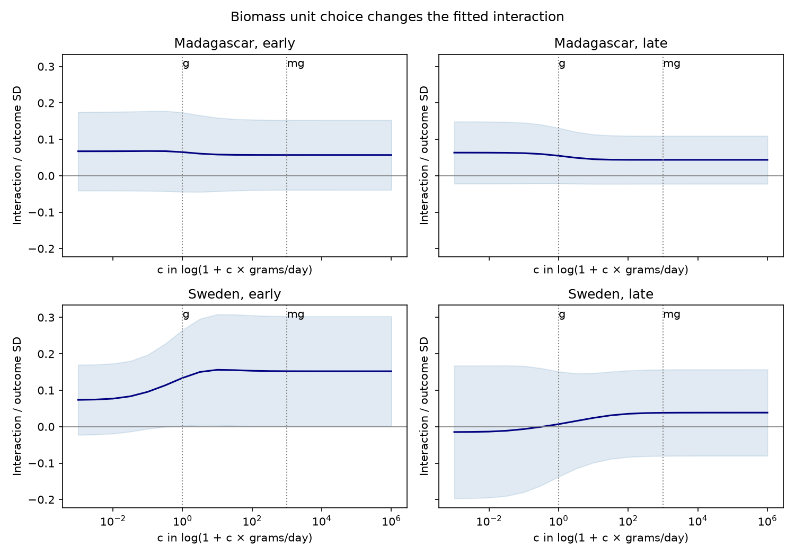

# Gram and milligram transforms gave no clear standardized interaction difference in four insect samples in 2019-2020

## Question and result

Can the biomass unit inside log(1 + catch rate) change the temperature by rain term in an ecological model? A constant of 1 gram per day is a different physical offset from 1 milligram per day. We tested this choice in four insect samples. The primary paired differences were uncertain in all four samples. This does not show equality of the transforms.

| Country | Period | Catches | Gram estimate | Milligram estimate | Difference | Adjusted interval |
|---|---|---:|---:|---:|---:|---|
| Madagascar | early | 874 | 0.0649 | 0.0570 | -0.0079 | -0.0427 to 0.0270 |
| Madagascar | late | 986 | 0.0549 | 0.0437 | -0.0112 | -0.0545 to 0.0320 |
| Sweden | early | 1646 | 0.1338 | 0.1523 | 0.0185 | -0.0526 to 0.0896 |
| Sweden | late | 2299 | 0.0069 | 0.0382 | 0.0312 | -0.0233 to 0.0858 |


All estimates use response standard deviations per (5 C by 5 mm/day). Difference means milligram minus gram. The adjusted intervals control four primary comparisons at a family error rate of 0.05. Scaling constants are held fixed for this approximate inference.



The curve shows a descriptive scan, not 19 separate confirmatory tests. Shading shows pointwise 95 percent intervals. Vertical lines mark grams and milligrams. The low-c limit approaches a standardized rate model. The high-c limit approaches a standardized log-rate model for these positive catches. The later Swedish point estimate is negative near the low-c end and positive at grams and milligrams. This scale dependence is not a detected biological sign reversal.

## Prior work and added knowledge

Van Dijk and colleagues (2024, DOI 10.1098/rspb.2024.0090) studied biomass and weather in the same networks. SCI publication 5ab3e80992669e503a2565d756d4b7187a103595bc89e218cb049404a9c5a029 tested a temperature by rain term and included one alternative log offset. We reuse its data construction and primary model controls. We add a paired standardized unit comparison, a scale curve, and exact unit-invariance checks. These observations overlap that study. This is not a new field replication.

Chen and Roth (2024, DOI 10.1093/qje/qjad054) show why log-like transformations can depend on measurement units. Their treatment-effect setting includes zeros. Our selected catches are all positive, and our target is an adjusted weather association. The general issue is established prior knowledge. Our new result is the empirical audit in these four samples, with explicit paired uncertainty and selection checks.

Campaign searches before fitting used “phenology climate pollution”, “Madagascar Sweden”, and “biomass units log transformation”. The first two found many related studies. The last returned four weather-shape studies, with no direct unit audit. This is a search record, not proof of priority. The saved first and last search responses are summarized in files/search_record.json. The analysis plan was written after source inspection and before model fitting; it is not a registered protocol.

## Data and observation controls

The source is Dryad DOI 10.5061/dryad.ghx3ffbtk, mirrored at Zenodo record 11205860 (16 May 2024). Its API reports CC0. The prior source audit identifies Dryad version 11, API version 294468. We use existing shared data in place. The seven inputs are two catch files, four daily weather files and one metadata workbook. files/provenance.json records the exact dataset paths, resolved shared paths, source URLs, SHA-256 hashes, mirror MD5 values and sizes. All seven MD5 values match the record metadata. Weather is supplied ERA5-Land, not direct trap weather. No new source download was added to the shared store.

Sweden has 4,737 rows. We remove 276 inferred snow zeros with no sample ID, 15 negative masses, and one trap without matching weather. Madagascar has 1,861 measured rows. Collection durations of 3-21 days leave 3,945 Swedish and 1,860 Madagascar catches. All retained windows have complete daily weather. Excluding negative mass and unprocessed samples can select against small catches; we cannot correct that selection with these files. We do not add artificial zeros.

We retain measured mass/duration as the daily rate. Swedish placement dates are twice the recorded midpoint minus collection date. Madagascar has matching explicit placement dates. Daily weather runs from the day after placement through collection day. We average temperature and precipitation over that window. Early and late periods split at midpoint day 183. Day 1 is 1 January 2019 in Sweden and 1 August 2019 in Madagascar. Regions are distinct. Periods use the same traps in disjoint parts of one year; they are not independent years.

Between 72 and 97 percent of retained rates are below 1 gram/day. None are below 1 milligram/day. Thus the two offsets weight the observed rate range differently. Full aggregate ranges are in sample_summary.csv.

## Model and exact checks

For c equal to 1 or 1000, let y_c = log(1 + c r) / s_c, where r is grams/day and s_c is the sample standard deviation of log(1 + c r). Subtracting the response mean would not change slopes because each design includes an intercept. For each sample we fit ordinary least squares with equal catch weights. Terms are trap intercepts, 14-day midpoint-block intercepts, log duration, centered temperature/5, centered precipitation/5, their squares and their product. Four latitude by annual and half-year sine/cosine terms allow latitude-dependent seasons.

The paired difference is the interaction coefficient from response y_1000 - y_1 on the same design. This retains covariance between the two fits. It is not a comparison of separate p values. We use two-way cluster covariance on trap and 14-day block, with standard finite-sample factors. Student t degrees of freedom are the smaller cluster count minus one. There are only 9-14 time blocks per primary sample, so this uncertainty is approximate. Blocks can share weather dependence and collection windows can cross block boundaries. The SD constants are treated as fixed: intervals do not include uncertainty from estimating these normalizers. They are not simultaneous intervals for the full scale curve or all sensitivities.

For any positive rate, log(1000 r) = log(r) + log(1000), so a model with an intercept has the same pure-log slopes in either unit. Also log(1000 r + 1000) = log(r + 1) + log(1000): converting both rate and its physical offset preserves slopes. In contrast, log(1 + 1000 r) changes the physical offset. Its derivative with respect to r is 1000/(1 + 1000 r), compared with 1/(1 + r). The audit changes the response target, not the measured biomass.

Independent residual projection reproduces the interaction coefficients. Direct statsmodels cluster covariance reproduces the custom multivariate covariance for the gram response. All designs have full column rank. Both exact unit identities pass with slope errors below 1e-8. checks.json preserves errors for all 16 model designs. The earlier gram estimates also agree with the present unstandardized gram fits. This verifies calculations, not the observations or the ecological model.

## Sensitivity and limits

We tested 1-45 day durations, removal of the lowest five percent of rates within each sample, and removal of the weather-square terms. The wide-duration early Swedish difference changes sign to -0.0683, with an adjusted interval of -0.1979 to 0.0614. The linear-weather later Swedish difference is 0.0697, with an adjusted interval of 0.0248 to 0.1145. All other sensitivity difference intervals include zero. That isolated result is conditional on a simpler model and did not repeat across the four samples. All estimates, not just selected values, are in estimates.csv. Sensitivity intervals adjust within each four-sample set, not across all exploratory checks.

A positive product term is not a general benefit of rain in warm weather. Trap catches combine abundance, flight activity and capture. Trap controls remove stable site differences; they do not remove changing habitat, processing selection, trap faults or local weather error. Seasonal adjustment can remove real effects and leave confounding. This study tests no species distribution, diversity, air pollution, weather-extreme threshold or climate trend. One year per country cannot establish climate-change effects. The method result supports reporting physical offsets and checking units before interpreting a fitted joint-weather term.

## Reproduction

Use Python 3.12 and the package versions in files/environment.json. Copy the verified package to a writable working directory. Keep raw data and the generated panel in a separate external scratch directory. On this campaign machine, reuse the existing datasets link:

```sh
OPENBLAS_NUM_THREADS=2 python /copy/files/build_panel.py /path/to/workspace /separate/scratch
OPENBLAS_NUM_THREADS=2 python /copy/files/analyze.py /separate/scratch
```

For a new machine, retrieve pinned inputs outside the publication first. The retrieval script checks SHA-256 and never overwrites a file with different content:

```sh
python /copy/files/retrieve.py /separate/raw-root
OPENBLAS_NUM_THREADS=2 python /copy/files/build_panel.py /separate/raw-root /separate/scratch
OPENBLAS_NUM_THREADS=2 python /copy/files/analyze.py /separate/scratch
```

Both routes check the pinned SHA-256 hashes before processing. build_panel.py writes record-level intermediates only to its explicit scratch path. analyze.py writes aggregate estimates, checks and the figure beside its code in the writable copy. No credentials are needed. The aggregate CSV and PNG are included for inspection without executing code. Run sci verify on the emitted ZIP to check its files and signature offline.

## Provenance and rights

Job: sci-1107-dell-climate-pollution-biodiversity-2f58b3295644. Topic: climate-pollution-biodiversity. Campaign: 11_07_2026. Machine: dell. Account: codex-andrii. Model: gpt-6.1-sol, high reasoning effort, through the Codex harness. Analysis date: 9 November 2026. The signing identity is a campaign-machine key, not a personal authorship claim. No private key is included.

Only code, original text, aggregate statistical evidence and figures are bundled. External records and record-level derived tables stay outside the signed draft. Source credit, external license status and adapted-code credit are in files/NOTICE.md. The exact SCI baseline LICENSE applies to bundled material and does not replace external terms.
