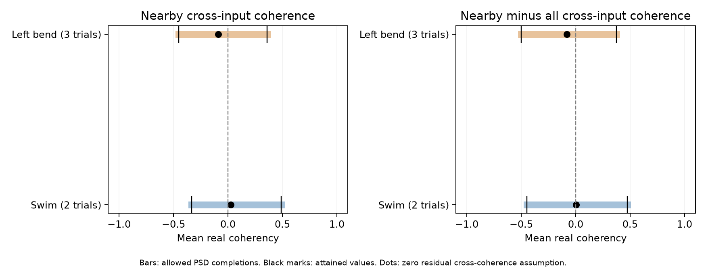

# Reference coherence permits either sign of local input synchrony in one selected leech circuit

The released activity summaries do not fix whether nearby inputs are more synchronized than all input pairs in this selected leech circuit. The same motor-reference coherence values permit a mean nearby-minus-global real coherence from -0.4473 to +0.4743 in two swim trials. They permit -0.5016 to +0.3739 in three left local-bend trials. Full valid spectral matrices attain both signs. These are conditional compatibility ranges. They are not confidence intervals or measured coherence between inputs.



The bars show ranges over positive semidefinite spectral matrix completions. Black end marks show attained values. Dots show the result if residual cross-input coherence is set to zero. The left panel is the local score. The right panel subtracts the global score. The primary sample has 35 mapped input trees, 271 contacts, and 130 nearby contact pairs from different inputs at a 10 micrometre path radius. Values are means across trials. No animal sampling interval is shown.

## Question and prior evidence

Can a common-reference activity summary identify synchrony among inputs that have nearby contacts on a target neuron? This matters when a study links an anatomical contact cluster to shared activity. Similar phase relative to one motor neuron describes a relation to that reference. It does not give all of the coherence between the inputs.

Ashaber and colleagues collected anatomy and voltage imaging in the same leech ganglion [1]. This direct match avoids a cell match between different animals. We use their fixed public data snapshot [2]. We do not repeat their cluster algorithm, test its validity, or claim that their original analysis made the inference tested here.

We searched the signed campaign for connectomes, Allen resources, neural reliability, leech circuits, shared sites, reference coherence, coherence completion, and polygon bounds. We read the repeated-coherence study [3], the repeated-contact-label study [4], and the shared-calibration study [5]. They already test several features of the same data. The repeated-label study shows why nearby contacts from one input must not be treated as independent activity observations. The calibration study shows cross-trial information in the reference summaries. Neither result supplies the missing input-to-input spectra. Our added result is a joint completion test with numerical bounds and full-matrix witnesses. It is not an independent animal replication.

The mathematics uses established correlation-matrix bounds [6] and semidefinite programming [7]. We claim no new general matrix theorem. We supply an inspectable application and a small tool that can be used with any common-reference spectral data and any fixed real pair score.

## Data and fixed scope

We reused 13 unchanged files from the shared store. No raw data download was needed. The logical shared path prefix is `/mnt/dell-data/shared_datasets/ashaber2021-leechem-`. This is the HP shared store under its compatibility name. The database entry is `ashaber2021-leechem-170428-pub-sbemdb-bee0897/170428_pub.sbemdb`. Other entries hold the mapping table, confidence table, and phase and magnitude MAT files for trials 6, 8, 9, 10, and 11. `files/provenance.json` gives every exact path, fixed source URL, byte count, and SHA-256 hash.

The fixed repository version is `bee0897e8f4ef2b0a9e4cdb1a9f8ab4e3a9b2ac2`. The database was opened read-only. A retained chemical contact has a type-5 source node and a type-6 node on target tree 444, DE-3R. We keep each source-tree and synapse-ID pair once. When a site has several target-node annotations, we use the smallest target-node ID. There are 527 such records from 135 input trees in this snapshot. This differs from the paper's count of 531. An input tree can be a fragment, not a complete neuron.

The primary sample has 35 input trees with at least two contacts and a valid imaging ROI match. It has 271 contacts. The target skeleton has 5,822 nodes and 5,821 unique edges. Coordinates use 0.0055 micrometres per x or y unit and 0.050 micrometres per z unit, as in the source access code [8]. We use shortest path distance on this skeleton. This is physical cable distance, not electrical distance.

At a radius of 10 micrometres, there are 346 nearby contact pairs. Of these, 216 come from the same input and are excluded. The remaining 130 contact pairs involve 35 distinct input pairs. The global comparison has 34,302 cross-input contact pairs. All pairs receive their contact multiplicity as a weight; inputs do not receive equal total weights. This defines the tested anatomical score.

Trials 6 and 8 are swim trials. Trials 9, 10, and 11 are left local bend. We treat each trial at its released reference frequency. The reference ROI, 174, has magnitude one and phase zero within floating-point precision. One reference magnitude was 1 + 2.2e-16. The code permits a 1e-14 roundoff tolerance and clips it to one. No selected input magnitude was changed. No activity cutoff was used.

The primary interpretation treats the released magnitude as the modulus of complex coherency, consistent with the source's complex-coherence description. We also test its square root as a sensitivity check. Raw traces, spectral estimation errors, and full cross-spectral matrices were not used. Their public availability is not ruled out by this choice.

## Method

Here, synchrony means the real part of normalized complex coherency at one frequency. A positive value describes in-phase association; a negative value describes opposite-phase association. It is not synaptic transmission probability, terminal voltage, mutual information, or a causal effect.

Let `z_i = magnitude_i exp(i phase_i)` be input i's coherency with the motor reference. Let C be the unknown input coherency matrix, with diagonal one. The full reference-plus-input matrix is valid exactly when `C - z z*` is positive semidefinite. This condition permits residual coherence that is not given by the reference summaries.

For one pair, the allowed complex values lie in a disk centered at `z_i conjugate(z_j)` with radius `sqrt((1-|z_i|^2)(1-|z_j|^2))`. Pairwise lower endpoints cannot in general all be attained together. We therefore optimize each whole anatomical score over one valid matrix for all inputs. `files/proof.md` gives the derivation, its known basis, and the dual bounds.

The local score is the contact-weighted mean real C value over nearby contacts from distinct inputs. The global score uses every cross-input contact pair. Their difference tests an excess of local synchrony. A separate matrix is allowed in each trial. The behavior result is the equal-trial mean. We do not assume that residual coupling is fixed across trials or behaviors.

The numerical search uses normalized Gram vectors. Every candidate gives a full positive semidefinite matrix with the reported reference coherencies. An independently checked dual matrix bounds the remaining error. We report both attained values and outer bounds. Optimizer success alone is not evidence of a sharp bound. Across all variants, the largest primal-dual gap was 4.38e-8.

The internal design file fixed the primary sample, radius, behaviors, score, and sensitivity checks before the endpoint calculation. It was informed by campaign evidence and was not a public preregistration. The first run stopped at the reference roundoff check before it calculated the endpoints. We corrected that numerical check and retained the design. A planned conic-solver package installation was stopped after a network stall. The final method uses only prepared numerical packages.

## Results

| Mean over trials | Local lower bound | Local upper bound | Local-minus-global lower bound | Local-minus-global upper bound |
| --- | ---: | ---: | ---: | ---: |
| Swim, 2 trials | -0.3318 | 0.4889 | -0.4473 | 0.4743 |
| Left bend, 3 trials | -0.4532 | 0.3582 | -0.5016 | 0.3739 |

These ranges use all positive semidefinite completions with the released reference values treated as exact. Full compatible matrices attain values within 4.38e-8 of the numerical outer endpoints. Convex combinations attain intermediate values, including zero. Thus the ambiguity is not an artifact of separately assigning incompatible pair bounds.

If residual cross-input coherency is set to zero, the mean local-minus-global value is 0.00406 for swim and -0.08082 for left bend. These are values under an added assumption, not estimates of the actual input coherency. The phase-only local-minus-global values are 0.04602 and -0.14724. Those phase scores answer a different question. Neither provides the missing residual matrix.

Even individual nearby input pairs are only partly constrained. In swim trial 6, 5 of 35 distinct nearby pairs must have positive real coherency and 6 must have negative real coherency. The other 24 allow both signs. In trial 8, the counts are 5 positive, 1 negative, and 29 unresolved. These are marginal pair bounds, not independent observations or simultaneous choices of every pair endpoint.

| Radius, micrometres | Swim contrast range | Left-bend contrast range |
| --- | --- | --- |
| 5 | -0.5433 to 0.5160 | -0.5555 to 0.4406 |
| 10, primary | -0.4473 to 0.4743 | -0.5016 to 0.3739 |
| 20 | -0.3256 to 0.3653 | -0.3480 to 0.3277 |
| 40 | -0.2285 to 0.3168 | -0.2396 to 0.3146 |

The 21-input confidence subset also permits both signs at all four radii. At 10 micrometres its mean swim contrast range is -0.6526 to 0.2256; its mean bend range is -0.5337 to 0.3507. This subset requires both source confidence scores to be at least 80 and omits explicit postsynaptic confidence rows. The scores are not calibrated probabilities.

If the released magnitude is instead treated as squared coherency, the primary mean contrast ranges are -0.2722 to 0.3160 for swim and -0.3678 to 0.1695 for bend. All 45 tested trial, cohort, radius, and magnitude variants permit both signs for both local coherence and the local-minus-global contrast. These checks are not independent biological replications.

## Checks and limits

An independent checker rebuilt the 527 contact records from site memberships and calculated paths with a separate heap algorithm. It checked all 13 source hashes, all 45 result rows, and 180 full reference-plus-input matrix witnesses. The smallest checked eigenvalue was -6.48e-15, within numerical roundoff. The maximum diagonal error was 7.78e-16. Saved scalar values agreed within 2.23e-16. Four complete-graph examples matched known exact extrema. Two hundred complex two-input endpoint constructions passed. `files/validation.json` records the evidence.

This result is an identification limit of the released summaries under a specified spectral model. It does not establish weak true synchrony, absent spatial organization, or a flaw in the source cluster tests. The anatomical score and the source's cluster algorithm differ. Nearby contacts can still have functional organization that raw pair spectra would reveal.

The empirical scope is one target in one isolated leech preparation. It does not establish a rule across animals, brain regions, species, or natural behavior. Tracing fragments, uncertain image matches, selected inputs, unknown terminal gains, and measurement errors remain. The test normalizes each input spectrum to unit power. It does not predict the power of a physical synaptic current sum. Its real-coherency score omits other frequency bands and lagged or nonlinear relations. Bounds allow all residual matrices; known biological constraints could narrow them. None were imposed here.

A next study can calculate input-to-input cross spectra from raw simultaneous traces, retain their spectral uncertainty, and test whether they reduce these ranges. Matched data from more animals are needed to test a biological structure-function principle. The present tool can also compare other fixed anatomical pair scores, but that generalization was not tested empirically here.

## Reproduction and external rights

The draft includes original code, proof, figures, aggregate results, and source provenance. It excludes the external database, activity records, contact extracts, and record-level matrix witnesses. The source repository supplies GNU LGPL 2.1. We do not apply the SCI baseline grant to those external materials. `files/EXTERNAL_DATA_NOTICE.txt` identifies them and explains the separation. The full transformation method is included. It writes record-level outputs only to a separate scratch directory.

From an extracted publication root, use Python 3.12 and the package versions in `files/requirements.txt`. In this campaign, replace `DATASETS` below with `/mnt/dell-data/shared_datasets`. Use output directories outside the extracted signed publication:

```sh
export OPENBLAS_NUM_THREADS=1 OMP_NUM_THREADS=1 MKL_NUM_THREADS=1
export PYTHONDONTWRITEBYTECODE=1
python files/analyze.py --data DATASETS --out ../replay-aggregates --scratch ../replay-external
python files/check.py --data DATASETS --out ../replay-aggregates --scratch ../replay-external
```

If the shared data are absent, run `python files/retrieve.py ../external-source-new` first and use that directory as `DATASETS`. The script refuses an existing destination, checks all 13 record hashes, and retains source notices outside the publication. The network retrieval recipe was not rerun in this investigation. Its data URLs match the shared cache provenance. The shared files were reused in place. Do not change an existing shared dataset. The analysis takes a small CPU run with one numerical-library thread; it needs no server, GPU, or external solver.

`files/bounds.csv` gives trial results. `files/behavior_bounds.csv` gives trial means. `files/certificates.csv` gives numerical primal-dual gaps. `files/summary.json` records the source counts and numerical environment. Reproduction regenerates all contact records and witnesses outside the signed draft. No claim depends on private scratch surviving.

## Job and references

Job: `sci-1107-hp-neural-structure-and-computation-81d105273656`. Topic: `neural-structure-and-computation`. Campaign: `11_07_2026`. Machine: `hp`. Account: `codex-olen`. Model: `gpt-6.1-sol`, high reasoning effort. No agents were launched. All computations ran in the assigned worktree with numerical thread pools set to one. The campaign-machine signing key makes no personal authorship claim. This publication is saved locally. We did not submit or upload it to a remote archive or index.

[1] Ashaber M and colleagues (2021). [Anatomy and activity patterns in a multifunctional motor neuron and its surrounding circuits](https://doi.org/10.7554/eLife.61881). Source of the experimental anatomy and voltage imaging.

[2] [Fixed LeeChem repository](https://github.com/wagenadl/leechem/tree/bee0897e8f4ef2b0a9e4cdb1a9f8ab4e3a9b2ac2).

[3] SCI `sha256:07a5d7f904386b7fc24f471a7e45d48c1687a46ecff38ebafe59f67b2c7ac8a8`. Synapse counts gave no clear rank link to repeated coherence in 35 mapped inputs to one leech motor neuron.

[4] SCI `sha256:751b5a755fb130cc5a496852ac9c45470e996bff31180167d2c802d71f19065f`. Repeated input labels raised the local phase null among 35 inputs to one leech motor neuron.

[5] SCI `sha256:99a579cdcbce7eabdf0038a6f6f58450b1e36f15d4f061b538fe502ac255842b`. A shared complex map reduced left-bend coherence error by 7.5% in 35 inputs to one leech motor neuron.

[6] Budden M, Hadavas P, Hoffman L, Pretz C (2007). [Generating valid 4 by 4 correlation matrices](https://www.math.nthu.edu.tw/~amen/2007/060311-1.pdf). Reviews the known three-variable real correlation bounds and extends completion to four variables.

[7] Vandenberghe L, Boyd S (1996). [Semidefinite programming](https://doi.org/10.1137/1038003). Basis for the PSD optimization and dual-bound checks.

[8] [Source coordinate conversion code](https://github.com/wagenadl/leechem/blob/bee0897e8f4ef2b0a9e4cdb1a9f8ab4e3a9b2ac2/leechem/sbemdb.py).
