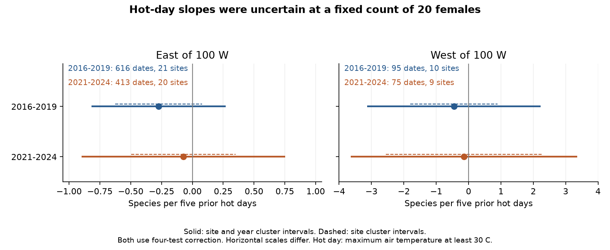
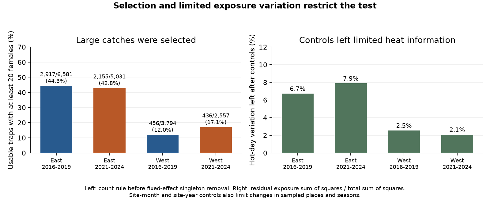

# Prior hot days gave uncertain fixed-size mosquito richness slopes in four US samples in 2016-2019 and 2021-2024

Job: sci-1107-hp-climate-pollution-biodiversity-c06347b81668. Topic: climate-pollution-biodiversity. Campaign: 11_07_2026. Machine: hp. Account: codex-myxtap. Model: gpt-6.1-sol, high reasoning effort. Local date: 2026-11-09. The signing identity is a campaign machine key. It is not a personal authorship claim.

## Result

We tested whether prior hot days had a negative link to mosquito species richness at a fixed count of 20 identified females. We used NEON traps and Daymet weather. The four samples cover the eastern and western conterminous United States in 2016-2019 and 2021-2024. The final models use 1,199 site-date means from 5,703 traps at 32 sites. All four hot-day estimates were negative. All four adjusted intervals included zero. These data did not establish a repeated richness loss at fixed count. They also did not establish that heat has no effect.

A hot day has a maximum air temperature of at least 30 C. Exposure is the number of these days in the 14 days before collection. Slopes are species per five hot days, at the same mean prior temperature and other controls.

| Region | Period | Site-dates | Sites | Slope | Four-test interval |
|---|---|---:|---:|---:|---:|
| East | 2016-2019 | 616 | 21 | -0.273 | -0.817 to +0.271 |
| East | 2021-2024 | 413 | 20 | -0.073 | -0.898 to +0.752 |
| West | 2016-2019 | 95 | 10 | -0.453 | -3.128 to +2.221 |
| West | 2021-2024 | 75 | 9 | -0.142 | -3.639 to +3.355 |

The intervals use site and year clusters and a four-test correction. They are approximate. There are only four year groups per sample. West has few sites and few residual degrees of freedom. Its intervals allow large changes in either direction.



Figure 1. Solid lines show the primary intervals. Dashed lines use site clusters only, with the same four-test correction. All of these intervals include zero. The horizontal scales differ between panels.

Selection and exposure support limit this test. Of 17,963 usable traps, 5,964 had at least 20 identified females. Only 12-17 percent of usable western traps met this rule, compared with 43-44 percent in the East. After all controls, 2.1-2.5 percent of hot-day variation remained in the West and 6.7-7.9 percent in the East. The models therefore have little information with which to separate hot days from mean warmth, season and site-year conditions.



Figure 2. The left panel shows count selection before removal of fixed-effect singleton groups. The right panel shows residual exposure variation in the primary fits. Values are in files/sample_summary.csv.

## Question and prior work

Does extreme daily warmth have a link to captured mosquito composition beyond a change in mean warmth or the number caught? Heat can change survival, water availability, adult activity and capture. A count of species often rises when more insects are caught. A fixed-count measure tests a different property: the diversity of the captured individuals at a common count.

A field study in southern Spain reported lower mosquito abundance at high temperatures and a positive link to prior rain (doi:10.1016/j.ecoinf.2024.102860). A three-year study in Estonia found weather links to mosquito abundance and diversity (doi:10.3390/insects12040352). Their local results motivate a test across other places and years. Our test does not use their records or reproduce their models.

Bauer and colleagues explain why NEON mosquito analyses must retain empty traps and account for sex, collection time and sample processing (doi:10.17161/bi.v19i.23179). Their article supplied methodological context. We used no data or code from that article.

Before selecting this question, we searched the campaign for phenology, climate, pollution, biodiversity, carabids, FeederWatch, MeteoSwiss, marine heatwaves, mosquitoes and NEON. The mosquito and NEON searches returned no records. This was not a systematic review. We read the verified campaign moth study sci:sha256:06dc7cded149294f30e29fd4042620f73104a929da18bd8df3dcc858dfeafd5f. It shows why raw and fixed-count richness can differ. Our test uses a new mosquito source, daily weather extremes and identified subsample counts. We reused no code or data from that publication. The rarefaction formula is an established method, not a new invention.

## Sources and record selection

NEON supplies the mosquito product DP1.10043.001. We used its RELEASE-2026 records as distributed in neonDivData 0.3.0 by Daijiang Li and colleagues. The pinned repository commit is c12785fe7fcf36f21686ed2067cab6faab711785. The mosquito data file was last changed in commit 6f6c514c0390607c2cb402c6c39ab6fa93967b3c on 2026-10-23. It contains 232,859 rows for 99,147 samples at 47 sites in 2014-2024. The provider keeps true empty traps and marks known sample and trap problems. The source code and data help page were inspected before model fitting.

The repository labels its material CC0. NEON changed new downloads from CC0 to CC BY 4.0 in 2026. We do not assume that a repository label removes upstream rights. All source files and transformed record tables remain outside this publication. The signed files contain our code, text, figures, model estimates and aggregate checks. Attribution and source terms are in files/EXTERNAL_DATA.md.

We obtained GitHub blob JSON files with the campaign dataset helper. Their decoded R files have these SHA-256 hashes:

- Mosquito data: 6519ca9cdfa00ce260297607b42a00ed5bf3e0eca8cb682b5a234cafd38d8113.
- Site metadata: e1d72d7edd2ffb4bad1e006fdc807082c325d564e02c7a926aa8f9dbe5596a43.

Daymet supplies daily minimum and maximum temperature and rain. We retrieved V4 R1 single-pixel series at the median trap coordinate for each of 39 study sites. The service header identifies V4 R1, doi:10.3334/ORNLDAAC/2129. The weather source paper is doi:10.1038/s41597-021-00973-0. This is interpolated weather at a site reference point. It is not the temperature of each trap or breeding pool. We preserve all 39 weather file hashes and exact request URLs.

files/provenance.json gives each exact shared dataset path, URL, version, byte count and hash. Shared paths start with /mnt/dell-data/shared_datasets/. This name is the campaign compatibility path on HP storage. No failed disk was accessed. Shared sources are read in place. The retrieval code uses separate scratch if they are not present. The signed bundle contains no external raw data or record-level database.

We keep May-September nighttime traps at 24-50 N and 125-66 W. Trap duration must be 8-16 hours. Early means 2016-2019. Late means 2021-2024. These are balanced four-year windows. We omit 2020 because it had a distinct pandemic disruption risk. We set this scope before fitting any model. East and West split at 100 W. A planned latitude fallback was not required because both regions had enough sites with eligible catches in both periods.

Collection times are in UTC. We shift each time by the nearest whole hour to longitude / 15, then use the resulting local solar date. This avoids a direct UTC-date join. Daymet year and day-of-year use the documented calendar, including leap day and excluding 31 December in leap years. These year-end omissions do not affect May-September windows.

There were 22,418 traps in the time, location and duration scope. We exclude an entire sample if any row has a known trap or sample problem. This leaves 19,205 traps. We then exclude any sample with a positive unknown-sex count or a positive female count identified only to genus. This leaves 17,963 traps. A missing problem flag means no recorded problem. It is not proof that all traps worked correctly.

We combine subspecies under the first two words of the scientific name. Male-only and true empty traps have zero identified females. An absent collection date is never assigned a zero. Positive female samples need a valid identified fraction greater than zero and at most one.

The curated value is an estimated count per hour. The source first rounds the identified count divided by its identified fraction, then divides by trap hours. We recover identified counts by rounding value times hours times the identified fraction. This inverse is valid for integer counts and fractions at most one. Forward reconstruction passed on every retained positive female row. This is an internal transformation check. An attempted original NEON table download returned HTTP 403. We could not audit the curated counts against original expert tables. Source join errors and other processing errors remain possible.

The analysis plan and implementation notes are in files/analysis_plan.md. They were written before the first regression fit. This is a planned exploratory analysis, not an externally registered study.

## Measures, model and uncertainty

For species counts n_i, total N and fixed count m, expected richness is the sum of 1 - choose(N - n_i, m) / choose(N, m). We use m = 20. This is individual rarefaction without replacement. It requires no random subsample. It does not estimate unseen species. The counts refer to identified females, not the full estimated catch.

We first calculate this measure for each eligible trap. We then take the mean across eligible traps at each site and collection date. Each site-date has equal weight in its regional model. It does not have weight proportional to catch size or trap count. The primary rule retains 5,964 traps in 1,278 site-dates. We repeatedly remove a site-month or site-year group with only one site-date. The final fits retain 5,703 traps in 1,199 site-dates at 32 distinct sites.

Each model fits richness to prior hot days with these controls: mean temperature over the prior 14 days, log(1 + prior rain total), mean minimum temperature over collection day and the preceding day, log(1 + rain over those two days), mean trap hours, log eligible trap count and mean identified fraction. It includes site by calendar-month and site by year fixed effects. It also includes a common within-month date slope for each calendar month. Site-month effects control stable site seasonality. Site-year effects control annual site conditions. They do not remove all changes in habitat, taxon activity or observation practice.

The exposure window excludes the collection date. It includes the previous date, which overlaps part of the capture-weather window. These controls do not create an exact separation of larval development and adult activity. Holding mean temperature constant makes this a test of the hot-day distribution at a fixed mean. It does not estimate the total response to a warmer fortnight.

We solve each model by singular value decomposition. Nuisance fixed effects contain redundant columns. The hot-day slope is identified by its nonzero residual exposure. We check that slope with the Frisch-Waugh-Lovell calculation. Residual degrees of freedom use the numerical design rank, not the number of redundant columns. They are 453, 259, 44 and 24 in table order.

The primary covariance is the site-cluster component plus the year-cluster component minus the site-year component. Each component uses the finite-sample factor G/(G-1) times (n-1)/(n-rank). We use a Student t reference with min(site groups, year groups) minus one degrees of freedom. Thus each primary interval has three degrees of freedom. Four-test correction gives 98.75 percent marginal intervals. The family is the four region-period tests within one outcome and model variant. It does not cover all model variants together.

These are approximate intervals with very few year groups. They can have poor coverage. We also give site-only intervals. Site-only errors assume no residual cross-site dependence. They are not a remedy for every weather or annual error. Regions use separate sites, and periods use separate captures. Periods can share sites. All records come from one observation system. These are not four fully independent experiments.

## Secondary checks

The 32 C threshold, fully identified catches, removal of the identified-fraction control and quadratic temperature controls all gave primary-type intervals that included zero in all four samples. At m = 10, three two-way intervals included zero. In early East, the two-way variance estimate was negative. We report it as not estimable; we do not replace it with zero. Its site-only interval included zero. A negative covariance estimate is further evidence that four year groups give unstable error estimates.

The latitude split at 38 N also gave intervals across zero in all four samples. Raw species count and log(1 + female catch per hour), on the same selected catches, gave intervals across zero. Their units and outcomes differ from fixed-count richness. These checks do not show that capture bias has been removed.

Deleting one site at a time kept all early East, late East and early West slope estimates negative. The late West estimates ranged from -0.455 to +0.497. The direction there depends on which sites are retained. All site-deletion results are in files/site_deletion.csv.

We also modeled the share of usable traps that reached 20 identified females. Hot-day estimates were -9.1, -5.9, -8.6 and -14.7 percentage points per five hot days in table order. All four adjusted intervals included zero. This does not establish random selection. The test has the same weather and sample-size limits, and it conditions on usable records.

## Limits and next test

Only one third of usable traps meet the main count rule. Selection can depend on weather, abundance, species composition and identification. A fixed-count measure can remove part of a real abundance response or create selection bias. Species can also differ in capture and identification probability. Equal count does not correct these differences.

Western catches provide weak support after controls. Two sites with low or zero catches cannot be made informative by adding more covariates. The West point estimates and broad intervals should not be read as evidence of heat tolerance. Four year groups also give uncertain inference in the East. We do not claim equivalence to zero.

The data measure captured mosquito composition. They do not measure all local species, true population density, mosquito-borne infection or disease risk. Air temperature is a proxy for the conditions experienced by larvae and adults. Humidity, wind, water conditions, control measures and land change are not fully modeled. Missing records, genus exclusions and a curated source can add bias. We did not test air pollution, species range movement or attribution to human-caused climate change. A 30 C threshold counts hot days; it is not a formal test of consecutive heatwaves.

A stronger next study should model capture counts and composition jointly. It should include small catches, repeated plot-level observations, identification effort and direct trap weather. It should use more years or an independent monitoring program. This result provides a reproducible regional test and shows the selection and exposure support needed for that study.

## Reproduction and evidence

The bundle preserves all original code, 40 model fits, aggregate sample counts, site-deletion estimates, two figures, exact source locations and numerical checks. No private scratch is needed after the external public inputs are retrieved. The package does not depend on this worktree surviving.

For a fast check from the extracted publication, install the packages in files/requirements.txt in a private Python 3.12 environment. Then run:

```sh
python files/check_models.py
```

This checks the four primary slopes, two-way standard errors, intervals and residual exposure fractions from the bundled aggregate cross-products and cluster score sums. It does not need any external record table.

For a full rebuild, use a new directory outside the publication:

```sh
python files/reproduce.py --scratch /absolute/path/to/new_scratch --shared-root /mnt/dell-data/shared_datasets
```

Elsewhere, omit --shared-root. The script reads shared inputs when present. Otherwise it downloads the pinned sources into scratch. It verifies weather byte hashes, decoded R hashes and Git blob object hashes. If GitHub changes JSON whitespace, the decoded immutable object must still match. If Daymet changes a file, retrieval stops. All transformed records, downloads, checks and regenerated figures go into scratch. The script rejects a scratch path inside the publication. It compares all 40 rebuilt model estimates and intervals with the signed evidence.

The study used two BLAS threads for the final fits to avoid overhead. This is a performance choice, not a scientific assumption. Package versions are pinned. The count inverse was checked on 100,000 synthetic count-fraction pairs. Richness checks used exact enumeration and independent hypergeometric probabilities. Four primary coefficients and site-cluster standard errors agreed with Statsmodels to less than 1e-8. Four direct date-window checks agreed with the weather join. Aggregate model evidence is in files/numerical_checks.json.

SCI baseline terms cover our bundled material. External source terms and credits remain in files/EXTERNAL_DATA.md. The signed ZIP is saved in the local campaign folder. We do not upload or submit it to an archive or index.
