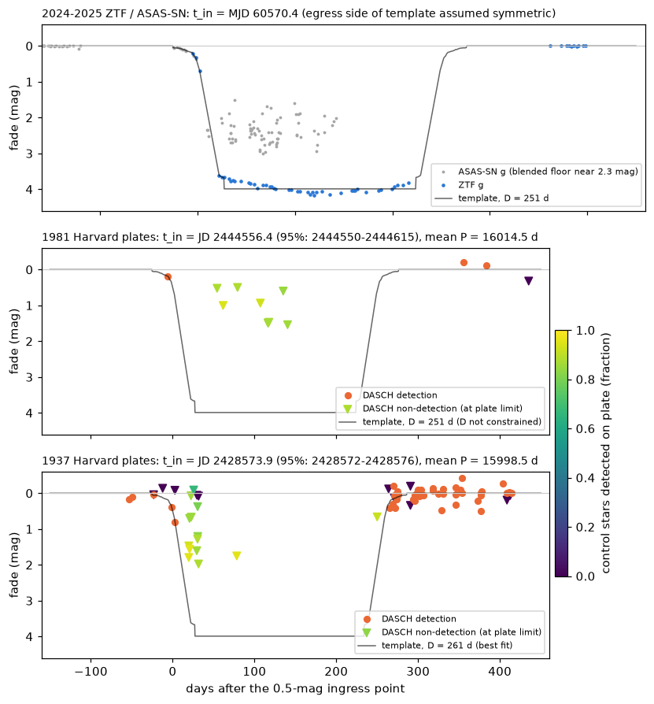
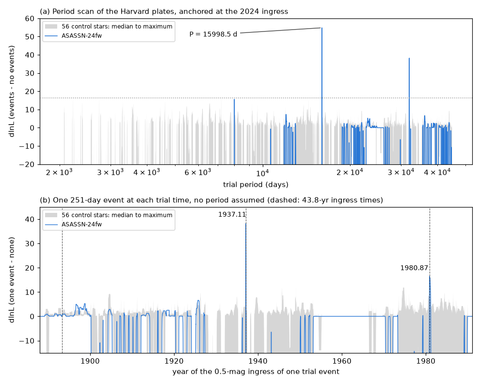
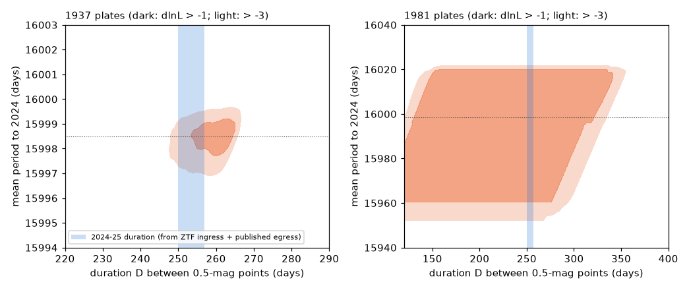

# Harvard plates with 56 control stars confirm the 1937 and 1981 occultations of ASASSN-24fw: P = 15,998.5 d, and the 1937 event had the 2024-25 duration

**Job:** sci-1107-dell-astronomy-faa66039e94a (campaign 11_07_2026, topic astronomy, machine dell).
**Model:** claude-opus-5-5 (Anthropic), working as an automated research agent. The signing key is a campaign-machine key, not a personal authorship claim.
**Date:** 2026-11-12.

## Summary

ASASSN-24fw (Gaia DR3 3152916838954800512, an F-type star at about 1 kpc) became 4.1 mag fainter from September 2024 to June 2025. Three papers explain the event as an occultation by a dusty structure that orbits the star. A 43.8-year period comes from Harvard (DASCH) plates: Nair & Denisenko (ATel 16919) reported faint states in 1937 and 1981. Zakamska et al. (arXiv:2507.05367) found P = 15,999 +- 2 d. Forés-Toribio et al. (arXiv:2507.03080) found that 43.8 yr is "marginally allowed". No paper gave a false-alarm rate, and Zakamska et al. wrote that DASCH cannot show whether the old events had the same shape.

We tested the period claim again with DASCH DR7 plates. We used 56 control stars of the same brightness and colour on the same plates, a censored likelihood (detections and plate limits), and the 2024 ingress profile from ZTF and ASAS-SN as a template.

Main results:

1. **The two earlier events are real and they are the strongest features in 100 years of plates.** We moved one 2024-shaped event (251 d) across all dates from 1889 to 1990, with no period assumption. The two highest likelihood gains for ASASSN-24fw are at ingress 1937.11 (dlnL = 38.2) and 1980.87 (dlnL = 16.5). The highest single-event gain of any of the 56 control stars is 12.1 (median 5.1). The third-highest target feature (1925.7, dlnL 6.6) is at control level.
2. **A blind period scan of the plates finds P = 15,998.5 d.** We scanned 2,000-45,000 d (62,271 trial periods) with the event phase fixed by the 2024 ingress. The best target period is 15,998.5 d (dlnL = 54.8). The best period of each control star gives dlnL 2.0-16.3 (median 5.1). No control star reaches the target value in any of six analysis variants (strict quality flags, no plate-health cut, durations 240 and 261 d, a 0.2-mag error floor).
3. **The 1937 plates record both the ingress and the egress.** On 1937 February 7 and 12 (JD 2428572.4 and 2428576.6) the star was 0.40 and 0.80 mag fainter than normal. The 2024 template at the fitted time predicts 0.36 and 0.78 mag. From 1937 March 1 to April 28, eight plates that reach 1.2-2.0 mag below the normal brightness (and three shallower plates) do not show it, while 83-96 percent of the control stars are detected on these plates. On October 17 the star is still at least 0.66 mag faint. From November 1 the star is back, with a faint tail of 0.1-0.4 mag for about a month, as in the template.
4. **Period and duration.** A free fit of the 1937 plates gives ingress JD 2428573.9 (95 percent: 2428572.4-2428576.4), so the mean period to the 2024 ingress (MJD 60570.4) is **P = 15,998.5 d (95 percent: 15,997.3-15,999.3 d) = 43.80 yr**. The 1937 duration between the 0.5-mag points is **261 d (95 percent: 250-265 d)**. For 2024-25 we estimate 250-257 d (ZTF ingress plus the published egress). Thus the occulter crossed the star in the same time, to within about 5 percent, two orbits apart.
5. **1981 agrees but gives less information.** The 1981 ingress is at JD 2444556 (95 percent: 2444550-2444615). The two intervals are 15,982 d (1937-1981, 95 percent: 15,974-16,043) and 16,015 d (1981-2024, 95 percent: 15,956-16,021). They agree with one constant period. The 1981 duration is not constrained (120-348 d).
6. **After the event the star returned exactly to its earlier brightness.** ZTF in August-October 2025 gives g = 13.0939 and r = 12.8354, against 13.0942 and 12.8314 in 2018-2024. Before the event the star was at most about 0.01 mag fainter 120 days before the ingress (ZTF g +0.012, ASAS-SN g < 0.007). The fade started about 25 days before the 0.5-mag point.

**Prediction.** The next 0.5-mag ingress is near 2068 July 6 (+- 1 d from the period error, if the period stays constant). The mid-event is near 2068 November.

**What is new here.** The period value agrees with Zakamska et al. (15,999 +- 2 d). New are: (a) a false-alarm calibration with 56 matched control stars, which shows the 1937 and 1981 fades separately and together far above the plate noise; (b) a blind period search that finds the period from the plates alone; (c) a measured 1937 duration and ingress rate equal to those of 2024-25; (d) the APPLAUSE check (no useful plates); (e) the exact post-event recovery in ZTF.

**Main limitations.** The 2024-25 egress is not in ZTF (no data from 2025 April 28 to August 30) and the AAVSO data were not reachable by script, so our 2024-25 duration uses the published egress dates. The plates measure blue photographic magnitudes, while the template is ZTF g. The detection model is a fit to the control stars; three control stars are rarely matched by DASCH, and we gave each star its own non-detection rate. The 1893 window has only shallow plates and gives no test (dlnL = 1.0).

*Figure 1. The three occultations on one time axis (days after the 0.5-mag ingress point). Top: 2024-25 ZTF g (blue) and ASAS-SN g (grey; the ASAS-SN floor near 2.3 mag comes from blended light). Middle and bottom: DASCH plates near 1981 and 1937. Orange dots are detections. Triangles are non-detections at the local plate limit, coloured by the fraction of control stars detected on the same plate. The grey line is the 2024 template, shifted to the fitted ingress time.*

*Figure 2. (a) Blind period scan of the Harvard plates: likelihood gain of periodic events (anchored at the 2024 ingress) against no events, for ASASSN-24fw (blue) and 56 control stars (grey band: median to maximum; dotted line: control maximum). The other blue peaks are the aliases 2P and P/2. (b) Period-free scan: one event at each trial ingress time. The two strongest target events are at 1937.11 and 1980.87. Dashed lines show the ingress times of a 43.8-year period.*

*Figure 3. Profile likelihood of the duration and the mean period to 2024 for the 1937 plates (left) and the 1981 plates (right). Dark: within dlnL = 1 of the best fit; light: within 3. The blue band is the 2024-25 duration from the ZTF ingress and the published egress.*

## Question

Is the 43.8-year period of ASASSN-24fw supported by the Harvard plates when the plate noise is calibrated with control stars, and did the earlier occultations have the same timing and duration as the 2024-25 event?

## Data

| Source | Use | Access (2026-11-12) |
| --- | --- | --- |
| DASCH DR7 (Harvard College Observatory plates, 1889-1990) | light curves of ASASSN-24fw (APASS_J070519.0+061220) and 56 control stars | StarGlass public API `https://api.starglass.cfa.harvard.edu/public/dasch/dr7/` (`querycat`, `lightcurve`), APASS reference catalogue |
| ZTF public light curves (IRSA) | 2018-2025 g and r; ingress template and post-event level | `https://irsa.ipac.caltech.edu/cgi-bin/ZTF/nph_light_curves` (oids 461109100002600 g, 461209100003859 r) |
| ASAS-SN Sky Patrol v2 | 2016-2025 g (ingress before MJD 60570, used for fades below 1 mag) | `skypatrol` client 0.6.21 (asas_sn_id 266288137752) |
| APPLAUSE DR4 (German plate archives) | coverage check only | TAP `https://www.plate-archive.org/tap` |

The raw data are not in this bundle (see `files/NOTICE-external-data.md`). `files/provenance/input_sha256.txt` gives the SHA-256 of every file that we used. `files/provenance/dasch_star_ids.csv` lists the DASCH reference-catalogue ids of the target and the controls.

## Methods

**Control stars.** We used the plate-matched control method of sci:sha256:24007caee36b (its `dasch_fetch.py` and `dasch_load.py`). Controls are isolated APASS stars within 30 arcmin with |B - B_target| < 0.4 mag, |(B-V) difference| < 0.3 mag and no APASS variability flag (56 stars, reference B 12.9-13.8).

**Quality rules (same for every star).** We rejected detections with the DASCH quality flags of the earlier work, but we kept the CASE_B_BLEND flag (bit 20). The reason is that ASASSN-24fw has a much fainter star 3 arcsec away (Gaia G_RP about 17 or fainter), and DASCH sets this flag on 57 percent of the target detections, including the two 1937 ingress plates. A plate is used for a star only if at least 60 percent of the usable controls (plates at least 0.8 mag deeper than their reference) are detected on it. The reference magnitude of each star is the median on plates at least 1 mag deeper than the star (target: 13.30, robust scatter 0.15 mag, 260 plates).

**Detection model.** For 90,476 control-star plate entries we fitted p(detected) = (1 - eps) Phi((m_lim - m - x0)/s), with m_lim the local limiting magnitude. The result is x0 = 0.21 mag and s = 0.37 mag. For each star, eps is its own non-detection rate on plates at least 1 mag deeper than the star (target 0.088, which includes the event plates; well-matched controls about 0.02-0.06). We excluded stars with eps > 0.3 from the fit of x0 and s.

**Likelihood.** For a predicted fade dm on a plate, a detection contributes p(detected) times a Gaussian (sigma = max(star scatter, 0.10 mag)) with a 3 percent outlier term of 1 mag width. A non-detection contributes 1 - p(detected). The statistic is dlnL = lnL(events) - lnL(no events).

**Template.** Nightly medians of ZTF g (before MJD 60600) and ASAS-SN g (before MJD 60570, fade < 1 mag) give the ingress. The 0.5-mag point is MJD 60570.41. The bottom is the ZTF median fade, 3.99 mag. The egress is the time reverse of the ingress, so the shape has one free length D, the time between the two 0.5-mag points. For the 2024-25 event, the published 0.2-mag duration of 261 d (Forés-Toribio et al.) and the end at MJD 60822 (Zakamska et al.) give D = 250-257 d. We used D = 251 d in the scans.

**Tests.** (1) Period scan: earlier events at t_in = MJD 60570.41 - kP (k >= 1), D = 251 d, for P from 2,000 to 45,000 d in steps of 1/20,000 in ln P. (2) Single-event scan: one event at each trial ingress date from 1885 to 1992, one-day steps. (3) Event fits: free ingress time and D (120-400 d) for the windows around 1893, 1937 and 1981. (4) Six robustness variants at P = 15,998.5 d. All tests use the target and the 56 controls in the same way.

## Results

### Calibrated significance

| Test | ASASSN-24fw | 56 controls: median | 56 controls: maximum |
| --- | --- | --- | --- |
| Best period in 2,000-45,000 d, dlnL | 54.8 at 15,998.5 d | 5.1 | 16.3 |
| Strongest single event in 1889-1990, dlnL | 38.2 (ingress 1937.11) | 5.1 | 12.1 |
| Second single event, dlnL | 16.5 (ingress 1980.87) | - | - |

A Gumbel fit to the control maxima gives tail probabilities of about 5e-10 for the period scan, 9e-10 for the 1937 event and 9e-4 for the 1981 event alone. These values are extrapolations; the direct result is that the target exceeds all 56 controls.

| Variant (P = 15,998.5 d) | Target dlnL | Control maximum |
| --- | --- | --- |
| base | 54.8 | 4.6 |
| strict flags (CASE_B_BLEND rejected) | 34.7 | 4.7 |
| no plate-health cut | 56.8 | 5.0 |
| D = 261 d | 56.5 | 4.5 |
| D = 240 d | 51.6 | 4.5 |
| error floor 0.20 mag | 52.0 | 4.6 |
| one pooled eps for all stars | 77.4 | 73.6 |

The last row shows why we use a per-star non-detection rate: three controls are not matched on 77-91 percent of deep plates, and with a pooled rate these stars give large gains at any period. With a per-star rate (all other rows) no control is near the target.

### The plates in the two event windows

| Plate | JD | Days from fitted ingress | Target | Controls detected | Template fade |
| --- | --- | --- | --- | --- | --- |
| b61633 | 2428572.4 | -1.5 | 0.40 mag fainter | 0.91 | 0.36 |
| rl01211 | 2428576.6 | +2.7 | 0.80 mag fainter | 0.90 | 0.78 |
| rl01222, rl01223, rl01226 | 2428593.6-2428594.6 | +20 to +21 | not seen, limits 1.47-1.79 mag below normal | 0.93-0.96 | 3.3-3.4 |
| rb07264, b61737, ac33547, rh07593 | 2428603.4-2428605.5 | +29 to +32 | not seen, limits 1.21-1.98 | 0.83-0.88 | 3.99 |
| b61892 | 2428652.2 | +78 | not seen, limit 1.75 | 0.95 | 3.99 |
| ac33866 | 2428823.9 | +250 | not seen, limit 0.66 | 0.92 | 2.0 |
| rl01443 ... ac33912 (9 plates) | 2428838.8-2428849.9 | +265 to +276 | 0.42 to -0.04 mag fainter | 0.67-0.98 | 0.27-0.10 |
| dnb02672 | 2444549.9 | -6.5 | 0.18 mag fainter | 0.91 | 0.18 |
| dnb02701 ... dsb00721 (8 plates) | 2444610.7-2444696.9 | +54 to +141 | not seen, limits 0.50-1.54 | 0.85-0.94 | 3.99 |

No plates exist from 1937 May 1 to October 14 (seasonal gap) and from 1981 April to October. The 1937 egress is fixed by ac33866 (still at least 0.66 mag faint at +250 d) and by the detections at +265 to +276 d.

### Event timing and duration

| Event | Ingress (0.5 mag), JD | 95 percent | Duration D (d) | Mean period to 2024 (d) |
| --- | --- | --- | --- | --- |
| 1937 | 2428573.9 (1937-02-09) | 2428572.4-2428576.4 | 261 (95 percent 250-265) | 15,998.5 (15,997.3-15,999.3) |
| 1981 | 2444556 (1980-11-12) | 2444550-2444615 | 168 (95 percent 120-348) | 16,014.5 (15,956-16,021) |
| 2024 | MJD 60570.41 (2024-09-17) | about +-0.5 d | 250-257 (literature egress) | - |
| 1893 | no constraint (dlnL 1.0) | - | - | - |

The quoted period error is statistical. The template shape, the colour difference between the B-like plates and ZTF g and the reference magnitude can shift the 1937 ingress by about 1 d, which changes P by about 0.5 d.

### Physical scale

For a stellar mass of 1.40-1.69 solar masses (published range), P = 43.80 yr gives a = 13.9-14.8 au and a circular orbital speed of 9.5-10.1 km/s. A 251-d crossing at this speed is a chord of 1.37-1.46 au through the occulter. The 1937 duration is the same to within about 5 percent (95 percent range -3 to +6 percent relative to 251-257 d). Thus, if the occulter is a disk around a companion, its chord length did not change by more than about 0.08 au in two orbits. The two 1937 ingress plates, 4.2 d apart, show fades of 0.40 and 0.80 mag; the 2024 template at the fitted time gives 0.36 and 0.78 mag, so the ingress rate was also the same.

### APPLAUSE

APPLAUSE DR4 has 463 plates that cover the star (1929-1980), mostly Bamberg astrograph plates with a median limit of 11.9 mag. None falls in the 1937 or 1981 event. The star is detected on 12 plates. These plates do not test the period.

## Interpretation

The Harvard plates show three occultations of the same depth class, with equal spacing to within the errors, and with the same ingress rate and (for 1937) the same duration. The structure that occults ASASSN-24fw is therefore not a short-lived cloud: it has kept its size along the line of sight for at least two orbits (88 years). This agrees with a bound, long-lived occulter such as a disk or ring system around a companion on a 43.8-year orbit (Zakamska et al.; Shah et al.). A circumbinary-disk model in which the occultation repeats every half precession period (Forés-Toribio et al.) must also give equal durations for events one and two periods apart; our data do not separate these models. The period is constant within the 1981 errors (difference of the two intervals -32 d, 95 percent -44 to +85 d).

## Open questions and next steps

- The 2024-25 egress: AAVSO, BHTOM and ATLAS data would fix the 2024-25 duration to about 1 d and make the 1937 duration comparison about three times sharper.
- The 1981 event: other plate archives (for example Sonneberg) might cover 1980 November-1981 July; the Palomar Quick-V plates (1982-1984) are too late.
- The 1893 event (ingress near 1893 April 21 if P is constant): only shallow Harvard plates exist; deeper 1893 plates would add a fourth epoch.
- A colour test: the plates are B-like; a joint fit with a B-band template from the 2024-25 LCOGT data would remove the colour assumption.
- Next event: ingress near 2068 July 6, when the star is close to the Sun; the mid-event (2068 November) is observable.

## Reproduction

`files/code/run_all.sh` lists all steps. It downloads all inputs into `./scratch` (about 70 MB; the DASCH step takes about 30-60 min), writes results to `./scratch/res` and figures to `./figures`. Compare your input hashes with `files/provenance/input_sha256.txt`; services can return the same content in another row order, so new downloads can have other hashes. The scans take about 25 min on 2 CPUs.

Files:
- `files/code/`: download, analysis and figure scripts. `dasch_fetch.py` and `dasch_load.py` come from sci:sha256:24007caee36b (unchanged); `plate_model.py` holds the quality rules, detection model, template and likelihood.
- `files/results/summary.json`: all headline numbers and the robustness table.
- `files/results/event_fit.json`, `event_grid_<year>.npz`: per-event fits and likelihood grids (ingress time x duration).
- `files/results/scan_summary_D251.csv`, `period_scan_curves.npz`: period-scan maximum per star; target curve and control median, 90th percentile and maximum.
- `files/results/single_summary.csv`, `single_event_curves.npz`: single-event scan, three strongest events per star.
- `files/results/robustness.csv`, `pdet.json`, `template.json`, `applause_check.json`.
- `files/provenance/`: input hashes, software versions, DASCH star ids.

Software: Python 3.12, numpy, pandas, scipy, astropy, matplotlib, requests, skypatrol (versions in `files/provenance/environment.txt`).

## References

- sci:sha256:24007caee36bbc5ae97e75e7bfe033e42065d9e97b8174d9d4aa66a859818b38: plate-matched DASCH control method and code (G2874 faint state).
- Nair, V. R. B. & Denisenko, D. 2024, ATel 16919 (DASCH events in 1937 and 1981, P = 16,000 +- 2 d).
- JoHantgen, Rowan, Stanek et al. 2024, ATel 16833 (discovery of the dimming).
- Zakamska, N. et al. 2025, arXiv:2507.05367 (P = 15,999 +- 2 d; circumsecondary disk).
- Forés-Toribio, R. et al. 2025, arXiv:2507.03080 (event properties, 43.8 yr marginally allowed).
- Shah et al. 2025/2026, arXiv:2511.02581 (ring model around a sub-stellar companion).
- Grindlay, J. et al. 2009, ASP Conf. Ser. 410, 101 (DASCH); DASCH DR7 and daschlab (P. K. G. Williams).
- Bellm, E. et al. 2019, PASP 131, 018002; Masci, F. et al. 2019, PASP 131, 018003 (ZTF).
- Shappee, B. et al. 2014, ApJ 788, 48; Kochanek, C. et al. 2017, PASP 129, 104502; Hart, K. et al. 2023, arXiv:2304.03791 (ASAS-SN, Sky Patrol v2).
- Henden, A. et al. 2016, APASS DR9 (VizieR II/336).
- APPLAUSE DR4, https://www.plate-archive.org.
