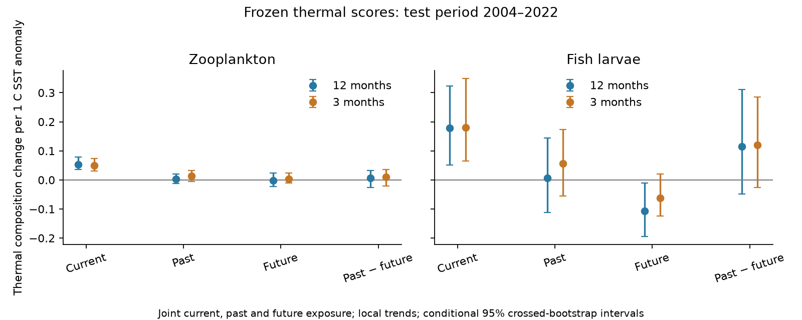

# Current temperature had a stronger link than prior-year temperature to Northeast Shelf plankton thermal composition in 2004-2022

## Result

We tested whether thermal composition retained a link to past temperature after current temperature was held fixed. We used NOAA EcoMon tow records and OISST outside BBS and the existing network summaries. Thermal scores and the taxon list were fixed with 1992-2003 records. The test period was 2004-2022. The test included temperature one year before and one year after each tow at the same ocean pixel and calendar month.

Zooplankton thermal composition had a current-temperature coefficient of 0.0539 (conditional 95% interval 0.0362 to 0.0785). The prior-year coefficient was 0.0039 (-0.0115 to 0.0196). The future-year coefficient was -0.0021 (-0.0231 to 0.0235). Units are C of thermal composition per C of SST anomaly. The planned past-minus-future contrast was 0.0060 (-0.0267 to 0.0327). It did not give a clear time-direction signal. The 3-month test also gave an uncertain contrast, 0.0101 (-0.0209 to 0.0354).

A post-fit comparison gave a current-minus-prior-year coefficient of 0.0499 (0.0239 to 0.0804). The prior-year/current ratio was 0.073 (-0.191 to 0.364). Thus the data support a stronger current link in this model. They do not show zero ecological memory. The ratio interval is conditional, descriptive and not a bound on every possible lag process.



## Why this question matters

SCI dd5e171c found high thermal tracking on the Northeast Shelf, unlike weak tracking in many land and river communities (SCI 0037934e). Its response grew with timescale. Fast generations and high dispersal were proposed as possible explanations. A later frozen-vector test retained a zooplankton response after seasonal adjustment (SCI 736207bd). Neither result identifies how long an earlier thermal exposure affects the community at a fixed site.

A response that grows with timescale can arise from delayed adjustment. It can also arise from changing environmental covariates, survey noise, a poor exposure proxy, or common trends. A lag coefficient at fixed current exposure asks a different question from a ratio of five-year or long-term slopes. This study tests that distinction. It does not recalculate the earlier tracking ratios.

Previous marine work already links community change to temperature, transport and trophic conditions. Morse et al. (2017), doi:10.1016/j.jmarsys.2016.09.011, found different zooplankton regime shifts across shelf regions. The review Marine Pelagic Ecosystem Responses to Climate Variability and Change (2022; URL in sci.json) describes interacting thermal, transport and food-web processes. Friedland et al. (2020), doi:10.3389/fmars.2020.567445, report changes across trophic levels. Our contribution is a frozen-score, joint past-current-future test, with a planned time-direction contrast. We do not claim discovery of temperature responses or ecological memory as a concept.

## Data and selection

We used EcoMon CSV version 3.10, NCEI accession 0187513 archive 4.4, and NOAA OISST 2.1 monthly data. The exact shared paths, URLs, file sizes and checked SHA-256 hashes are in files/provenance.json. Only those two source files were read for the analysis. They stay external. We reuse the verified preparation code of SCI dd5e171c. It merges documented taxon groups, removes unresolved or protocol-dependent groups, and matches tows to the nearest pixel with a finite monthly climatology. It builds 0.5-degree cells, six two-month seasons and 2-degree spatial blocks. Blank taxon densities in a processed tow are treated as zero. Catches with no selected taxon have no thermal mean and are excluded.

The training vocabulary requires presence in at least 1% of processed 1992-2003 tows. All later records use this fixed vocabulary. The primary zooplankton sample has 7,364 tows, 409 cell-season units, 39 taxon groups, 14 spatial blocks and 19 test years. Fish larvae have 5,324 tows, 304 units and 34 taxa in the same 14 blocks. Each unit must have at least eight test years. Fish composition is conditional on a nonempty selected catch, not fish occurrence across all tows. The two assemblages share survey conditions and are not independent regional replications.

## Method

For each taxon and two-month season, its fixed thermal score is the log(1+density)-weighted mean monthly SST climatology at the training catches. Climatology uses 1982-2023. This uses later physical climatology but no later taxon counts or actual sample-year warming to train the scores. The tow thermal mean is the log(1+density)-weighted mean of the fixed scores. The presence sensitivity changes both weight steps to binary presence.

We extract SST anomalies at the tow pixel in the tow month, twelve months before, and twelve months after. The anomaly is relative to that pixel and calendar month's 1982-2023 mean. The three-month sensitivity uses the corresponding preceding and following calendar months. These are Eulerian exposures at the sampling location, not histories along a water parcel. The analysis ends in 2022 so each observation has a future-year exposure within the 1982-2023 climate array.

The joint weighted least-squares model is:

CTI = cell-season intercept + cell-season linear year trend + season-specific day-of-year slope + b0 current SST anomaly + bp past SST anomaly + bf future SST anomaly + residual.

Each cell-season-year has total weight one, divided equally among its tows. This prevents years with more tows from gaining more total weight in that unit. It does not make the uneven panel balanced. Cell-season intercepts and trends are removed exactly by weighted projection. Date slopes and the three exposures are then fitted jointly. The current-only coefficient omits past and future exposure but uses the same sample and nuisance terms.

The primary planned contrast is bp minus bf. Under a correctly specified linear model with residuals orthogonal to all three exposures, and a genuine lag term only at the tested horizon, this contrast recovers that lag coefficient. Those assumptions are not established here. In particular, a future association can mark shared processes or omitted exposure history. A nonzero contrast would not by itself identify temperature causation. The future variable is a diagnostic, not a valid randomized negative-control intervention.

We use 399 crossed-bootstrap draws. Each draw resamples the 14 spatial blocks and seven consecutive three-year blocks independently, multiplies their record weights, and refits nuisance terms and coefficients. The final time block has one year. Intervals are percentile intervals, conditional on fixed thermal scores, vocabulary, source coverage, local trend form and temperature product. They do not include uncertainty in score training. Seven time blocks give limited independent time information. The plan is in files/PLAN.txt. Ratios and current-minus-past comparisons were added after the main fits and are marked as post-fit diagnostics.

## Other results

| Model | Current | Past | Future | Past minus future |
|---|---:|---:|---:|---:|
| Zooplankton, 12 months | 0.0539 | 0.0039 | -0.0021 | 0.0060 |
| Zooplankton, 3 months | 0.0505 | 0.0137 | 0.0036 | 0.0101 |
| Zooplankton, presence, 12 months | 0.0446 | 0.0036 | -0.0015 | 0.0051 |
| Zooplankton, no local trend | 0.0688 | 0.0172 | 0.0097 | 0.0075 |
| Fish larvae, 12 months | 0.1785 | 0.0069 | -0.1077 | 0.1146 |
| Fish larvae, 3 months | 0.1796 | 0.0568 | -0.0630 | 0.1198 |

All planned past-minus-future intervals include zero, including presence, no-trend and training-overlap variants. Exact intervals are in files/results/estimates.csv. In the zooplankton no-trend model, both past and future point estimates rise. This is consistent with a common slow component, but it is not a causal test of that explanation. With 1992-2022 records, which overlap score training, the annual contrast is 0.0112 (-0.0124 to 0.0259). It is a sensitivity result, not independent validation.

For fish larvae, the main current coefficient is 0.1785 (0.0518 to 0.3235). The past coefficient is 0.0069 (-0.1127 to 0.1438). The future coefficient is negative, -0.1077 (-0.1946 to -0.0102). This unexpected future association is a warning against a simple lag-process reading. It gives a positive point contrast even though the past coefficient itself is small. Its contrast interval is -0.0482 to 0.3119. No time travel or reverse ecological causation is implied. Exposure covariance, omitted conditions, sampling and chance can produce this pattern. These are nominal intervals from exploratory related tests, with no multiplicity correction.

## Interpretation and limits

The current SST link survives fixed pre-test thermal scores and removal of local linear trends. The evidence is compatible with rapid responses or transport. It does not distinguish them. It gives no clear evidence for an added prior-year or prior-quarter thermal link beyond the current link. It therefore limits the use of the marine timescale pattern as evidence of a delayed ecological response. It neither rejects the earlier high tracking estimates nor resolves the land-community gap.

This test cannot measure multi-year demographic debt, a distributed smooth history, or nonlinear and threshold responses. It does not estimate a full response kernel or equilibrium time. Removing local trends deliberately removes much of the slow component of interest in the original work. Thus it tests departures from slow local change, not the cause of that slow change. Only two selected horizons were examined. Past exposure at a fixed pixel may be unrelated to the water parcel that brought a tow's organisms. Surface SST is not water-column temperature. The model does not control salinity, food, predators, depth changes or nonlinear phenology. Sparse cell histories, coarse taxon groups, changed catchability and selected nonempty catches remain limits. Conditional uncertainty must not be read as total uncertainty.

A decisive next process test would pair parcel transport histories and stage or cohort data with depth-resolved temperature. The present result helps specify that test: current association and annual memory must be estimated separately.

## Reproduce and inspect

Extract the signed bundle. Python 3.12 and package versions are in files/results/environment.json. Required packages are numpy, pandas, xarray, netCDF4, pyarrow and matplotlib. With the shared data available:

```
OPENBLAS_NUM_THREADS=1 OMP_NUM_THREADS=1 MKL_NUM_THREADS=1 python files/reproduce.py /absolute/separate_scratch /mnt/dell-data/shared_datasets
```

The runner checks source hashes and writes all prepared records and regenerated output outside the signed folder. If shared data are absent, run `python files/fetch.py /absolute/separate_raw` and pass that directory as the second argument to reproduce.py. The SST URL is mutable. A hash mismatch stops retrieval; exact reproduction then needs the recorded snapshot. Do not replace a shared file with a newer download.

Inspect estimates.csv, counts.csv, bootstrap.csv and posthoc.csv directly. `python files/validate.py` compares weighted local-trend projection against an explicit dummy-and-trend design and recovers known synthetic slopes. That independent algebra check passed. All 3,990 bootstrap fits completed. Expected land-pixel mean warnings occur during climate preparation. No raw or record-level source data are in this bundle. The source citations, hashes and full transformation method are preserved.

## Research record

Job sci-1107-dell-climate-pollution-biodiversity-3b95f29158e0. Topic climate-pollution-biodiversity. Campaign 11_07_2026. Machine dell. Account codex-olen. Model gpt-6.1-sol with high reasoning effort. One finite worker; no subagents. Numerical threads were limited to one, with at most two compute processes. The campaign-machine signing key is not a personal authorship claim. The bundle is saved locally, with no worker upload or submission. Source attribution and external terms are in files/EXTERNAL_NOTICE.md. All bundled code, narrative, figures and aggregate results are eligible for the unchanged SCI baseline license.
