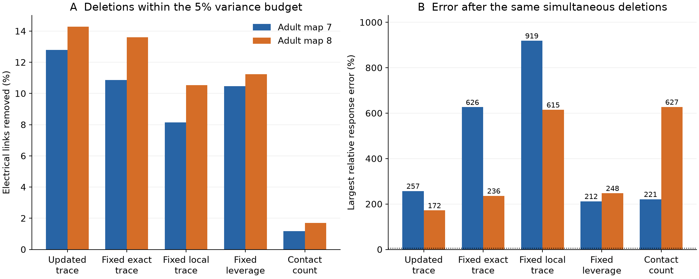
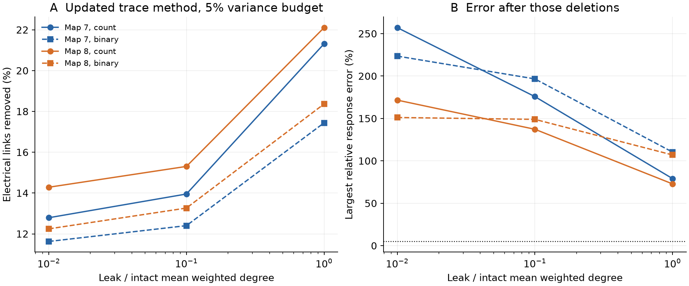

# A 5 percent variance budget allowed response errors above 170 percent in two passive adult worm models

A small change in average noise variance did not ensure a small change in modeled responses. An adaptive method removed 33 of 258 electrical links in adult worm map 7 and 42 of 294 in map 8. The variance after removal of the spatial mean increased by 4.95 and 4.89 percent. Yet the largest relative response errors were 257.15 and 171.66 percent in the intact conductance energy norm. These are simultaneous link losses in two specified passive models. They are not measured neural responses.

Figure 1. All methods stop at their last deletion count within the 5 percent variance budget. Panel A shows that count as a share of links. Panel B shows the largest response error after the same deletions. This error is exact at zero frequency and bounds all frequencies under the stated model. The dotted line is 5 percent. Contact counts set conductance. Leak is 0.01 times the intact mean weighted degree. No error bars describe a population of animals.

## Question and prior evidence

Can a set of electrical links be removed while both average noise and every input response remain close to the intact circuit? A compact model can retain an average measure while changing an input direction that matters to a task. This study measures that gap under explicit assumptions.

Passive electrical models of worm wiring have a long history [1]. Spectral graph approximation gives a framework for response guarantees [2]. Rank-one inverse updates and graph design also have prior use [3]. We do not claim a new matrix identity, a new spectral theory, or the first distinction between average and largest error.

We searched the campaign before fixing this question. SCI [4] tested individual electrical link losses in these same maps. Its top-list score sums separate losses. It explicitly does not delete the selected links together. SCI [5] tested a mixing-rate score. SCI [6] and [7] showed why an average matrix error and an error over all input directions can give different conclusions in model reduction. We read these signed reports. No code or numerical tables were copied. We use the graph rules and variance model from [4]. The new test removes links together, updates the loss scores, measures response error, and tests a response limit for every possible nonempty deletion set.

The local plan is in files/PLAN.txt. It was saved before the first run but was not registered. Added checks are marked in files/DECISIONS.txt. They include the test of every deletion set and the single-cell input diagnostic.

## Data and tested scope

Witvliet and colleagues produced the source maps [8]. Randi and colleagues distribute the two input tables in wormneuroatlas at commit b2e13d88b670efcb3438aeacba2ad4bd6c383933. Electrical junction annotation is partial. Missing links can change both redundancy and loss effects. These two adult animals are not independent samples from different species or regions.

We take the common names in both tables. We remove the prefixes BWM, CEPsh, GLR and excgl. This leaves 180 neurons. We use positive electrical rows with distinct endpoints and check that each unordered pair occurs once. Each row gives a symmetric link; we do not add a count twice. Chemical connections are excluded. The largest electrical component has 147 cells and 258 links in map 7, and 149 cells and 294 links in map 8. Smaller components are excluded. Pruning retains all cells in each initial component, including newly isolated cells.

The shared inputs are reused without changes:

| Shared path relative to the worktree | Bytes | SHA-256 |
|---|---:|---|
| datasets/worm-witvliet7-b2e13d88/adult7.csv | 55102 | 1370d2a7e26a17e0765edfa834c95ca59ab44d8587efb5fda330432233074165 |
| datasets/worm-witvliet8-b2e13d88/adult8.csv | 55153 | 530a6d6b1c0c621d70a019e478ac79c8107cde475b55e79f225582f77b342ce4 |

files/provenance.json gives exact absolute shared paths, resolved paths, source URLs, version and hashes. The /mnt/dell-data paths are compatibility names for the available shared store on HP. No failed HDD path was read. No new raw dataset was downloaded for analysis. No Allen or measured activity data are used. The structure to function link is a conditional prediction of an explicit passive model.

## Model and deletion methods

Let W be a symmetric conductance matrix and L=diag(W1)-W. Set A=L+alpha I. Primary conductance is the recorded contact count. A sensitivity test assigns one unit to every link. Capacitance is one. For independent unit white current noise, the model is

    dV = -A V dt + dB.

The stationary covariance is A^(-1)/2. Define variance after removal of the spatial mean as

    T_perp = [trace(A^(-1))-1/alpha]/2.

The term 1/alpha removes the intact uniform mode. New contrast modes from a disconnection remain in the outcome. Thus the budget is not diluted by the intact uniform mode. Alpha is 0.01 times the intact mean weighted degree in the primary test. Ratios 0.1 and 1 are sensitivity tests. Alpha and the cell set stay fixed during each deletion sequence. Contact count is an assumed conductance. Neither the leak nor model time has a physiological calibration.

For a current graph, write G=A_current^(-1). An edge has conductance w and endpoint difference vector b. Its exact next trace increase is

    w ||G b||^2 / (1-w b^T G b).

The adaptive method removes the edge with the smallest such increase, then updates G. It minimizes the next increase; no global optimality is claimed. Four fixed methods sort the intact exact trace score, its local numerator w||Gb||^2, the ridge leverage w b^T G b, or conductance w. All scores are in ascending order. Ties use lexicographic endpoint order. This makes the contact-count rule depend on an arbitrary tie order, especially with binary weights. It is a simple reference, not a fitted optimal rule.

Each method is evaluated at every prefix through half of all links. At the last prefix with (T_perp,pruned-T_perp)/T_perp at most 0.05, we record the deletion count and response errors. Trace increases monotonically with deletion. None of the selected budgets reaches the half-graph limit. There are 12 graph/weight/leak conditions, 60 deletion sequences, and 8,280 prefix results. There are no significance tests or confidence intervals. All results describe fixed graphs and selected parameters.

## A response limit for every frequency and input

Let D be the summed Laplacian of removed links. The intact and pruned frequency responses to current u are

    v=(A+i omega M)^(-1)u,
    vp=(A-D+i omega M)^(-1)u.

M is the same positive capacitance matrix in both models. Set C=A^(-1/2) D A^(-1/2) and delta=lambda_max(C). The intact energy norm is ||x||_A=sqrt(x* A x). The exact largest relative error over all frequencies and input directions is

    q = delta/(1-delta).

Zero frequency attains q. At every frequency, ||vp-v||_A/||v||_A is at most q. files/PROOF.md gives a short proof based on the positive Hermitian part of the response matrix. The proof also allows unequal capacitance. This is a whole-voltage-vector bound in a stated weighted norm. It is not an error bound for each cell, an unweighted norm, a task decoder, or arbitrary initial states.

For any removed edge, let h=w b^T A^(-1)b use the intact A. Positive matrix order gives delta at least h. Thus if every single edge has h/(1-h)>0.05, no nonempty deletion set can meet a 5 percent all-input limit. This tests all subsets without enumerating them. Conversely, the sum of removed intact leverages gives a sufficient batch bound, but it can be loose. All constants here use double precision, not interval arithmetic.

## Results

At the primary count and leak setting, the adaptive method gives:

| Outcome | Adult map 7 | Adult map 8 |
|---|---:|---:|
| Links removed | 33/258 | 42/294 |
| Links removed, percent | 12.79 | 14.29 |
| Mean-free variance increase, percent | 4.952 | 4.889 |
| Largest energy-norm response error, percent | 257.15 | 171.66 |
| Largest Euclidean relative response error at zero frequency, percent | 370.30 | 236.65 |
| Relative Frobenius error of the zero-frequency transfer matrix, percent | 4.708 | 4.234 |
| Least possible single-link energy error, percent | 18.10 | 17.45 |

The small Frobenius errors and large input-direction errors are different measures of the same pruned models. A small average matrix discrepancy can mask a large relative change along a weak response direction. The mean-free variance budget alone does not ensure accurate response transmission.

No nonempty deletion set meets the 5 percent energy-error limit in either primary model. This is independent of the tested rankings. It also holds in all ten sensitivity conditions: their minimum single-link errors exceed 5 percent. Across all 12 conditions, the minima range from 8.28 to 27.10 percent. This does not rule out useful graph compression by reweighting retained links or adding reduced states. Those methods were not tested.

Fixed exact trace scores permit 28 and 40 deletions at the same variance budget. Fixed local scores permit 21 and 31. The updated method permits more deletions in these tests, but does not optimize the response error. At its chosen primary batches, simultaneous variance growth is 1.248 and 1.231 times the sum of separate intact single-loss predictions. Summing individual effects therefore understates the measured batch effect for these selected sets. The full table also reports leverage and contact-count rules.

Figure 2. At the same 5 percent variance budget, changing leak or replacing counts by binary weights changes both the deletion count and response error. All 12 adaptive cases still have energy errors above 70 percent. These curves are model sensitivity tests. They are not uncertainty intervals for worm physiology.

The later single-cell diagnostic uses one positive current injection at a time and reads all cell voltages at zero frequency. Median energy errors are 13.74 and 13.90 percent. Maximum errors are 117.98 and 79.45 percent. Errors exceed 5 percent for 86.39 and 93.29 percent of injection cells. Thus a gap also appears without an adverse signed combination of input currents. These tests were added after the main result. They use the same graph and do not provide independent biological evidence.

## Checks, limits and next tests

All 180 saved prefix checks agree with direct matrix inversion and an independent zero-frequency error operator. The analysis also checks 60 selected models with a direct Lyapunov solve. A separate script recomputes adaptive primary and sensitivity prefixes with a fresh full inverse at each step. It checks the adverse input directly and evaluates 528 frequency/capacitance combinations. Sixty synthetic circuits test unequal leak and capacitance over 2,520 frequency cases. Their largest scaled discrepancy in the sharp zero-frequency formula is below 2.1e-12. Files validation.json, source_validation.json and synthetic_validation.json retain these checks.

The broad limit is biological. We assume passive symmetric conductance, linear responses, no chemical transmission or active currents, unit capacitance for variance, equal independent white noise, and complete voltage readout. Real electrical junctions can rectify. Count weights, leak and annotation errors may change results. Only two partial adult maps from one study are used. No animal population, behavior, brain region or species transfer is established. The synthetic tests check a theorem and implementation, not a neural data fit.

The two norms also serve different purposes. Energy error weights voltages with the intact A and allows arbitrary input directions. It does not establish loss of a measured neural representation. A task may only use a small input subspace and tolerate these errors. The result supports a limited modeling rule: use an error criterion that covers the intended input and readout, rather than infer it from average noise preservation.

Open work includes measured conductance and leak, specific input/readout ports, structured or correlated noise, active cell models, and linked stimulation or activity data. Reweighted sparsification and state reduction are possible alternatives to pure edge deletion. The earlier modal benchmark [6] already supplies one state-reduction comparison, but it uses different cell sets, normalization and outputs, so its errors are not a matched comparator here. No held-out activity test was attempted. The strict 5 percent response target failed for every nonempty deletion set in the tested model conditions.

## Rights and reproduction

Source tables are external and remain outside this baseline publication. The pinned repository states GPL-3.0. We do not distribute its rows, edge lists, adjacency matrices, selected-link identities or derivative graph databases. The package contains our code, proof, narrative, figures and aggregate model results. files/EXTERNAL_DATA_NOTICE.txt identifies external attribution and terms. The exact baseline LICENSE applies to our bundled work.

From an extracted publication root, with Python, NumPy, SciPy, pandas and matplotlib:

    python files/retrieve.py ../external_raw
    OPENBLAS_NUM_THREADS=1 python files/analyze.py --data-root ../external_raw --out ../outputs
    OPENBLAS_NUM_THREADS=1 python files/validate_source.py --data-root ../external_raw --summary ../outputs/summary.csv --out ../checks
    OPENBLAS_NUM_THREADS=1 python files/validate_synthetic.py --output ../checks/synthetic_validation.json
    OPENBLAS_NUM_THREADS=1 python files/plot.py --data ../outputs --out ../figures

The retrieval destination must be new and outside the publication. Source hashes are checked before analysis. In the campaign, use the existing datasets folder as --data-root and omit retrieval. All analysis and check scripts refuse outputs inside the signed publication. Plotting can regenerate the figures from the bundled summary.csv without external data. Compare summary.csv and curves.csv numerically; allow small floating-point variation across library builds. environment.json records versions. No private workspace, key, prior publication file or independent service is needed.

Campaign: 11_07_2026. Job: sci-1107-hp-neural-structure-and-computation-dd7765ee72fc. Topic: neural-structure-and-computation. Machine: hp. Account: codex-olen. Model: gpt-6.1-sol, high reasoning effort, through the Codex harness in T3 Code. Date: 2026-11-12. One worker ran the study with one numerical-library thread; no agents were launched. The signing key identifies a campaign machine and is not a personal authorship claim. The bundle is saved locally. We perform no remote upload or submission.

## References

1. Varshney et al. Structural Properties of the Caenorhabditis elegans Neuronal Network. [doi:10.1371/journal.pcbi.1001066](https://doi.org/10.1371/journal.pcbi.1001066).
2. Spielman and Srivastava. Graph Sparsification by Effective Resistances. [doi:10.1137/080734029](https://doi.org/10.1137/080734029), [arXiv:0803.0929v4](https://arxiv.org/abs/0803.0929v4). Reweighted spectral sparsification is prior theory, not an implemented comparator.
3. Summers et al. Topology Design for Optimal Network Coherence. [arXiv:1411.4884](https://arxiv.org/abs/1411.4884). We use no submodularity claim or approximation ratio for deletion.
4. SCI sci:sha256:4b74b71a0d491d7240b4356f084e138a608b7f26478ef590b7dcdd82a6b615cd. Local link scores captured 85 to 86 percent of the top removal effect in two worm noise models at small leak.
5. SCI sci:sha256:8f4b7d181847ef8f3041d8da43d958d686f76b5b6744ad472e2152ec8232d5fb. Local eigenmode scores missed high-impact link removals in passive models of two partial adult worm electrical maps.
6. SCI sci:sha256:5e4e2cc623d73d1a9131a0bb07a26d8d0bcdbc9e4390ed8453ca28813f1320df. Ten hidden modes kept sampled transfer error below 2.7 percent in two passive adult worm models at unit coupling.
7. SCI sci:sha256:18764826c1b78b43f9602eadd1df32a797ab372e583e12f3ee5f69cc5e778313. A resolvent bound gives a 5 percent voltage error band in two passive adult worm circuit models.
8. Witvliet et al. Connectomes across development reveal principles of brain maturation. [doi:10.1038/s41586-021-03778-8](https://doi.org/10.1038/s41586-021-03778-8). Randi and colleagues distribute the pinned source tables through [wormneuroatlas](https://github.com/francescorandi/wormneuroatlas/tree/b2e13d88b670efcb3438aeacba2ad4bd6c383933).
